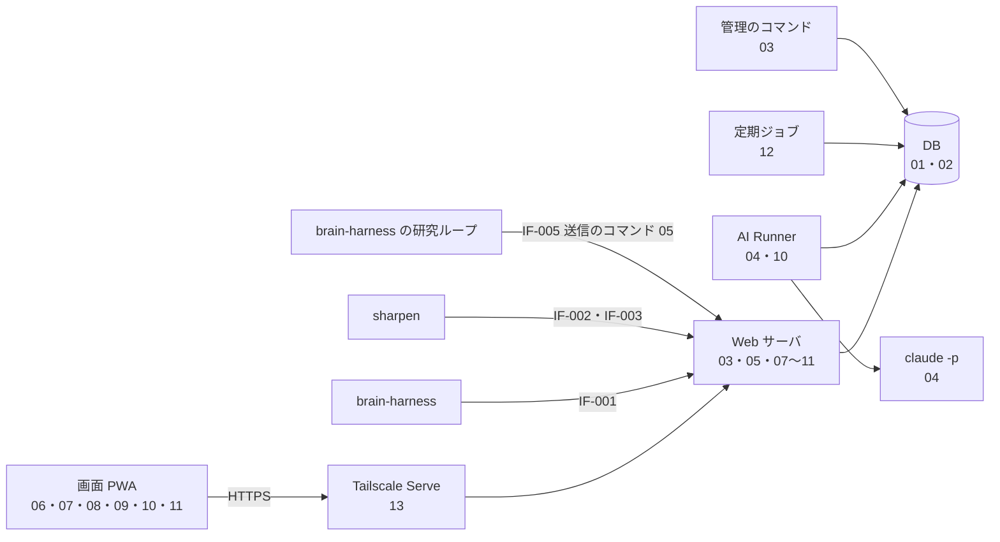

# NEXUS システム全体仕様書（Overview）

**一次情報源**: `docs/upstream/`（要件定義 RD、基本設計 BD、詳細設計 DD、横断 X）。この索引は DD-11 実装単位一覧が書き出した。

## 1. プロダクト概要

NEXUS は、AI（brain-harness、sharpen）から届くニュースと英語の教材と調査の週報（CR-020）を、本人1人が iPad と Android で読み、探し、AI に質問する PWA である（RD-01）。本人の Mac mini で動き、Tailscale の中だけから使う（BD-01）。

## 2. システム全体像

## 3. 詳細仕様書一覧（索引）

| # | ファイル名 | 範囲 | 担当 | 前提 |
|---|-----------|------|------|------|
| 01 | [`01-foundation.md`](./01-foundation.md) | リポジトリの足場、make verify、層の規則、共通層（M23）、DB の接続とマイグレーションの仕組み（M21） | Backend | - |
| 02 | [`02-data-model.md`](./02-data-model.md) | DD-03 の全てのテーブル、制約、索引を作るマイグレーション | Backend | 01 |
| 03 | [`03-auth-and-admin.md`](./03-auth-and-admin.md) | 端末の鍵と登録、配信元の鍵の用意、API の入口の土台（P01）、管理のコマンド（M30） | Backend | 02 |
| 04 | [`04-ai-runner.md`](./04-ai-runner.md) | AI の呼び出し（M26）、待ち行列（M20）、AI Runner（M24）、記事の関係の判定（FN-002）、状態を返す API | Backend | 03 |
| 05 | [`05-ingest.md`](./05-ingest.md) | ニュースと英語のセットの受け取り（IF-001、IF-002）、sharpen が読む API（IF-003）、配信元の鍵の入口（P02） | Backend | 03、04 |
| 06 | [`06-app-shell.md`](./06-app-shell.md) | 画面の道と共通の枠（M01）、PWA、CSP、共通部品（M07） | Frontend | 03 |
| 07 | [`07-contents.md`](./07-contents.md) | 既読と保存と開いた日時（FN-004 の一部、FN-005、FN-006）、Inbox、Explore、Library（FN-017〜FN-019） | Backend | 05、06 |
| 08 | [`08-news.md`](./08-news.md) | 記事の図（FN-003）と記事の案内（FN-004）の API と画面（SCR-002、SCR-003） | Frontend | 07 |
| 09 | [`09-english.md`](./09-english.md) | 教材の一覧と教材と完了（FN-008〜FN-012）の API と画面（SCR-004、SCR-005） | Frontend | 07 |
| 10 | [`10-chat.md`](./10-chat.md) | 会話の選択（FN-014）、質問と応答（FN-015）、送り直しと中止（FN-016）の API、AI Runner の質問の応答と会話の要約、画面（SCR-006） | Backend | 04、07 |
| 11 | [`11-home.md`](./11-home.md) | ホームの表示（FN-020）の API と画面（SCR-001）、端末の API のオリジンの確かめの通し | Frontend | 08、09、10 |
| 12 | [`12-batch.md`](./12-batch.md) | 定期ジョブの入口（M27）、BAT-001（FN-021）、BAT-002（FN-022） | Backend | 05 |
| 13 | [`13-release.md`](./13-release.md) | launchd と CLI の設定の雛形、運用の手順書、契約のテスト、総合テスト、受入テスト、配信元の改修 | Backend、（人間） | 11、12 |
| 14 | [`14-research.md`](./14-research.md) | 研究課題の一覧（FN-026）と週報（FN-027）の API と画面（SCR-010、SCR-011）、ホームの Research のセグメント（SCR-001）、道 `/research`（CR-023 で 06 から移した）。CR-020。道のり（段と方法の木）と NEW の確かめ（`markApproachSeen`）は CR-024 | Frontend | 05、07、10、11 |

- 「前提」は、先に終わっている必要がある仕様書の番号である（DD-11 1章）。

## 4. 確定済みの初期値（横断・変更禁止）

| 値 | 決めた書類 |
|---|---|
| 本番のポート 48400、`127.0.0.1` だけで待ち受ける | DD-09 2.1 |
| AI の同時の実行は 2 つ、1 回 5 分、自動の送り直しは 1 回 | NFR-017 |
| 登録コードは 10 分、質問の文は 4,000 文字、検索の言葉は 200 文字 | Q-079 の答え |
| 要約は直近の 6 発言を除いて 20,000 文字を超えたら | Q-085 の答え |
| 記事の関係の判定に渡す案内は先頭 600 文字、合計 200,000 文字まで | Q-086 の答え |
| BAT-001 は毎日 3:00、BAT-002 は毎月 1日の 3:30 | BD-02 5.1（CR-012） |
| CLI の引数と設定 | DD-09 2.5（Q-082 の答え） |
| IF-005 は 256 KiB、方法の件数の上限は無い（CR-024）、欄ごとの上限（topicId 64 文字、見出し 200 文字、answerMd 4 KiB、howToMd 8 KiB、counterMd 2 KiB、unknownsMd と changesMd 8 KiB、出典の URL は1つの方法に 50 件・1件 2,048 文字。段の欄は steps 30 件、段の title 200 文字、stepChangesMd 4 KiB） | Q-088、Q-096、Q-098〜Q-100 の答え（CR-020、CR-024） |

## 5. スコープ外

- 依頼 10章の Phase 4（ADR-004）。
- 生成された HTML を隔離して表示する仕組み（ADR-001）。

## 6. 用語

`docs/upstream/x/X-03-glossary.md` による。
