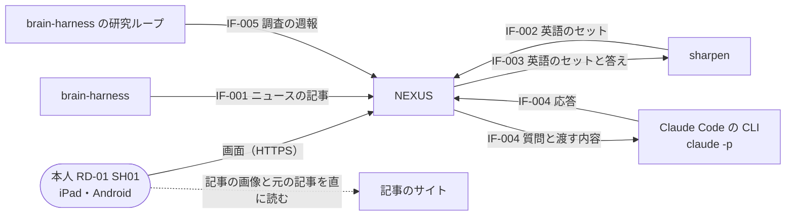
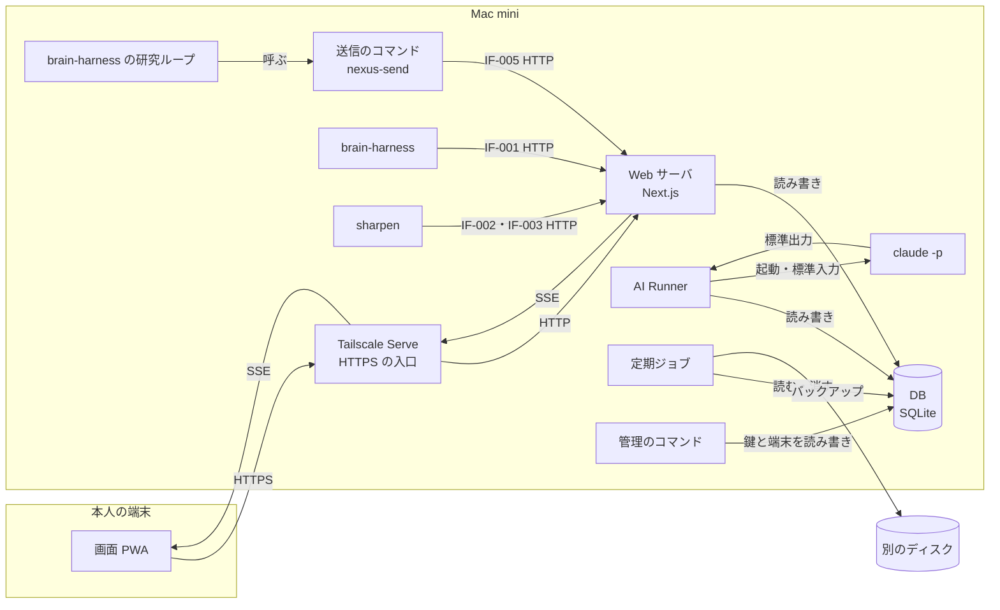
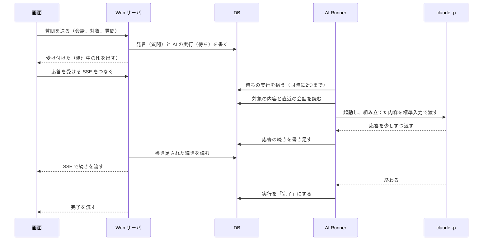
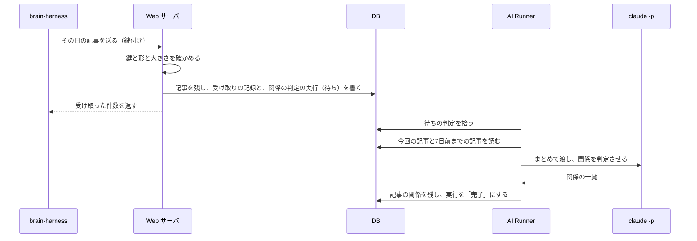
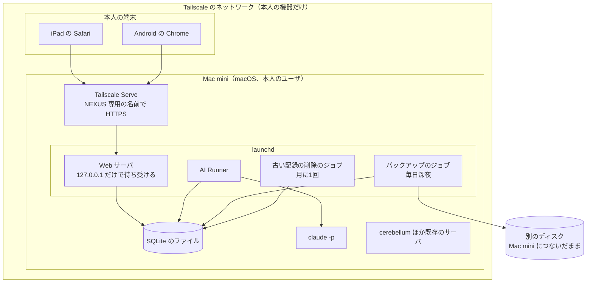

# BD-01 方式設計書（NEXUS）

- 読んだもの: RD-01 1.0（関係者の節を含む）、RD-03 1.0、RD-05 1.0、RD-09 1.0、RD-10 1.0、RD-11 1.0、RD-12 1.0、RD-13 1.0、RD-15 1.0、依頼の文（`NEXUS_implementation_handoff/NEXUS_IMPLEMENTATION_HANDOFF.md`。3章、5章〜9章、11章）、X-02 1.0、X-04 1.0（Q の答え）、X-05 PG01、X-06 1.0、X-07 1.0。
- 今の Mac mini の様子は、2026-11-23 に次を見て確かめた。cerebellum の `README.md` と `web/package.json`（Next.js、TypeScript、Tailwind、SQLite、launchd で動かしている）、`tailscale serve status`（`https://orionmac-mini.<tailnet>.ts.net/` は cerebellum に割り当て済み。evaloom は Tailscale Service の専用の名前で動いている）、Mac mini の時刻帯（JST）。
- この書類の技術と方式は、本人の答え Q-067〜Q-075（2026-11-23）で決めた。比べた案は X-02 ADR-006〜ADR-013 に書いた。
- PG01 の条件: Q-066 に左右される範囲（IF-004、FN-002、FN-015、FN-016、NFR-002、NFR-009、NFR-016、NFR-017、NFR-019、NFR-029）を書いた行には Q-066 を付けた。Q-066 が決まるまで、この範囲を含む仕様書を `confirmed` の候補にしない。
- 0.2: X-05 RV06 の指摘と、Q-079〜Q-081 の答え、CR-003（2026-11-24 承認）で直した（2026-11-24）。RV07 の指摘も直した。
- 0.3: BD-13 の試作の結果（P03。2026-11-24 本人）で、ニュースの図の部品を React Flow に決めた（ADR-015）。
- 1.0: 基本設計の完了判定（X-05 PG02。2026-11-24 RD-01 SH01。条件付きで進める）で承認した。
- 1.1: X-04 CR-005（2026-11-24 RD-01 SH01 が承認）で、6章 IF-004 と 7章 NFR-016 の使えるツールに、質問の応答での決めたフォルダ（`~/projects/brain-harness`）の読み取りを足した。Q-082 の答え（2026-11-24 決定）を 7章 NFR-016 に写した。X-04 CR-007（2026-11-24 RD-01 SH01 が承認）で、7章 NFR-016 の文書で保証の無い点を受け入れるリスクにした。X-05 RV14-03 の指摘で、6章 ログの AI の実行の記録にフォルダの読み取りの回数を足した。
- 1.2: X-04 CR-009（2026-11-24 RD-01 SH01 が承認。Q-083 の答え）で、3章の構成要素に「管理のコマンド」を足し、Web サーバの担当する範囲に FN-023 の登録の URL を開くことを足した。
- 1.3: X-04 CR-013（2026-11-24 RD-01 SH01 が承認）で、6章 ログのアクセスとエラーのログの出力先を、各プロセスが日ごとのファイルに書く形に直した。
- 1.4: X-04 CR-016（2026-11-26 RD-01 SH01 が承認）で、NFR-005 の扱いを、再起動の後は本人がログインする形に直した（2章、5章、7章）。
- 1.5: X-04 CR-020（2026-11-27 RD-01 SH01 が承認）で、外部との接点と構成要素に、brain-harness の研究ループ（IF-005）と送信のコマンド（FN-028）を足した。DB の範囲に ENT-014、ENT-015 を足した（Q-087、Q-090、Q-092 の答え）。
- 書いた AI: Claude（Opus 5.5）。人の承認の前の案である。

## 1. 前提と制約

### 品質目標

| 優先 | 品質 | 元の要件 |
|---|---|---|
| 1 | 本人の端末だけが NEXUS を使え、AI に渡した内容が AI への指示にならず、Mac mini の情報と認証の情報が外に出ないこと | NFR-012、NFR-013、NFR-016、NFR-019 |
| 2 | 画面が待たずに出て、AI の応答が少しずつ出ること | NFR-001、NFR-002 |
| 3 | Mac mini がスリープから人の手を借りずに戻り、再起動しても本人がログインすれば戻り、壊れても前日の終わりの時点まで戻せること | NFR-005、NFR-006 |
| 4 | 新しい種類の情報を、共通の部分を変えずに足せること | NFR-004 |
| 5 | AI を動かす費用が今の Claude の契約の範囲に収まること | NFR-009 |

- 並べ方は RD-01 2章の目標の優先（G01、G03、G02、G04）と、RD-12 3章でリスクを「大きい」とした脅威（T01、T03、T09）から決めた。

### 技術上の制約

| 制約 | 決まった理由 |
|---|---|
| 画面は Next.js と React の PWA で、スマートフォンを先に考えて作る | 依頼 3章「確定」、NFR-011 |
| サーバは本人の Mac mini に置き、端末からは Tailscale のプライベートな接続で使う | 依頼 3章「確定」、NFR-011、NFR-012 |
| Mac mini では cerebellum（48210）、教材の HTML を配るサーバ（48310）、sharpen の単語帳（48330）などが動いており、NEXUS はそこに足す | RD-01 5章 前提（Q-012 の答え） |
| AI は、本人のサブスクリプションでログインした、改変していない Claude Code の CLI（`claude -p`）で動かす。ブラウザから直接起動しない | ADR-005（Q-040 の答え）、NFR-016。Q-066 の確認で Messages API に替わることがある |
| 配信元から受け取る API と、sharpen に返す API は、今の cerebellum の形に合わせる | Q-039 の答え、X-07 2章 |

### 組織上の制約

- 期限は無い。AI の費用は今の Claude の契約の範囲に収め、従量の課金を足さない（RD-01 5章、Q-008 の答え）。
- 作るのも運用するのも本人（RD-01 SH01）と開発の担当の AI（RD-01 SH02）だけである（RD-13 2章）。
- 依頼に無い認証の方式、課金の方式、生成の頻度、AI のモデルの名前を、勝手に決めない（X-07 3章）。AI のモデルの名前はこの書類で決めない。

### 規模の前提

- 利用者は本人1人、同時に使う端末は2台まで、届く内容は1日50件まで、質問は1日10回（NFR-003、RD-03 4章）。
- データの件数と増え方は RD-09 2章（ENT-001 は年に最大で約18,000件、ENT-008 は年に約7,300件など）による。
- この書類で使う量の見積りは 7章の「量の見積り」に書く。

## 2. システムコンテキスト

### コンテキスト図

- 利用者のロールは本人1つだけで、ROLE の番号は振っていない（X-06 で BD-08 を省いた。Q-004 の答え）。
- 端末が記事の画像と元の記事を、NEXUS を通さずにそれぞれのサイトから直に読むことは、RD-12 5章で T12 として受け入れた（Q-047 の答え）。

### 外部との接点一覧

| 相手 | 方向 | 手段 | 対応する ID |
|---|---|---|---|
| 本人の端末（iPad の Safari、Android の Chrome） | 双方向 | 画面と、画面が使う API（HTTPS。Tailscale Serve を通す） | 本人（ロールは1つ） |
| brain-harness | 受信 | API（HTTP。Mac mini の中から送る） | IF-001 |
| sharpen | 受信 | API（HTTP。Mac mini の中から送る） | IF-002 |
| sharpen | 送信（sharpen が取りに来る） | API（HTTP。Mac mini の中から読む） | IF-003 |
| brain-harness の研究ループ（配信元 brain-research。CR-020） | 受信 | API（HTTP。Mac mini の中から、NEXUS が配る送信のコマンドで送る） | IF-005 |
| Claude Code の CLI | 双方向 | 同じ Mac mini の上でコマンドとして起動し、引数と標準入力で渡し、標準出力で受ける | IF-004（Q-066） |
| 記事のサイト | 端末が直に読む | 端末のブラウザ | 該当なし（NEXUS の接点ではない。T12） |

## 3. 構成要素

### 構成要素の図

### 構成要素一覧

| 名前 | 責務 | 主な技術 | 担当する範囲 |
|---|---|---|---|
| 画面（PWA） | 本人の端末で画面を見せ、操作を Web サーバの API に送る | Next.js と React、TypeScript、Tailwind CSS、Motion、PWA の manifest と service worker（5章） | FN-003〜FN-006、FN-008〜FN-012、FN-014〜FN-020、FN-026、FN-027 の画面 |
| Web サーバ | 画面を配り、端末と配信元からの API を受け、DB を読み書きし、AI の実行を DB の待ち行列に入れ、応答を SSE で端末へ流す | Next.js の Route Handlers（Node.js の上で動かす） | FN-001、FN-003〜FN-014、FN-015 と FN-016 の受け付けと応答の中継、FN-017〜FN-020、FN-023 の登録の URL を開くこと（CR-009）、FN-025〜FN-027（CR-020）。IF-001〜IF-003、IF-005 |
| AI Runner | DB の待ち行列から AI の実行を1件ずつ拾い、`claude -p` を起動し、応答を DB に書く。同時に動かす数、時間の上限、取り消し、送り直しを受け持つ | Node.js の常駐のプロセス（Web サーバと同じリポジトリの TypeScript） | FN-002、FN-015 と FN-016 の AI の実行。IF-004（Q-066） |
| DB | 全てのデータを1つのファイルに残す | SQLite（5章） | ENT-001〜ENT-010、ENT-014、ENT-015（CR-020） |
| 定期ジョブ | 毎日深夜のバックアップと、月に1回の古い記録の削除を行う | launchd の定期実行で起動する TypeScript のコマンド | FN-021、FN-022（バッチの番号は BD-02 のバッチの節で振る） |
| 管理のコマンド | 本人が Mac mini の本人のユーザで打ち、端末の登録の URL を出し、端末と配信元の鍵を用意し、一覧を出し、取り消す（BD-10 2章）。バッチを手で動かすときは、定期ジョブの入口を使う（CR-009） | 定期ジョブと同じリポジトリの TypeScript のコマンド | FN-023（登録の URL を出す、一覧、取り消し）、FN-024 |
| 送信のコマンド（CR-020） | 送り手（brain-harness の研究ループ）が Mac mini の送り手のユーザで打ち、週報のファイルの形を確かめてから、環境変数の鍵を付けて IF-005 に送る（Q-092 の答え）。NEXUS の DB を直接読み書きしない | Web サーバと同じリポジトリの TypeScript のコマンド。受け取りの形の確かめは Web サーバと同じ定義を使う（DD-01） | FN-028。IF-005 |
| Tailscale Serve | Tailscale の中だけに HTTPS の入口を開き、Web サーバへ渡す | Tailscale Serve と Tailscale Service（専用の名前） | NFR-012、NFR-021 |

- 構成の決め方（Web サーバと AI Runner を別のプロセスにする）は ADR-008、受け渡しを DB の待ち行列にする判断は ADR-012 に記録した。
- 新しい種類の情報を足すときに足すのは、受け取りの形の検証、種類ごとの表示部品、AI に渡す内容の組み立ての3つだけにし、受け取り・既読と保存・検索・会話の共通の部分は種類を問わない作りにする（NFR-004）。分け方は DD-01 で決める。

### 構成要素間の通信

| 通信 | 方式 | データの向き | 通信が止まったときに利用者から見て起きること |
|---|---|---|---|
| 画面 → Tailscale Serve → Web サーバ | 同期の HTTPS（Tailscale Serve から Web サーバへは Mac mini の中の HTTP） | 双方向 | 画面と API が開けない。AI チャットと最新のデータは使えない（依頼 9章）。開けないときの表示は BD-03 で決める |
| Web サーバ → 画面（応答の中継） | SSE | Web サーバから画面へ | 応答が途中で止まって見える。つなぎ直すと、DB に書かれた続きから受け直す（ADR-013） |
| brain-harness・sharpen → Web サーバ | 同期の HTTP（Mac mini の中から `127.0.0.1` へ送る） | 配信元から NEXUS へ（IF-003 は sharpen が読む） | 配信元が送信の失敗を報告する。本人が NEXUS を直してから送り直す（RD-10 3章、Q-032 の答え）。ホームに未着が出る（NFR-022） |
| Web サーバ ↔ DB | DB のファイルを直接読み書きする | 双方向 | 画面が開いても内容が出ず、エラーの知らせが出る（BD-09） |
| AI Runner ↔ DB | DB のファイルを直接読み書きする（待ち行列を拾い、応答を書く） | 双方向 | 質問が「待ち」のまま進まない。AI Runner が戻ると続きから動く（ADR-012） |
| Web サーバ → AI Runner | 直接は通信しない。Web サーバが DB の待ち行列に AI の実行（ENT-009）を書き、AI Runner が拾う | Web サーバから AI Runner へ | 上の行と同じ |
| AI Runner ↔ `claude -p` | 子のプロセスとして起動し、引数の配列と標準入力で渡し、標準出力で少しずつ受ける（Q-066） | 双方向 | 質問を残し、答えられないことを見せる。本人が後で送り直す（RD-06 UC-013、UC-014） |
| 定期ジョブ → DB・別のディスク | DB のファイルを読み、別のディスクへ写す | DB から別のディスクへ | 本人の操作には影響しない。取れなかったことは記録に残る（FN-021） |

### 主要シナリオの動き

#### 質問と応答（FN-015。Q-066）

- 対象の内容は、画面が送った文ではなく、NEXUS に残してあるデータから組み立てる（依頼 6章、RD-03 R13）。組み立てるのが Web サーバか AI Runner かは DD-01 で決める。

#### ニュースの受信と記事の関係の判定（FN-001、FN-002。Q-066）

- 判定は1回の受け取りにつき1回、まとめて行う（ADR-011）。失敗したときは記事を残したまま関係をつながない（RD-06 UC-001）。

## 4. 配置

### 配置図

- Web サーバは Mac mini の `127.0.0.1` だけで待ち受け、Tailscale Serve だけが外からの入口になる（NFR-012）。cerebellum と同じ名前のオリジンを使わず、NEXUS 専用の名前を Tailscale Service で付ける（ADR-009）。PWA のホーム画面への追加、Cookie、service worker がオリジンごとに分かれるためである。
- 配信元（brain-harness、sharpen）は Mac mini の上で動くので、Tailscale Serve を通さず `127.0.0.1` の Web サーバへ送る。
- 待ち受けのポート、Tailscale Service の名前、ファイルの置き場所、launchd の設定の中身は DD-09 で決める。

### 環境の種類

| 環境 | 用途 | 本番との違い |
|---|---|---|
| 本番 | 本人が毎日使う。受入テストもここで行う（RD-15 1章、Q-052 の答え） | - |
| 試験 | 自動のテストと総合テストを流す（RD-15 1章） | 同じ Mac mini に、別のポートと別の DB のファイルで置く。サンプルのデータだけを使い、本番のデータは使わない（Q-052 の答え）。自動のテストでは `claude -p` を呼ばず、決まった応答を返す偽の AI に替える（費用を足さず、結果を毎回同じにするため。Q-008） |
| 開発 | 実装中に開発の担当（AI）が動かす | 試験と同じく、同じ Mac mini の別のポートと別のデータで動かす。launchd には載せない |

### 冗長化

該当なし。可用性の NFR は NFR-005（スリープから5分以内に自動で戻り、再起動では本人のログインから5分以内に戻る。CR-016）で、稼働率の目標を置かない（Q-042 の答え）。1台の Mac mini で動かし、止まったときは launchd が起動し直す（7章 NFR-005）。

## 5. 技術選定

| 分類 | 採用するもの | 選んだ理由 | サポート期限 |
|---|---|---|---|
| 言語 | TypeScript | 画面とサーバと AI Runner を1つの言語で書ける。cerebellum と同じ（ADR-006） | 該当なし（言語の版は Node.js と Next.js に合わせる） |
| 画面とサーバのフレームワーク | Next.js（安定版の最新）、React | 依頼 3章「確定」（NFR-011） | Next.js の版のサポートの終わりは Renovate の更新で追う（NFR-026） |
| 実行の基盤 | Node.js（長期サポート版の最新） | Next.js の動く基盤。Web サーバ、AI Runner、定期ジョブを同じ基盤で動かす | 長期サポートが終わる前に、次の長期サポート版へ上げる（NFR-026） |
| 見た目と動き | Tailwind CSS、Motion | HUD の回転とカードの前面への移動、ニュースの図の動き（依頼 2章）を作るため。動きを減らす設定にも Motion で従う（NFR-008。ADR-006） | Renovate の更新で追う |
| ニュースの図の部品 | React Flow | BD-13 の試作で、SVG と Motion で作る案と比べ、本人が選んだ（P03。2026-11-24）。ノードに記事の画像を出し、選んだ記事を中心にする動きを作れる（X-02 ADR-015） | Renovate の更新で追う |
| DB | SQLite（検索は FTS5 の trigram） | 量が少なく利用者が1人で、DB のサーバを別に動かさずに済み、バックアップがファイルの写しで済む。cerebellum と同じ（ADR-007） | 該当なし（Node.js から使う部品は DD-03 で決める） |
| プロセスの起動と常駐 | launchd（Web サーバと AI Runner は常駐、定期ジョブは時刻で起動） | Mac mini の起動とともに自動で動き、止まったら起動し直す（NFR-005）。cerebellum と同じ（ADR-008） | 該当なし |
| HTTPS の入口 | Tailscale Serve と Tailscale Service | Tailscale の中だけに HTTPS を開ける（NFR-012、NFR-021）。evaloom と同じ（ADR-009） | 該当なし |
| AI の実行 | Claude Code の CLI（`claude -p`） | ADR-005。出力を少しずつ受ける方法は公式の文書の headless の頁にある `stream-json` を使う。Q-066 の確認で Messages API に替わることがある | CLI の更新は本人の Claude Code の更新に従う |
| 応答の流し方 | SSE | 依頼 5章、3章の第一候補。切れても続きから受け直せる（ADR-013） | 該当なし |
| 更新の管理 | Renovate | NFR-026（Q-051 の答え） | 該当なし |

- AI のモデルの名前は決めない（X-07 3章）。`claude -p` の既定に従う。

## 6. 横断方式の方針

### 認証・認可

- 端末の認証: 本人が Mac mini でコマンドを打つと、1回だけ使える登録コードを含む URL が出る。端末でその URL を開くと、Web サーバがその端末に長く使える端末の鍵を渡し、端末は Cookie に持つ。コードを入れる画面は作らない（用意と取り消しは画面を持たない。Q-034 の答え）。取り消しは Mac mini のコマンドで、その端末の鍵を消す。消した鍵は次の利用から通らない（NFR-013、Q-034 の答え、ADR-010）。登録コードの有効な時間、Cookie の属性、鍵の持ち方は BD-10 と DD-02 で決める（X-06 で DD-07 を省いた）。
- 配信元の認証: 配信元ごとに別の鍵を持たせ、鍵ごとに使える API を限る（brain-harness は IF-001、sharpen は IF-002 と IF-003、brain-research は IF-005。CR-020）。鍵は Mac mini のコマンドで用意し、取り消す（NFR-014）。端末の鍵と配信元の鍵は別のものにする（依頼 5章）。
- 認可を判定する層: Web サーバの API の入口で、全ての要求について、端末の鍵か配信元の鍵かを見て、使ってよい API かを判定する。ロールは本人1つなので、データの範囲で絞らない（X-06 で BD-08 と DD-07 を省いた）。
- Tailscale は網の境界で、アプリの認証を代わりにしない（依頼 9章）。

### ログ

| 種類 | 何を残すか | 出力先 | 保存期間 |
|---|---|---|---|
| AI の実行の記録 | 何のための実行か、いつ始まりいつ終わったか、どうなったか、失敗の理由（NFR-020）、ウェブの検索、ページの読み取り、決めたフォルダ（`~/projects/brain-harness`）の読み取りを使った回数（RD-15 AC14、CR-005） | DB（ENT-009） | 1年（NFR-010）。FN-022 で消す |
| 受け取りの記録 | どの配信元から、いつ、何件、受け取れたか（NFR-020） | DB（ENT-010） | 1年（NFR-010）。FN-022 で消す |
| アクセスとエラーのログ | 要求の結果と、エラーの中身 | 各プロセスが Mac mini のログのフォルダの日ごとのファイルに書く。ログの関数が使えるようになる前の出力（起動の失敗など）だけを、launchd の設定でファイルへ出す（Q-036 の答え。CR-013。置き場所は DD-09） | 30日（NFR-025）。30日より古い日のファイルを各プロセスが消す（CR-013）。ログの見方は BD-11 |
| 操作の記録 | 残さない（RD-12 4章「記録しない操作」。Q-059 の答え） | - | - |

- どのログにも、Claude の認証の情報、配信元の鍵、端末の鍵を出さない（NFR-019）。監視での使い方は BD-11。

### エラー処理

- 本人に見せるエラーの知らせは、BD-09 の `MSG` に揃える。
- システムの外で失敗したときの基本方針:
  - AI の実行（IF-004）: 質問の応答と記事の関係の判定は、時間の上限を超えた、出力が読めない、途中で止まった、のときに1回だけ自動で送り直し、その後は本人が選んだときだけ送り直す（NFR-017、RD-03 R15）。AI を動かす仕組みが使えないときは自動で送り直さない。会話の要約は自動で送り直さない。質問は残す（RD-06 UC-013）。目的と失敗の種類ごとの扱いは BD-02 FN-002、FN-015 と BD-06 IF-004。
  - 記事の関係の判定（FN-002）: 上の送り直しの後も失敗したら、記事を残したまま関係をつながない（RD-06 UC-001）。
  - AI Runner が処理の途中で止まったとき: 起動し直したときに、処理中のまま残った実行を失敗にし、上の自動の送り直しの決まりに従う（NFR-005）。
  - 配信元からの受信（IF-001、IF-002）: 受け取れないときは理由を返し、配信元が送り直す。NEXUS からは取りに行かない（Q-032 の答え）。
- 分類と再試行の実装は DD-06。

### データの一貫性

- 同じデータを更新するのは本人1人で、端末は2台まで（NFR-003）。2台から同じ内容の状態や答えを続けて更新したときは、後に保存した方を残す（RD-03 R11 のやり直しは前の答えを置き換える）。
- Web サーバと AI Runner は同じ DB のファイルを読み書きする。AI の実行（ENT-009）の状態は、待ち → 実行中 → 完了・失敗・取り消し の順にだけ進め、1件の実行を2つの AI Runner の枠が同時に拾わないようにする。状態の遷移は BD-02、実現の方法は DD-05。
- 同じ日の同じ記事、同じ日付の英語のセットが届いたら置き換える（RD-03 R01、R06）。同じ送信を2回受けても内容は1つにする（NFR-015）。

### 外部連携

- IF-001、IF-002、IF-003: 同期の HTTP。配信元が Mac mini の中から送るか読みに来る。NEXUS が止まっているとき、IF-001 と IF-002 は配信元が失敗を報告し、本人が直した後に送り直す（RD-10 3章）。IF-003 は、sharpen が「つながらない」として扱い、前の日の答えを使わずに今日のセットを作る。答えは NEXUS に残っているので、直った後の朝に読める（RD-10 IF-003）。形は今の cerebellum に合わせる（Q-039 の答え）。個々の仕様は BD-06。
- IF-004: 非同期。DB の待ち行列を通し、AI Runner が `claude -p` を起動する（ADR-012）。使えるツールはウェブの検索とページの読み取りと、決めたフォルダ（`~/projects/brain-harness`）の読み取りだけにする（NFR-016、Q-029 の答え、CR-005）。記事の関係の判定では、ツールを使わせない（7日前までの記事を渡せば足りるため）。止まっているときは質問を残し、本人が後で送り直す（RD-10 3章）。Q-066 の確認で Messages API に替えるときに、AI を呼ぶところを1か所で替えられるよう、AI Runner の中で `claude -p` を呼ぶ部分を1つにまとめる（ADR-005、依頼 7章の AIProvider）。
- 外部連携の方針は、全て Q-066 の答えで IF-004 の部分が替わることがある。

### データ管理

- バックアップ: 定期ジョブ（FN-021）が毎日深夜に、DB を動かしたまま SQLite のバックアップの機能で写しを取り、Mac mini の内蔵のディスクとは別のディスクに置き、7日より古いものを消す（NFR-023）。写しは本人のユーザだけが読めるようにし、暗号化はしない（NFR-028）。戻し方の手順は BD-11。
- 保存期間と削除: ENT-001〜ENT-008 は消さない。ENT-009 と ENT-010 は1年を過ぎたら、定期ジョブ（FN-022）が月に1回消す（NFR-010、NFR-024）。
- 個人情報: 会話（ENT-007、ENT-008）は私的な内容を含み得る。Mac mini の DB とバックアップのほかに置くのは、質問のときに AI に渡す分だけである（IF-004。RD-12 1章）。

### 監視・可観測性

- 通知は作らない（Q-009 の答え）。
- 外から確かめられるようにするもの: Web サーバの死活（状態を返す API）、AI Runner の死活と待ち行列に残っている実行の数、その日の受け取りの記録の有無、AI の実行の失敗。
- 本人に見せるのは、ホームの未着と AI の失敗だけにする（NFR-022）。そのほかは Mac mini のログで見る（Q-036 の答え）。
- 項目としきい値、ログの見方は BD-11。

### 日時・文字コード・言語

- 時刻は時差を付けて残す。「その日」「毎朝7時」「毎日深夜」「月に1回」の区切りは日本時間で数える。Mac mini の時刻帯が日本時間で、配信元の送る日付も日本時間の日付であるため。
- 文字コードは UTF-8。表示の言語は日本語（英語の教材の本文は英語）。

## 7. 非機能要件の実現方式

| 非機能要件 | 大項目 | 実現方式 | 検証方法 | 詳細を決める書類 |
|---|---|---|---|---|
| NFR-001 画面の表示の速さ | 性能・拡張性 | Web サーバと DB を同じ Mac mini に置き、DB をファイルで直接読む（3章、ADR-007）。ニュースの図の過去の記事は要るときに読み込む（RD-03 R04） | 総合テストで、Tailscale を通して iPad と Android で計測する（RD-15） | BD-03、DD-03、DD-09 |
| NFR-002 AI の応答が出始めるまでの時間 | 性能・拡張性 | 質問を受けたらすぐ処理中の印を返し、AI Runner が `claude -p` の出力を少しずつ DB に書き、Web サーバが SSE で流す（3章、ADR-012、ADR-013）。Q-066 | 総合テストで計測する（RD-15） | BD-02、DD-01、DD-05 |
| NFR-003 業務の量 | 性能・拡張性 | 量の見積り（この章の末尾）のとおり、1台の Mac mini と SQLite で足りる | 総合テストで、1日50件を受け取り、10回質問し、2台から同時に開いて計測する（RD-15） | DD-03、DD-09 |
| NFR-004 新しい種類の足しやすさ | 性能・拡張性 | 種類ごとに足すのは、受け取りの形の検証、表示部品、AI に渡す内容の組み立ての3つだけにする（3章） | ニュースと英語が同じ共通の部分で動くことを総合テストで確かめる（RD-15） | BD-02、BD-07、DD-01 |
| NFR-005 使える時間と、止まった後の戻り | 可用性 | Web サーバと AI Runner を launchd で常駐させ、本人のログインで自動で動き、止まったら起動し直す（4章、ADR-008）。FileVault をオンにするので、再起動の後は本人がログインする。計画した再起動は `sudo fdesetup authrestart` で行う（CR-016）。DB のサーバを別に起動しない（ADR-007） | Mac mini を再起動する試験（RD-15） | BD-11、DD-09 |
| NFR-006 壊れたときに戻す時点と時間 | 可用性 | 毎日深夜のバックアップを別のディスクに置き、ファイルを戻して動かし直す（6章 データ管理） | バックアップから戻す手順を試験して計測する（RD-15） | BD-11 |
| NFR-007 使う端末とブラウザ | システム環境 | PWA の manifest と service worker を NEXUS 専用のオリジンから配る（4章、ADR-009） | 総合テストで、決めた端末と幅で動かす（RD-15） | BD-03、BD-13、DD-09 |
| NFR-008 見た目と見えやすさ | システム環境 | Tailwind CSS と Motion で作り、動きを減らす設定に Motion で従う（5章、ADR-006） | 総合テストで、幅ごとに画面を撮って確かめる（RD-15） | BD-03、BD-09、BD-13 |
| NFR-009 AI を動かす費用 | システム環境 | 本人のサブスクリプションでログインした `claude -p` を使い、API キーを使わない（ADR-005）。記事の関係の判定は1回の受け取りにつき1回にまとめる（ADR-011）。Q-066 | 1か月使った後に、本人が請求を確かめる（RD-15） | BD-11 |
| NFR-010 データの保存期間 | 運用・保守性 | ENT-001〜ENT-008 は消さず、ENT-009 と ENT-010 を定期ジョブが1年で消す（6章 データ管理） | 資料の確認（RD-15） | BD-02（バッチの節）、BD-07 |
| NFR-011 使う技術と置き場所 | システム環境 | Next.js と React の PWA、Mac mini、Tailscale（1章、5章） | 資料の確認と、総合テスト（RD-15） | DD-09 |
| NFR-012 Tailscale の外から届かない | セキュリティ | Web サーバは `127.0.0.1` だけで待ち受け、入口は Tailscale Serve だけにする（4章、ADR-009） | Tailscale の外から開けないことを確かめる（RD-15） | BD-10、DD-09 |
| NFR-013 用意した端末だけが使える | セキュリティ | 登録コードと端末の鍵（6章 認証・認可、ADR-010） | 用意していない端末と取り消した端末で確かめる（RD-15） | BD-10、DD-02 |
| NFR-014 配信元ごとの鍵 | セキュリティ | 配信元ごとに別の鍵を持たせ、API の入口で使える連携を限る（6章 認証・認可） | 鍵の無い送信、別の鍵、取り消した鍵で確かめる（RD-15） | BD-06、BD-10、DD-02 |
| NFR-015 受け取る内容の確かめ | セキュリティ | API の入口で形と大きさを確かめ、同じ送信の重なりを見分ける（3章 シナリオ、6章 データの一貫性）。上限の値は BD-06 で決める | 総合テストで確かめる（RD-15） | BD-06、DD-04 |
| NFR-016 AI に許す操作を限る | セキュリティ | AI Runner だけが `claude -p` を起動し、引数の配列と標準入力で渡す。ツールを、質問の応答ではウェブの検索とページの読み取りと決めたフォルダ（`~/projects/brain-harness`）の読み取り、記事の関係の判定と会話の要約では無しにする。ファイルを書くツールとコマンドを動かすツールを許さず、読み取りは CLI の設定で作業の場所と決めたフォルダの中に限り、決めたフォルダの中の `.git` と鍵のファイルを読ませない（読めるファイルを限る方法。BD-10 T03。CR-005、ADR-016）。作業の場所を空のフォルダにし、環境変数を AI Runner の分だけに絞る（3章、6章 外部連携、ADR-008）。CLI の設定でこれができることは公式の文書で確かめた（Q-082 の答え）。文書で保証の無い点は受け入れるリスクにした（BD-10 6章、CR-007）。設定の仕方は DD-09 で決め、RD-15 の NFR-016 の試験で確かめる。AI Runner は本人の macOS のユーザで動かし、別のユーザを作らない（Q-075 の答え。`claude -p` を本人のログインのまま使うため）。Q-066 | 指示を紛れ込ませた記事と教材と質問で確かめる（RD-15） | BD-10、DD-09 |
| NFR-017 AI の実行の上限 | セキュリティ | AI Runner が同時に2つまで動かし、5分で打ち切り、取り消しを受け、1回だけ自動で送り直す（6章 エラー処理、ADR-012）。Q-066 | 上限を超えたときに止まることを確かめる（RD-15） | BD-02、DD-05、DD-06 |
| NFR-018 スクリプトを動かさない | セキュリティ | 届いた内容と AI の応答を、HTML として画面に埋め込まず、決めた表示部品で文字として見せる（ADR-001、X-07 3章） | スクリプトを紛れ込ませた内容で確かめる（RD-15） | BD-10、DD-02 |
| NFR-019 認証の情報を外に出さない | セキュリティ | Claude の認証の情報は本人のログインのまま CLI が持ち、NEXUS は読まない。配信元と端末の鍵は Mac mini の NEXUS の中だけに置き、応答、AI に渡す内容、ログに出さない（6章 ログ）。Q-066 | 応答、渡した内容、記録を確かめる（RD-15） | BD-10、DD-09 |
| NFR-020 AI の実行と受け取りの記録 | セキュリティ | ENT-009 と ENT-010 に残す（6章 ログ） | 総合テストで確かめる（RD-15） | BD-07、DD-06 |
| NFR-021 HTTPS | セキュリティ | Tailscale Serve が HTTPS で受ける（4章、ADR-009） | 暗号化していない通信で開けないことを確かめる（RD-15） | BD-10、DD-09 |
| NFR-022 未着と AI の失敗の見え方 | 運用・保守性 | ホームの表示で、受け取りの記録と AI の実行の記録を読む（6章 監視・可観測性） | 配信を止めた日と AI を失敗させたときに確かめる（RD-15） | BD-02、BD-03、BD-11 |
| NFR-023 バックアップの取り方 | 運用・保守性 | 定期ジョブ（6章 データ管理） | 取れたバックアップから戻して確かめる（RD-15） | BD-02（バッチの節）、BD-11 |
| NFR-024 古い記録の消し方 | 運用・保守性 | 定期ジョブ（6章 データ管理） | 運用の試験で確かめる（RD-15） | BD-02（バッチの節）、BD-11 |
| NFR-025 ログの残し方 | 運用・保守性 | ログのファイルを30日で消す（6章 ログ） | 運用の試験で確かめる（RD-15） | BD-11、DD-09 |
| NFR-026 ソフトウェアの更新 | 運用・保守性 | Renovate（5章） | 資料の確認（RD-15） | BD-11 |
| NFR-027 運用の手順の引継ぎ | 運用・保守性 | 起動、端末と配信元の鍵のコマンド、バックアップ、ログの手順を運用設計書に書く | 資料の確認（RD-15） | BD-11 |
| NFR-028 バックアップを読める人 | セキュリティ | 写しを本人のユーザだけが読める権限で置く（6章 データ管理） | 置き場所の読み取りの権限を確かめる（RD-15） | BD-10、BD-11 |
| NFR-029 AI の使い方が規約に合う | セキュリティ | AI を呼ぶところを AI Runner の1か所にまとめ、Q-066 の答えで Messages API に替えられるようにする（6章 外部連携、ADR-005）。Q-066 | 資料の確認（RD-15 AC36） | BD-10、BD-11 |

### 量の見積り（CL-BD C19）

- 内容（ENT-001〜ENT-003）: 英語のセットは sharpen の今の `set.json` が12〜20 KB、`read.json` が約7〜8 KB（2026-09〜11 のファイルを見た）で、1日約30 KB、年に約11 MB。ニュースの記事は案内が10行以内（RD-01 1章）で、1件を2 KB と置くと、全ての種類を合わせて1日50件の上限で年に約37 MB。2 KB は見積りで、確かめていない。
- 会話（ENT-007、ENT-008）: 年に約7,300件の発言（RD-09 2章）。発言に渡した内容の写しを持つので、1件を20 KB と置くと年に約150 MB。20 KB は見積りで、確かめていない。
- 合わせて年に約200 MB で、Mac mini の空きの容量（2026-11-23 に約400 GB）とバックアップ7日分に比べて小さい。検索（FTS5 の trigram の索引）は本文の数倍になり得るが、同じく小さい。
- 書き込みが集まるのは毎朝5時と5時半の受け取りと、質問の応答の書き足しだけで、SQLite の1つの書き手で足りる見込み。
- この見積りは同じ工程の担当（本人）が確かめる（`CL-BD` C19）。

## 8. 設計判断

判断の一覧（内容は X-02 に書いた）:

| ADR | 表題 |
|---|---|
| ADR-005 | AI は Claude Code の CLI（`claude -p`）を本人のサブスクリプションで動かす（要件定義で承認） |
| ADR-006 | 言語は TypeScript、見た目と動きは Tailwind CSS と Motion にする |
| ADR-007 | DB は SQLite にする |
| ADR-008 | Web サーバと AI Runner を別のプロセスにし、どちらも launchd で動かす |
| ADR-009 | HTTPS の入口は、Tailscale Service で NEXUS 専用の名前を付ける |
| ADR-010 | 端末の認証は、登録コードと端末の鍵にする |
| ADR-011 | 記事の関係は、AI が1回の受け取りにつき1回まとめて判定する |
| ADR-012 | Web サーバと AI Runner の受け渡しは、DB の待ち行列にする |
| ADR-013 | AI の応答は SSE で端末へ流す |
| ADR-015 | ニュースの図の部品は React Flow にする |

## 9. 上流との対応

| 非機能要件 NFR | 関連要件 REQ | この書類の節 | ADR |
|---|---|---|---|
| NFR-001 | REQ-020 | 3章、7章 | ADR-007 |
| NFR-002 | REQ-013 | 3章 シナリオ、7章 | ADR-012、ADR-013 |
| NFR-003 | REQ-001、REQ-006、REQ-011 | 1章 規模の前提、7章 量の見積り | ADR-007 |
| NFR-004 | REQ-019 | 3章 構成要素一覧、7章 | - |
| NFR-005 | REQ-027 | 4章、7章 | ADR-007、ADR-008 |
| NFR-006 | REQ-028 | 6章 データ管理、7章 | - |
| NFR-007 | REQ-020 | 4章、7章 | ADR-009 |
| NFR-008 | REQ-021 | 5章、7章 | ADR-006 |
| NFR-009 | REQ-024 | 5章、7章 | ADR-005、ADR-011 |
| NFR-010 | REQ-028 | 6章 データ管理、7章 | - |
| NFR-011 | REQ-025 | 1章、5章、7章 | - |
| NFR-012 | REQ-022 | 4章、7章 | ADR-009 |
| NFR-013 | REQ-022 | 6章 認証・認可、7章 | ADR-010 |
| NFR-014 | REQ-022 | 6章 認証・認可、7章 | - |
| NFR-015 | REQ-022 | 3章 シナリオ、6章 データの一貫性、7章 | - |
| NFR-016 | REQ-023 | 3章、6章 外部連携、7章 | ADR-005、ADR-008 |
| NFR-017 | REQ-023、REQ-024 | 6章 エラー処理、7章 | ADR-012 |
| NFR-018 | REQ-023 | 7章 | ADR-001 |
| NFR-019 | REQ-023 | 6章 ログ、7章 | ADR-005 |
| NFR-020 | REQ-023 | 6章 ログ、7章 | - |
| NFR-021 | REQ-020、REQ-022 | 4章、7章 | ADR-009 |
| NFR-022 | REQ-018 | 6章 監視・可観測性、7章 | - |
| NFR-023 | REQ-028 | 6章 データ管理、7章 | - |
| NFR-024 | REQ-028 | 6章 データ管理、7章 | - |
| NFR-025 | REQ-027 | 6章 ログ、7章 | - |
| NFR-026 | REQ-023 | 5章、7章 | - |
| NFR-027 | REQ-027、REQ-028 | 7章 | - |
| NFR-028 | REQ-028 | 6章 データ管理、7章 | - |
| NFR-029 | REQ-029 | 6章 外部連携、7章 | ADR-005 |

- RD-11、RD-12、RD-13 の NFR-001〜NFR-029 は、全て 7章の行にある。
- RD-10 の IF-001〜IF-004 は、全て 2章のコンテキスト図にある。

## 10. 未決事項

この書類で決めた未決事項: Q-067〜Q-075（2026-11-23。答えは X-04）。

| ID | 内容 | 影響する箇所 | 期限 | 担当 |
|---|---|---|---|---|
| Q-066 | 本人のサブスクリプションで `claude -p` を NEXUS のサーバから動かす使い方を、Anthropic が認めるか（要件定義から持ち越し） | 3章 AI Runner と IF-004 の通信、6章 外部連携、7章 NFR-002・NFR-009・NFR-016・NFR-017・NFR-019・NFR-029 | Phase 3 の開始の前 | RD-01 SH01 |
| Q-082 | Claude Code の CLI の設定で、使えるツールをウェブの検索とページの読み取りだけにし、ファイルの読み書きとコマンドの実行を許さず、ページの読み取りで Mac mini の中と Tailscale の中の宛先を読ませないことができるか（X-05 RV06-08） | 7章 NFR-016、BD-10 T03・T16 | DD-09 を書く前 | RD-01 SH02（公式の文書で確かめる）。結果は RD-01 SH01 が確かめる |
