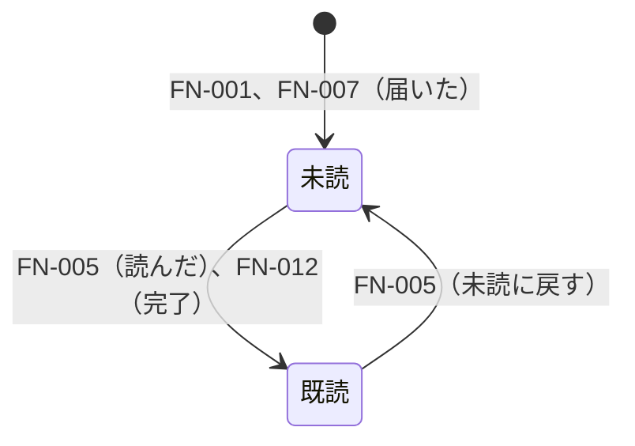
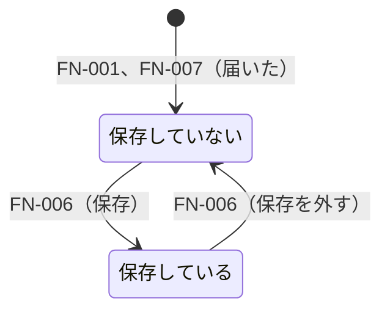
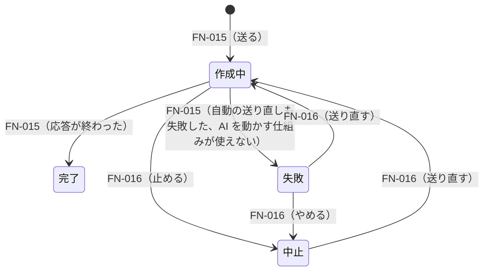
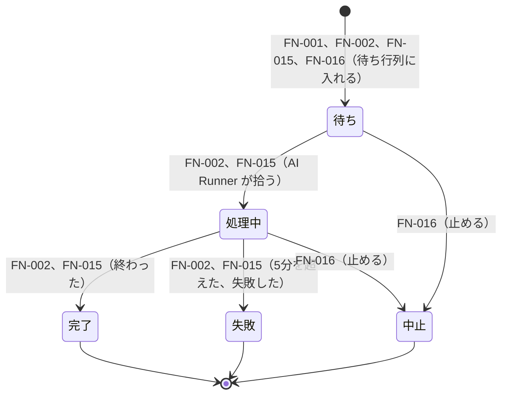
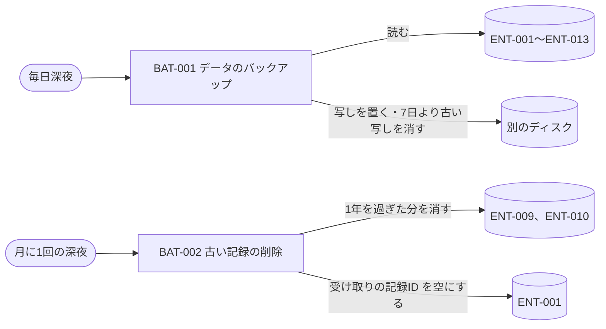

# BD-02 機能仕様書（NEXUS）

- 読んだもの: RD-03 1.0、RD-04 1.0、RD-05 1.1、RD-06 1.0、RD-07 1.0、RD-09 1.1、RD-10 1.0、RD-11 1.0、RD-12 1.1、RD-13 1.0、X-03 1.0、X-04 1.1、BD-01 0.1、BD-07 0.1、BD-09 0.1。BD-08 は X-06 で省いた。
- X-06 で BD-05 バッチ設計書をこの書類の「バッチ」の節（5章）にまとめた。
- 画面の操作の番号（`SCR-xxx-Ann`）と入力の番号（`SCR-xxx-Inn`）は、この書類で振り、BD-03 で同じ番号を使う。
- 英語の学習の振る舞い（自動の採点の比べ方、段の進み方、やり直し）は、今の cerebellum の作り（`docs/specs/15-web-learning.md` 3章、`14-learning.md` 3章）に合わせた（RD-03 R07〜R11 の出所）。
- 0.2: X-05 RV06 の指摘と、Q-079〜Q-081 の答え、CR-003（2026-11-24 承認）で直した（2026-11-24）。RV07 の指摘も直した。
- 1.0: 基本設計の完了判定（X-05 PG02。2026-11-24 RD-01 SH01。条件付きで進める）で承認した。
- 書いた AI: Claude（Opus 5.5）。人の承認の前の案である。

## 1. 機能一覧

機能の名前と概要は RD-05 を正とする。ロールは本人1つで、ROLE の番号は振らない（X-06 で BD-08 を省いた）。

| 機能ID | 処理方式 | 利用ロール | 関連する画面・帳票・バッチ・IF |
|---|---|---|---|
| FN-001 | 外部からの受信 | 配信元 brain-harness | IF-001 |
| FN-002 | 外部からの受信（FN-001 の後に AI Runner が行う） | システム | IF-004（Q-066） |
| FN-003 | オンライン（画面） | 本人 | SCR-002 |
| FN-004 | オンライン（画面） | 本人 | SCR-003 |
| FN-005 | オンライン（画面） | 本人 | SCR-003、SCR-005 |
| FN-006 | オンライン（画面） | 本人 | SCR-003、SCR-005 |
| FN-007 | 外部からの受信 | 配信元 sharpen | IF-002 |
| FN-008 | オンライン（画面） | 本人 | SCR-004 |
| FN-009 | オンライン（画面） | 本人 | SCR-005 |
| FN-010 | オンライン（画面） | 本人 | SCR-005 |
| FN-011 | オンライン（画面） | 本人 | SCR-005 |
| FN-012 | オンライン（画面） | 本人 | SCR-005 |
| FN-013 | オンライン（API） | 配信元 sharpen | IF-003 |
| FN-014 | オンライン（画面） | 本人 | SCR-006（内容を開いている画面とホームから開く。CR-003） |
| FN-015 | オンライン（画面） | 本人 | SCR-006、IF-004（Q-066） |
| FN-016 | オンライン（画面） | 本人 | SCR-006、IF-004（Q-066） |
| FN-017 | オンライン（画面） | 本人 | SCR-007 |
| FN-018 | オンライン（画面） | 本人 | SCR-008 |
| FN-019 | オンライン（画面） | 本人 | SCR-009 |
| FN-020 | オンライン（画面） | 本人 | SCR-001 |
| FN-021 | バッチ | システム | BAT-001 |
| FN-022 | バッチ | システム | BAT-002 |
| FN-023 | オンライン（API）と Mac mini のコマンド | 本人 | 画面なし（登録の URL を端末で開く） |
| FN-024 | Mac mini のコマンド | 本人 | 画面なし |

- 端末から使う機能（FN-003〜FN-006、FN-008〜FN-012、FN-014〜FN-020）は、端末の鍵（ENT-011）が通ったときだけ動く（BD-01 6章）。通らないときは MSG-020 を出し、ほかの処理をしない。鍵を確かめる共通の処理が、通るたびに ENT-011 の最後に使った日時を変える（この更新は各機能の CRUD に書かない。BD-07 5章）。この事前条件は機能ごとには書かない。
- FN-023 のうち、端末が登録の URL を開く求めは、端末の鍵を求めず、登録コードで確かめる。FN-023、FN-024 の Mac mini のコマンドと、バッチを手で動かすコマンドは、Mac mini の本人のユーザで打つことで確かめ、端末の鍵を使わない（BD-10 2章）。
- 配信元の機能（FN-001、FN-007、FN-013）は、配信元の鍵（ENT-013）が通り、その鍵でその連携を使えるときだけ動く（NFR-014）。

## 2. 機能ごとの定義

### FN-001 ニュースの受信

- 目的: brain-harness が送ったその日の記事を残し、関係の判定に回す。
- 起動のきっかけ: IF-001（brain-harness が送る）
- 関連する要件: REQ-001、REQ-026

| 区分 | 内容 |
|---|---|
| 事前条件 | 配信元の鍵が brain-harness のもので、IF-001 を使える |
| 事後条件（正常終了） | 形の正しい記事が、内容（ENT-001）と記事（ENT-002）に残る。受け取りの記録（ENT-010）が「受け取った」で1件増える。1件以上残したときは、記事の関係の判定の AI の実行（ENT-009。目的は記事の関係の判定、状態は待ち）が1件増える |
| 事後条件（異常終了） | 鍵か全体の形が正しくないときは、内容も記事も変わらず、受け取りの記録が「断った」で1件増える |

- 入力データ: IF-001 の項目（日付、記事ごとの slug、見出し、案内、元の記事の URL、画像の URL、テーマ）。項目と上限は BD-06。
- 出力データ: 受け取った件数（MSG-031）と、受け取れなかった記事と理由（MSG-033、MSG-034）を、brain-harness への応答として返す（IF-001）。

読み書きするデータ:

| データ | C | R | U | D |
|---|---|---|---|---|
| ENT-001 内容 | ○ | - | ○ | - |
| ENT-002 記事 | ○ | ○ | ○ | - |
| ENT-009 AI の実行 | ○ | - | - | - |
| ENT-010 受け取りの記録 | ○ | - | - | - |
| ENT-013 配信元の鍵 | - | ○ | - | - |

基本の流れ:

1. brain-harness が、その日の記事を鍵を付けて送る。
2. システムは、鍵と全体の形と大きさを確かめる。
3. システムは、記事ごとに形を確かめ、同じ日の同じ slug の記事が無ければ新しい内容と記事を作り、あれば置き換える（RD-03 R01）。
4. システムは、受け取りの記録を残し、残した記事が1件以上あれば記事の関係の判定を待ち行列に入れる（X-02 ADR-012）。
5. システムは、受け取った件数を返す。

- 代替の流れ: 3 で記事が0件のときは、受け取りの記録（件数0）だけを残し、判定を待ち行列に入れずに 5 へ進む（RD-06 UC-001）。
- 業務ルール・計算規則: 置き換えるときは、内容ID を変えず、見出し、案内、元の記事の URL、画像の URL、テーマ、届いた日時、受け取りの記録ID を新しい値にする。内容の状態（ENT-006）、会話（ENT-007）、記事の関係（ENT-004）は引き継ぐ。本人が開いた記事や話した会話を、置き換えで失わないためである。内容の見出しは記事の見出しにし、対象日は送られた日付にする。
- データの状態や関係によるチェック: 1回の送信の中で同じ slug が2回以上あったら、2回目からの記事を MSG-033 で断り、最初の記事を残す（BD-06 IF-001 3.2）。

| 異常の内容 | 利用者から見た結果 | データの状態 |
|---|---|---|
| 鍵が無いか、正しくないか、取り消されているか、IF-001 を使えない | MSG-032 を返し、何も残さない | 受け取りの記録が「断った」で1件増える |
| 全体の形が正しくない（日付が無いなど） | MSG-033 を返し、何も残さない | 同上 |
| 全体の大きさか件数が上限を超える（BD-06） | MSG-034 を返し、何も残さない | 同上 |
| 一部の記事の形が正しくない | その記事について MSG-033 を返し、ほかの記事は残す（RD-06 UC-001） | 正しい記事だけが残る。受け取りの記録は「受け取った」で、件数は残した数 |
| 置き換えの途中で失敗した | MSG-045 を返す。brain-harness が失敗を報告し、本人が送り直す（RD-10 3章） | その送信で残した記事は1件も残らない（全てを残すか、何も残さないかのどちらか。DD-05） |

- 同時に操作されたときの結果: 同じ日の記事が2回続けて送られたときは、後から届いた方の値が残る（RD-03 R01）。
- 操作の記録: 受け取りの記録（ENT-010）を残す（NFR-020）。
- 関連する非機能要件: NFR-003、NFR-014、NFR-015、NFR-020。

### FN-002 記事の関係の判定

- 目的: 届いた記事を7日前までの記事と照らし、関係のある記事とだけ関係の種類を付けてつなぐ。
- 起動のきっかけ: FN-001 が待ち行列に入れた AI の実行を、AI Runner が拾う（X-02 ADR-011、ADR-012）
- 関連する要件: REQ-002
- Q-066: AI を動かす仕組みは、規約の確認の結果で替わることがある。

| 区分 | 内容 |
|---|---|
| 事前条件 | 目的が記事の関係の判定で、状態が待ちの AI の実行がある。同時に動いている AI の実行が2つ未満（NFR-017）。完了と失敗にするのは、その実行の状態が処理中のときだけ（3章） |
| 事後条件（正常終了） | 関係があると判定された記事の組ごとに、記事の関係（ENT-004）が1件ある。AI の実行は完了 |
| 事後条件（異常終了） | 記事の関係は変わらない。AI の実行は失敗で、失敗の理由が残る。記事は残ったまま（RD-06 UC-001） |

- 入力データ: 判定する受け取りの記録（ENT-010）が届けた記事と、その対象日から7日前までの対象日の記事（ENT-001、ENT-002）。記事ごとに内容ID、見出し、テーマ、案内を渡す。
- 出力データ: 記事の関係（ENT-004）。ログに MSG-037（失敗したとき）。

読み書きするデータ:

| データ | C | R | U | D |
|---|---|---|---|---|
| ENT-001 内容 | - | ○ | - | - |
| ENT-002 記事 | - | ○ | - | - |
| ENT-004 記事の関係 | ○ | - | ○ | - |
| ENT-009 AI の実行 | ○ | ○ | ○ | - |
| ENT-010 受け取りの記録 | - | ○ | - | - |

基本の流れ:

1. AI Runner が待ちの判定を拾い、処理中にする。
2. AI Runner は、届いた記事と7日前までの記事をまとめて AI に渡し、関係のある組と関係の種類と根拠を返させる。AI にツールを使わせない（BD-01 6章）。
3. AI Runner は、返ってきた組を確かめ、記事の関係として残す。
4. AI Runner は、AI の実行を完了にする。

- 代替の流れ: 3 で関係のある組が1つも無いときは、何も残さずに 4 へ進む（関係の無い記事は線の無いまま置く。RD-03 R02）。
- 業務ルール・計算規則:
  - 照らす範囲: 関係の元は今回届いた記事、関係の先は今回届いたほかの記事か、対象日が7日前までの記事（RD-03 R02）。
  - 関係の種類は BD-07 4.2 の4つの値にする。ほかの言葉が返ったら「関連する話題」にし、AI の言葉は根拠に残す（BD-07 4.2）。
  - 根拠は AI が書いた文として残し、画面でも AI の判定として見せる。因果を事実として書かせない（RD-03 R03）。
  - 同じ2つの記事の関係がもう一度判定されたら、向きを問わず1件に置き換える（BD-07 ENT-004）。
  - 今回照らした組（今回届いた記事のどれかを、関係の元か関係の先に含み、相手の記事が同じ回に届いた記事か7日前までの記事である組）のうち、前に有効だった関係で今回返らなかったものは、有効を偽にする。消さない（Q-038 の答え）。図と案内には有効な関係だけを出す（REQ-002）。
  - 結果を残すときと、上の有効を偽にするときに、渡した後に置き換えられた記事（届いた日時がその実行を作った日時より新しい記事）を含む組は、残しも無効にもしない（新しい判定の結果を古い判定が変えないため）。置き換えた後の記事は、FN-001 が待ちに入れた新しい判定が扱う。
- データの状態や関係によるチェック: 返ってきた組のうち、渡していない内容ID を含むもの、同じ記事どうしのものは捨てる。

| 異常の内容 | 利用者から見た結果 | データの状態 |
|---|---|---|
| AI の実行が5分を超えた、返ってきた形が読めない | 1回だけ自動で送り直す（2回目の実行を待ちに入れる）。2回目も失敗したら、ログに MSG-037 を出し、ホームに MSG-017 を出す（Q-078） | 記事の関係は変わらない。AI の実行は失敗 |
| AI を動かす仕組みが使えない（CLI が動かない、ログインが切れた、使える量の上限に当たった） | 自動で送り直さない（FN-015 と同じ）。ログに MSG-037、ホームに MSG-017 | 同上 |
| AI Runner が処理中に止まった | AI Runner が起動し直したときに、処理中のまま残った実行を失敗（理由: 途中で止まった）にし、5分を超えたときと同じく1回だけ自動で送り直す（NFR-005） | 同上 |
| 判定の途中で記事が置き換えられた | FN-001 が置き換えた後の記事で新しい判定を待ちに入れる。古い判定は、置き換えられた記事を含む組を残さない（業務ルール） | 置き換えた後の記事の関係は、新しい判定の結果だけが残る |

- 同時に操作されたときの結果: 同じ受け取りの判定は、1つの AI Runner の枠だけが拾う（BD-01 6章 データの一貫性）。
- 操作の記録: AI の実行（ENT-009）を残す（NFR-020）。
- 関連する非機能要件: NFR-009、NFR-016、NFR-017、NFR-020。

### FN-003 記事の図の表示

- 目的: 本人が、選んだ日の記事どうしの関係を図で見る。
- 起動のきっかけ: SCR-002-A01（画面を開く）、SCR-002-A02（日付を選ぶ）、SCR-002-A03（テーマを選ぶ）、SCR-002-A04（記事のノードを選ぶ）
- 関連する要件: REQ-003、REQ-021

| 区分 | 内容 |
|---|---|
| 事前条件 | なし（共通の事前条件だけ） |
| 事後条件（正常終了） | データは変わらない。選んだ日の記事の図を見せた |
| 事後条件（異常終了） | データは変わらない |

- 入力データ: 日付（SCR-002-I01。開いたときは今日）、テーマ（SCR-002-I02。任意）、中心にする記事（SCR-002-A04 で選んだノード）。
- 出力データ: 選んだ日の記事（内容ID、見出し、テーマ、画像の URL、既読か）と、それらの記事に有効な関係のある記事（7日前までの記事を含む）と、有効な関係（関係の元、関係の先、関係の種類）。画面 SCR-002 に返す。

読み書きするデータ:

| データ | C | R | U | D |
|---|---|---|---|---|
| ENT-001 内容 | - | ○ | - | - |
| ENT-002 記事 | - | ○ | - | - |
| ENT-004 記事の関係 | - | ○ | - | - |
| ENT-006 内容の状態 | - | ○ | - | - |

基本の流れ:

1. 本人が日付を選ぶ（開いたときは今日）。
2. システムは、その日の記事と、それらの記事の関係と、関係の先の記事を返す。
3. 本人が記事のノードを選ぶと、システムはその記事を中心にし、その記事の関係の先で、まだ読み込んでいない過去の記事を返す（RD-03 R04）。

- 代替の流れ: 2 でテーマを選んだときは、そのテーマの記事だけを返す。
- 業務ルール・計算規則: 「今日のニュース」のような作り物の中心を置かず、選んだ記事を中心にする（RD-03 R04）。1年分を一度に返さず、選んだ日と、選んだ記事の関係の先だけを返す。
- データの状態や関係によるチェック: 該当なし（入力の日付とテーマの形は BD-03 で確かめる）。

| 異常の内容 | 利用者から見た結果 | データの状態 |
|---|---|---|
| その日の記事が無い | MSG-001 を出し、日付を選べる状態にする | 変わらない |
| 読み込めなかった | MSG-019 | 変わらない |

- 同時に操作されたときの結果: 該当なし。データを変えない。
- 操作の記録: 該当なし（見るだけの操作は記録しない。RD-12 4章）。
- 関連する非機能要件: NFR-001、NFR-008。

### FN-004 記事の案内の表示

- 目的: 本人が、選んだ記事の案内を読み、関係のある記事へたどる。
- 起動のきっかけ: SCR-003-A01（画面を開く）、SCR-002-A04（記事のノードを選ぶ）、SCR-003-A06（関係のある記事を選ぶ）、SCR-001-A04（今日のピックアップの記事を押す）、SCR-007-A02、SCR-008-A03、SCR-009-A02（一覧で記事を選ぶ）
- 関連する要件: REQ-003、REQ-004

| 区分 | 内容 |
|---|---|
| 事前条件 | なし |
| 事後条件（正常終了） | 記事の内容の状態の開いた日時が入っている（初めて開いたときに入れる。RD-03 R18）。既読は変えない（RD-03 R05） |
| 事後条件（異常終了） | データは変わらない |

- 入力データ: 記事の内容ID。
- 出力データ: 見出し、テーマ、届いた日時、画像の URL、案内、元の記事の URL、既読か、保存しているか、有効な関係のある記事の一覧（見出し、関係の種類、根拠）。画面 SCR-003 に返す。

読み書きするデータ:

| データ | C | R | U | D |
|---|---|---|---|---|
| ENT-001 内容 | - | ○ | - | - |
| ENT-002 記事 | - | ○ | - | - |
| ENT-004 記事の関係 | - | ○ | - | - |
| ENT-006 内容の状態 | ○ | ○ | ○ | - |

基本の流れ:

1. 本人が記事を選ぶ。
2. システムは、記事と関係のある記事を返し、開いた日時が空なら今の日時を入れる。

- 代替の流れ: 該当なし（関係のある記事へ進むと、その記事でこの機能をもう一度動かす。元の記事を開くのは端末のブラウザで、NEXUS は何もしない。RD-06 UC-003）。
- 業務ルール・計算規則: 開いただけでは既読にしない（RD-03 R05）。
- データの状態や関係によるチェック: 内容が無い、またはニュースでないときは MSG-002。

| 異常の内容 | 利用者から見た結果 | データの状態 |
|---|---|---|
| 記事が見つからない | MSG-002 | 変わらない |
| 開いた日時を残せなかった | 案内は見せる。次に開いたときにもう一度入れる | 開いた日時は空のまま |

- 同時に操作されたときの結果: 2台の端末で同時に初めて開いたときは、先に入った日時を残す（開いた日時は一度入れたら変えない。BD-07 ENT-006）。
- 操作の記録: 該当なし。
- 関連する非機能要件: NFR-001。

### FN-005 既読にする

- 目的: 本人が、読み終えた記事を既読にし、間違えたら未読に戻す。
- 起動のきっかけ: SCR-003-A02（「読んだ」を押す）、SCR-003-A03（「未読に戻す」を押す）、SCR-005-A12（「未読に戻す」を押す）、FN-012（教材を完了する）
- 関連する要件: REQ-004

| 区分 | 内容 |
|---|---|
| 事前条件 | 「読んだ」は未読のとき、「未読に戻す」は既読のとき |
| 事後条件（正常終了） | 内容の状態の既読が真（既読にした日時が入る）か、偽になる |
| 事後条件（異常終了） | 内容の状態は変わらない |

- 入力データ: 内容ID と、既読にするか未読に戻すか。
- 出力データ: 既読か未読か。画面に返す。

読み書きするデータ:

| データ | C | R | U | D |
|---|---|---|---|---|
| ENT-001 内容 | - | ○ | - | - |
| ENT-006 内容の状態 | ○ | ○ | ○ | - |

基本の流れ:

1. 本人が「読んだ」か「未読に戻す」を押す。
2. システムは、内容の状態を変え、結果を返す。

- 代替の流れ: 該当なし。
- 業務ルール・計算規則: 記事は「読んだ」を押したとき、教材は完了したとき（FN-012）に既読にする（RD-03 R05、R12）。どちらも未読に戻せる（Q-044 の答え）。確認は出さない（RD-07 3章）。
- データの状態や関係によるチェック: 既に既読のものを既読にする求めと、未読のものを未読に戻す求めは、何もせずに今の状態を返す（2台の端末で続けて押したときのため）。

| 異常の内容 | 利用者から見た結果 | データの状態 |
|---|---|---|
| 状態を変えられなかった | MSG-003（操作は「既読に」か「未読に戻す」） | 変わらない |

- 同時に操作されたときの結果: 2台の端末から逆の操作をしたときは、後に届いた方を残す（BD-01 6章 データの一貫性）。
- 操作の記録: 該当なし（RD-12 4章）。
- 関連する非機能要件: NFR-001。

### FN-006 保存と保存の取り消し

- 目的: 本人が、後で見返す内容を保存し、要らなくなったら外す。
- 起動のきっかけ: SCR-003-A04（「保存」か「保存を外す」を押す）、SCR-005-A08（同じ）
- 関連する要件: REQ-005

| 区分 | 内容 |
|---|---|
| 事前条件 | 「保存」は保存していないとき、「保存を外す」は保存しているとき |
| 事後条件（正常終了） | 内容の状態の保存が真（保存した日時が入る）か、偽になる |
| 事後条件（異常終了） | 内容の状態は変わらない |

- 入力データ: 内容ID と、保存するか外すか。
- 出力データ: 保存の状態。画面に返す。

読み書きするデータ:

| データ | C | R | U | D |
|---|---|---|---|---|
| ENT-001 内容 | - | ○ | - | - |
| ENT-006 内容の状態 | ○ | ○ | ○ | - |

基本の流れ:

1. 本人が「保存」か「保存を外す」を押す。
2. システムは、内容の状態を変え、結果を返す。

- 代替の流れ: 該当なし。
- 業務ルール・計算規則: 保存した内容は Library に並び、外すと並ばない（RD-03 R20）。確認は出さない（RD-07 3章）。
- データの状態や関係によるチェック: FN-005 と同じく、今と同じ状態にする求めは何もせずに今の状態を返す。

| 異常の内容 | 利用者から見た結果 | データの状態 |
|---|---|---|
| 状態を変えられなかった | MSG-003（操作は「保存」か「保存を外す」） | 変わらない |

- 同時に操作されたときの結果: FN-005 と同じ。
- 操作の記録: 該当なし。
- 関連する非機能要件: NFR-001。

### FN-007 英語のセットの受信

- 目的: sharpen が送ったその日の英語のセットを、読む教材と一緒に残す。
- 起動のきっかけ: IF-002（sharpen が送る）
- 関連する要件: REQ-006、REQ-026

| 区分 | 内容 |
|---|---|
| 事前条件 | 配信元の鍵が sharpen のもので、IF-002 を使える |
| 事後条件（正常終了） | 内容（ENT-001）と英語のセット（ENT-003）が、その日付の分として1件ある。受け取りの記録が「受け取った」で1件増える |
| 事後条件（異常終了） | 内容と英語のセットは変わらない。受け取りの記録が「断った」で1件増える |

- 入力データ: IF-002 の項目（日付、学習テーマ、教材の本文、問題の一覧、締めの一言、読む教材）。項目と上限は BD-06。
- 出力データ: 受け取った結果（MSG-031）か、受け取れない理由（MSG-032〜MSG-034）を sharpen への応答として返す。

読み書きするデータ:

| データ | C | R | U | D |
|---|---|---|---|---|
| ENT-001 内容 | ○ | - | ○ | - |
| ENT-003 英語のセット | ○ | ○ | ○ | - |
| ENT-010 受け取りの記録 | ○ | - | - | - |
| ENT-013 配信元の鍵 | - | ○ | - | - |

基本の流れ:

1. sharpen が、その日のセットを鍵を付けて送る。
2. システムは、鍵と形と大きさを確かめる。
3. システムは、同じ日付のセットが無ければ新しい内容と英語のセットを作り、あれば置き換える（RD-03 R06）。
4. システムは、受け取りの記録を残し、結果を返す。

- 代替の流れ: 持ち越し（前の日のセットを今日の分として送る）も、同じ流れで今日の日付のセットとして受け取る（RD-06 UC-005）。
- 業務ルール・計算規則: 置き換えるときは、内容ID を変えず、セットの全ての項目と届いた日時を新しい値にする。英語の答え（ENT-005）と内容の状態は消さない（今の cerebellum も答えを残す。`31-learning-lanes.md` 3.2）。内容の見出しは学習テーマにする。
- データの状態や関係によるチェック: 形の確かめ（cerebellum `14-learning.md` 3.2 と同じ）: 問題が1〜60問、問題番号が重ならない、答えの形があれば正解がある、選ぶ問題の選択肢が2〜6件で重ならず正解を含む、数の問題の正解が数として読める。読む教材は、あれば段落と文の形を確かめる。崩れたセットは1問でも残さない（壊れたまま画面に出すと学習ができないため）。

| 異常の内容 | 利用者から見た結果 | データの状態 |
|---|---|---|
| 鍵が無いか、正しくないか、取り消されているか、IF-002 を使えない | MSG-032 | 変わらない。受け取りの記録が「断った」で1件増える |
| 形が正しくない | MSG-033（項目の名前を差し込む） | 同上 |
| 大きさが上限を超える（BD-06） | MSG-034 | 同上 |

- 同時に操作されたときの結果: 同じ日付のセットが2回続けて届いたときは、後から届いた方が残る（RD-03 R06）。本人が教材を開いている間に置き換わったときは、次に開いたときから新しいセットを見せる。
- 操作の記録: 受け取りの記録（ENT-010）。
- 関連する非機能要件: NFR-003、NFR-014、NFR-015、NFR-020。

### FN-008 教材の一覧の表示

- 目的: 本人が、届いた英語の教材を一覧から選ぶ。
- 起動のきっかけ: SCR-004-A01（画面を開く）、SCR-004-A03（続きを読み込む）
- 関連する要件: REQ-007

| 区分 | 内容 |
|---|---|
| 事前条件 | なし |
| 事後条件（正常終了） | データは変わらない。教材の一覧を見せた |
| 事後条件（異常終了） | データは変わらない |

- 入力データ: なし（続きを読み込むときは、前に返した最後の教材）。
- 出力データ: 英語の教材ごとに、日付（対象日）、学習テーマ、完了したか（英語の答えがあるか）、新着か。対象日の新しい順。1回に返す件数は DD-04（BD-09 5章）。

読み書きするデータ:

| データ | C | R | U | D |
|---|---|---|---|---|
| ENT-001 内容 | - | ○ | - | - |
| ENT-003 英語のセット | - | ○ | - | - |
| ENT-005 英語の答え | - | ○ | - | - |
| ENT-006 内容の状態 | - | ○ | - | - |

基本の流れ:

1. 本人が English を開く。
2. システムは、英語の教材を新しい順に返す。

- 代替の流れ: 下までスクロールしたら続きを返す（BD-09 5章）。
- 業務ルール・計算規則: 該当なし。
- データの状態や関係によるチェック: 該当なし。

| 異常の内容 | 利用者から見た結果 | データの状態 |
|---|---|---|
| 教材が1つも無い | MSG-004 | 変わらない |
| 読み込めなかった | MSG-019 | 変わらない |

- 同時に操作されたときの結果: 該当なし。
- 操作の記録: 該当なし。
- 関連する非機能要件: NFR-001。

### FN-009 教材の表示

- 目的: 本人が、教材の本文と読む教材を続けて読み、語句の説明を見る。
- 起動のきっかけ: SCR-005-A01（画面を開く）、SCR-004-A02（教材を選ぶ）、SCR-007-A02、SCR-008-A03、SCR-009-A02（一覧で教材を選ぶ）、SCR-005-A02（語句をタップする。画面の中だけで行い、サーバを呼ばない）
- 関連する要件: REQ-008

| 区分 | 内容 |
|---|---|
| 事前条件 | なし |
| 事後条件（正常終了） | 教材の内容の状態の開いた日時が入っている（初めて開いたとき）。既読は変えない |
| 事後条件（異常終了） | データは変わらない |

- 入力データ: 教材の内容ID。
- 出力データ: 学習テーマ、教材の本文、読む教材（あれば）、問題の一覧、締めの一言、完了したことがあれば前の答えと採点、既読か、保存しているか。画面 SCR-005 に返す。

読み書きするデータ:

| データ | C | R | U | D |
|---|---|---|---|---|
| ENT-001 内容 | - | ○ | - | - |
| ENT-003 英語のセット | - | ○ | - | - |
| ENT-005 英語の答え | - | ○ | - | - |
| ENT-006 内容の状態 | ○ | ○ | ○ | - |

基本の流れ:

1. 本人が教材を選ぶ。
2. システムは教材を返し、開いた日時が空なら今の日時を入れる。画面は教材の段を見せる。教材の本文の後に、読む教材を続けて置く（RD-03 R07、Q-033 の答え）。
3. 本人が読む教材の語句をタップすると、画面は読む教材の注にある説明を出す。AI は呼ばない（RD-05 FN-009）。

- 代替の流れ: 完了したことのある教材を開いたときは、前の答えと採点を見せ、「やり直す」（SCR-005-A11）で問題の段から始め直せる（今の cerebellum の作り。`15-web-learning.md` 4章）。
- 業務ルール・計算規則: 段は教材 → 問題 → 採点の順で、通った段には戻れ、先へは飛ばせない（RD-03 R07）。締めの一言は採点の段の終わりに置く（cerebellum `14-learning.md` 3.1「学習セット末尾のまとめ」）。読む教材が届いているときは、教材の本文の「## 読む」で始まる節を出さない。sharpen は読む教材を出せない cerebellum のために、同じ英文を教材の本文にも入れているので、2回出さないためである（BD-13 P07。2026-11-24 本人）。読む教材が届いていない日は、その節を出す。
- データの状態や関係によるチェック: 内容が無い、または英語でないときは MSG-019。

| 異常の内容 | 利用者から見た結果 | データの状態 |
|---|---|---|
| 教材が見つからないか、読み込めなかった | MSG-019 | 変わらない |
| 読む教材が届いていない | 教材の本文だけを見せる（RD-06 UC-007）。知らせは出さない | 変わらない |

- 同時に操作されたときの結果: FN-004 と同じ。
- 操作の記録: 該当なし。
- 関連する非機能要件: NFR-001、NFR-018。

### FN-010 問題の回答

- 目的: 本人が、問題に1問ずつ答える。
- 起動のきっかけ: SCR-005-A03（問題の段へ進む）、SCR-005-A04（答えを入れる）
- 関連する要件: REQ-009

| 区分 | 内容 |
|---|---|
| 事前条件 | 教材の段を通った |
| 事後条件（正常終了） | データは変わらない。答えは端末の画面の中に預かる（残すのは FN-012） |
| 事後条件（異常終了） | データは変わらない |

- 入力データ: 問題ごとの答え（SCR-005-I01。選ぶ、数、文）。
- 出力データ: 問題の段の画面。

読み書きするデータ:

| データ | C | R | U | D |
|---|---|---|---|---|
| ENT-003 英語のセット | - | ○ | - | - |

基本の流れ:

1. 本人が問題の段へ進む。
2. 画面は問題を1問ずつ見せ、本人が答える。
3. 本人が採点の段へ進む（SCR-005-A05）。

- 代替の流れ: 分からない問題を飛ばしても採点の段へ進める（RD-06 UC-008）。教材の段へ戻っても答えは預けたまま（同）。
- 業務ルール・計算規則: 答えは画面を閉じると消える（今の cerebellum と同じく、途中の答えを残す仕組みは作らない。`15-web-learning.md` 4章。RD-06 UC-008 で答えを残すのは UC-010 だけ）。問題の種類が「手元で解く」の問題は答えの欄を出さない。
- データの状態や関係によるチェック: 該当なし（サーバを呼ばない）。

| 異常の内容 | 利用者から見た結果 | データの状態 |
|---|---|---|
| 該当なし。サーバを呼ばず、失敗する処理が無い（RD-06 UC-008） | - | - |

- 同時に操作されたときの結果: 該当なし。
- 操作の記録: 該当なし。
- 関連する非機能要件: NFR-008。

### FN-011 採点

- 目的: 本人が、問題ごとの正解と解説を見て、○△× を確かめて直す。
- 起動のきっかけ: SCR-005-A05（採点の段へ進む）、SCR-005-A06（○△× を直す）
- 関連する要件: REQ-009

| 区分 | 内容 |
|---|---|
| 事前条件 | 問題の段を通った |
| 事後条件（正常終了） | データは変わらない。採点は端末の画面の中に預かる |
| 事後条件（異常終了） | データは変わらない |

- 入力データ: 預かった答え、本人が直した ○△×。
- 出力データ: 問題ごとの解答（正解と解説）と ○△×。

読み書きするデータ:

| データ | C | R | U | D |
|---|---|---|---|---|
| ENT-003 英語のセット | - | ○ | - | - |

基本の流れ:

1. 本人が採点の段へ進む。
2. 画面は、答えの形を持つ問題に自動で ○ か × を付ける。
3. 本人が、自動の結果を ○、△、× に直し、答えの形を持たない問題に ○、△、× を付ける。

- 代替の流れ: 本人が問題の段へ戻ったときは FN-010 へ戻る（RD-06 UC-009）。
- 業務ルール・計算規則（RD-03 R08。比べ方は cerebellum `15-web-learning.md` 3.3）: 答えの形が「選ぶ」は選んだものと正解が同じなら ○。「数」は両方を数として読んで同じなら ○（読めなければ ×）。「文」は前後の空白を除き、全角と半角、大文字と小文字をそろえて同じなら ○。未回答は ×。自動の結果を直すのは ○△× だけで、答えは入れたまま。
- データの状態や関係によるチェック: 該当なし。

| 異常の内容 | 利用者から見た結果 | データの状態 |
|---|---|---|
| 該当なし。サーバを呼ばない | - | - |

- 同時に操作されたときの結果: 該当なし。
- 操作の記録: 該当なし。
- 関連する非機能要件: NFR-008。

### FN-012 教材の完了

- 目的: 本人が、答えと ○△× を残し、教材を完了する。
- 起動のきっかけ: SCR-005-A07（「完了」を押す）
- 関連する要件: REQ-009

| 区分 | 内容 |
|---|---|
| 事前条件 | 全ての問題に ○△× が付いている（RD-03 R09） |
| 事後条件（正常終了） | 英語の答え（ENT-005）が今回の答えと採点になり、完了した日時が入る。内容の状態の既読が真になる（RD-03 R12） |
| 事後条件（異常終了） | 英語の答えと内容の状態は変わらない。答えは画面に預けたまま（RD-06 UC-010） |

- 入力データ: 預かった答えと ○△×（問題番号、答え、採点）。
- 出力データ: 完了した結果。

読み書きするデータ:

| データ | C | R | U | D |
|---|---|---|---|---|
| ENT-001 内容 | - | ○ | - | - |
| ENT-003 英語のセット | - | ○ | - | - |
| ENT-005 英語の答え | ○ | ○ | ○ | - |
| ENT-006 内容の状態 | ○ | ○ | ○ | - |

基本の流れ:

1. 本人が「完了」を押す。
2. システムは、全ての問題に ○△× があることを確かめる。
3. システムは、英語の答えを残し、内容を既読にする。

- 代替の流れ: 2 の後、既に完了した教材なら、画面が MSG-006 を出し、「置き換える」を選んだら 3 へ進み、前の答えを置き換える（RD-03 R11、Q-044 の答え）。「やめる」を選んだら何もしない。
- 業務ルール・計算規則: sharpen が既に前の答えを読んだ後でも、置き換えは NEXUS の中だけで行い、sharpen には送り直さない（RD-03 R11、Q-058 の答え）。感想は残さない（Q-026 の答え）。
- データの状態や関係によるチェック: 問題番号がセットに無いときと、○△× の無い問題があるときは MSG-005。

| 異常の内容 | 利用者から見た結果 | データの状態 |
|---|---|---|
| ○△× の付いていない問題がある | MSG-005。完了しない | 変わらない |
| 残せなかった | MSG-007。答えは画面に預けたまま | 変わらない（答えと既読の両方を残すか、どちらも残さない。DD-05） |

- 同時に操作されたときの結果: 2台の端末から続けて完了したときは、後に届いた答えが残る（RD-03 R11 の置き換えと同じ）。
- 操作の記録: 該当なし（RD-12 4章。完了とやり直しは記録しない。Q-059 の答え）。
- 関連する非機能要件: NFR-001。

### FN-013 答えの提供

- 目的: sharpen が、日付を指定して英語のセットと本人の答えを読む。
- 起動のきっかけ: IF-003（sharpen が読みに来る）
- 関連する要件: REQ-010、REQ-026

| 区分 | 内容 |
|---|---|
| 事前条件 | 配信元の鍵が sharpen のもので、IF-003 を使える |
| 事後条件（正常終了） | データは変わらない。セットか答えを返した |
| 事後条件（異常終了） | データは変わらない |

- 入力データ: 日付と、セットを読むか答えを読むか（IF-003）。
- 出力データ: セットは届いたセットの原文（ENT-003）。答えは、問題ごとの問題番号、採点、答えと、空の感想（Q-026 の答え。RD-10 IF-003）。形は今の cerebellum に合わせる（BD-06）。

読み書きするデータ:

| データ | C | R | U | D |
|---|---|---|---|---|
| ENT-001 内容 | - | ○ | - | - |
| ENT-003 英語のセット | - | ○ | - | - |
| ENT-005 英語の答え | - | ○ | - | - |
| ENT-013 配信元の鍵 | - | ○ | - | - |

基本の流れ:

1. sharpen が日付を指定して読みに来る。
2. システムは、鍵を確かめ、その日付のセットか答えを返す。

- 代替の流れ: 答えを求められて、その日の教材が完了していないときは「まだ無い」（MSG-035）を返す。sharpen はこれで未着手と見分けて持ち越す（RD-06 UC-011）。
- 業務ルール・計算規則: 置き換えた後のセットに無い問題番号の答えも、残っている答えのまま返す（FN-007 で答えを消さないため）。
- データの状態や関係によるチェック: 該当なし。

| 異常の内容 | 利用者から見た結果 | データの状態 |
|---|---|---|
| 鍵が無いか、正しくないか、取り消されているか、IF-003 を使えない | MSG-032。何も返さない | 変わらない |
| その日付のセットが無い | MSG-036 | 変わらない |

- 同時に操作されたときの結果: 本人が完了している途中に読まれたときは、読んだ時点で残っている答えを返す。
- 操作の記録: 該当なし（読み出しは受け取りの記録に入れない。RD-09 ENT-010 は送られてきた記録）。
- 関連する非機能要件: NFR-014。

### FN-014 会話の選択

- 目的: 本人が、質問の対象を選び、前の会話を選ぶか新しい会話を始める。
- 起動のきっかけ: SCR-006-A01（画面を開く）、SCR-003-A05、SCR-005-A09、SCR-002-A05（「AI に質問」を押す）、SCR-001-A05（中心の AI の印を押す）、SCR-006-A02（前の会話を選ぶ）、SCR-006-A03（「新しい会話」を押す）
- 関連する要件: REQ-011、REQ-012

| 区分 | 内容 |
|---|---|
| 事前条件 | なし |
| 事後条件（正常終了） | 対象と会話が決まった。新しい会話を始めたときは会話（ENT-007）が1件増える |
| 事後条件（異常終了） | データは変わらない |

- 入力データ: 質問の対象（対象の種類と、内容ID、語句、語句を含む文、文の位置。BD-07 4.1）。ホームからは対象なし。
- 出力データ: 対象の表示、その内容の前の会話の一覧（最後に話した日時の新しい順）、選んだ会話の発言。

読み書きするデータ:

| データ | C | R | U | D |
|---|---|---|---|---|
| ENT-001 内容 | - | ○ | - | - |
| ENT-007 会話 | ○ | ○ | - | - |
| ENT-008 発言 | - | ○ | - | - |

基本の流れ:

1. 本人が、開いている画面で対象を選び、「AI に質問」を押す。
2. システムは、対象と、同じ内容を対象にした前の会話の一覧を返す（RD-03 R14）。
3. 本人が前の会話を選ぶと、システムはその会話の発言を返す。

- 代替の流れ: 3 で「新しい会話」を押したとき、または 2 で前の会話が無いときは、対象を付けた会話を作る。ホームから開いたときは、対象の無い会話の一覧を返す（RD-03 R14）。
- 業務ルール・計算規則: 前の会話を選んだときは、その会話の対象で続ける。今選んだ箇所で質問したいときは新しい会話を始める（会話の対象は直さない。RD-03 R22）。対象の内容は、端末が送った文ではなく、内容ID から NEXUS に残してある内容を引く（RD-03 3章 BIZ-003、依頼 6章）。
- データの状態や関係によるチェック: 内容ID の内容が無いときは、MSG-011 を出し、対象の無い会話として開く（RD-06 UC-012）。

| 異常の内容 | 利用者から見た結果 | データの状態 |
|---|---|---|
| 対象の内容が見つからない | MSG-011。対象の無い会話として開く | 対象の無い会話が1件増える |
| 読み込めなかった | MSG-019 | 変わらない |

- 同時に操作されたときの結果: 2台の端末で同じ会話を開いても、発言は FN-015 で足すだけなので食い違わない。
- 操作の記録: 該当なし。
- 関連する非機能要件: NFR-001。

### FN-015 質問と応答

- 目的: 本人が質問を送り、AI の応答を少しずつ受け取って読む。
- 起動のきっかけ: SCR-006-A04（「送る」を押す）
- 関連する要件: REQ-011、REQ-013、REQ-014、REQ-023、REQ-024
- Q-066: AI を動かす仕組みは、規約の確認の結果で替わることがある。

| 区分 | 内容 |
|---|---|
| 事前条件 | 会話が開いている。質問の文が空でない（BD-03）。同じ会話の AI の発言に、応答の状態が作成中のものが無い（NFR-002 の時間を守るため）。AI Runner が進める遷移は、遷移前の状態のときだけ行う: AI の実行を処理中にするのは待ちのとき、完了と失敗にするのは処理中のとき。AI の発言を完了と失敗にし、2回目を待ちに入れるのは作成中のとき（3章） |
| 事後条件（正常終了） | 本人の発言と AI の発言（応答の状態は完了、AI に渡した内容の写しあり）が会話に増える。会話の最後に話した日時が変わる。AI の実行が完了で残る。会話が決めた長さを超えたら、会話の要約の AI の実行が待ちに入る（Q-076） |
| 事後条件（異常終了） | 本人の発言は残り、AI の発言は応答の状態が失敗で残る。AI の実行が失敗で残る（RD-06 UC-013） |

- 入力データ: 会話ID、質問の文（SCR-006-I01）。
- 出力データ: 処理中の印、応答の続き（SSE。X-02 ADR-013）、完了か失敗。

読み書きするデータ:

| データ | C | R | U | D |
|---|---|---|---|---|
| ENT-001 内容 | - | ○ | - | - |
| ENT-002 記事 | - | ○ | - | - |
| ENT-003 英語のセット | - | ○ | - | - |
| ENT-004 記事の関係 | - | ○ | - | - |
| ENT-007 会話 | - | ○ | ○ | - |
| ENT-008 発言 | ○ | ○ | ○ | - |
| ENT-009 AI の実行 | ○ | ○ | ○ | - |

基本の流れ:

1. 本人が質問を書いて「送る」を押す。
2. Web サーバは、本人の発言と、作成中の AI の発言と、待ちの AI の実行（目的は質問の応答、1回目）を残し、処理中の印を返す（NFR-002）。
3. AI Runner は実行を拾い、AI に渡す内容を組み立てて写しを AI の発言に残し、AI に渡す。
4. AI Runner は応答を少しずつ AI の発言の本文に書き足し、Web サーバはそれを端末へ流す。
5. AI Runner は、応答が終わったら AI の発言と実行を完了にする。

- 代替の流れ:
  - 3 の後、AI が渡した内容で答えが分からないときは、ウェブの検索とページの読み取りを使って答える（RD-03 R17）。使えるツールはこの2つだけ（NFR-016）。
  - 5 の後、会話の発言が決めた長さを超えていて、要約に含めていない古い発言があるときは、会話の要約の実行を待ちに入れる。要約の実行は、古い発言を要約して会話の要約と要約に含めた最後の発言を置き換える。要約は次の質問から使い、今の応答を待たせない（Q-076 の答え）。長さの値は DD-02 で決める。
- 業務ルール・計算規則（AI に渡す内容。RD-03 R13、R16。依頼 6章）:
  - 対象の内容は、内容ID から NEXUS に残してある内容で組み立てる。ニュースは、記事の見出し、テーマ、案内、元の記事の URL と、関係のある記事の見出しと関係の種類。英語は、学習テーマ、対象の文、その文の語句の注（事前の説明）、対象の箇所の語句。ページ全体のときは、その内容の本文（英語は教材の本文と読む教材の文）。
  - そこに、会話の要約（あれば）と、要約に含めていない直近の発言と、今の質問を足す。会話の全てや過去の会話を際限なく渡さない。
  - 届いた内容と質問は、AI への指示としてではなく、読む材料として渡す（NFR-016）。組み立て方は DD-02。
  - 自動の送り直しは1回だけ（2回目の実行を待ちに入れ、AI の発言の本文を空に戻す。RD-03 R15、NFR-017）。
- データの状態や関係によるチェック: 会話が無いときは MSG-019。

| 異常の内容 | 利用者から見た結果 | データの状態 |
|---|---|---|
| 応答が失敗した（5分を超えた、返ってきた形が読めない など） | 1回だけ自動で送り直す。2回目も失敗したら MSG-012 を会話の中に出す | AI の発言は失敗。2つの実行が失敗で残る |
| AI を動かす仕組みが使えない（CLI が動かない、使える量の上限に当たった など） | MSG-013 を会話の中に出す。自動の送り直しはしない（RD-06 UC-013 の例外の流れ） | AI の発言は失敗。実行は失敗で、失敗の理由が残る |
| 質問を残せなかった | MSG-019。質問の文は入力の欄に残す（BD-09 2章） | 変わらない |
| AI Runner が処理中に止まった | 起動し直したときに失敗にし、1回だけ自動で送り直す（FN-002 と同じ。NFR-005） | 2回目も失敗したら、AI の発言は失敗 |
| 会話の要約の実行が失敗した | 本人には出さない。自動で送り直さず、次の質問の応答が終わったときにもう一度待ちに入れる。次の質問は、前の要約（あれば）と直近の発言で組み立てる | 会話の要約は変わらない。実行は失敗 |

- 同時に操作されたときの結果: 同じ会話で応答が作成中のあいだは、次の質問を受け付けない（画面は「送る」を押せなくし、2台目の端末から届いた質問には作成中の状態を返して残さない）。AI Runner は、待ちの実行のうち質問の応答を、記事の関係の判定と会話の要約より先に拾う（NFR-002）。同じ会話の会話の要約が動いていても、質問の応答は待たずに拾う（要約は次の質問から使う。Q-076 の答え）。
- 操作の記録: AI の実行（ENT-009）と、AI に渡した内容の写し（ENT-008）を残す（NFR-020）。実行ごとに、ウェブの検索とページの読み取りを使った回数を残す（RD-15 AC14。BD-07 ENT-009）。
- 関連する非機能要件: NFR-002、NFR-009、NFR-016、NFR-017、NFR-019、NFR-020。

### FN-016 応答の送り直しと中止

- 目的: 本人が、失敗した応答を送り直し、作っている途中の応答を止める。
- 起動のきっかけ: SCR-006-A05（「送り直す」を押す）、SCR-006-A06（「止める」を押す）、SCR-006-A07（「やめる」を押す）
- 関連する要件: REQ-013
- Q-066: AI を動かす仕組みは、規約の確認の結果で替わることがある。

| 区分 | 内容 |
|---|---|
| 事前条件 | 「送り直す」は AI の発言の応答の状態が失敗、中止のとき。「止める」は応答の状態が作成中で、AI の実行の状態が待ち、処理中のとき。「やめる」は応答の状態が失敗のとき（3章） |
| 事後条件（正常終了） | 送り直したときは、AI の発言が作成中に戻り、新しい AI の実行が待ちに入る。止めたときは、AI の発言と実行が中止になり、それまでの本文は残る（RD-06 UC-014）。やめたときは、AI の発言が中止になる |
| 事後条件（異常終了） | AI の発言と実行は変わらない |

- 入力データ: AI の発言の発言ID。
- 出力データ: 新しい応答の続き（送り直し）か、中止の状態（MSG-014）。

読み書きするデータ:

| データ | C | R | U | D |
|---|---|---|---|---|
| ENT-007 会話 | - | ○ | - | - |
| ENT-008 発言 | - | ○ | ○ | - |
| ENT-009 AI の実行 | ○ | ○ | ○ | - |

基本の流れ（送り直す）:

1. 本人が「送り直す」を押す。
2. Web サーバは、AI の発言の本文を空にして作成中に戻し、同じ質問で新しい AI の実行（1回目）を待ちに入れる。
3. FN-015 の 3 からと同じに進む。

- 代替の流れ:
  - 「止める」を押したときは、Web サーバが今の実行の止める求めを真にする。AI Runner は AI を止め、実行と AI の発言を中止にする。実行がまだ待ちのときは、拾わずに中止にする。
  - 「やめる」を押したときは、AI の発言を中止にする（失敗のまま送り直さないことを、本人が選んだと残す）。ホームの失敗の知らせは変わらない（FN-020。Q-078 の答え）。
- 業務ルール・計算規則: 送り直しにも自動の送り直しを1回だけ行う（RD-03 R15 は失敗のたびに当てる）。前の実行の記録は消さずに残す（NFR-020）。本人の質問の文は変えない（RD-03 R22）。
- データの状態や関係によるチェック: 応答の状態が事前条件に合わないとき（もう完了していた など）は、何もせずに今の状態を返す。

| 異常の内容 | 利用者から見た結果 | データの状態 |
|---|---|---|
| 送り直しも失敗した | FN-015 の異常系と同じ（RD-06 UC-014） | FN-015 と同じ |
| 止める前に応答が終わった | 完了した応答を見せる | AI の発言と実行は完了 |

- 同時に操作されたときの結果: 2台の端末から「送り直す」を続けて押したときは、先の1回だけを受け、後の求めは作成中の状態を返す。
- 操作の記録: AI の実行（ENT-009）。
- 関連する非機能要件: NFR-002、NFR-017、NFR-020。

### FN-017 新着と未読の一覧

- 目的: 本人が、届いた新着と未読を種類をまたいで見る。
- 起動のきっかけ: SCR-007-A01（画面を開く）、SCR-007-A03（続きを読み込む）
- 関連する要件: REQ-015

| 区分 | 内容 |
|---|---|
| 事前条件 | なし |
| 事後条件（正常終了） | データは変わらない |
| 事後条件（異常終了） | データは変わらない |

- 入力データ: なし（続きのときは前に返した最後の内容）。
- 出力データ: 新着か未読の内容ごとに、種類、見出し、届いた日時、新着か。届いた日時の新しい順。

読み書きするデータ:

| データ | C | R | U | D |
|---|---|---|---|---|
| ENT-001 内容 | - | ○ | - | - |
| ENT-006 内容の状態 | - | ○ | - | - |

基本の流れ:

1. 本人が Inbox を開く。
2. システムは、新着（開いた日時が空か、内容の状態が無い）か未読（既読が偽か、内容の状態が無い）の内容を返す（RD-03 R18）。

- 代替の流れ: 下までスクロールしたら続きを返す。
- 業務ルール・計算規則: 新着と未読は別の印で見せる。新着は未読でもある（開いていない内容は既読でない）。
- データの状態や関係によるチェック: 該当なし。

| 異常の内容 | 利用者から見た結果 | データの状態 |
|---|---|---|
| 新着も未読も無い | MSG-008 | 変わらない |
| 読み込めなかった | MSG-019 | 変わらない |

- 同時に操作されたときの結果: 該当なし。
- 操作の記録: 該当なし。
- 関連する非機能要件: NFR-001、NFR-004。

### FN-018 検索

- 目的: 本人が、言葉で内容を探す。
- 起動のきっかけ: SCR-008-A01（前に探した言葉で画面を開く）、SCR-008-A02（検索する）、SCR-008-A04（続きを読み込む）
- 関連する要件: REQ-016

| 区分 | 内容 |
|---|---|
| 事前条件 | 検索の言葉が空でない（BD-03） |
| 事後条件（正常終了） | データは変わらない |
| 事後条件（異常終了） | データは変わらない |

- 入力データ: 検索の言葉（SCR-008-I01）。
- 出力データ: 見つかった内容ごとに、種類、見出し、届いた日時。届いた日時の新しい順。

読み書きするデータ:

| データ | C | R | U | D |
|---|---|---|---|---|
| ENT-001 内容 | - | ○ | - | - |
| ENT-002 記事 | - | ○ | - | - |
| ENT-003 英語のセット | - | ○ | - | - |

基本の流れ:

1. 本人が言葉を入れて検索する。
2. システムは、見出し、ニュースの案内、教材の本文に、空白で区切った言葉を全て含む内容を、種類をまたいで返す（RD-03 R19、Q-081 の答え）。

- 代替の流れ: 下までスクロールしたら続きを返す。
- 業務ルール・計算規則: 会話は探さない（RD-03 R19）。言葉は、見出し、案内、教材の本文のどこに含まれていてもよい。大文字と小文字、全角と半角は区別しない（Q-081 の答え）。探し方の実現（FTS5 の trigram と、2文字以下の言葉の扱い）は DD-03。
- データの状態や関係によるチェック: 該当なし。

| 異常の内容 | 利用者から見た結果 | データの状態 |
|---|---|---|
| 見つからない | MSG-009 | 変わらない |
| 読み込めなかった | MSG-019 | 変わらない |

- 同時に操作されたときの結果: 該当なし。
- 操作の記録: 該当なし。
- 関連する非機能要件: NFR-001、NFR-004。

### FN-019 保存した内容の一覧

- 目的: 本人が、保存した内容を見返す。
- 起動のきっかけ: SCR-009-A01（画面を開く）、SCR-009-A03（続きを読み込む）
- 関連する要件: REQ-017

| 区分 | 内容 |
|---|---|
| 事前条件 | なし |
| 事後条件（正常終了） | データは変わらない |
| 事後条件（異常終了） | データは変わらない |

- 入力データ: なし。
- 出力データ: 保存した内容ごとに、種類、見出し、保存した日時。保存した日時の新しい順。

読み書きするデータ:

| データ | C | R | U | D |
|---|---|---|---|---|
| ENT-001 内容 | - | ○ | - | - |
| ENT-006 内容の状態 | - | ○ | - | - |

基本の流れ:

1. 本人が Library を開く。
2. システムは、保存が真の内容を返す（RD-03 R20）。

- 代替の流れ: 下までスクロールしたら続きを返す。
- 業務ルール・計算規則: 該当なし。
- データの状態や関係によるチェック: 該当なし。

| 異常の内容 | 利用者から見た結果 | データの状態 |
|---|---|---|
| 保存した内容が無い | MSG-010 | 変わらない |
| 読み込めなかった | MSG-019 | 変わらない |

- 同時に操作されたときの結果: 該当なし。
- 操作の記録: 該当なし。
- 関連する非機能要件: NFR-001、NFR-004。

### FN-020 ホームの表示

- 目的: 本人が、新着の数や学習の続きを見て、機能を選ぶ。
- 起動のきっかけ: SCR-001-A01（画面を開く）
- 関連する要件: REQ-018、REQ-021

| 区分 | 内容 |
|---|---|
| 事前条件 | なし |
| 事後条件（正常終了） | データは変わらない |
| 事後条件（異常終了） | データは変わらない |

- 入力データ: なし。
- 出力データ: 新着の数、未読の数、学習の続き、AI の応答の状況、今日のピックアップ、朝の配信の未着（MSG-015、MSG-016）、AI の実行の失敗（MSG-017）。

読み書きするデータ:

| データ | C | R | U | D |
|---|---|---|---|---|
| ENT-001 内容 | - | ○ | - | - |
| ENT-002 記事 | - | ○ | - | - |
| ENT-003 英語のセット | - | ○ | - | - |
| ENT-004 記事の関係 | - | ○ | - | - |
| ENT-005 英語の答え | - | ○ | - | - |
| ENT-006 内容の状態 | - | ○ | - | - |
| ENT-008 発言 | - | ○ | - | - |
| ENT-009 AI の実行 | - | ○ | - | - |
| ENT-010 受け取りの記録 | - | ○ | - | - |

基本の流れ:

1. 本人が NEXUS を開く。
2. システムは、ホームに出す値を返す。

- 代替の流れ: 該当なし（ホームから機能へ移るのは画面の遷移で、BD-03）。
- 業務ルール・計算規則:
  - 新着の数と未読の数: FN-017 と同じ決め方で数える。
  - 学習の続き: 対象日が一番新しい英語の教材が完了していなければ、その教材の学習テーマを出し、押すと FN-009 で開く。完了していれば完了したことを出す。sharpen が未着手の教材を今日の分として持ち越すので、一番新しい教材がやるべき教材になる（RD-03 2章 持ち越し）。
  - AI の応答の状況: 応答の状態が作成中の AI の発言の数と、下の失敗の有無。
  - 今日のピックアップ: 対象日が今日の記事のうち、有効な記事の関係の数が多い順に3件。同じ数のときは届いた順（RD-03 R21、Q-037 の答え）。
  - 朝の配信の未着: 日本時間の7時を過ぎて、今日の対象日で結果が「受け取った」の受け取りの記録が brain-harness に無ければ MSG-015、sharpen に無ければ MSG-016（RD-11 NFR-022、Q-049、Q-054 の答え）。
  - AI の実行の失敗: 終わった日時が今から24時間以内で、失敗のまま終わった AI の実行（目的は問わない）があれば MSG-017（Q-078 の答え）。自動の送り直しで次の実行が完了したものは数えない（2026-11-24 に本人に確かめた。X-05 RV06-11）。本人が「やめる」を押しても、24時間たつまでは出す。
  - データが無いものは0か空にする（RD-03 R21）。
- データの状態や関係によるチェック: 該当なし。

| 異常の内容 | 利用者から見た結果 | データの状態 |
|---|---|---|
| 読み込めなかった | HUD とカードは出し、数の場所に MSG-019 | 変わらない |

- 同時に操作されたときの結果: 該当なし。
- 操作の記録: 該当なし。
- 関連する非機能要件: NFR-001、NFR-008、NFR-022。

### FN-021 データのバックアップ

- 目的: 壊れたときに前日の終わりの時点まで戻せるよう、毎日バックアップを取る。
- 起動のきっかけ: BAT-001（毎日深夜）
- 関連する要件: REQ-028
- 振る舞いは 5章 BAT-001 に書く。

### FN-022 古い記録の削除

- 目的: 1年を過ぎた AI の実行と受け取りの記録を消す。
- 起動のきっかけ: BAT-002（月に1回）
- 関連する要件: REQ-028
- 振る舞いは 5章 BAT-002 に書く。

### FN-023 端末の登録と取り消し

- 目的: 本人が、NEXUS を使う端末を登録し、要らなくなった端末を取り消す。
- 起動のきっかけ: 本人が Mac mini で打つコマンド（登録の URL を出す、登録した端末の一覧を出す、端末を取り消す）、端末が登録の URL を開く
- 関連する要件: REQ-022

| 区分 | 内容 |
|---|---|
| 事前条件 | コマンドは Mac mini の本人のユーザで打つ。登録の URL は、有効な期限の前で、まだ使っていない |
| 事後条件（正常終了） | 登録の URL を出したときは、登録コード（ENT-012）が1件増える。端末が開いたときは、端末（ENT-011）が1件増え、登録コードが消え、端末に端末の鍵が渡る。取り消したときは、その端末が消える |
| 事後条件（異常終了） | 端末と登録コードは変わらない |

- 入力データ: 端末の名前（登録の URL を出すとき、取り消すとき）、登録の URL の登録コード。
- 出力データ: 登録の URL（コマンドの出力。1回だけ見せる）、登録した端末の一覧（名前、登録した日時、最後に使った日時）、取り消しの結果。端末には鍵（Cookie）とホームへの移動を返す。

読み書きするデータ:

| データ | C | R | U | D |
|---|---|---|---|---|
| ENT-011 端末 | ○ | ○ | ○ | ○ |
| ENT-012 登録コード | ○ | ○ | - | ○ |

基本の流れ（登録）:

1. 本人が Mac mini で、端末の名前を付けて登録の URL を出すコマンドを打つ。
2. システムは、登録コードを作り、照合値と有効な期限を残し、登録の URL を出す。
3. 本人が、登録したい端末でその URL を開く。
4. システムは、登録コードを確かめ、端末を作り、端末の鍵を端末に渡し、登録コードを消し、ホームへ移す。

- 代替の流れ: 取り消しは、本人が端末の名前を付けて取り消すコマンドを打ち、システムがその端末を消す。一覧は、登録した端末を返す。
- 業務ルール・計算規則: 登録コードと端末の鍵は、そのものを残さず照合値だけを残す（BD-07）。有効な時間の長さと鍵の作り方は BD-10。端末の鍵が通るたびに最後に使った日時を変える。有効な期限を過ぎた登録コードは、次にコマンドを打ったときに消す。
- データの状態や関係によるチェック: 同じ名前の端末があるときは、登録の URL を出さずにコマンドで MSG-043 を出す（先に取り消すよう求める）。

| 異常の内容 | 利用者から見た結果 | データの状態 |
|---|---|---|
| 登録の URL のコードが正しくない、使用済み、有効な期限を過ぎた | 端末に MSG-021 | 変わらない |
| 取り消す名前の端末が無い | コマンドで MSG-042 | 変わらない |

- 同時に操作されたときの結果: 同じ登録の URL を2台で開いたときは、先に開いた1台だけを登録し、後の1台には MSG-021。
- 操作の記録: 該当なし（Q-059 の答え。鍵の用意と取り消しは記録しない）。
- 関連する非機能要件: NFR-013、NFR-019。

### FN-024 配信元の鍵の用意と取り消し

- 目的: 本人が、配信元ごとの鍵を用意し、漏れたときなどに取り消す。
- 起動のきっかけ: 本人が Mac mini で打つコマンド（鍵を用意する、一覧を出す、取り消す）
- 関連する要件: REQ-022

| 区分 | 内容 |
|---|---|
| 事前条件 | コマンドは Mac mini の本人のユーザで打つ。配信元は BD-07 4.2 の配信元の値のどれか |
| 事後条件（正常終了） | 用意したときは、その配信元の鍵（ENT-013）が1件ある（あれば置き換える）。取り消したときは、その配信元の鍵が無い |
| 事後条件（異常終了） | 配信元の鍵は変わらない |

- 入力データ: 配信元。
- 出力データ: 用意した鍵（コマンドの出力。1回だけ見せる）、鍵のある配信元の一覧（配信元、用意した日時）、取り消しの結果。

読み書きするデータ:

| データ | C | R | U | D |
|---|---|---|---|---|
| ENT-013 配信元の鍵 | ○ | ○ | ○ | ○ |

基本の流れ（用意）:

1. 本人が Mac mini で、配信元を指定して鍵を用意するコマンドを打つ。
2. システムは、鍵を作り、照合値を残し、鍵を1回だけ出す。
3. 本人が、出た鍵を配信元の設定に入れる（BD-11 の手順）。

- 代替の流れ: 取り消しは、本人が配信元を指定して取り消すコマンドを打ち、システムがその鍵を消す。用意し直したときは、前の鍵は次の送信から通らない。
- 業務ルール・計算規則: 鍵で使える連携は配信元で決まる（BD-07 4.2）。鍵の作り方は BD-10。
- データの状態や関係によるチェック: 配信元の値に無い名前はコマンドで断る。

| 異常の内容 | 利用者から見た結果 | データの状態 |
|---|---|---|
| 配信元の名前が正しくない | コマンドで MSG-044 | 変わらない |

- 同時に操作されたときの結果: 該当なし（本人が Mac mini で1つずつ打つ）。
- 操作の記録: 該当なし（Q-059 の答え）。
- 関連する非機能要件: NFR-014、NFR-019。

## 3. 状態遷移

### 状態遷移（ENT-006 内容の状態の既読）

- 対象データ: ENT-006 内容の状態の既読。

| 状態 | 意味 |
|---|---|
| 未読 | 既読が偽か、内容の状態が無い |
| 既読 | 既読が真 |

| 遷移前 | きっかけ | 条件 | 遷移後 |
|---|---|---|---|
| （無し） | FN-001、FN-007 | 内容が届いた | 未読 |
| 未読 | FN-005 | 記事か教材で「読んだ」を押した | 既読 |
| 未読 | FN-012 | 教材を完了した | 既読 |
| 既読 | FN-012 | 完了した教材をやり直して完了した | 既読（変わらない） |
| 既読 | FN-005 | 「未読に戻す」を押した | 未読 |

- 許されない遷移: 既読を既読に、未読を未読にする求めは、何もせずに今の状態を返す（FN-005）。
- 新着（開いた日時が空）は、FN-004 と FN-009 で開いたときに一度だけ外れ、戻らない。

### 状態遷移（ENT-006 内容の状態の保存）

- 対象データ: ENT-006 内容の状態の保存。

| 状態 | 意味 |
|---|---|
| 保存していない | 保存が偽か、内容の状態が無い |
| 保存している | 保存が真 |

| 遷移前 | きっかけ | 条件 | 遷移後 |
|---|---|---|---|
| （無し） | FN-001、FN-007 | 内容が届いた | 保存していない |
| 保存していない | FN-006 | 「保存」を押した | 保存している |
| 保存している | FN-006 | 「保存を外す」を押した | 保存していない |

- 許されない遷移: 今と同じ状態にする求めは、何もせずに今の状態を返す（FN-006）。

### 状態遷移（ENT-008 発言の応答の状態）

- 対象データ: ENT-008 発言の応答の状態。

コードの値は BD-07 4.2 の応答の状態。

| 遷移前 | きっかけ | 条件 | 遷移後 |
|---|---|---|---|
| （無し） | FN-015 | 本人が質問を送った | 作成中 |
| 作成中 | FN-015 | 応答が終わった | 完了 |
| 作成中 | FN-015 | 1回目が失敗した | 作成中（2回目を待ちに入れる） |
| 作成中 | FN-015 | 2回目も失敗したか、AI を動かす仕組みが使えない | 失敗 |
| 作成中 | FN-016 | 「止める」を押した | 中止 |
| 失敗、中止 | FN-016 | 「送り直す」を押した | 作成中 |
| 失敗 | FN-016 | 「やめる」を押した | 中止 |

- 許されない遷移: 完了からは動かない。完了した応答に「送り直す」「止める」「やめる」を求められたら、何もせずに完了を返す（FN-016）。

### 状態遷移（ENT-009 AI の実行の状態）

- 対象データ: ENT-009 AI の実行の状態。

コードの値は BD-07 4.2 の実行の状態。

| 遷移前 | きっかけ | 条件 | 遷移後 |
|---|---|---|---|
| （無し） | FN-001 | 記事を1件以上残した | 待ち |
| （無し） | FN-015 | 質問を送った、1回目が失敗した、会話が決めた長さを超えた | 待ち |
| （無し） | FN-002 | 1回目が失敗した（AI を動かす仕組みが使えないときを除く） | 待ち |
| （無し） | FN-016 | 「送り直す」を押した | 待ち |
| 待ち | FN-002、FN-015 | 同時に動いている実行が2つ未満。質問の応答は、同じ会話の質問の応答の実行が動いていない（同じ会話の会話の要約が動いていても待たない） | 処理中 |
| 待ち | FN-016 | 「止める」を押した | 中止 |
| 処理中 | FN-002、FN-015 | 結果を残した | 完了 |
| 処理中 | FN-002、FN-015 | 5分を超えた、AI を動かす仕組みが使えない、結果が読めない | 失敗 |
| 処理中 | FN-002、FN-015 | AI Runner が起動し直したときに、処理中のまま残っていた | 失敗 |
| 処理中 | FN-016 | 止める求めが真になった | 中止 |

- 許されない遷移: 完了、失敗、中止からは動かない。送り直すときは、新しい実行を作る（前の実行の記録を残すため。NFR-020）。

- ほかの状態を持つ属性: ENT-012 登録コードは、使うか期限を過ぎたら消すだけで、状態の属性を持たない。ENT-010 受け取りの記録の結果は、作るときに決まり変わらない。

## 4. 機能共通ルール

メッセージ、表示、命名の決まりは BD-09 に書いた。この書類で足す決まりは次のとおり。

- 日付の区切り: 「今日」「その日」「7時」は日本時間で数える（BD-01 6章）。
- 種類をまたぐ機能: FN-001 と FN-007 の受け取り、FN-005、FN-006、FN-014〜FN-019 は、内容（ENT-001）と内容の状態（ENT-006）だけで動き、種類ごとの違いは、受け取りの形の確かめ、表示部品、AI に渡す内容の組み立ての3つに閉じ込める（NFR-004、BD-01 3章）。
- 準拠する規則: Anthropic の利用規約（FN-002、FN-015、FN-016。RD-03 3章 BIZ-003）。
- 決定表: 条件が2つ以上組み合わさって結果が変わるのは、FN-020 の知らせ（未着と失敗）と FN-015 の異常で、どちらも条件ごとに独立して結果が決まる（組み合わせで結果が変わらない）ので、機能ごとの決定表は書かず、各機能の業務ルールと異常系の表に書いた。

## 5. バッチ（BD-05 をまとめた節）

X-06 で BD-05 をこの節にまとめた。バッチは BAT-001 と BAT-002 の2本で、互いに前後の関係が無い（Q-050 の答え）。

### 5.1 バッチ処理一覧

| バッチID | バッチ名 | 処理概要 | 処理サイクル | 処理タイミング | 起動方式 | 終了期限 | 再処理方式 | データ量 |
|---|---|---|---|---|---|---|---|---|
| BAT-001 | データのバックアップ | DB を動かしたまま写しを取り、別のディスクに置き、7日より古い写しを消す（FN-021） | 日次 | 毎日深夜（時刻は DD-09） | 時刻による自動起動（launchd の定期実行）。本人の手動起動もできる | 期限は無い。受け取りや本人の操作と重なっても止めない（5.4 並行稼働） | 最初からやり直す | DB の全体。1年で約200 MB（BD-01 7章 量の見積り） |
| BAT-002 | 古い記録の削除 | 1年を過ぎた AI の実行と受け取りの記録を消す（FN-022） | 月次 | 月に1回の深夜（日と時刻は DD-09。BAT-001 と重ならない時刻にする） | 時刻による自動起動。本人の手動起動もできる | 期限は無い（消すのが遅れても、本人の操作に影響しない） | 最初からやり直す（消し終わった分はもう対象にならない） | 1か月分。AI の実行は月に約330件の質問の分（年に約3,650件。BD-07 2章）と、記事の関係の判定の約30件と、会話の要約の分。受け取りの記録は月に約60件（年に約730件） |

### 5.2 バッチ処理フロー

- フローの説明: 2本は別々の時刻に launchd が起動し、互いを待たない。
- 途中で止まったときの影響: BAT-001 が止まっても、本人の操作は続けられる。その日の写しが無いので、戻せる時点が1日前にずれる。BAT-002 が止まっても、古い記録が残るだけで、本人から見て変わることは無い。

### 5.3 バッチごとの定義

#### BAT-001 データのバックアップ（FN-021）

| 項目 | 内容 |
|---|---|
| 目的 | Mac mini の故障や誤った操作でデータが消えたときに、前日の終わりの時点まで戻せるようにする（NFR-006、NFR-023） |
| 前提条件 | 別のディスクが Mac mini につながっている（NFR-028、Q-064 の答え） |
| オンラインへの影響 | 無い。DB を動かしたまま SQLite のバックアップの機能で写す（BD-01 6章）。写している間も本人は使える |
| 入力元 | DB の全て（ENT-001〜ENT-013） |
| 対象の条件 | 全件 |
| パラメータ | 無い |
| 処理の内容 | DB の写しを1つ作り、日付の付いた名前で別のディスクに置く。写しには端末と配信元の鍵の照合値も入る（戻したときの扱いは BD-11 4章）。写しは本人のユーザだけが読める権限にする（NFR-028）。置いた後、7日より古い写しを消す |
| 1件ごとの不備の扱い | 該当なし（DB の全体を1つの写しにする） |
| 出力先 | 別のディスクの写し |
| 出力の内容 | 同じ日にもう一度動かしたときは、その日の写しを置き換える |
| 結果の報告 | Mac mini のログに MSG-038 か MSG-039 を出す。本人がログで見る（Q-036 の答え。BD-11） |

| 想定する異常 | 異常ごとの結果 | 再処理の方法 |
|---|---|---|
| 別のディスクがつながっていない、空きが無い | 写しを作らない。前の日までの写しは残る。MSG-039 を出し、異常で終わる | 本人がディスクを確かめ、手で BAT-001 を動かし直す（BD-11） |
| 写している途中で止まった | 作りかけの写しを残さない（作り終えてから決まった名前にする） | 同上 |
| 古い写しを消せなかった | 新しい写しは残す。MSG-039 を出し、警告で終わる | 次の日の BAT-001 が消す |

#### BAT-002 古い記録の削除（FN-022）

| 項目 | 内容 |
|---|---|
| 目的 | AI の実行と受け取りの記録を1年で消す（NFR-010、NFR-024） |
| 前提条件 | 無い |
| オンラインへの影響 | 無い。消す記録は1年より前のもので、画面に出すもの（ホームの失敗と未着は今日の分）と重ならない |
| 入力元 | ENT-009、ENT-010、ENT-001 |
| 対象の条件 | ENT-009 は作った日時が、ENT-010 は受け取った日時が、動かした時点から1年より前のもの |
| パラメータ | 無い |
| 処理の内容 | 対象の AI の実行を消す。対象の受け取りの記録を指している内容の受け取りの記録ID を空にしてから、受け取りの記録を消す（BD-07 ENT-001） |
| 1件ごとの不備の扱い | 該当なし（条件に合う全てを1回で消す） |
| 出力先 | ENT-009、ENT-010、ENT-001 |
| 出力の内容 | もう一度動かしても、消し終わった分は対象にならないので結果は同じ |
| 結果の報告 | Mac mini のログに MSG-040 か MSG-041 を出す |

| 想定する異常 | 異常ごとの結果 | 再処理の方法 |
|---|---|---|
| 消している途中で止まった | 消した分も消していない分も、1件の中で中途半端にはならない（DD-05） | 次の月に動けば残りを消す。急ぐときは本人が手で動かす（BD-11） |

### 5.4 バッチ共通ルール

| 項目 | 決まり |
|---|---|
| カレンダー | 休日を設けない。毎日（BAT-001）と毎月（BAT-002）動く（RD-13 1章 繁忙期なし） |
| スケジューリング | 深夜に動かす。本人がいつ使っていてもよい（RD-13 1章） |
| 起動方式 | 時刻による自動起動は launchd。本人は Mac mini でいつでも手で動かせる（RD-05 2章） |
| 障害対応 | 止まったら、次の起動を待つか、本人が手で動かし直す。自動の送り直しはしない |
| 多重起動 | 同じバッチが動いている間にもう一度起動されたら、後から起動した方は何もせずに終わり、ログに残す |
| 並行稼働 | バッチと本人の操作、受け取り、AI Runner は同時に動いてよい。本人から見て止まる操作は無い（実現は DD-05） |
| リターンコード | 正常は 0、警告（古い写しを消せなかった など）は 1、異常（写しを作れなかった など）は 2。値は launchd のログに残る。本人はログで見る（BD-11） |
| ログ | 始めた日時、終わった日時、件数（写しの大きさ、消した件数）、エラーの内容を Mac mini のログに出す。30日残す（NFR-025） |
| 制約条件 | 無い |

### 5.5 バッチの上流との対応

| バッチID | 関連機能 FN | 関連非機能要件 NFR | 関連要件 REQ |
|---|---|---|---|
| BAT-001 | FN-021 | NFR-006、NFR-023、NFR-028 | REQ-028 |
| BAT-002 | FN-022 | NFR-010、NFR-024 | REQ-028 |

- RD-05 で処理方式を「バッチ」とした FN-021、FN-022 は、BAT-001、BAT-002 に現れる。
- 終了期限と件数は、NFR-006（前日の終わりの時点）、NFR-023（毎日深夜、7日分）と食い違わない。

## 6. 上流との対応

| 機能ID | 関連ユースケース UC | 関連要件 REQ | 関連業務 BIZ |
|---|---|---|---|
| FN-001 | UC-001 | REQ-001、REQ-026 | BIZ-001 |
| FN-002 | UC-001 | REQ-002 | BIZ-001 |
| FN-003 | UC-002 | REQ-003、REQ-021 | BIZ-001 |
| FN-004 | UC-003 | REQ-003、REQ-004 | BIZ-001 |
| FN-005 | UC-003、UC-010 | REQ-004 | BIZ-001、BIZ-002 |
| FN-006 | UC-004 | REQ-005 | BIZ-001、BIZ-004 |
| FN-007 | UC-005 | REQ-006、REQ-026 | BIZ-002 |
| FN-008 | UC-006 | REQ-007 | BIZ-002 |
| FN-009 | UC-007 | REQ-008 | BIZ-002 |
| FN-010 | UC-008 | REQ-009 | BIZ-002 |
| FN-011 | UC-009 | REQ-009 | BIZ-002 |
| FN-012 | UC-010 | REQ-009 | BIZ-002 |
| FN-013 | UC-011 | REQ-010、REQ-026 | BIZ-002 |
| FN-014 | UC-012 | REQ-011、REQ-012 | BIZ-003 |
| FN-015 | UC-013 | REQ-011、REQ-013、REQ-014、REQ-023、REQ-024 | BIZ-003 |
| FN-016 | UC-014 | REQ-013 | BIZ-003 |
| FN-017 | UC-015 | REQ-015 | BIZ-004 |
| FN-018 | UC-016 | REQ-016 | BIZ-004 |
| FN-019 | UC-017 | REQ-017 | BIZ-004 |
| FN-020 | UC-018 | REQ-018、REQ-021 | BIZ-004 |
| FN-021 | 該当なし（管理用） | REQ-028 | 該当なし（管理用） |
| FN-022 | 該当なし（管理用） | REQ-028 | 該当なし（管理用） |
| FN-023 | 該当なし（管理用。CR-001） | REQ-022 | 該当なし（管理用） |
| FN-024 | 該当なし（管理用。CR-001） | REQ-022 | 該当なし（管理用） |

- RD-05 の FN-001〜FN-024 は、全て 2章にある。
- どの REQ にも対応しない機能は無い。

## 7. 未決事項

この書類で決めた未決事項: Q-076（会話の要約）、Q-078（ホームの AI の実行の失敗。2026-11-24 の答えは「直近24時間だけ出す」）。

| ID | 内容 | 影響する箇所 | 期限 | 担当 |
|---|---|---|---|---|
| Q-066 | 本人のサブスクリプションで `claude -p` を NEXUS のサーバから動かす使い方を、Anthropic が認めるか（要件定義から持ち越し） | FN-002、FN-015、FN-016 | Phase 3 の開始の前 | RD-01 SH01 |
