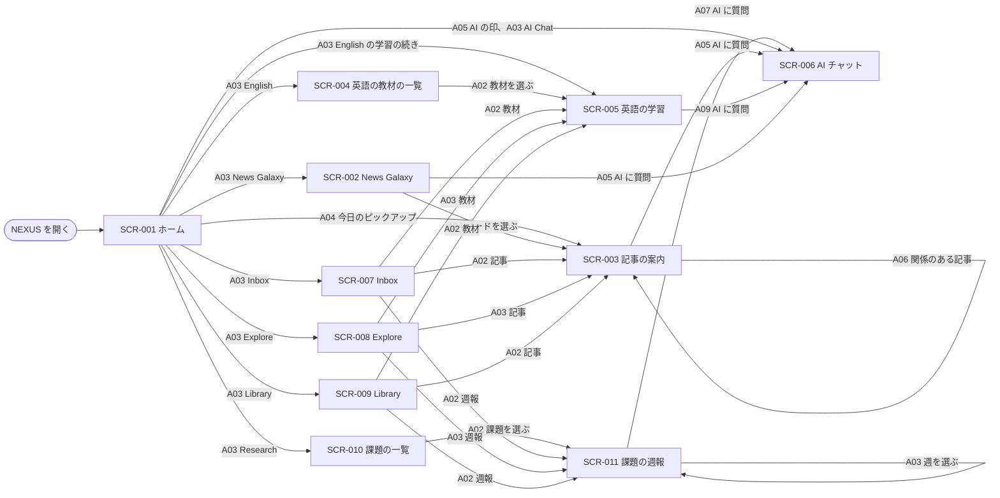

# BD-03 画面設計書（NEXUS）

- 読んだもの: RD-04 1.0、RD-05 1.1、RD-06 1.0、RD-07 1.0、RD-11 1.0、BD-02 0.1、BD-07 0.1、BD-09 0.1、依頼の文（2章、9章、10章 Phase 1、12章）、依頼に同梱の参照（`references/nexus-home-reference.png`、`news-galaxy-reference.png`、`nexus-home-mock-v3-handoff.html`、`news-galaxy-mock.html`）。BD-08 は X-06 で省いた。
- 操作の番号（`SCR-xxx-Ann`）と入力の番号（`SCR-xxx-Inn`）は BD-02 で振ったものを使う。
- レイアウト図は、領域と部品の置き場所を文字の図で示す。見た目は依頼の参照の画像とモックを方向として使い、BD-13 の試作で本人に見せて確かめる（依頼 12章。モックのコードとデータは本番に使わない）。
- 0.2: X-05 RV06 の指摘と、Q-079〜Q-081 の答え、CR-003（2026-11-24 承認）で直した（2026-11-24）。RV07 の指摘も直した。
- 0.3: BD-13 の試作の結果（P01〜P08。2026-11-24 本人）を反映した。
- 1.0: 基本設計の完了判定（X-05 PG02。2026-11-24 RD-01 SH01。条件付きで進める）で承認した。
- 1.1: X-04 CR-018（2026-11-27 RD-01 SH01 が承認）で、SCR-002 に未読の切り替え（I03、A06）を足し、上の帯の「AI に質問」（A05）をやめた。SCR-003 の既読・保存・AI に質問をアイコンのボタンにし、SCR-002 と SCR-003 のレイアウトを `references/news-galaxy-reference.png` に寄せた。4章の「AI に質問」の置き場所を直した。
- 1.2: X-04 CR-019（2026-11-27 RD-01 SH01 が承認）で、SCR-002 のテーマ（I02）を選択欄に戻し、未読（I03）をテーマから離した入と切のスイッチにした。
- 1.3: X-04 CR-020（2026-11-27 RD-01 SH01 が承認）で、SCR-010 課題の一覧と SCR-011 課題の週報を足した。SCR-001 の HUD を7つのセグメントにし、Research のカードに未読の週報の数（O10）を出す。SCR-007〜SCR-009 から週報を開けるようにした（Q-093、Q-094 の答え）。
- 1.4: X-04 Q-095 の答え（2026-11-27 本人。試作 `prototype/shots/q095-*.png` を見て）で、SCR-011 の印の見せ方（行の左の色の帯と、枠と文字の色のタグ）、帯の色の優先順、方法の広げ方（どの幅でもその場で広げる）と、SCR-001 の Research のアイコン（虫眼鏡と折れ線）と Explore との見分け方を決めた。
- 書いた AI: Claude（Opus 5.5）。人の承認の前の案である。

## 1. 画面一覧

| 画面ID | 画面名 | 分類 | 概要 | 利用ロール | 利用頻度・件数 |
|---|---|---|---|---|---|
| SCR-001 | ホーム | メニュー | 本人が、主な機能を選び、新着や学習の続きを見る | 本人 | 1日数回 |
| SCR-002 | News Galaxy | 検索・一覧 | 本人が、選んだ日の記事どうしの関係を図で見る | 本人 | 1日数回。1日10件と X のブックマークと、その関係の先 |
| SCR-003 | 記事の案内 | 詳細 | 本人が、記事の案内を読み、関係をたどる | 本人 | 1日10回ほど |
| SCR-004 | 英語の教材の一覧 | 検索・一覧 | 本人が、届いた英語の教材を選ぶ | 本人 | 1日1回。年に約365件 |
| SCR-005 | 英語の学習 | 登録・編集 | 本人が、教材を読み、問題に答え、採点して完了する | 本人 | 1日1回。1セットに60問まで |
| SCR-006 | AI チャット | ダイアログ | 本人が、選んだ対象について AI に質問する | 本人 | 1日10回 |
| SCR-007 | Inbox | 検索・一覧 | 本人が、届いた新着と未読を見る | 本人 | 1日数回 |
| SCR-008 | Explore | 検索・一覧 | 本人が、言葉で内容を探す | 本人 | 1日数回 |
| SCR-009 | Library | 検索・一覧 | 本人が、保存した内容を見る | 本人 | 1日数回 |
| SCR-010 | 課題の一覧 | 検索・一覧 | 本人が、届いた調査の週報の研究課題を選ぶ（CR-020） | 本人 | 週に数回。課題は同時に1〜3個 |
| SCR-011 | 課題の週報 | 詳細 | 本人が、課題の1週分の週報を読み、方法を開き、過去の週をさかのぼる（CR-020） | 本人 | 週に数回。方法は15件まで |

- ロールは本人1つ（X-06 で BD-08 を省いた）。ロールによる違いは全ての画面で無いので、各画面の 3.1 に「ロールによる違い」の行を書かない。
- 端末の登録（FN-023）は画面を持たない（Q-034 の答え）。登録していない端末で開いたときと、登録の URL が使えないときは、画面の代わりに全面の知らせ（MSG-020、MSG-021）を出す（BD-09 1.1）。

## 2. 画面遷移

### 画面遷移図



### 遷移表

| 遷移元 | アクション | 条件 | 遷移先 |
|---|---|---|---|
| SCR-001 | SCR-001-A03（カードを押す） | 選んでいる機能のカード | 機能の画面（News Galaxy は SCR-002、English は SCR-004、Research は SCR-010、Inbox は SCR-007、Explore は SCR-008、Library は SCR-009、AI Chat は SCR-006） |
| SCR-001 | SCR-001-A03（学習の続きを押す） | 完了していない教材がある | SCR-005（その教材） |
| SCR-001 | SCR-001-A04 | - | SCR-003（その記事） |
| SCR-001 | SCR-001-A05 | - | SCR-006（対象なし） |
| SCR-002 | SCR-002-A04 | - | SCR-003（下から出る面。SCR-002 は後ろに残す） |
| SCR-003、SCR-005 | SCR-003-A05、SCR-005-A09 | - | SCR-006（下から出る面。元の画面は後ろに残す。SCR-002 からは SCR-003 を通って開く。CR-018） |
| SCR-003 | SCR-003-A06 | - | SCR-003（関係のある記事。SCR-002 から開いていれば、図の中心もその記事に移す） |
| SCR-003 | SCR-003-A07 | - | 端末のブラウザで元の記事を開く（NEXUS の画面は変わらない） |
| SCR-004 | SCR-004-A02 | - | SCR-005 |
| SCR-007、SCR-008、SCR-009 | SCR-007-A02、SCR-008-A03、SCR-009-A02 | 内容の種類がニュース | SCR-003（全画面） |
| SCR-007、SCR-008、SCR-009 | SCR-007-A02、SCR-008-A03、SCR-009-A02 | 内容の種類が英語 | SCR-005 |
| SCR-007、SCR-008、SCR-009 | SCR-007-A02、SCR-008-A03、SCR-009-A02 | 内容の種類が週報 | SCR-011（その週。CR-020） |
| SCR-010 | SCR-010-A02 | - | SCR-011（その課題の最新の週） |
| SCR-011 | SCR-011-A03 | - | SCR-011（選んだ週） |
| SCR-011 | SCR-011-A07 | - | SCR-006（下から出る面。対象はその週の週報の全体） |
| SCR-011 | SCR-011-A08 | - | 端末のブラウザで出典を開く（NEXUS の画面は変わらない） |
| 全ての画面 | 上の帯の「ホーム」 | - | SCR-001 |

### 戻る操作の扱い

- ブラウザ（PWA）の戻る操作は、1つ前の画面に戻る。下から出る面（SCR-003、SCR-006）が開いているときは、面を閉じる。
- 再読み込み: 今の画面を開き直す。SCR-005 で答えている途中の答えと採点は消える（BD-02 FN-010。今の cerebellum と同じ）。SCR-006 で送っていない質問の文は消える。応答が作成中なら、開き直した後も続きから受ける（X-02 ADR-013）。
- URL の直接入力: 内容ID を含む URL（SCR-003、SCR-005、SCR-011）は、その内容を開く。内容が無ければ MSG-002 か MSG-019 を出す。
- 「完了」「送る」を押した直後に戻っても、二重に残さない（各画面の 3.4 二重実行の防止）。

## 3. 画面ごとの定義

### SCR-001 ホーム

#### 3.1 画面概要

- 目的: 本人が、主な機能を選び、新着の数、学習の続き、AI の応答の状況、今日のピックアップを見る（RD-03 R21）。
- 表示の条件: NEXUS を開いたとき。どの画面からも上の帯の「ホーム」で戻れる。

#### 3.2 レイアウト

```text
┌──────────────────────────────────────────────┐
│ [ロゴ] NEXUS  日付              （右上に惑星の飾り）│
│  ┌────────────────┐       ┌ 前の機能のカード（薄く）┐│
│  │   円形 HUD      │──線──┌──────────────────┐ │
│  │ 7つのセグメント  │      │ 選んだ機能のカード O03 │ │
│  │ （指で回す）     │      │ ・機能名と件数       │ │
│  │  中心: AI の印   │      │ ・ピックアップの写真  │ │
│  │  O02            │      │ ・O09 未着・失敗     │ │
│  │ 右の真ん中=選択中 │      └──────────────────┘ │
│  └────────────────┘       └ 次の機能のカード（薄く）┘│
│ ┌ O05 未読 │ O04 新着 │ O06 学習の続き │ O07 AI の応答中 ┐│
│ [ ✦ AI に質問 ]（A05 と同じ）                        │
│ 今日のピックアップ O08（写真、テーマのタグ、見出し）   │
└──────────────────────────────────────────────┘
```

- 見た目の方向: `references/nexus-home-reference.png` と `nexus-home-mock-v3-handoff.html`（依頼 2章 共通トーン）。BD-13 の試作（`prototype/app/page.tsx`）で本人が確かめた作り（2026-11-24）を正とする。モックの件数と記事は作り物で、本番では使わない。要件に無い部品（宣伝文、検索と設定のボタン、学習連続、ワークスペース、下の帯）は置かない（2026-11-24 本人）。右上の惑星の飾りは本人の希望で置く（機能は持たない）。画像（中心の球、惑星、記事の写真が無いときの代わりの絵など）は Codex（gpt-image）に作らせる（2026-11-24 本人）。
- Research のアイコン（CR-020。Q-095 の答え）: 虫眼鏡と、その中の折れ線（`prototype/app/page.tsx` の `researchB`）。Explore の方位の印（円と針と4方向の目盛り）と紛れないよう、次の3つで見分ける。(1) 形: Research は円の右下に斜めの持ち手が出て、円の中に右上がりの折れ線がある。Explore は持ち手が無く、円の外に上下左右の目盛りがあり、中は菱形の針。(2) 色: Research は緑、Explore は紫（値はデザインシステムで決める）。(3) 名前: セグメントとカードには、アイコンの下か横に必ず機能名（Research、Explore）を出す。
- 画面幅による違い（BD-13 P02 で確かめた）: HUD は画面の幅の約3分の2にする。幅 480 ピクセル以下では、前のカードは「アイコン、見出し、件数」を縦に並べ、隣のカードは前のカードのすぐ上と下に詰める。スマートフォン（360〜430 ピクセル）でも、左に HUD、右にカードを横に並べる。HUD とカードが重なってもよいが、カードの文字と押す場所は HUD に隠れない（依頼 2章、NFR-008）。iPad では HUD とカードを大きくし、カードに出す件数を増やす（ピックアップの案内の1行目を足すなど。BD-13 で決める）。縦と横の向きを変えても同じ並び（NFR-007）。

#### 3.3 入出力項目一覧

| 項目ID | ラベル | 部品の種類 | 入出力区分 | データ項目 | 型・桁 | 必須 | 入力チェック | 初期値 | 表示書式 |
|---|---|---|---|---|---|---|---|---|---|
| SCR-001-O01 | （HUD のセグメント） | 選択 | 入力 | 画面のみ（7つの機能。Research は CR-020。7分割は Q-095 の答えで試作のまま） | - | - | - | News Galaxy を選んだ状態 | 機能名（依頼 2章の英語の名前。BD-09 4章） |
| SCR-001-O02 | （中心の AI の印） | ボタン | 入力 | 画面のみ | - | - | - | - | ロゴの印 |
| SCR-001-O03 | 機能カード | 表示のみ | 出力 | 画面のみ | - | - | - | 選んだ機能のカード | - |
| SCR-001-O04 | 新着 | 表示のみ | 出力 | ENT-006 開いた日時から数える（BD-02 FN-020） | 整数 | - | - | 0 | 件数（BD-09 5章） |
| SCR-001-O05 | 未読 | 表示のみ | 出力 | ENT-006 既読から数える | 整数 | - | - | 0 | 件数 |
| SCR-001-O06 | 学習の続き | 表示のみ | 出力 | ENT-001 見出し（一番新しい英語の教材）と ENT-005 の有無 | 文字 | - | - | 空 | 学習テーマ。完了していれば「完了」 |
| SCR-001-O07 | AI の状況 | 表示のみ | 出力 | ENT-008 応答の状態の数（作成中）と失敗の有無 | 整数 | - | - | 0 | 「応答中 {件数}」 |
| SCR-001-O08 | 今日のピックアップ | 表示のみ | 出力 | ENT-001 見出し、ENT-002 テーマ・画像の URL（3件） | 文字 | - | - | 空 | 見出しとテーマ |
| SCR-001-O09 | 知らせ | 表示のみ | 出力 | 画面のみ（MSG-015〜MSG-017） | 文字 | - | - | 出さない | BD-09 2章「ホームのカード」 |
| SCR-001-O10 | 未読の週報 | 表示のみ | 出力 | ENT-006 既読から数える（種類が週報の内容。BD-02 FN-020） | 整数 | - | - | 0 | Research のカードに「未読 {件数}」。週報の未着は出さない（Q-093 の答え。CR-020） |

- 入力の欄は無い（O01 と O02 は選ぶだけ）。入力の番号（`Inn`）は振らない。

#### 3.4 アクション明細

| アクションID | きっかけ | 実行できる条件 | 処理の概要 | 呼ぶ機能 | 正常時の結果 | 異常時の結果 | 確認の要否 | 二重実行の防止 |
|---|---|---|---|---|---|---|---|---|
| SCR-001-A01 | 画面を開いたとき | いつでも | ホームに出す値を読む | FN-020 | 値を出す。0件のものは0か空（RD-03 R21）。未着と失敗は O09 に出す | 読めなければ数の場所に MSG-019。HUD とカードは出す | 不要（データを変えない） | 該当なし |
| SCR-001-A02 | HUD を指で回す。セグメントを押す | いつでも | 指で回すと HUD が回り、離すといちばん近い機能が右の真ん中に合う。セグメントを押すと、その機能が右の真ん中に来るまで回る。右の真ん中の機能を光らせ、そのカードを前に出し、ほかを上下に奥へ薄く置く（BD-13 P01。2026-11-24 本人） | なし（画面の中だけ） | カードが入れ替わる | 該当なし | 不要 | 該当なし |
| SCR-001-A03 | 前面のカードを押す。学習の続きを押す | カードが前面にある | 選んだ機能の画面へ移る。セグメントの光 → カードの移動 → 広がって移る、の順に動かす（RD-07 3章） | なし（移った先の画面が呼ぶ） | 遷移表のとおり移る | 該当なし | 不要 | 移る動きの間は、もう一度押しても受けない |
| SCR-001-A04 | 今日のピックアップの記事を押す | ピックアップがある | その記事の案内を開く | FN-004 | SCR-003 | FN-004 の異常（MSG-002） | 不要 | 同上 |
| SCR-001-A05 | 中心の AI の印を押す | いつでも | 対象の無い AI チャットを開く（依頼 2章） | FN-014 | SCR-006 | FN-014 の異常 | 不要 | 同上 |

- ホームの「選ぶ」（A02。回す）と「移る」（A03。カードを押す）は別の操作にする（BD-13 P01 で本人が決めた。2026-11-24）。

#### 3.5 画面の状態ごとの表示

| 状態 | 表示 |
|---|---|
| 読み込み中 | HUD とカードはすぐに出し、数の場所を空けて待つ印を出す。HUD とカードは操作できる |
| 0件 | 数は0、学習の続きとピックアップは空の状態（RD-03 R21） |
| 取得の失敗 | 数の場所に MSG-019。NEXUS につながらないときは上の帯に MSG-018 |
| 権限が無い | 登録していない端末は MSG-020 の全面の知らせ（BD-09） |

### SCR-002 News Galaxy

#### 3.1 画面概要

- 目的: 本人が、選んだ日の記事と、関係のある記事を図で見て、記事を選ぶ（RD-03 R02〜R04）。
- 表示の条件: ホームの News Galaxy のカードから開く。

#### 3.2 レイアウト

```text
┌───────────────────────────────────────┐
│ [ロゴ] News Galaxy                     │ ← 上の帯
│        I01 日付 ▼                      │
│ [I02 テーマ: すべて ▼]  [I03 未読だけ ○ 3] │
│        ●──────●                        │
│   ●          (中心の記事)───●          │
│        ●        ╲                      │
│                  ● (7日前までの記事)    │
│   ●（線の無い記事）                     │
├───────────────────────────────────────┤
│ ▔▔ 下から出る面: SCR-003 記事の案内 ▔▔ │
└───────────────────────────────────────┘
```

- 見た目の方向: `references/news-galaxy-reference.png` と `news-galaxy-mock.html`。暗い星座の図、画像付きのノード、細い光る線（依頼 2章）。
- 上の帯の題名「News Galaxy」は文字のまま出し、「Galaxy」をアンバーにする。日付は題名の下に置く。テーマ（I02）は、暗い土台とアンバーの色の選択欄にする（テーマの名前は長く、数も増えるため。CR-019）。未読（I03）は、テーマの選択欄から離して置く入と切のスイッチにし、選んだ日の未読の数を添える。テーマとは別の切り替えで、テーマの選択と重ねて使うことが見てわかる形にする（CR-019）。
- 上の帯には「AI に質問」を置かない。記事を選ぶと出る記事の案内（SCR-003）の「AI に質問」から開く（CR-018）。
- 作り物の中心（「今日のニュース」）は置かない。初めて開いたときは中心を決めずにその日の記事を並べ、本人が選んだ記事を中心に移す（RD-03 R04）。
- 線には関係の種類の名前を、選んだ記事の線にだけ出す（全ての線に出すと文字が重なるため）。
- 図の部品は React Flow で作る（BD-13 P03 で本人が決めた。X-02 ADR-015）。ノードには記事の画像を出す。
- 画面幅による違い: スマートフォンでは図を画面いっぱいにし、指で動かして見る。iPad では図を広く出し、下から出る面を画面の下半分までにする。

#### 3.3 入出力項目一覧

| 項目ID | ラベル | 部品の種類 | 入出力区分 | データ項目 | 型・桁 | 必須 | 入力チェック | 初期値 | 表示書式 |
|---|---|---|---|---|---|---|---|---|---|
| SCR-002-I01 | 日付 | 日付 | 入力 | ENT-001 対象日 | 日付 | 必須 | 今日より後の日付は選べない | 今日（日本時間） | BD-09 5章の日付 |
| SCR-002-I02 | テーマ | 選択 | 入力 | ENT-002 テーマ | 文字 | 任意 | 選択肢は、その日の記事のテーマ | すべて | テーマの名前 |
| SCR-002-I03 | 未読だけ | スイッチ | 入力 | ENT-006 既読 | 真偽 | 任意 | - | 切 | 「未読だけ」と、選んだ日の記事のうち未読の数。入と切がわかる形にする（CR-018、CR-019） |
| SCR-002-O01 | 記事のノード | 表示のみ | 出力 | ENT-001 見出し、ENT-002 画像の URL・テーマ、ENT-006 既読 | - | - | - | その日の記事 | 画像（無ければ代わりの印）と見出し。既読は薄く |
| SCR-002-O02 | 関係の線 | 表示のみ | 出力 | ENT-004 関係の元・関係の先・関係の種類 | - | - | - | - | 細い線。選んだ記事の線に関係の種類の名前 |

#### 3.4 アクション明細

| アクションID | きっかけ | 実行できる条件 | 処理の概要 | 呼ぶ機能 | 正常時の結果 | 異常時の結果 | 確認の要否 | 二重実行の防止 |
|---|---|---|---|---|---|---|---|---|
| SCR-002-A01 | 画面を開いたとき | いつでも | 今日の記事と関係を読む | FN-003 | 図を出す | 記事が無ければ MSG-001、読めなければ MSG-019 | 不要 | 該当なし |
| SCR-002-A02 | 日付を選ぶ | いつでも | 選んだ日の記事と関係を読む | FN-003 | 図をその日の記事で描き直す | 同上 | 不要 | 前の読み込みを止め、最後に選んだ日だけを出す |
| SCR-002-A03 | テーマを選ぶ | 記事がある | そのテーマの記事だけを出す | FN-003 | 図を絞る | 同上 | 不要 | 同上 |
| SCR-002-A04 | 記事のノードを押す | いつでも | その記事を中心に移し、関係の先の過去の記事を読み込み、案内を下から出す | FN-003、FN-004 | 中心が移り、SCR-003 が下から出る | 記事が無ければ MSG-002 | 不要 | 動いている間の押しは最後の1回だけを受ける |
| SCR-002-A05 | （CR-018 でやめた。News Galaxy では SCR-003-A05 から AI チャットを開く） | - | - | - | - | - | - | - |
| SCR-002-A06 | 「未読だけ」を押す | 記事がある | 切なら未読の記事だけを出し、入なら全ての記事に戻す。テーマ（A03）の絞り込みと重ねる。サーバは呼ばない（CR-018） | FN-003 | 図を絞るか戻す | 該当なし | 不要 | 該当なし |

#### 3.5 画面の状態ごとの表示

| 状態 | 表示 |
|---|---|
| 読み込み中 | 図の場所に待つ印を出す。日付とテーマは選べる |
| 0件 | MSG-001。日付は選べる |
| 取得の失敗 | MSG-019。もう一度開くか、日付を選び直す |
| 権限が無い | MSG-020（BD-09） |

### SCR-003 記事の案内

#### 3.1 画面概要

- 目的: 本人が、記事の案内を読み、既読にし、保存し、関係のある記事へたどり、元の記事を開く。
- 表示の条件: SCR-002 から下から出る面として開く。SCR-001、SCR-007〜SCR-009 からは全画面で開く。

#### 3.2 レイアウト

```text
┌───────────────────────────────────────┐
│ ▔▔（引き上げると全画面に広がる）▔▔      │
│ [O01 画像] O02 テーマ ・ O03 届いた日時 │
│            O04 見出し                  │
│  [本の印 A02/A03] [ブックマークの印 A04] [吹き出しの印 A05] │
│ O05 案内（10行以内）                   │
│ [元の記事を開く A07]                   │
│ 関係のある記事 O06                      │
│  ・続報: 見出し（根拠）  A06            │
│  ・背景: 見出し（根拠）  A06            │
└───────────────────────────────────────┘
```

- 画面幅による違い: スマートフォンでは下から出る面を、初めは画面の下半分にし、引き上げると全画面にする（依頼 2章）。iPad では下半分のままでも案内を全て読める大きさにする。
- 見た目の方向: `references/news-galaxy-reference.png` の下の面。暗い面に、画像を左、テーマと届いた日時と見出しを右に置く。関係のある記事は小さい画像付きの行にする（CR-018）。
- 「読んだ」「未読に戻す」（本）、「保存」「保存を外す」（ブックマーク）、「AI に質問」（吹き出し）は、アイコンのボタンにする。ボタンの名前は BD-09 4章の操作の言葉にする（CR-018）。

#### 3.3 入出力項目一覧

| 項目ID | ラベル | 部品の種類 | 入出力区分 | データ項目 | 型・桁 | 必須 | 入力チェック | 初期値 | 表示書式 |
|---|---|---|---|---|---|---|---|---|---|
| SCR-003-O01 | 画像 | 表示のみ | 出力 | ENT-002 画像の URL | URL | - | - | - | 端末が記事のサイトから直に読む（RD-12 T12）。無ければ表示しない |
| SCR-003-O02 | テーマ | 表示のみ | 出力 | ENT-002 テーマ | 文字 | - | - | - | そのまま |
| SCR-003-O03 | 届いた日時 | 表示のみ | 出力 | ENT-001 届いた日時 | 日時 | - | - | - | BD-09 5章の日付と時刻 |
| SCR-003-O04 | 見出し | 表示のみ | 出力 | ENT-001 見出し | 文字 | - | - | - | そのまま |
| SCR-003-O05 | 案内 | 表示のみ | 出力 | ENT-002 案内 | Markdown の文 | - | - | - | BD-09 6章「届いた文の表示」 |
| SCR-003-O06 | 関係のある記事 | 表示のみ | 出力 | ENT-004 関係の種類・関係の根拠、ENT-001 見出し | - | - | - | - | 関係の種類の名前、見出し、根拠（AI の判定として見せる。RD-03 R03） |
| SCR-003-O07 | 既読・保存の状態 | 表示のみ | 出力 | ENT-006 既読・保存 | 真偽 | - | - | - | アイコンを塗って見せる（既読は本、保存はブックマーク）。ボタンの名前は BD-09 4章の言葉（CR-018） |

#### 3.4 アクション明細

| アクションID | きっかけ | 実行できる条件 | 処理の概要 | 呼ぶ機能 | 正常時の結果 | 異常時の結果 | 確認の要否 | 二重実行の防止 |
|---|---|---|---|---|---|---|---|---|
| SCR-003-A01 | 画面を開いたとき | いつでも | 記事と関係を読み、初めてなら開いた日時を残す | FN-004 | 案内を出す | MSG-002、MSG-019 | 不要 | 該当なし |
| SCR-003-A02 | 「読んだ」を押す | 未読のとき。既読のときは「未読に戻す」に替わる | 既読にする | FN-005 | ボタンの名前が「未読に戻す」に替わり、本のアイコンを塗る | MSG-003。状態は変わらない | 不要（未読に戻せる。RD-07 3章） | 結果が出るまで押せなくする |
| SCR-003-A03 | 「未読に戻す」を押す | 既読のとき | 未読にする | FN-005 | ボタンの名前が「読んだ」に替わり、本のアイコンを塗らない | MSG-003 | 不要 | 同上 |
| SCR-003-A04 | 「保存」か「保存を外す」を押す | いつでも | 保存の状態を入れ替える | FN-006 | ボタンの名前が替わり、ブックマークのアイコンの塗りが替わる | MSG-003 | 不要（外せる。RD-07 3章） | 同上 |
| SCR-003-A05 | 「AI に質問」を押す | いつでも | この記事を対象に AI チャットを開く | FN-014 | SCR-006 が下から出る | FN-014 の異常 | 不要 | 該当なし |
| SCR-003-A06 | 関係のある記事を押す | 関係のある記事がある | その記事の案内を開く | FN-004 | その記事の SCR-003 | MSG-002 | 不要 | 該当なし |
| SCR-003-A07 | 「元の記事を開く」を押す | 元の記事の URL がある | 端末のブラウザで開く | なし（NEXUS は何もしない。RD-06 UC-003） | 端末のブラウザが開く | 該当なし | 不要 | 該当なし |

#### 3.5 画面の状態ごとの表示

| 状態 | 表示 |
|---|---|
| 読み込み中 | 面の中に待つ印。ボタンは押せない |
| 0件 | 関係のある記事が無いときは、その欄を出さない |
| 取得の失敗 | MSG-019 |
| 権限が無い | MSG-020 |

### SCR-004 英語の教材の一覧

#### 3.1 画面概要

- 目的: 本人が、届いた英語の教材を選ぶ（RD-01 課題1）。
- 表示の条件: ホームの English のカードから開く。

#### 3.2 レイアウト

```text
┌───────────────────────────────────────┐
│ [ホーム] English                       │
│ ┌─────────────────────────────────┐   │
│ │ O01 11月24日（火） O02 学習テーマ │   │
│ │ O03 完了 / 新着                  │   │
│ └─────────────────────────────────┘   │
│ （新しい順。下までスクロールで続き A03） │
└───────────────────────────────────────┘
```

- 画面幅による違い: iPad では行を2列に並べてもよい（BD-13 で決める）。

#### 3.3 入出力項目一覧

| 項目ID | ラベル | 部品の種類 | 入出力区分 | データ項目 | 型・桁 | 必須 | 入力チェック | 初期値 | 表示書式 |
|---|---|---|---|---|---|---|---|---|---|
| SCR-004-O01 | 日付 | 表示のみ | 出力 | ENT-001 対象日 | 日付 | - | - | - | BD-09 5章の日付 |
| SCR-004-O02 | 学習テーマ | 表示のみ | 出力 | ENT-003 学習テーマ | 文字 | - | - | - | そのまま |
| SCR-004-O03 | 完了・新着 | 表示のみ | 出力 | ENT-005 の有無、ENT-006 開いた日時 | - | - | - | - | 「完了」と「新着」のタグ（BD-13 P06） |

#### 3.4 アクション明細

| アクションID | きっかけ | 実行できる条件 | 処理の概要 | 呼ぶ機能 | 正常時の結果 | 異常時の結果 | 確認の要否 | 二重実行の防止 |
|---|---|---|---|---|---|---|---|---|
| SCR-004-A01 | 画面を開いたとき | いつでも | 教材を新しい順に読む | FN-008 | 一覧を出す | MSG-004、MSG-019 | 不要 | 該当なし |
| SCR-004-A02 | 教材を押す | いつでも | その教材を開く | FN-009 | SCR-005 | MSG-019 | 不要 | 該当なし |
| SCR-004-A03 | 下までスクロールする | 続きがある | 続きを読む | FN-008 | 一覧に足す | 足せなければ一覧の下に MSG-019 | 不要 | 読み込み中はもう一度読まない |

#### 3.5 画面の状態ごとの表示

| 状態 | 表示 |
|---|---|
| 読み込み中 | 一覧の場所に待つ印 |
| 0件 | MSG-004 |
| 取得の失敗 | MSG-019 |
| 権限が無い | MSG-020 |

### SCR-005 英語の学習

#### 3.1 画面概要

- 目的: 本人が、教材の本文と読む教材を読み、問題に答え、採点を確かめて完了する（RD-03 R07〜R12）。
- 表示の条件: SCR-004、SCR-007〜SCR-009 で教材を選んだとき。ホームの学習の続きから。

#### 3.2 レイアウト

```text
┌───────────────────────────────────────┐
│ [ホーム] O01 学習テーマ           [AI] │
│ [① 教材] ─ [② 問題] ─ [③ 採点]   O02  │ ← 今の段
│ ① 教材の段                             │
│   O03 教材の本文                       │
│   O04 読む教材（語句は色付き。A02）     │
│      └ 語句の説明 O05                  │
│   [問題へ A03]                         │
│ ② 問題の段: 問題を1問ずつ。I01 答え    │
│   [採点へ A05] [教材へ戻る A10]         │
│ ③ 採点の段: O06 正解と解説、○△× A06   │
│   O07 締めの一言                       │
│   [完了 A07] [問題へ戻る A10]          │
│ [保存 A08] [未読に戻す A12] [やり直す A11] │
└───────────────────────────────────────┘
```

- 画面幅による違い: スマートフォンでは段を1つずつ見せる。iPad では教材の本文と読む教材を広く出し、語句の説明を横に出してもよい（BD-13 で決める）。

#### 3.3 入出力項目一覧

| 項目ID | ラベル | 部品の種類 | 入出力区分 | データ項目 | 型・桁 | 必須 | 入力チェック | 初期値 | 表示書式 |
|---|---|---|---|---|---|---|---|---|---|
| SCR-005-I01 | 答え | 問題の答えの形による。選ぶは選択、数は数値、文はテキスト。答えの形の無い問題と手元で解く問題は欄を出さない | 入力 | ENT-005 答えの一覧の答え | 文字、500文字まで（BD-07 4.1） | 任意（未回答は ×。RD-03 R08） | 500文字を超えたら入れられない | 前に完了していれば、その答え。無ければ空 | - |
| SCR-005-O01 | 学習テーマ | 表示のみ | 出力 | ENT-003 学習テーマ | 文字 | - | - | - | そのまま |
| SCR-005-O02 | 今の段 | 表示のみ | 出力 | 画面のみ | - | - | - | 教材の段 | 3つの段の印 |
| SCR-005-O03 | 教材の本文 | 表示のみ | 出力 | ENT-003 教材の本文 | Markdown の文 | - | - | - | BD-09 6章「届いた文の表示」（表を含む。BD-13 P06）。読む教材が届いているときは「## 読む」の節を出さない（BD-02 FN-009） |
| SCR-005-O04 | 読む教材 | 表示のみ | 出力 | ENT-003 読む教材 | 構造 | - | - | - | 題、場面、段落の英文。注のある語句を種類（今日の規則、単語、熟語、文法）ごとに色分けし、凡例と「印を隠す」を置く。文の注の無い所を押すと、その文の和訳を下に出す。注を押すと、その注の種類と説明を出す（BD-13 P07。今の sharpen の read.html と同じ見せ方）。無ければ出さない |
| SCR-005-O05 | 語句の説明 | 表示のみ | 出力 | ENT-003 読む教材の注の説明 | 文字 | - | - | - | 語句の近くに重ねて出す |
| SCR-005-O06 | 正解と解説、○△× | 入出力 | 入出力 | ENT-003 問題の一覧の解答、ENT-005 採点 | コード | 全ての問題に必須（RD-03 R09） | 付いていない問題があれば完了で MSG-005 | 自動の採点（BD-02 FN-011） | ○、△、× の記号 |
| SCR-005-O07 | 締めの一言 | 表示のみ | 出力 | ENT-003 締めの一言 | Markdown の文 | - | - | - | 採点の段の終わり。無ければ出さない |

#### 3.4 アクション明細

| アクションID | きっかけ | 実行できる条件 | 処理の概要 | 呼ぶ機能 | 正常時の結果 | 異常時の結果 | 確認の要否 | 二重実行の防止 |
|---|---|---|---|---|---|---|---|---|
| SCR-005-A01 | 画面を開いたとき | いつでも | 教材を読み、初めてなら開いた日時を残す | FN-009 | 教材の段を出す。完了したことがあれば前の答えと採点を出す | MSG-019 | 不要 | 該当なし |
| SCR-005-A02 | 読む教材の語句を押す | 注のある語句 | 語句の説明を出す。AI は呼ばない | FN-009（画面の中だけで、サーバを呼ばない） | O05 を出す | 該当なし | 不要 | 該当なし |
| SCR-005-A03 | 「問題へ」を押す | 教材の段 | 問題の段へ進む | FN-010（画面の中だけで、サーバを呼ばない） | 問題を1問ずつ出す | 該当なし | 不要 | 該当なし |
| SCR-005-A04 | 答えを入れる | 問題の段 | 答えを画面の中に預かる | FN-010（画面の中だけで、サーバを呼ばない） | 入れた答えを出す | 該当なし | 不要 | 該当なし |
| SCR-005-A05 | 「採点へ」を押す | 問題の段。未回答があっても進める（RD-06 UC-008） | 自動で採点し、採点の段へ進む | FN-011（画面の中だけで、サーバを呼ばない） | 正解と解説と ○△× を出す | 該当なし | 不要 | 該当なし |
| SCR-005-A06 | ○△× を押す | 採点の段 | その問題の ○△× を直す | FN-011（画面の中だけで、サーバを呼ばない） | ○△× が替わる | 該当なし | 不要 | 該当なし |
| SCR-005-A07 | 「完了」を押す | 採点の段で、全ての問題に ○△× がある。無いときも押せ、MSG-005 を出す | 答えと採点を残し、既読にする | FN-012 | 完了したことを出す | MSG-005、MSG-007（答えは画面に残す） | 完了したことのある教材なら MSG-006 で確かめる（Q-044 の答え） | 結果が出るまで押せなくする |
| SCR-005-A08 | 「保存」か「保存を外す」を押す | いつでも | 保存の状態を入れ替える | FN-006 | ボタンの言葉が替わる | MSG-003 | 不要 | 結果が出るまで押せなくする |
| SCR-005-A09 | 「AI に質問」を押す | いつでも。語句か文を選んでいれば、それを対象にする | 選んだ語句と文（無ければページ全体）を対象に AI チャットを開く | FN-014 | SCR-006 が下から出る | FN-014 の異常 | 不要 | 該当なし |
| SCR-005-A10 | 「教材へ戻る」「問題へ戻る」を押す | 問題の段か採点の段 | 通った段に戻る。答えは預けたまま（RD-03 R07） | なし（画面の中だけ） | 前の段を出す | 該当なし | 不要 | 該当なし |
| SCR-005-A11 | 「やり直す」を押す | 完了したことのある教材 | 前の答えを初めの値にして問題の段から始め直す（今の cerebellum の作り） | なし（画面の中だけ。残すのは A07） | 問題の段を出す | 該当なし | 不要（置き換えは A07 で確かめる） | 該当なし |
| SCR-005-A12 | 「未読に戻す」を押す | 既読のとき | 未読にする | FN-005 | ボタンが消える（教材は完了で既読になるため、「読んだ」は出さない。BD-09 4章） | MSG-003 | 不要 | 結果が出るまで押せなくする |

- 先の段へ飛ぶ操作は置かない（RD-03 R07）。

#### 3.5 画面の状態ごとの表示

| 状態 | 表示 |
|---|---|
| 読み込み中 | 段の場所に待つ印。段の操作はできない |
| 0件 | 該当なし（教材が1つの画面）。読む教材が無い日は、教材の本文だけを出す（RD-06 UC-007） |
| 取得の失敗 | MSG-019。完了を残せないときは MSG-007 で、答えを画面に残す |
| 権限が無い | MSG-020 |

### SCR-006 AI チャット

#### 3.1 画面概要

- 目的: 本人が、選んだ対象について AI に質問し、前の会話の続きから話す（RD-03 R13〜R17、R22）。
- 表示の条件: 内容を開いている画面（記事を選んだ SCR-002、SCR-003、SCR-005）と、ホーム（中心の AI の印と AI Chat のカード。対象なし）から開ける。一覧の画面（SCR-004、SCR-007〜SCR-009）と、記事を選んでいない SCR-002 には入口を置かない（2026-11-24 本人。CR-003 で承認）。

#### 3.2 レイアウト

```text
┌───────────────────────────────────────┐
│ ▔▔（引き上げると全画面）▔▔        [閉じる] │
│ O01 対象: 記事「…」 / 語句「am」         │
│ O02 前の会話 ▼ [新しい会話 A03]         │
│ ─────────────────────────────────     │
│ 本人: …                                │
│ AI: …（少しずつ出る）O03 応答の状態      │
│   [送り直す A05] [やめる A07] / [止める A06] │
│ ─────────────────────────────────     │
│ [I01 質問を書く欄            ] [送る A04] │
└───────────────────────────────────────┘
```

- 画面幅による違い: スマートフォンでも iPad でも、下から出る面にし、引き上げると全画面にする（依頼 2章。iPad も下から出る面にすることは BD-13 P04 で本人が決めた）。

#### 3.3 入出力項目一覧

| 項目ID | ラベル | 部品の種類 | 入出力区分 | データ項目 | 型・桁 | 必須 | 入力チェック | 初期値 | 表示書式 |
|---|---|---|---|---|---|---|---|---|---|
| SCR-006-I01 | 質問 | テキスト（複数行） | 入力 | ENT-008 本文（本人の発言） | Markdown の文。上限の文字数は BD-10 4章（Q-079 の答え） | 必須 | 空のときは「送る」を押せなくする。上限を超えたら入れられない | 空 | - |
| SCR-006-O01 | 対象 | 表示のみ | 出力 | ENT-007 対象の内容・対象の箇所 | - | - | - | 開いた画面と選んだ箇所 | 対象の種類と、見出しか語句（BD-09 6章「質問の対象の印」） |
| SCR-006-O02 | 前の会話 | 選択 | 入出力 | ENT-007（同じ内容の会話） | - | - | - | 一番新しい会話。無ければ新しい会話 | 最初の質問の書き出しと、最後に話した日時 |
| SCR-006-O03 | 応答の状態 | 表示のみ | 出力 | ENT-008 応答の状態 | コード | - | - | - | 作成中は処理中の印。失敗と中止は MSG-012〜MSG-014 |
| SCR-006-O04 | 発言 | 表示のみ | 出力 | ENT-008 話し手・本文・送った日時 | Markdown の文 | - | - | - | BD-09 6章「届いた文の表示」 |

#### 3.4 アクション明細

| アクションID | きっかけ | 実行できる条件 | 処理の概要 | 呼ぶ機能 | 正常時の結果 | 異常時の結果 | 確認の要否 | 二重実行の防止 |
|---|---|---|---|---|---|---|---|---|
| SCR-006-A01 | 画面を開いたとき | いつでも | 対象と前の会話を読む | FN-014 | 一番新しい会話の発言を出す。無ければ新しい会話にする | MSG-011（対象が無い）、MSG-019 | 不要 | 該当なし |
| SCR-006-A02 | 前の会話を選ぶ | 前の会話がある | その会話の発言を読む | FN-014 | 発言を出す | MSG-019 | 不要 | 該当なし |
| SCR-006-A03 | 「新しい会話」を押す | いつでも | 今の対象で会話を作る | FN-014 | 空の会話を出す | MSG-019 | 不要 | 結果が出るまで押せなくする |
| SCR-006-A04 | 「送る」を押す | 質問が空でなく、同じ会話に作成中の応答が無い（BD-02 FN-015） | 質問を残し、AI に質問する | FN-015 | 1秒以内に処理中の印を出し、応答を少しずつ出す（NFR-002）。終わったら完了 | MSG-012、MSG-013、MSG-019（質問の文は欄に残す） | 不要 | 押してから質問を受け付けたと返るまで押せなくする。同じ会話の応答が作成中のあいだも押せない（BD-02 FN-015） |
| SCR-006-A05 | 「送り直す」を押す | 応答の状態が失敗か中止 | 同じ質問で応答を作り直す | FN-016 | 作成中に戻り、応答を少しずつ出す | FN-015 と同じ | 不要 | 結果が出るまで押せなくする |
| SCR-006-A06 | 「止める」を押す | 応答の状態が作成中 | 応答を作るのを止める | FN-016 | MSG-014。それまでの本文は残す | 止める前に終わったら完了を出す | 不要 | 同上 |
| SCR-006-A07 | 「やめる」を押す | 応答の状態が失敗 | 送り直さないことにする | FN-016 | 応答を中止にする。ホームの失敗の知らせは24時間たつまで出る（Q-078 の答え） | MSG-019 | 不要 | 同上 |

#### 3.5 画面の状態ごとの表示

| 状態 | 表示 |
|---|---|
| 読み込み中 | 発言の場所に待つ印。質問の欄は書ける |
| 0件 | 新しい会話の空の状態。対象を O01 に出す |
| 取得の失敗 | MSG-019。応答の途中でつながりが切れたときは、つながり直して続きを受ける（X-02 ADR-013）。つながらなければ上の帯に MSG-018 |
| 権限が無い | MSG-020 |

### SCR-007 Inbox

#### 3.1 画面概要

- 目的: 本人が、届いた新着と未読を、種類をまたいで見る（RD-03 R18）。
- 表示の条件: ホームの Inbox のカードから開く。

#### 3.2 レイアウト

```text
┌───────────────────────────────────────┐
│ [ホーム] Inbox                         │
│ O01 種類の印 O02 見出し  O03 届いた日時 O04 新着 │
│ …（届いた日時の新しい順。下までで続き A03） │
└───────────────────────────────────────┘
```

- 画面幅による違い: 無い（行の幅が広がるだけ）。

#### 3.3 入出力項目一覧

| 項目ID | ラベル | 部品の種類 | 入出力区分 | データ項目 | 型・桁 | 必須 | 入力チェック | 初期値 | 表示書式 |
|---|---|---|---|---|---|---|---|---|---|
| SCR-007-O01 | 種類 | 表示のみ | 出力 | ENT-001 種類 | コード | - | - | - | 種類の名前と色の印（BD-09 3章） |
| SCR-007-O02 | 見出し | 表示のみ | 出力 | ENT-001 見出し | 文字 | - | - | - | そのまま |
| SCR-007-O03 | 届いた日 | 表示のみ | 出力 | ENT-001 届いた日時 | 日時 | - | - | - | 日付だけ（時刻は出さない。BD-13 P06、CR-004）。書式は BD-09 5章 |
| SCR-007-O04 | 新着・未読 | 表示のみ | 出力 | ENT-006 開いた日時・既読 | - | - | - | - | 新着はタグで、未読は別の印で出す（BD-02 FN-017、BD-13 P06） |

#### 3.4 アクション明細

| アクションID | きっかけ | 実行できる条件 | 処理の概要 | 呼ぶ機能 | 正常時の結果 | 異常時の結果 | 確認の要否 | 二重実行の防止 |
|---|---|---|---|---|---|---|---|---|
| SCR-007-A01 | 画面を開いたとき | いつでも | 新着と未読を読む | FN-017 | 一覧を出す | MSG-008、MSG-019 | 不要 | 該当なし |
| SCR-007-A02 | 行を押す | いつでも | 内容を開く | FN-004、FN-009、FN-027 | 記事は SCR-003、教材は SCR-005、週報は SCR-011（CR-020） | MSG-002、MSG-019 | 不要 | 該当なし |
| SCR-007-A03 | 下までスクロールする | 続きがある | 続きを読む | FN-017 | 一覧に足す | 一覧の下に MSG-019 | 不要 | 読み込み中はもう一度読まない |

#### 3.5 画面の状態ごとの表示

| 状態 | 表示 |
|---|---|
| 読み込み中 | 一覧の場所に待つ印 |
| 0件 | MSG-008 |
| 取得の失敗 | MSG-019 |
| 権限が無い | MSG-020 |

### SCR-008 Explore

#### 3.1 画面概要

- 目的: 本人が、見出し、ニュースの案内、教材の本文を言葉で探す（RD-03 R19）。
- 表示の条件: ホームの Explore のカードから開く。

#### 3.2 レイアウト

```text
┌───────────────────────────────────────┐
│ [ホーム] Explore                       │
│ [I01 検索の言葉            ] [探す A02] │
│ O01 種類の印 O02 見出し  O03 届いた日時   │
│ …（新しい順。下までで続き A04）           │
└───────────────────────────────────────┘
```

- 画面幅による違い: 無い。

#### 3.3 入出力項目一覧

| 項目ID | ラベル | 部品の種類 | 入出力区分 | データ項目 | 型・桁 | 必須 | 入力チェック | 初期値 | 表示書式 |
|---|---|---|---|---|---|---|---|---|---|
| SCR-008-I01 | 検索の言葉 | テキスト（1行） | 入力 | 画面のみ | 文字。上限の文字数は BD-10 4章（Q-079 の答え） | 必須 | 空のときは「探す」を押せなくする。空白で区切った言葉を全て含むものを探す（BD-02 FN-018） | 前に探した言葉（画面を離れて戻ったとき。BD-09 5章）。初めは空 | - |
| SCR-008-O01 | 種類 | 表示のみ | 出力 | ENT-001 種類 | コード | - | - | - | SCR-007-O01 と同じ |
| SCR-008-O02 | 見出し | 表示のみ | 出力 | ENT-001 見出し | 文字 | - | - | - | そのまま |
| SCR-008-O03 | 届いた日 | 表示のみ | 出力 | ENT-001 届いた日時 | 日時 | - | - | - | 日付だけ（時刻は出さない。BD-13 P06）。書式は BD-09 5章 |

#### 3.4 アクション明細

| アクションID | きっかけ | 実行できる条件 | 処理の概要 | 呼ぶ機能 | 正常時の結果 | 異常時の結果 | 確認の要否 | 二重実行の防止 |
|---|---|---|---|---|---|---|---|---|
| SCR-008-A01 | 画面を開いたとき | いつでも | 前に探した言葉があれば、その結果を読む | FN-018（前の言葉があるとき） | 結果を出す。無ければ欄だけ | MSG-019 | 不要 | 該当なし |
| SCR-008-A02 | 「探す」を押す | 言葉が空でない | 言葉で探す | FN-018 | 一覧を出す | MSG-009、MSG-019 | 不要 | 前の検索を止め、最後の検索だけを出す |
| SCR-008-A03 | 行を押す | いつでも | 内容を開く | FN-004、FN-009、FN-027 | 記事は SCR-003、教材は SCR-005、週報は SCR-011（CR-020） | MSG-002、MSG-019 | 不要 | 該当なし |
| SCR-008-A04 | 下までスクロールする | 続きがある | 続きを読む | FN-018 | 一覧に足す | 一覧の下に MSG-019 | 不要 | 読み込み中はもう一度読まない |

#### 3.5 画面の状態ごとの表示

| 状態 | 表示 |
|---|---|
| 読み込み中 | 一覧の場所に待つ印。言葉は書き直せる |
| 0件 | MSG-009 |
| 取得の失敗 | MSG-019 |
| 権限が無い | MSG-020 |

### SCR-009 Library

#### 3.1 画面概要

- 目的: 本人が、保存した内容を見返す（RD-03 R20）。
- 表示の条件: ホームの Library のカードから開く。

#### 3.2 レイアウト

```text
┌───────────────────────────────────────┐
│ [ホーム] Library                       │
│ O01 種類の印 O02 見出し  O03 保存した日時 │
│ …（保存した日時の新しい順。下までで続き A03）│
└───────────────────────────────────────┘
```

- 画面幅による違い: 無い。

#### 3.3 入出力項目一覧

| 項目ID | ラベル | 部品の種類 | 入出力区分 | データ項目 | 型・桁 | 必須 | 入力チェック | 初期値 | 表示書式 |
|---|---|---|---|---|---|---|---|---|---|
| SCR-009-O01 | 種類 | 表示のみ | 出力 | ENT-001 種類 | コード | - | - | - | SCR-007-O01 と同じ |
| SCR-009-O02 | 見出し | 表示のみ | 出力 | ENT-001 見出し | 文字 | - | - | - | そのまま |
| SCR-009-O03 | 保存した日 | 表示のみ | 出力 | ENT-006 保存した日時 | 日時 | - | - | - | 日付だけ（時刻は出さない。BD-13 P06、CR-004）。書式は BD-09 5章 |

#### 3.4 アクション明細

| アクションID | きっかけ | 実行できる条件 | 処理の概要 | 呼ぶ機能 | 正常時の結果 | 異常時の結果 | 確認の要否 | 二重実行の防止 |
|---|---|---|---|---|---|---|---|---|
| SCR-009-A01 | 画面を開いたとき | いつでも | 保存した内容を読む | FN-019 | 一覧を出す | MSG-010、MSG-019 | 不要 | 該当なし |
| SCR-009-A02 | 行を押す | いつでも | 内容を開く | FN-004、FN-009、FN-027 | 記事は SCR-003、教材は SCR-005、週報は SCR-011（CR-020） | MSG-002、MSG-019 | 不要 | 該当なし |
| SCR-009-A03 | 下までスクロールする | 続きがある | 続きを読む | FN-019 | 一覧に足す | 一覧の下に MSG-019 | 不要 | 読み込み中はもう一度読まない |

#### 3.5 画面の状態ごとの表示

| 状態 | 表示 |
|---|---|
| 読み込み中 | 一覧の場所に待つ印 |
| 0件 | MSG-010 |
| 取得の失敗 | MSG-019 |
| 権限が無い | MSG-020 |

### SCR-010 課題の一覧（CR-020）

#### 3.1 画面概要

- 目的: 本人が、届いた調査の週報の研究課題を選ぶ（RD-06 UC-020）。
- 表示の条件: ホームの Research のカードから開く。

#### 3.2 レイアウト

```text
┌───────────────────────────────────────┐
│ [ロゴ] Research                         │
│ ● O05  O01 課題名                        │
│        O02 状態  O03 何週目  O04 最後に届いた日 │
│ …（最後に届いた日の新しい順。続きの読み込みは無い）│
└───────────────────────────────────────┘
```

- 画面幅による違い: 無い。上の帯は SCR-002 と同じ（ロゴでホームへ戻る。CR-018）。
- 見た目の方向: ほかの一覧（SCR-007〜SCR-009）と同じ暗い土台とアンバー。画像は使わない。

#### 3.3 入出力項目一覧

| 項目ID | ラベル | 部品の種類 | 入出力区分 | データ項目 | 型・桁 | 必須 | 入力チェック | 初期値 | 表示書式 |
|---|---|---|---|---|---|---|---|---|---|
| SCR-010-O01 | 課題名 | 表示のみ | 出力 | ENT-014 課題名 | 文字 | - | - | - | そのまま。長いときは2行で切る |
| SCR-010-O02 | 状態 | 表示のみ | 出力 | ENT-014 状態 | コード | - | - | - | 「進行中」「終了」（BD-07 4.2）。終了は文字を薄くする |
| SCR-010-O03 | 何週目 | 表示のみ | 出力 | ENT-014 最後に届いた週 | 整数 | - | - | - | 「{n}週目」 |
| SCR-010-O04 | 最後に届いた日 | 表示のみ | 出力 | ENT-014 最後に届いた日時 | 日時 | - | - | - | 日付だけ（CR-004 と同じ。BD-09 5章） |
| SCR-010-O05 | 未読の印 | 表示のみ | 出力 | ENT-006 既読（その課題の週報） | 真偽 | - | - | - | 未読の週報があれば点を出す（SCR-007 の新着の印と同じ形） |

- 入力の欄は無い。入力の番号（`Inn`）は振らない。

#### 3.4 アクション明細

| アクションID | きっかけ | 実行できる条件 | 処理の概要 | 呼ぶ機能 | 正常時の結果 | 異常時の結果 | 確認の要否 | 二重実行の防止 |
|---|---|---|---|---|---|---|---|---|
| SCR-010-A01 | 画面を開いたとき | いつでも | 研究課題を読む | FN-026 | 一覧を出す | MSG-047、MSG-019 | 不要 | 該当なし |
| SCR-010-A02 | 行を押す | いつでも | その課題の最新の週の週報を開く | FN-027 | SCR-011 | MSG-048、MSG-019 | 不要 | 移る動きの間は、もう一度押しても受けない |

#### 3.5 画面の状態ごとの表示

| 状態 | 表示 |
|---|---|
| 読み込み中 | 一覧の場所に待つ印 |
| 0件 | MSG-047 |
| 取得の失敗 | MSG-019 |
| 権限が無い | MSG-020 |

### SCR-011 課題の週報（CR-020）

#### 3.1 画面概要

- 目的: 本人が、課題の1週分の週報で全体像と今週の変化を一緒に読み、方法を開いて出典を確かめ、過去の週をさかのぼる（RD-06 UC-020）。
- 表示の条件: SCR-010 で課題を選んだとき（最新の週）。Inbox、Explore、Library で週報を選んだとき（その週）。

#### 3.2 レイアウト

```text
┌──────────────────────────────────────────────┐
│ [ロゴ] O01 課題名                    [AI] A07   │
│ O02 {n}週目  O03 送った日  O04 状態   [週 ▼] I01 │
│ [📖 読んだ A04/A05] [🔖 保存 A06]                 │
│ ┌ 今週の変化 O05 ─────────────────────────┐ │
│ └──────────────────────────────────────┘ │
│ 現時点の答え O06（1〜2文）                       │
│ 方法の一覧 O07（送られた順）                      │
│ ┃[+今週足した][!反対の意見あり] 見出し 出典 {n} ▸ A02 │
│ │   └ 開くと: そのためには O08 / 出典の一覧 O09（A08）│
│ │            / 反対の意見 O10                       │
│ ├ …（15件まで）                                    │
│ まだ分かっていないこと O11                         │
└──────────────────────────────────────────────┘
```

- 今週の変化を一番上に置き、続けて全体像（現時点の答え、方法の一覧、まだ分かっていないこと）を置く。変化だけでなく今どこまで分かっているかも一緒に見たいため（`handoff-nexus.md`「何のために」）。
- 方法は、行を押すとその場で下に広げる（もう一度押すと閉じる。複数を同時に開ける）。スマートフォンも iPad も同じにし、左右に並べる形は採らない（Q-095 の答え）。方法は15件までで、別の画面や下から出る面にすると全体像との行き来が増えるため。
- 印（O07 の中）は、今週足した・出典が増えた・反対の意見ありの3つを、文字のタグと色の両方で見分けられるようにする（色だけに頼らない。BD-09 5章 アクセシビリティ）。Q-095 の答え（2026-11-27 本人）で次の形にする。
  - タグ: 記号と文字（「+ 今週足した」「↑ 出典が増えた」「! 反対の意見あり」）を、印ごとの色の枠と文字の色で出す（塗らない）。色は今週足したが緑、出典が増えたがアンバー、反対の意見ありが赤みのある色（値はデザインシステムで決める）。
  - 帯: 方法の行の左に、印の色の帯を1本出す。印が無い方法は帯を出さない。
  - 帯の色の優先順（2026-11-27 本人が確定）: 印が2つ以上あるときは、反対の意見あり → 今週足した → 出典が増えた の順で先にある印の色にする。反対の意見は読み手が答えを信じる度合いを変えるので最も目立たせ、次に、今週初めて出た方法を目立たせる。出典が増えたは前からある方法の強まりなので最後にする。
  - 帯は1つの色しか出せないが、全ての印はタグの枠と文字の色で分かるので、帯は目印にとどめ、印を読むのはタグで行う（Q-095 の答えで、このままでよいとした）。
- 画面幅による違い: スマートフォンでは上の帯の2行目（週の選択）を折り返す。iPad では一覧と本文を広くするだけで、並べ方は変えない（Q-095 の答え）。

#### 3.3 入出力項目一覧

| 項目ID | ラベル | 部品の種類 | 入出力区分 | データ項目 | 型・桁 | 必須 | 入力チェック | 初期値 | 表示書式 |
|---|---|---|---|---|---|---|---|---|---|
| SCR-011-I01 | 週 | 選択欄 | 入力 | 画面のみ（ENT-015 何週目か の一覧） | 整数 | - | 一覧の中の値だけ | 開いた週 | 「{n}週目（{送った日}）」。新しい週を上に |
| SCR-011-O01 | 課題名 | 表示のみ | 出力 | ENT-014 課題名 | 文字 | - | - | - | そのまま |
| SCR-011-O02 | 何週目 | 表示のみ | 出力 | ENT-015 何週目か | 整数 | - | - | - | 「{n}週目」 |
| SCR-011-O03 | 送った日 | 表示のみ | 出力 | ENT-015 送った日 | 日付 | - | - | - | BD-09 5章 |
| SCR-011-O04 | 状態 | 表示のみ | 出力 | ENT-015 状態 | コード | - | - | - | 「進行中」「終了」。終了の週報には「最後の報告」と添える（RD-03 R25） |
| SCR-011-O05 | 今週の変化 | 表示のみ | 出力 | ENT-015 今週の変化 | Markdown | - | - | - | BD-09 の Markdown の表示（届いた内容の扱い。BD-10） |
| SCR-011-O06 | 現時点の答え | 表示のみ | 出力 | ENT-015 現時点の答え | Markdown | - | - | - | 同上 |
| SCR-011-O07 | 方法の一覧 | 一覧 | 出力 | ENT-015 方法の一覧（見出し、出典の数、印） | 構造 | - | - | 全て閉じた状態 | 行の左に印の色の帯（3.2 の優先順）、印のタグ（枠と文字の色）、見出し、「出典 {n}」 |
| SCR-011-O08 | そのためには | 表示のみ | 出力 | ENT-015 方法の一覧のそのためには | Markdown | - | - | 開いたときだけ | 同上 |
| SCR-011-O09 | 出典 | リンクの一覧 | 出力 | ENT-015 方法の一覧の出典の URL | 文字 | - | - | 開いたときだけ | URL のホスト名を出し、押すとブラウザで開く |
| SCR-011-O10 | 反対の意見 | 表示のみ | 出力 | ENT-015 方法の一覧の反対の意見 | Markdown | - | - | 開いたときだけ。無ければ出さない | 同上 |
| SCR-011-O11 | まだ分かっていないこと | 表示のみ | 出力 | ENT-015 まだ分かっていないこと | Markdown | - | - | - | 同上 |

#### 3.4 アクション明細

| アクションID | きっかけ | 実行できる条件 | 処理の概要 | 呼ぶ機能 | 正常時の結果 | 異常時の結果 | 確認の要否 | 二重実行の防止 |
|---|---|---|---|---|---|---|---|---|
| SCR-011-A01 | 画面を開いたとき | いつでも | 週報を読み、開いた状態にする | FN-027 | 週報を出す | MSG-048、MSG-019 | 不要 | 該当なし |
| SCR-011-A02 | 方法の行を押す | いつでも | その方法を広げるか閉じる | なし（画面の中だけ。FN-027 で返した中身を使う） | 広がるか閉じる | 該当なし | 不要 | 該当なし |
| SCR-011-A03 | 週を選ぶ（I01） | 週が2つ以上ある | その週の週報を開く | FN-027 | その週の週報に替わる | MSG-019 | 不要 | 読み込み中はもう一度読まない |
| SCR-011-A04 | 「読んだ」を押す | 未読 | 既読にする | FN-005 | アイコンを塗る（SCR-003 と同じ。CR-018） | MSG-003 | 不要（戻せる） | 押している間はもう一度受けない |
| SCR-011-A05 | 「未読に戻す」を押す | 既読 | 未読に戻す | FN-005 | アイコンを戻す | MSG-003 | 不要 | 同上 |
| SCR-011-A06 | 「保存」か「保存を外す」を押す | いつでも | 保存するか外す | FN-006 | アイコンを塗るか戻す | MSG-003 | 不要 | 同上 |
| SCR-011-A07 | 「AI に質問」を押す | いつでも | その週の週報の全体を対象に AI チャットを開く | FN-014 | SCR-006（下から出る面） | FN-014 の異常 | 不要 | 移る動きの間は受けない |
| SCR-011-A08 | 出典を押す | `http` か `https` の URL | 端末のブラウザで開く | なし | ブラウザが開く（NEXUS の画面は変わらない） | 該当なし | 不要 | 該当なし |

#### 3.5 画面の状態ごとの表示

| 状態 | 表示 |
|---|---|
| 読み込み中 | 上の帯は出し、本文の場所に待つ印 |
| 0件 | 方法が0件の週報は、方法の一覧の見出しだけを出し、その下を空にする（1週目など、方法がまだ無い週がありうる） |
| 取得の失敗 | MSG-019。週報が無いときは MSG-048 |
| 権限が無い | MSG-020 |

## 4. 画面共通ルール

BD-09 5章（画面の領域、遷移、一覧、表示書式、誤操作の防止、セッション切れ、環境、アクセシビリティ）と BD-09 2章（メッセージの表示）による。この書類で足す決まりは次のとおり。

- 内容を開いている画面に「AI に質問」を置き、その内容1件のページ全体か、選んだ箇所を対象に SCR-006 を開く（FN-014）。SCR-005 は上の帯に置く（[AI]）。SCR-003 は操作の並びに置く（SCR-002 から下から出る面で開いたときも、全画面で開いたときも）。SCR-002 の上の帯には置かず、記事の案内から開く（CR-018。上の帯と案内の2か所に要らないため。2026-11-27 本人）。ホームでは中心の AI の印がこれに当たる（対象なし）。週報を開いている SCR-011 は上の帯に置く（[AI]。対象はその週の週報の全体。CR-020）。一覧の画面（SCR-004、SCR-007〜SCR-010）と、記事を選んでいない SCR-002 には置かない。一覧について AI に質問することは要らないため（2026-11-24 本人。RD-07 SCR-006 を CR-003 で直した）。
- 依頼のモック（`nexus-home-mock-v3-handoff.html`）にある下の帯（ホーム、受信、探索、保存）は置かない（BD-13 P05 で本人が決めた）。

## 5. 上流との対応

| 画面ID | 関連機能 FN | 関連ユースケース UC | 関連要件 REQ |
|---|---|---|---|
| SCR-001 | FN-020、FN-004、FN-014 | UC-018 | REQ-018、REQ-021 |
| SCR-002 | FN-003、FN-004、FN-014 | UC-002 | REQ-003、REQ-021 |
| SCR-003 | FN-004、FN-005、FN-006、FN-014 | UC-003、UC-004 | REQ-003、REQ-004、REQ-005 |
| SCR-004 | FN-008、FN-009 | UC-006 | REQ-007 |
| SCR-005 | FN-005、FN-006、FN-009、FN-010、FN-011、FN-012、FN-014 | UC-004、UC-007、UC-008、UC-009、UC-010 | REQ-005、REQ-008、REQ-009 |
| SCR-006 | FN-014、FN-015、FN-016 | UC-012、UC-013、UC-014 | REQ-011、REQ-012、REQ-013、REQ-014 |
| SCR-007 | FN-017、FN-004、FN-009、FN-027 | UC-015 | REQ-015 |
| SCR-008 | FN-018、FN-004、FN-009、FN-027 | UC-016 | REQ-016 |
| SCR-009 | FN-019、FN-004、FN-009、FN-027 | UC-017 | REQ-017 |
| SCR-010 | FN-026、FN-027 | UC-020 | REQ-031 |
| SCR-011 | FN-027、FN-005、FN-006、FN-014 | UC-020、UC-004 | REQ-031、REQ-004、REQ-005 |

- BD-02 で処理方式を「オンライン（画面）」とした FN-003〜FN-006、FN-008〜FN-012、FN-014〜FN-020、FN-026、FN-027 は、全てどこかの画面に現れる。
- どの FN にも対応しない画面は無い。

## 6. 未決事項

この書類で起こした未決事項は無い。BD-13 の試作で確かめるとした問い（P01〜P08）は、2026-11-24 に本人が全て確かめた（BD-13 4章、5章）。

CR-020 で起こした未決事項 Q-095 は、2026-11-27 に本人が試作を見て答えた（答えは X-04。3.2 の SCR-011 と SCR-001 に書いた）。
