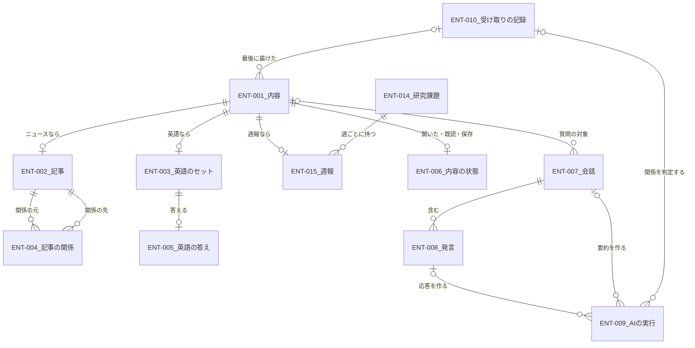

# BD-07 データ論理設計書（NEXUS）

- 読んだもの: RD-03 1.0、RD-05 1.1、RD-06 1.0、RD-09 1.1、RD-10 1.0、RD-12 1.1、X-03 1.0、X-04 1.1、BD-01 0.1、BD-09 0.1。BD-02 0.1 と行き来して書いた（AP-BD 1.3）。
- 配信元が今送っている形は、sharpen の `drills/en/2026-11-19/set.json` と `read.json`、cerebellum の `docs/specs/14-learning.md` 3.1〜3.3、`15-web-learning.md` 3.3、`31-learning-lanes.md` 3.2・3.6、brain-harness の `brain-collect/SKILL.md` の送信の形（2026-11-23 の作業ツリー）を読んで確かめた。
- ENT-011〜ENT-013 は CR-001（2026-11-23 承認）で RD-09 に足したものである。
- 0.2: X-05 RV06 の指摘と、Q-079〜Q-081 の答え、CR-003（2026-11-24 承認）で直した（2026-11-24）。RV07 の指摘も直した。
- 1.0: 基本設計の完了判定（X-05 PG02。2026-11-24 RD-01 SH01。条件付きで進める）で承認した。
- 1.1: X-04 CR-005（2026-11-24 RD-01 SH01 が承認）で、ENT-009 にフォルダの読み取りの回数を足した（RD-15 AC14。X-05 RV13-03）。
- 1.2: X-04 CR-020（2026-11-27 RD-01 SH01 が承認）で、ENT-014 研究課題と ENT-015 週報を足し、情報の種類に research、配信元に brain-research、コードに課題の状態と方法の印、データ項目に課題の ID と方法を足した（Q-087〜Q-090 の答え）。
- 1.3: X-04 CR-024（2026-11-28。本人の承認の前の案）で、ENT-015 に段の一覧と段の変更の案を、ENT-006 に確かめた方法を足し、方法の件数の上限を外した。データ項目に段と確かめた方法を、コードに段の状態を足した（Q-098〜Q-101 の答え）。
- 書いた AI: Claude（Opus 5.5）。人の承認の前の案である。

## 1. 論理 ER 図

- 図の分け方: エンティティは15件で20件を超えないので、1枚に描いた。
- 多重度: ENT-001 から ENT-010 への参照は、ENT-010 を1年で消した後に空になるので任意にした。ENT-009 の3つの参照は、目的に合う1つだけを持つので、どれも任意にした（3章 ENT-009）。ENT-012 登録コードは、使ったら消すので ENT-011 端末との関連を図に描かない（登録した端末は登録コードを参照しない）。
- ENT-013 配信元の鍵は、ほかのエンティティと関連を持たない（配信元のコードで ENT-010 と同じ配信元を指すが、鍵を取り消しても受け取りの記録は残すため、参照にしない）。
- 1つの発言の応答を、自動の送り直し（RD-03 R15）と本人の送り直し（FN-016）で何度か作り直すので、ENT-008 と ENT-009 は1対多にした（RD-09 1章の図は1対0か1）。

## 2. エンティティ一覧

| エンティティID | エンティティ名 | 種別 | 定義 | 件数 | 保存期間 | 削除の扱い |
|---|---|---|---|---|---|---|
| ENT-001 | 内容 | イベント系 | 1件は、届いた情報1件（ニュースの記事1件、英語のセット1日分か、週報1件）の、種類によらない共通の部分を表す | 開始時0件。年に最大で約18,000件（RD-09 2章） | 消さずに残す（RD-09 2章、Q-038 の答え） | 消さない。同じ日の同じ記事、同じ日付のセットが届いたら、同じ内容を置き換える（RD-03 R01、R06。BD-02 FN-001、FN-007） |
| ENT-002 | 記事 | イベント系 | 1件は、ニュースの記事1件の中身を表す | 年に約3,650件と X のブックマークの件数（RD-09 2章） | 消さずに残す | 消さない |
| ENT-003 | 英語のセット | イベント系 | 1件は、英語の教材1日分の中身を表す | 年に約365件（RD-09 2章） | 消さずに残す | 消さない |
| ENT-004 | 記事の関係 | イベント系 | 1件は、2つの記事のあいだの関係1つを表す | 見込めない（RD-09 2章）。判定は1回の受け取りにつき1回で、1日10件と X のブックマークを7日前までの記事と照らす | 消さずに残す | 消さない。同じ2つの記事の関係がもう一度判定されたら置き換える。判定し直して返らなかった関係は、消さずに有効を偽にする（BD-02 FN-002） |
| ENT-005 | 英語の答え | イベント系 | 1件は、英語のセット1つへの本人の答えと ○△× の、最後に完了した1回分を表す | 年に最大で約365件 | 消さずに残す | 消さない。やり直したら置き換える（RD-03 R11） |
| ENT-006 | 内容の状態 | イベント系 | 1件は、内容1件についての本人の開いた日時、既読、保存を表す。1件も無い内容は、開いていない・未読・保存していない | ENT-001 と同じ数まで | 消さずに残す | 消さない |
| ENT-007 | 会話 | イベント系 | 1件は、本人と AI のひと続きのやり取り1つを表す | 年に最大で約3,650件 | 消さずに残す | 消さない。消す画面は持たない（RD-09 2章） |
| ENT-008 | 発言 | イベント系 | 1件は、会話の中の本人の質問1つか、AI の応答1つを表す | 年に約7,300件 | 消さずに残す | 消さない。本人の発言は直さない（RD-03 R22） |
| ENT-009 | AI の実行 | 集計・履歴 | 1件は、AI を1回動かした記録を表す。DB の待ち行列も兼ねる（X-02 ADR-012） | 年に約3,650件の質問の分と、記事の関係の判定（1日1回程度で年に約365件）と、会話の要約の分 | 1年（RD-09 2章、NFR-010） | 1年を過ぎたら FN-022 が消す。消しても発言（ENT-008）の応答の状態は残る |
| ENT-010 | 受け取りの記録 | 集計・履歴 | 1件は、配信元から1回送られてきた記録を表す | 年に約730件（RD-09 2章） | 1年 | 1年を過ぎたら FN-022 が消す。消しても内容（ENT-001）は残る（2つをつなぐ属性は空にする。3章 ENT-001） |
| ENT-011 | 端末 | リソース系 | 1件は、本人が登録した端末1台を表す | 2台ほど（RD-11 NFR-003） | 取り消すまで | 取り消したら消す（FN-023） |
| ENT-012 | 登録コード | イベント系 | 1件は、端末を登録するために出した、1回だけ使えるコード1つを表す | 登録するたびに1件 | 使うか、有効な時間が過ぎるまで | 使ったら消す。有効な時間を過ぎたものは、次に FN-023 を動かしたときに消す |
| ENT-013 | 配信元の鍵 | リソース系 | 1件は、配信元1つの鍵を表す | 配信元ごとに1件（CR-020 で brain-research を足して3件） | 取り消すまで | 取り消したら消す（FN-024）。用意し直したら置き換える |
| ENT-014 | 研究課題 | リソース系 | 1件は、送り手が調べる研究課題1つを表す（CR-020） | 同時に1〜3個。年に数件から十数件 | 消さずに残す（ENT-001 と同じ扱い） | 消さない。同じ課題の ID の週報が届いたら、最新の週のときだけ課題名と状態を置き換える（BD-02 FN-025） |
| ENT-015 | 週報 | イベント系 | 1件は、研究課題1つの1週分の報告を表す（CR-020） | 年に最大で約160件（課題3個で週1回） | 消さずに残す | 消さない。同じ課題の同じ週が届いたら置き換える（RD-03 R23） |

- 担当部署: 全て本人（RD-09 2章）。

## 3. エンティティ定義

### ENT-001 内容

| 属性名 | 説明 | データ項目 | 論理の型 | 桁・精度 | 必須 | 主キー | 一意 | 参照先 | 更新の可否 |
|---|---|---|---|---|---|---|---|---|---|
| 内容ID | NEXUS が振る番号 | 通し番号 | 整数 | 4.1 | 必須 | ○ | - | - | 不可 |
| 種類 | ニュース、英語、週報のどれか（週報は CR-020） | 情報の種類 | コード | 4.2 | 必須 | - | - | - | 不可 |
| 見出し | 一覧に出す1行。ニュースは記事の見出し、英語は学習テーマ | 見出し | 文字 | 4.1 | 必須 | - | - | - | 置き換えのときだけ可 |
| 対象日 | どの日の分か。ニュースは送られた日、英語はセットの日付 | 日付 | 日付 | 4.1 | 必須 | - | 種類が英語のとき、種類と対象日の組で一意 | - | 不可 |
| 届いた日時 | 最後に受け取った日時 | 日時 | 日時 | 4.1 | 必須 | - | - | - | 置き換えのときだけ可 |
| 受け取りの記録ID | 最後に届けた受け取りの記録 | 通し番号 | 整数 | 4.1 | 任意（ENT-010 を1年で消した後は空） | - | - | ENT-010 記録ID | 置き換えのときと、FN-022 が空にするときだけ可 |

- 一貫性の規則: 種類がニュースなら ENT-002 が1件、英語なら ENT-003 が1件、週報なら ENT-015 が1件ある。2つ以上は無い。
- 状態を持つ属性: 無い（開いた・既読・保存は ENT-006 に持つ）。

### ENT-002 記事

| 属性名 | 説明 | データ項目 | 論理の型 | 桁・精度 | 必須 | 主キー | 一意 | 参照先 | 更新の可否 |
|---|---|---|---|---|---|---|---|---|---|
| 内容ID | 記事の内容 | 通し番号 | 整数 | 4.1 | 必須 | ○ | - | ENT-001 内容ID | 不可 |
| slug | 同じ記事を見分ける印 | slug | 文字 | 4.1 | 必須 | - | ENT-001 対象日と slug の組で一意（RD-03 R01） | - | 不可 |
| 案内 | 配信元が書いた日本語の説明 | Markdown の文 | 文字 | 4.1 | 必須 | - | - | - | 置き換えのときだけ可 |
| 元の記事の URL | 元の記事の場所。brain-harness が別の項目で送る（Q-077 の答え。CR-002） | URL | 文字 | 4.1 | 必須 | - | - | - | 置き換えのときだけ可 |
| 画像の URL | 記事の画像の場所（Q-021 の答え） | URL | 文字 | 4.1 | 任意（画像の無い記事も受け取り、図では画像の代わりの印を出す。BD-03） | - | - | - | 置き換えのときだけ可 |
| テーマ | 配信元が付けた記事の分類（Q-021 の答え） | 短い文 | 文字 | 4.1 | 必須 | - | - | - | 置き換えのときだけ可 |

- 一貫性の規則: ENT-001 の種類がニュースである。

### ENT-003 英語のセット

| 属性名 | 説明 | データ項目 | 論理の型 | 桁・精度 | 必須 | 主キー | 一意 | 参照先 | 更新の可否 |
|---|---|---|---|---|---|---|---|---|---|
| 内容ID | セットの内容 | 通し番号 | 整数 | 4.1 | 必須 | ○ | - | ENT-001 内容ID | 不可 |
| 学習テーマ | セットが扱う学びの題材（sharpen の `theme`） | 短い文 | 文字 | 4.1 | 必須 | - | - | - | 置き換えのときだけ可 |
| 教材の本文 | 最初に読む本文（`lessonMd`） | Markdown の文 | 文字 | 4.1 | 必須 | - | - | - | 置き換えのときだけ可 |
| 締めの一言 | セットの終わりのまとめ（`closingMd`） | Markdown の文 | 文字 | 4.1 | 任意 | - | - | - | 置き換えのときだけ可 |
| 問題の一覧 | 問題1〜60問（`problems`） | 問題 | 構造 | 4.1 | 必須 | - | - | - | 置き換えのときだけ可 |
| 読む教材 | 語句ごとの説明を含む読み物（`read.json`） | 読む教材 | 構造 | 4.1 | 任意（無い日がある。RD-06 UC-007） | - | - | - | 置き換えのときだけ可 |
| 届いたセットの原文 | sharpen が送ったセットの全体。IF-003 で今の cerebellum の形のまま返すために持つ（Q-039 の答え） | 届いた原文 | 文字 | 4.1 | 必須 | - | - | - | 置き換えのときだけ可 |

- 一貫性の規則: ENT-001 の種類が英語である。問題の一覧の問題番号は重ならない。答えの形が「選ぶ」の問題では、正解が選択肢のどれかと同じである（cerebellum `14-learning.md` 3.1）。

### ENT-004 記事の関係

| 属性名 | 説明 | データ項目 | 論理の型 | 桁・精度 | 必須 | 主キー | 一意 | 参照先 | 更新の可否 |
|---|---|---|---|---|---|---|---|---|---|
| 関係の元 | 判定したときに届いていた記事（新しい方） | 通し番号 | 整数 | 4.1 | 必須 | ○ | - | ENT-002 内容ID | 不可 |
| 関係の先 | 照らした記事（同じ回に届いた記事か、7日前までの記事） | 通し番号 | 整数 | 4.1 | 必須 | ○ | - | ENT-002 内容ID | 不可 |
| 関係の種類 | 関係の元から見た関係の先との関係 | 関係の種類 | コード | 4.2 | 必須 | - | - | - | 判定し直したときだけ可 |
| 関係の根拠 | 関係があると判定したわけ。AI が書いた文で、因果を事実として書かない（RD-03 R03） | 短い文 | 文字 | 4.1 | 必須 | - | - | - | 判定し直したときだけ可 |
| 判定した日時 | 最後に判定した日時 | 日時 | 日時 | 4.1 | 必須 | - | - | - | 判定し直したときだけ可 |
| 有効 | 今の関係として図と案内に出すか。判定し直して返らなかったら偽にする | 真偽 | 真偽 | - | 必須（作るときは真） | - | - | - | 判定し直したときだけ可 |

- 一貫性の規則: 関係の元と関係の先は別の記事である。同じ2つの記事の関係は、向きを問わず1件だけにする。

### ENT-005 英語の答え

| 属性名 | 説明 | データ項目 | 論理の型 | 桁・精度 | 必須 | 主キー | 一意 | 参照先 | 更新の可否 |
|---|---|---|---|---|---|---|---|---|---|
| 内容ID | 答えたセット | 通し番号 | 整数 | 4.1 | 必須 | ○ | - | ENT-003 内容ID | 不可 |
| 答えの一覧 | 問題ごとの問題番号、答え、採点 | 答え | 構造 | 4.1 | 必須 | - | - | - | やり直したときだけ可（置き換える） |
| 完了した日時 | 最後に完了した日時 | 日時 | 日時 | 4.1 | 必須 | - | - | - | やり直したときだけ可 |

- 一貫性の規則: 完了したときに、答えの一覧の問題番号は ENT-003 の問題の一覧にある番号だけで、全ての問題に採点が付いている（RD-03 R09）。後でセットが置き換えられても答えは消さないので、置き換えた後のセットに無い番号が残ることがある（BD-02 FN-007、FN-013）。

### ENT-006 内容の状態

| 属性名 | 説明 | データ項目 | 論理の型 | 桁・精度 | 必須 | 主キー | 一意 | 参照先 | 更新の可否 |
|---|---|---|---|---|---|---|---|---|---|
| 内容ID | 状態を持つ内容 | 通し番号 | 整数 | 4.1 | 必須 | ○ | - | ENT-001 内容ID | 不可 |
| 開いた日時 | 本人が初めて開いた日時。空なら新着（RD-03 R18） | 日時 | 日時 | 4.1 | 任意 | - | - | - | 空のときだけ可（一度入れたら変えない） |
| 既読 | 既読か未読か | 真偽 | 真偽 | - | 必須（初めは偽） | - | - | - | 可 |
| 既読にした日時 | 最後に既読にした日時 | 日時 | 日時 | 4.1 | 既読が真のとき必須 | - | - | - | 可 |
| 保存 | 保存しているか | 真偽 | 真偽 | - | 必須（初めは偽） | - | - | - | 可 |
| 保存した日時 | 最後に保存した日時。Library の並びに使う | 日時 | 日時 | 4.1 | 保存が真のとき必須 | - | - | - | 可 |
| 確かめた方法 | 週報で、本人が開いて確かめた方法の番号と、確かめた日時の並び（RD-03 R26。CR-024）。週報のほかの種類には無い | 確かめた方法 | 構造 | 4.1 | 任意（0件もある） | - | 1つの内容の中で方法の番号は重ならない | - | 足すだけ（一度入れたら変えない、消さない） |

- 状態を持つ属性: 既読、保存（BD-02 3章）。

### ENT-007 会話

| 属性名 | 説明 | データ項目 | 論理の型 | 桁・精度 | 必須 | 主キー | 一意 | 参照先 | 更新の可否 |
|---|---|---|---|---|---|---|---|---|---|
| 会話ID | NEXUS が振る番号 | 通し番号 | 整数 | 4.1 | 必須 | ○ | - | - | 不可 |
| 対象の内容 | 質問の対象の内容。ホームの AI Chat から始めた会話と、対象が見つからなかった会話は空（RD-06 UC-012） | 通し番号 | 整数 | 4.1 | 任意 | - | - | ENT-001 内容ID | 不可（RD-03 R22） |
| 対象の箇所 | 内容の中のどこを対象にしたか | 質問の対象 | 構造 | 4.1 | 任意（対象の内容があるとき必須） | - | - | - | 不可（RD-03 R22） |
| 始めた日時 | 会話を作った日時 | 日時 | 日時 | 4.1 | 必須 | - | - | - | 不可 |
| 最後に話した日時 | 最後の発言の日時。前の会話の一覧の並びに使う | 日時 | 日時 | 4.1 | 必須 | - | - | - | 可 |
| 会話の要約 | 古い発言を AI がまとめた文（Q-076 の答え） | Markdown の文 | 文字 | 4.1 | 任意（会話が決めた長さを超えるまで空） | - | - | - | 可（要約し直したら置き換える） |
| 要約に含めた最後の発言 | 会話の要約に入れた最後の発言 | 通し番号 | 整数 | 4.1 | 会話の要約があるとき必須 | - | - | ENT-008 発言ID | 可 |

### ENT-008 発言

| 属性名 | 説明 | データ項目 | 論理の型 | 桁・精度 | 必須 | 主キー | 一意 | 参照先 | 更新の可否 |
|---|---|---|---|---|---|---|---|---|---|
| 発言ID | NEXUS が振る番号 | 通し番号 | 整数 | 4.1 | 必須 | ○ | - | - | 不可 |
| 会話ID | 発言が入る会話 | 通し番号 | 整数 | 4.1 | 必須 | - | - | ENT-007 会話ID | 不可 |
| 話し手 | 本人か AI か | 話し手 | コード | 4.2 | 必須 | - | - | - | 不可 |
| 本文 | 質問か応答の文。応答は少しずつ書き足す | Markdown の文 | 文字 | 4.1 | 必須（作成中の応答は空でよい） | - | - | - | 本人の発言は不可（RD-03 R22）。AI の発言は作成中だけ書き足せ、送り直しのときに空に戻せる |
| 送った日時 | 質問を送った日時か、応答を作り始めた日時 | 日時 | 日時 | 4.1 | 必須 | - | - | - | 送り直しのときだけ可 |
| 応答の状態 | AI の応答の状態 | 応答の状態 | コード | 4.2 | 話し手が AI のとき必須 | - | - | - | 可（BD-02 3章の遷移に限る） |
| 答える質問 | この応答が答える本人の発言 | 通し番号 | 整数 | 4.1 | 話し手が AI のとき必須 | - | 一意（1つの質問に応答は1つ） | ENT-008 発言ID | 不可 |
| AI に渡した内容の写し | 応答を作るときに AI に渡した内容（対象の内容、要約、直近の発言、質問）（RD-03 R16） | 渡した内容 | 文字 | 4.1 | 話し手が AI で、応答の状態が完了か失敗のとき必須。作成中と、AI Runner が拾う前に中止したときは空でよい | - | - | - | 送り直しのときだけ可（置き換える） |

- 一貫性の規則: 話し手が本人の発言には、応答の状態、答える質問、AI に渡した内容の写しを持たない。

### ENT-009 AI の実行

| 属性名 | 説明 | データ項目 | 論理の型 | 桁・精度 | 必須 | 主キー | 一意 | 参照先 | 更新の可否 |
|---|---|---|---|---|---|---|---|---|---|
| 実行ID | NEXUS が振る番号 | 通し番号 | 整数 | 4.1 | 必須 | ○ | - | - | 不可 |
| 目的 | 何のための実行か（NFR-020） | 実行の目的 | コード | 4.2 | 必須 | - | - | - | 不可 |
| 状態 | 待ちか、処理中か、終わったか | 実行の状態 | コード | 4.2 | 必須 | - | - | - | 可（BD-02 3章の遷移に限る） |
| 応答の発言 | 目的が「質問の応答」のとき、応答を書く AI の発言 | 通し番号 | 整数 | 4.1 | 目的が質問の応答のとき必須 | - | - | ENT-008 発言ID | 不可 |
| 要約する会話 | 目的が「会話の要約」のとき、要約する会話 | 通し番号 | 整数 | 4.1 | 目的が会話の要約のとき必須 | - | - | ENT-007 会話ID | 不可 |
| 判定する受け取り | 目的が「記事の関係の判定」のとき、判定する記事を届けた受け取りの記録 | 通し番号 | 整数 | 4.1 | 目的が記事の関係の判定のとき必須 | - | - | ENT-010 記録ID | 不可 |
| 回目 | 同じ求めの何回目の実行か。自動の送り直しは2回目になる（NFR-017） | 回数 | 整数 | 4.1 | 必須 | - | - | - | 不可 |
| 作った日時 | 待ちに入れた日時 | 日時 | 日時 | 4.1 | 必須 | - | - | - | 不可 |
| 始めた日時 | 処理中にした日時 | 日時 | 日時 | 4.1 | 状態が処理中、完了、失敗のとき必須。待ちから中止したときは空 | - | - | - | 処理中にするときだけ可 |
| 終わった日時 | 完了・失敗・中止にした日時 | 日時 | 日時 | 4.1 | 状態が完了・失敗・中止のとき必須 | - | - | - | 終わるときだけ可 |
| 失敗の理由 | 失敗したわけ（時間の上限、AI を動かす仕組みが使えない、応答の形が正しくない、途中で止まった など）。認証の情報を入れない（NFR-019） | 短い文 | 文字 | 4.1 | 状態が失敗のとき必須 | - | - | - | 終わるときだけ可 |
| 止める求め | 本人が止めるを押したか（FN-016） | 真偽 | 真偽 | - | 必須（初めは偽） | - | - | - | 偽から真にだけ可 |
| ウェブの検索の回数 | この実行で AI がウェブの検索を使った回数（RD-15 AC14） | 回数 | 整数 | 4.1 | 必須（初めは0） | - | - | - | 処理中だけ可 |
| ページの読み取りの回数 | この実行で AI がページの読み取りを使った回数 | 回数 | 整数 | 4.1 | 必須（初めは0） | - | - | - | 処理中だけ可 |
| フォルダの読み取りの回数 | この実行で AI が決めたフォルダ（`~/projects/brain-harness`）のファイルを読んだ回数（RD-15 AC14、CR-005） | 回数 | 整数 | 4.1 | 必須（初めは0） | - | - | - | 処理中だけ可 |

- 一貫性の規則: 応答の発言、要約する会話、判定する受け取りのうち、目的に合う1つだけを持つ。

### ENT-010 受け取りの記録

| 属性名 | 説明 | データ項目 | 論理の型 | 桁・精度 | 必須 | 主キー | 一意 | 参照先 | 更新の可否 |
|---|---|---|---|---|---|---|---|---|---|
| 記録ID | NEXUS が振る番号 | 通し番号 | 整数 | 4.1 | 必須 | ○ | - | - | 不可 |
| 配信元 | 送ってきた配信元（鍵の持ち主） | 配信元 | コード | 4.2 | 必須 | - | - | - | 不可 |
| 対象日 | 送られてきた分の日付 | 日付 | 日付 | 4.1 | 受け取ったとき必須。断ったときは、分かれば入れる | - | - | - | 不可 |
| 受け取った日時 | 送信を受けた日時 | 日時 | 日時 | 4.1 | 必須 | - | - | - | 不可 |
| 件数 | 受け取った記事かセットの数。0件の日もある（RD-06 UC-001） | 回数 | 整数 | 4.1 | 必須 | - | - | - | 不可 |
| 結果 | 受け取ったか断ったか | 受け取りの結果 | コード | 4.2 | 必須 | - | - | - | 不可 |
| 断った理由 | 断ったときの MSG の番号と、差し込んだ値（BD-09 1.2） | 短い文 | 文字 | 4.1 | 結果が断ったのとき必須 | - | - | - | 不可 |

- ホームの未着（NFR-022）は、その日の対象日で結果が「受け取った」の記録が、配信元ごとに有るかで決める。

### ENT-011 端末

| 属性名 | 説明 | データ項目 | 論理の型 | 桁・精度 | 必須 | 主キー | 一意 | 参照先 | 更新の可否 |
|---|---|---|---|---|---|---|---|---|---|
| 端末ID | NEXUS が振る番号 | 通し番号 | 整数 | 4.1 | 必須 | ○ | - | - | 不可 |
| 端末の名前 | 本人が登録の URL を出すときに付ける名前（例 iPad）。取り消すときに使う | 短い文 | 文字 | 4.1 | 必須 | - | ○ | - | 不可 |
| 端末の鍵の照合値 | 端末の鍵から作った照合のための値。鍵そのものは持たない（NFR-019） | 照合値 | 文字 | 4.1 | 必須 | - | ○ | - | 不可 |
| 登録した日時 | 登録した日時 | 日時 | 日時 | 4.1 | 必須 | - | - | - | 不可 |
| 最後に使った日時 | 最後に鍵が通った日時 | 日時 | 日時 | 4.1 | 必須 | - | - | - | 可 |

### ENT-012 登録コード

| 属性名 | 説明 | データ項目 | 論理の型 | 桁・精度 | 必須 | 主キー | 一意 | 参照先 | 更新の可否 |
|---|---|---|---|---|---|---|---|---|---|
| コードの照合値 | 登録コードから作った照合のための値。コードそのものは持たない | 照合値 | 文字 | 4.1 | 必須 | ○ | - | - | 不可 |
| 端末の名前 | 登録したときに ENT-011 に付ける名前 | 短い文 | 文字 | 4.1 | 必須 | - | - | - | 不可 |
| 出した日時 | 登録の URL を出した日時 | 日時 | 日時 | 4.1 | 必須 | - | - | - | 不可 |
| 有効な期限 | これを過ぎたら使えない日時。有効な時間の長さは BD-10 3章 T01（Q-079 の答え） | 日時 | 日時 | 4.1 | 必須 | - | - | - | 不可 |

### ENT-013 配信元の鍵

| 属性名 | 説明 | データ項目 | 論理の型 | 桁・精度 | 必須 | 主キー | 一意 | 参照先 | 更新の可否 |
|---|---|---|---|---|---|---|---|---|---|
| 配信元 | 鍵の持ち主。使える連携は配信元で決まる（4.2） | 配信元 | コード | 4.2 | 必須 | ○ | - | - | 不可 |
| 鍵の照合値 | 鍵から作った照合のための値。鍵そのものは持たない（NFR-019） | 照合値 | 文字 | 4.1 | 必須 | - | ○ | - | 用意し直したときだけ可 |
| 用意した日時 | 最後に用意した日時 | 日時 | 日時 | 4.1 | 必須 | - | - | - | 用意し直したときだけ可 |

### ENT-014 研究課題（CR-020）

| 属性名 | 説明 | データ項目 | 論理の型 | 桁・精度 | 必須 | 主キー | 一意 | 参照先 | 更新の可否 |
|---|---|---|---|---|---|---|---|---|---|
| 課題番号 | NEXUS が振る番号 | 通し番号 | 整数 | 4.1 | 必須 | ○ | - | - | 不可 |
| 課題の ID | 送り手が付けた研究課題の ID（brain-harness の `research/<課題>/`） | 課題の ID | 文字 | 4.1 | 必須 | - | ○ | - | 不可 |
| 課題名 | 研究課題の問い | 見出し | 文字 | 4.1 | 必須 | - | - | - | 最新の週の週報が届いたときだけ可（BD-02 FN-025） |
| 状態 | 進行中か終了 | 課題の状態 | コード | 4.2 | 必須 | - | - | - | 同上 |
| 最後に届いた週 | いちばん新しい週の何週目か | 回数 | 整数 | 4.1 | 必須 | - | - | - | 同上 |
| 最後に届いた日時 | いちばん新しい週の週報を受け取った日時 | 日時 | 日時 | 4.1 | 必須 | - | - | - | 同上 |

- 一貫性の規則: 最後に届いた週は、その課題の ENT-015 の何週目かの最大と同じ。
- 状態を持つ属性: 状態（進行中、終了）。終了から進行中に戻ることもある（RD-03 R25。決めるのは送り手）。

### ENT-015 週報（CR-020）

| 属性名 | 説明 | データ項目 | 論理の型 | 桁・精度 | 必須 | 主キー | 一意 | 参照先 | 更新の可否 |
|---|---|---|---|---|---|---|---|---|---|
| 内容ID | 週報の内容 | 通し番号 | 整数 | 4.1 | 必須 | ○ | - | ENT-001 内容ID | 不可 |
| 課題番号 | どの研究課題の週報か | 通し番号 | 整数 | 4.1 | 必須 | - | 課題番号と何週目かの組で一意（RD-03 R23） | ENT-014 課題番号 | 不可 |
| 何週目か | その課題の何週目の報告か | 回数 | 整数 | 4.1 | 必須 | - | 同上 | - | 不可 |
| 送った日 | 送り手が送った日 | 日付 | 日付 | 4.1 | 必須 | - | - | - | 置き換えのときだけ可 |
| 状態 | この週の時点で進行中か終了か | 課題の状態 | コード | 4.2 | 必須 | - | - | - | 置き換えのときだけ可 |
| 現時点の答え | 課題への今の答え | Markdown の文 | 文字 | 4.1 | 必須 | - | - | - | 置き換えのときだけ可 |
| 方法の一覧 | 方法0件以上（件数の上限は無い。CR-024） | 方法 | 構造 | 4.1 | 必須（0件もある） | - | - | - | 置き換えのときだけ可 |
| 段の一覧 | ゴールまでの段（CR-024） | 段 | 構造 | 4.1 | 任意（無い週報もある） | - | - | - | 置き換えのときだけ可 |
| 段の変更の案 | 段を直す案（CR-024） | Markdown の文 | 文字 | 4.1 | 任意 | - | - | - | 置き換えのときだけ可 |
| まだ分かっていないこと | 課題についてまだ分かっていないこと | Markdown の文 | 文字 | 4.1 | 必須（空の文字もある） | - | - | - | 置き換えのときだけ可 |
| 今週の変化 | 前の週から何がなぜ変わったか | Markdown の文 | 文字 | 4.1 | 必須 | - | - | - | 置き換えのときだけ可 |

- 一貫性の規則: ENT-001 の種類が週報である。方法の一覧の印は、1つの方法の中で重ならない。出典の数は持たず、出典の URL の数で数える（Q-088 の答え）。段の番号と方法の番号は、それぞれ週報の中で重ならない。方法のぶら下がる段は段の一覧にある。今ここの段は1つまで（CR-024）。
- 状態を持つ属性: 状態（ENT-014 と同じ値。週ごとの値を残す）。

## 4. データ項目とコード

### 4.1 データ項目

| データ項目名 | 論理の型と桁 | 値の範囲と書式 | 意味 |
|---|---|---|---|
| 通し番号 | 整数 | 1以上。NEXUS が振り、使い回さない | エンティティの1件を指す番号 |
| 回数 | 整数 | 0以上 | 件数や何回目か |
| 日付 | 日付 | 「YYYY-MM-DD」。日本時間の日付（BD-01 6章） | どの日の分か |
| 日時 | 日時 | 時差付きの日時（BD-01 6章） | いつ起きたか |
| 真偽 | 真偽 | 真か偽 | はいか、いいえ |
| 見出し | 文字 | 空でない1行。改行を含まない。上限の文字数は BD-06 の受け取りの上限で決める | 一覧に出す1行 |
| 短い文 | 文字 | 改行を含まない。上限の文字数は BD-06 と BD-10 で決める | 名前や理由などの短い文 |
| Markdown の文 | 文字 | Markdown。画面では BD-09 6章の「届いた文の表示」で見せ、HTML として埋め込まない（NFR-018） | 案内、教材の本文、質問、応答などの文 |
| slug | 文字 12 | 0〜9 と a〜f の12文字（元の記事の URL の sha1 の先頭12桁。brain-harness `brain-collect/SKILL.md`） | 同じ記事を見分ける印 |
| URL | 文字 | `http` か `https` で始まる URL だけ。ほかの形（`javascript:` など）は受け取らない（NFR-018） | ウェブの場所 |
| 照合値 | 文字 | 鍵やコードから一方向に作った値。作り方は BD-10 で決める | 鍵やコードが正しいかを確かめる値 |
| 問題 | 構造 | 問題の並び。1〜60問（cerebellum `31-learning-lanes.md` 3.6）。1問は、問題番号（整数、セットの中で重ならない）、問題の種類（コード 4.2）、問題文（Markdown の文）、解答（Markdown の文。正解と解説）、答えの形（コード 4.2。任意）、正解（文字。答えの形があるとき必須）、選択肢（文字の並び。答えの形が「選ぶ」のとき必須で2〜6件、重ならない）、作業の場所（文字。任意。NEXUS は画面に出すだけで、その場所を読まない）を持つ（cerebellum `14-learning.md` 3.1） | 英語のセットの問題 |
| 読む教材 | 構造 | 日付、形式、題、場面、あらまし（いずれも文字）と、段落の並びを持つ。段落は文の並びを持ち、文は英文、和訳、注の並びを持つ。注は、語句（文字）、注の種類（文字。sharpen の値をそのまま持つ）、説明（文字）を持つ（sharpen `read.json`） | 語句をタップして説明を出す読み物 |
| 届いた原文 | 文字 | sharpen が送った JSON の全体。大きさの上限は BD-06 | IF-003 で返すための原文 |
| 答え | 構造 | 答えの並び。1件は、問題番号（整数）、答え（文字、500文字まで。答えの欄があった問題だけ）、採点（コード 4.2）を持つ（cerebellum `14-learning.md` 3.3） | 問題ごとの本人の答えと ○△× |
| 質問の対象 | 構造 | 対象の種類（コード 4.2）と、対象の種類に応じて、記事の内容ID、語句、語句を含む文、文の位置（読む教材の段落と文の番号か、教材の本文のどこか）を持つ | AI に質問するときに選んだ箇所 |
| 渡した内容 | 文字 | AI に渡した文の全体。認証の情報を含めない（NFR-019） | 応答を作るときに AI に渡した内容 |
| 課題の ID | 文字 | a〜z、0〜9、`-` の1〜64文字（BD-06 IF-005。CR-020） | 送り手が付けた研究課題の ID |
| 方法 | 構造 | 方法の並び。0件以上（件数の上限は CR-024 で外した）。1件は、見出し（見出し）、そのためには（Markdown の文）、出典の URL の並び（URL。重ならない。0件以上）、印の並び（コード 4.2 方法の印。重ならない）、反対の意見（Markdown の文。任意）、方法の番号（整数。任意。CR-024）、ぶら下がる段の番号（整数。任意。CR-024）を持つ（BD-06 IF-005。CR-020） | 週報の中の答え方の1つ |
| 段 | 構造 | 段の並び。0〜30件。1件は、段の番号（整数、1以上、重ならない）、中身（見出し）、状態（コード 4.2 段の状態）を持つ（BD-06 IF-005。CR-024） | ゴールまでの通過点 |
| 確かめた方法 | 構造 | 確かめた方法の並び。1件は、方法の番号（整数）と確かめた日時（日時）を持つ（CR-024） | 本人がどの方法の NEW を確かめたか |

- 文字の上限（見出し、短い文、Markdown の文、届いた原文）は、受け取りの上限と一緒に BD-06 で決め、ここは BD-06 を参照する。

### 4.2 コード定義

| コード名 | 値 | 名前 | 意味 | 使う属性 | 用途 | 並び順 | 値を足すときの扱い |
|---|---|---|---|---|---|---|---|
| 情報の種類 | news | ニュース | brain-harness の記事 | ENT-001 種類 | 内容の種類を区別する（RD-09 4章） | 1 | 新しい種類を足すときに、改修で値を足す（NFR-004） |
| 情報の種類 | english | 英語 | sharpen の英語のセット | ENT-001 種類 | 同上 | 2 | 同上 |
| 情報の種類 | research | 週報 | brain-harness の研究ループの調査の週報（CR-020） | ENT-001 種類 | 同上 | 3 | 同上 |
| 関係の種類 | follow_up | 続報 | 関係の元が、関係の先の出来事の続きを伝える | ENT-004 関係の種類 | 記事どうしの関係を区別する（RD-03 R03） | 1 | 改修で値を足す。AI がこの4つのほかの言葉を返したときは「関連する話題」にし、AI の言葉は関係の根拠に残す |
| 関係の種類 | background | 背景 | 関係の先が、関係の元の出来事の背景を伝える | 同上 | 同上 | 2 | 同上 |
| 関係の種類 | same_actor | 共通の主体 | 2つの記事が同じ会社、人、製品などを扱う | 同上 | 同上 | 3 | 同上 |
| 関係の種類 | related_topic | 関連する話題 | 2つの記事が関連する話題を扱う | 同上 | 同上 | 4 | 同上 |
| 採点 | o | ○ | 正しい | ENT-005 答えの一覧の採点 | 問題ごとの出来（RD-03 R08） | 1 | 足さない（sharpen と cerebellum の値に合わせる） |
| 採点 | d | △ | 解けたが怪しい | 同上 | 同上 | 2 | 同上 |
| 採点 | x | × | 正しくない。未回答も × | 同上 | 同上 | 3 | 同上 |
| 問題の種類 | quiz | 画面で答える | 画面で答える問題 | ENT-003 問題の一覧 | 問題の答え方（cerebellum `14-learning.md` 3.1） | 1 | sharpen の値に合わせて改修で足す |
| 問題の種類 | code | 手元で解く | ターミナルで解く問題。NEXUS は自己採点だけにする | 同上 | 同上 | 2 | 同上 |
| 答えの形 | choice | 選ぶ | 選択肢から選び、正解と同じかで ○ か × を付ける | ENT-003 問題の一覧 | 自動の採点の比べ方（RD-03 R08、cerebellum `15-web-learning.md` 3.3） | 1 | 同上 |
| 答えの形 | number | 数 | 数として比べる | 同上 | 同上 | 2 | 同上 |
| 答えの形 | text | 文 | 前後の空白を除き、全角と半角と大文字と小文字をそろえて比べる | 同上 | 同上 | 3 | 同上 |
| 実行の目的 | answer | 質問の応答 | 本人の質問に答える（FN-015、FN-016） | ENT-009 目的 | 何のための実行か（NFR-020） | 1 | 改修で足す |
| 実行の目的 | relate | 記事の関係の判定 | 届いた記事の関係を判定する（FN-002） | 同上 | 同上 | 2 | 同上 |
| 実行の目的 | summarize | 会話の要約 | 長くなった会話の古い部分を要約する（FN-015。Q-076 の答え） | 同上 | 同上 | 3 | 同上 |
| 実行の状態 | queued | 待ち | 待ち行列に入れ、AI Runner がまだ拾っていない（X-02 ADR-012） | ENT-009 状態 | AI の実行の状態（RD-09 4章に「待ち」を足した） | 1 | 足さない |
| 実行の状態 | running | 処理中 | AI Runner が動かしている | 同上 | 同上 | 2 | 同上 |
| 実行の状態 | done | 完了 | 終わり、結果を残した | 同上 | 同上 | 3 | 同上 |
| 実行の状態 | failed | 失敗 | 終わったが、結果を残せなかった | 同上 | 同上 | 4 | 同上 |
| 実行の状態 | cancelled | 中止 | 本人が止めた | 同上 | 同上 | 5 | 同上 |
| 応答の状態 | writing | 作成中 | 応答を待っているか、書き足している | ENT-008 応答の状態 | 会話に出す応答の状態（RD-03 R15）。ENT-009 を1年で消しても残すため、発言に持つ | 1 | 足さない |
| 応答の状態 | done | 完了 | 応答を書き終えた | 同上 | 同上 | 2 | 同上 |
| 応答の状態 | failed | 失敗 | 自動の送り直しも失敗したか、AI を動かす仕組みが使えない | 同上 | 同上 | 3 | 同上 |
| 応答の状態 | cancelled | 中止 | 本人が止めた | 同上 | 同上 | 4 | 同上 |
| 話し手 | owner | 本人 | 本人の質問 | ENT-008 話し手 | 発言を区別する | 1 | 足さない |
| 話し手 | ai | AI | AI の応答 | 同上 | 同上 | 2 | 同上 |
| 対象の種類 | page | ページ全体 | 開いている内容1件（記事か英語のセット）の全体。一覧の画面からは質問しない（CR-003） | ENT-007 対象の箇所 | 質問の対象（X-03） | 1 | 改修で足す |
| 対象の種類 | article | 記事 | ニュースの記事1件 | 同上 | 同上 | 2 | 同上 |
| 対象の種類 | phrase | 語句と文 | 教材の中の語句と、それを含む文 | 同上 | 同上 | 3 | 同上 |
| 対象の種類 | node | 図のノード | News Galaxy の図で選んだ記事 | 同上 | 同上 | 4 | 同上 |
| 配信元 | brain-harness | brain-harness | ニュースを送る。使える連携は IF-001 | ENT-010 配信元、ENT-013 配信元 | 送ってきた配信元と、鍵で使える連携を区別する（NFR-014） | 1 | 配信元を足すときに、改修で値と使える連携を足す |
| 配信元 | sharpen | sharpen | 英語のセットを送り、答えを読む。使える連携は IF-002 と IF-003 | 同上 | 同上 | 2 | 同上 |
| 配信元 | brain-research | brain-research | brain-harness の研究ループ。調査の週報を送る。使える連携は IF-005 だけ。brain-harness の鍵とは分ける（Q-090 の答え。CR-020） | 同上 | 同上 | 3 | 同上 |
| 課題の状態 | active | 進行中 | 研究課題を調べ続けている | ENT-014 状態、ENT-015 状態 | 課題が続いているか（RD-03 R25。CR-020） | 1 | 足さない（送り手の値に合わせる） |
| 課題の状態 | ended | 終了 | 2週続けて新しい方法が出ず、最後の報告を送った（`handoff-nexus.md`） | 同上 | 同上 | 2 | 同上 |
| 方法の印 | added | 今週足した | その週に足した方法 | ENT-015 方法の一覧の印 | その週に方法に何が起きたか（Q-088 の答え。CR-020） | 1 | 送り手と合わせて改修で足す |
| 方法の印 | more_sources | 出典が増えた | その週に出典が増えた方法 | 同上 | 同上 | 2 | 同上 |
| 方法の印 | disputed | 反対の意見あり | 反対の意見がある方法 | 同上 | 同上 | 3 | 同上 |
| 段の状態 | done | できた | 本人ができたとした段 | ENT-015 段の一覧の状態 | ゴールまでの段がどこまで進んだか（Q-098 の答え。CR-024） | 1 | 送り手と合わせて改修で足す |
| 段の状態 | doing | 途中 | 手を付けているが、できたではない段 | 同上 | 同上 | 2 | 同上 |
| 段の状態 | current | 今ここ | 毎日の調査で今取り組んでいる段。週報の中で1つまで | 同上 | 同上 | 3 | 同上 |
| 段の状態 | todo | まだ | まだ手を付けていない段 | 同上 | 同上 | 4 | 同上 |
| 受け取りの結果 | accepted | 受け取った | 形を確かめて残した | ENT-010 結果 | 受け取れたか（NFR-020） | 1 | 足さない |
| 受け取りの結果 | rejected | 断った | 鍵、形、大きさのどれかで断った | 同上 | 同上 | 2 | 同上 |

- 使わなくなった値の扱い: 値を廃止することは今は無い。廃止するときは、過去のデータの値の名前を出し続け、新しく作るときにだけ使わない。
- RD-09 4章の「実行の状態」に「待ち」を足したのは、X-02 ADR-012 で待ち行列にしたためである。業務の決まりは変えない。

## 5. CRUD

CRUD 表（バッチと外部連携の行を含む）:

| 機能 | 001 | 002 | 003 | 004 | 005 | 006 | 007 | 008 | 009 | 010 | 011 | 012 | 013 |
|---|---|---|---|---|---|---|---|---|---|---|---|---|---|
| FN-001 ニュースの受信 | CU | CRU | - | - | - | - | - | - | C | C | - | - | R |
| FN-002 記事の関係の判定 | R | R | - | CU | - | - | - | - | CRU | R | - | - | - |
| FN-003 記事の図の表示 | R | R | - | R | - | R | - | - | - | - | R | - | - |
| FN-004 記事の案内の表示 | R | R | - | R | - | CRU | - | - | - | - | R | - | - |
| FN-005 既読にする | R | - | - | - | - | CRU | - | - | - | - | R | - | - |
| FN-006 保存と保存の取り消し | R | - | - | - | - | CRU | - | - | - | - | R | - | - |
| FN-007 英語のセットの受信 | CU | - | CRU | - | - | - | - | - | - | C | - | - | R |
| FN-008 教材の一覧の表示 | R | - | R | - | R | R | - | - | - | - | R | - | - |
| FN-009 教材の表示 | R | - | R | - | R | CRU | - | - | - | - | R | - | - |
| FN-010 問題の回答 | - | - | R | - | - | - | - | - | - | - | R | - | - |
| FN-011 採点 | - | - | R | - | - | - | - | - | - | - | R | - | - |
| FN-012 教材の完了 | R | - | R | - | CRU | CRU | - | - | - | - | R | - | - |
| FN-013 答えの提供 | R | - | R | - | R | - | - | - | - | - | - | - | R |
| FN-014 会話の選択 | R | - | - | - | - | - | CR | R | - | - | R | - | - |
| FN-015 質問と応答 | R | R | R | R | - | - | RU | CRU | CRU | - | R | - | - |
| FN-016 応答の送り直しと中止 | - | - | - | - | - | - | R | RU | CRU | - | R | - | - |
| FN-017 新着と未読の一覧 | R | - | - | - | - | R | - | - | - | - | R | - | - |
| FN-018 検索 | R | R | R | - | - | - | - | - | - | - | R | - | - |
| FN-019 保存した内容の一覧 | R | - | - | - | - | R | - | - | - | - | R | - | - |
| FN-020 ホームの表示 | R | R | R | R | R | R | - | - | R | R | R | - | - |
| FN-021 データのバックアップ（BAT-001） | R | R | R | R | R | R | R | R | R | R | R | R | R |
| FN-022 古い記録の削除（BAT-002） | U | - | - | - | - | - | - | - | D | D | - | - | - |
| FN-023 端末の登録と取り消し | - | - | - | - | - | - | - | - | - | - | CRUD | CRD | - |
| FN-024 配信元の鍵の用意と取り消し | - | - | - | - | - | - | - | - | - | - | - | - | CRUD |
| FN-025 週報の受信 | CU | - | - | - | - | - | - | - | - | C | - | - | R |
| FN-026 課題の一覧の表示 | R | - | - | - | - | R | - | - | - | - | R | - | - |
| FN-027 週報の表示 | R | - | - | - | - | CRU | - | - | - | - | R | - | - |
| FN-028 週報の送信のコマンド（送り手の側。NEXUS のデータを直接は読み書きしない） | - | - | - | - | - | - | - | - | - | - | - | - | - |
| IF-001 ニュースの受信（FN-001 が受ける） | C | C | - | - | - | - | - | - | - | C | - | - | R |
| IF-002 英語のセットの受信（FN-007 が受ける） | C | - | C | - | - | - | - | - | - | C | - | - | R |
| IF-005 調査の週報の受信（FN-025 が受ける。CR-020） | C | - | - | - | - | - | - | - | - | C | - | - | R |

- 列の番号は ENT の番号である（001 は ENT-001）。
- RD-09 5章との違い（基本設計で足したもの）:
  - FN-001 が ENT-009 を C する（関係の判定を待ち行列に入れる。X-02 ADR-012）。FN-002 は ENT-009 を RU し（拾って動かす）、自動の送り直しのときだけ C する。FN-002 は ENT-004 の置き換えのため U、ENT-010 を R する。
  - FN-005、FN-006、FN-009、FN-012 が ENT-006 の R を、FN-009 が ENT-005 の R を、FN-012 が ENT-005 の R と ENT-006 の CRU を持つ（既読と、やり直しの判定のため。RD-03 R11、R12）。
  - FN-015 が ENT-009 の R を持ち、要約の実行を C する（Q-076 の答え）。FN-016 は ENT-008 を C しない（同じ AI の発言を作り直す）。
  - FN-022 が ENT-001 を U する（ENT-010 を消す前に、受け取りの記録ID を空にする）。
  - 端末から使う機能は全て ENT-011 を R する（端末の認証。BD-01 6章）。鍵が通るたびに最後に使った日時を変える U は、各機能の前に動く共通の処理が行い、表の各行には書かない（BD-02 1章）。配信元の機能は ENT-013 を R する。
- 表から確かめること（確かめた結果）:
  - C: 全ての ENT に C がある（ENT-001〜ENT-003 と ENT-010 は FN-001、FN-007 と IF-001、IF-002、ENT-004 は FN-002、ENT-005 は FN-012、ENT-006 は FN-004 ほか、ENT-007 は FN-014、ENT-008 は FN-015、ENT-009 は FN-001 と FN-015 と FN-016、ENT-011〜ENT-013 は FN-023、FN-024）。
  - R: 全ての ENT に R がある。
  - D: D の無い ENT-001〜ENT-008 は、2章で「消さずに残す」と決めた。ENT-009、ENT-010 は FN-022、ENT-011〜ENT-013 は FN-023、FN-024 が消す。

CR-020 で足した ENT-014 研究課題と ENT-015 週報の CRUD は次のとおり（上の表の列に無いため分けた。ここに無い機能は ENT-014、ENT-015 を使わない）。

| 機能 | 014 | 015 |
|---|---|---|
| FN-005 既読にする、FN-006 保存と保存の取り消し | - | - |
| FN-015 質問と応答（週報が対象のとき） | R | R |
| FN-017 新着と未読の一覧、FN-019 保存した内容の一覧 | R | - |
| FN-018 検索 | R | R |
| FN-020 ホームの表示 | - | - |
| FN-021 データのバックアップ（BAT-001） | R | R |
| FN-025 週報の受信 | CRU | CRU |
| FN-026 課題の一覧の表示 | R | R |
| FN-027 週報の表示 | R | R |
| IF-005 調査の週報の受信（FN-025 が受ける） | CU | CU |

- FN-017、FN-019 は見出し（ENT-001）だけで並べるので ENT-015 は読まないが、種類が週報の行に課題名を添えるために ENT-014 を読む。FN-020 の未読の週報の数は ENT-001 の種類と ENT-006 で数える。
- C: ENT-014、ENT-015 は FN-025 が作る。D: どちらも「消さずに残す」で、消す機能を持たない（2章）。
- FN-028 は送り手の側のコマンドで、NEXUS のデータを直接読み書きしない（行に書かない）。

## 6. 上流との対応

| エンティティID | 概念データ（RD-09） | 関連機能 FN | 関連要件 REQ |
|---|---|---|---|
| ENT-001 | ENT-001 内容 | FN-001、FN-002、FN-003、FN-004、FN-005、FN-006、FN-007、FN-008、FN-009、FN-012、FN-013、FN-014、FN-015、FN-017、FN-018、FN-019、FN-020、FN-021、FN-022 | REQ-001、REQ-006、REQ-019 |
| ENT-002 | ENT-002 記事 | FN-001、FN-002、FN-003、FN-004、FN-015、FN-018、FN-020、FN-021 | REQ-001、REQ-003、REQ-004 |
| ENT-003 | ENT-003 英語のセット | FN-007、FN-008、FN-009、FN-010、FN-011、FN-012、FN-013、FN-015、FN-018、FN-020、FN-021 | REQ-006、REQ-007、REQ-008、REQ-009 |
| ENT-004 | ENT-004 記事の関係 | FN-002、FN-003、FN-004、FN-015、FN-020、FN-021 | REQ-002、REQ-003 |
| ENT-005 | ENT-005 英語の答え | FN-008、FN-009、FN-012、FN-013、FN-020、FN-021 | REQ-009、REQ-010 |
| ENT-006 | ENT-006 内容の状態 | FN-003、FN-004、FN-005、FN-006、FN-008、FN-009、FN-012、FN-017、FN-019、FN-020、FN-021 | REQ-004、REQ-005、REQ-015、REQ-017 |
| ENT-007 | ENT-007 会話 | FN-014、FN-015、FN-016、FN-021 | REQ-011、REQ-012 |
| ENT-008 | ENT-008 発言 | FN-014、FN-015、FN-016、FN-021 | REQ-011、REQ-012、REQ-013 |
| ENT-009 | ENT-009 AI の実行 | FN-001、FN-002、FN-015、FN-016、FN-020、FN-021、FN-022 | REQ-013、REQ-023 |
| ENT-010 | ENT-010 受け取りの記録 | FN-001、FN-002、FN-007、FN-020、FN-021、FN-022 | REQ-001、REQ-006 |
| ENT-011 | ENT-011 端末（CR-001） | FN-003、FN-004、FN-005、FN-006、FN-007、FN-008、FN-009、FN-010、FN-011、FN-012、FN-014、FN-015、FN-016、FN-017、FN-018、FN-019、FN-020、FN-021、FN-023 | REQ-022 |
| ENT-012 | ENT-012 登録コード（CR-001） | FN-021、FN-023 | REQ-022 |
| ENT-013 | ENT-013 配信元の鍵（CR-001） | FN-001、FN-007、FN-013、FN-021、FN-024、FN-025 | REQ-022 |
| ENT-014 | ENT-014 研究課題（CR-020） | FN-015、FN-017、FN-018、FN-019、FN-021、FN-025、FN-026、FN-027 | REQ-030、REQ-031 |
| ENT-015 | ENT-015 週報（CR-020） | FN-015、FN-018、FN-021、FN-025、FN-026、FN-027 | REQ-030、REQ-031 |

- RD-09 の ENT-001〜ENT-015 は、分けもまとめもせず、同じ番号でこの書類にある。
- BD-03 と BD-06 が参照する属性が3章にあるかは、それらを書いた後に確かめる。

## 7. 未決事項

この書類で決めた未決事項: Q-076、Q-077（2026-11-23。答えは X-04）。

| ID | 内容 | 影響する箇所 | 期限 | 担当 |
|---|---|---|---|---|
