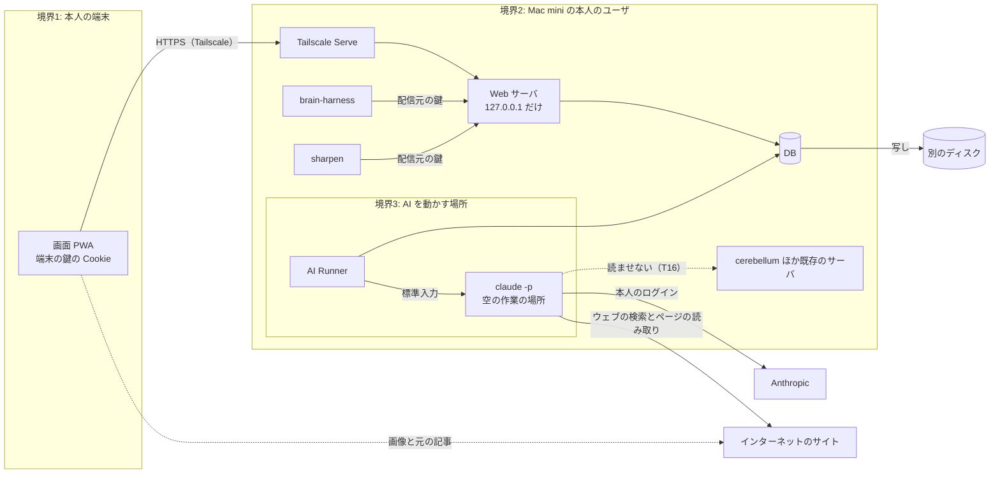

# BD-10 セキュリティ設計書（NEXUS）

- 読んだもの: RD-12 1.1（1章 システムプロファイル、2章 脅威、3章 リスク分析、4章 要件、5章 リスク受容）、RD-13 1.0、BD-01 0.1、BD-02 0.1、BD-06 0.1、BD-07 0.1、BD-09 0.1、X-07 1.0。BD-08 は X-06 で省いた。
- 脅威の番号は RD-12 2章の T01〜T15 をそのまま使い、基本設計で見つけたものを T16、T17 として足した。
- 対策の実装は DD-02（処理）、DD-04（API）、DD-06（エラー）、DD-09（環境）で決める。X-06 で DD-07 を省いたので、認証の実装は DD-02 と DD-09 で扱う。
- Q-066 に左右される範囲（AI を動かす仕組み。T03、T04、T08、T09、T15、T16）は、Q-066 の答えで Messages API に替わることがある。
- 0.2: X-05 RV06 の指摘と、Q-079〜Q-081 の答え、CR-003（2026-11-24 承認）で直した（2026-11-24）。RV07 の指摘も直した。
- 1.0: 基本設計の完了判定（X-05 PG02。2026-11-24 RD-01 SH01。条件付きで進める）で承認した。
- 1.1: X-04 CR-005（2026-11-24 RD-01 SH01 が承認）で、3章 T03 の対策に決めたフォルダ（`~/projects/brain-harness`）の読み取りを足し、6章に、その読み取りで増える T03 の経路を受け入れるリスクとして足した。Q-082 の答え（2026-11-24 決定）を 3章 T03・T16 に写した。X-04 CR-006 で 3章 T15 を、X-04 CR-007 で 3章 T03・T16、4章 ネットワーク、6章を直した（いずれも 2026-11-24 RD-01 SH01 が承認。4章と6章の末尾は X-05 RV13-02 の指摘で直した）。
- 書いた AI: Claude（Opus 5.5）。人の承認の前の案である。

## 1. 守る対象

### 対象範囲

BD-01 2章のコンテキスト図の NEXUS（Web サーバ、AI Runner、DB、定期ジョブ、Tailscale Serve の設定、別のディスクのバックアップ）を扱う。範囲の外に置くもの: Tailscale のネットワークそのもの、本人の端末の OS とブラウザ、brain-harness と sharpen の中身（送り先と鍵の設定のほか）、Claude Code の CLI とその中のツール、記事のサイト。

### 資産一覧

重要度と業務への影響は RD-12 1章の表による。基本設計で足した資産は次のとおり。

| 資産 | 対応する ENT | 重要度 | 漏えい・改ざん・消失のときの影響 |
|---|---|---|---|
| 会話、発言、AI に渡した内容の写し | ENT-007、ENT-008 | 高（RD-12 1章） | RD-12 1章 |
| 英語の答え、内容の状態 | ENT-005、ENT-006 | 中 | RD-12 1章 |
| 内容、記事、英語のセット、記事の関係 | ENT-001〜ENT-004 | 低 | RD-12 1章 |
| AI の実行、受け取りの記録 | ENT-009、ENT-010 | 中 | RD-12 1章 |
| 端末の鍵の照合値、登録コードの照合値、配信元の鍵の照合値 | ENT-011〜ENT-013 | 高 | 照合値からは鍵に戻せない（4章 秘密情報の管理）。消えると端末と配信元が使えなくなり、登録し直す |
| 端末の鍵（端末の Cookie）、配信元の鍵（配信元の設定） | NEXUS の外に置く | 高 | 他人が本人の端末や配信元を装う |
| Claude を動かす認証の情報 | NEXUS の外（本人の Claude Code のログイン） | 高 | 他人が本人の Claude の契約を使う |
| バックアップの写し | 全ての ENT | 高（会話を含む） | RD-12 T14 |

### 情報の流れと寿命

RD-12 1章の「情報のライフサイクル」による。基本設計で足したもの: 登録コードは出してから10分（Q-079 の答え。3章 T01）まで、使ったらすぐ消す（BD-07 ENT-012）。端末の鍵と配信元の鍵は取り消すまで残す（ENT-011、ENT-013）。バックアップの写しは7日で消す（NFR-023）。

### 準拠する基準

Anthropic の利用規約（RD-12 1章、NFR-029）。満たし方は 3章 T15 と BD-01 6章 外部連携。

## 2. データフロー図と信頼の境界

- 境界1と境界2のあいだ: 端末は本人のものだが、盗まれることがあるので、端末の鍵で確かめる（NFR-013）。
- 境界2の中: 配信元は Mac mini の上で動くが、鍵で確かめる（NFR-014）。
- 境界3: 届いた内容、質問、ウェブのページは信じない材料として AI に渡すので、AI Runner と CLI は Web サーバより信じない場所として扱う（NFR-016）。

### 外から入れる口の一覧

| 口 | 使える人 | 閉じたもの |
|---|---|---|
| Tailscale Serve の NEXUS 専用の名前（HTTPS） | Tailscale につないだ本人の機器で、端末の鍵を持つもの（FN-023 の登録の URL だけは鍵の無い端末も開ける） | Web サーバは 127.0.0.1 だけで待ち受け、Mac mini のほかの口や Tailscale の外から直に届かない（NFR-012） |
| 127.0.0.1 の Web サーバ（配信元の API） | 配信元の鍵を持つ brain-harness と sharpen | 鍵で使える API を限る（NFR-014）。端末の API は端末の鍵が無いと通らない |
| Mac mini のコマンド（FN-023、FN-024、手で動かすバッチ） | Mac mini の本人のユーザ | 画面から鍵を作る口は作らない（Q-034 の答え） |
| AI Runner | 口を持たない（DB の待ち行列を読むだけ。ADR-012） | 待ち受けの口を開けない |

## 3. 脅威と対策

| 番号 | 対象 | 分類 | 脅威の内容 | 優先度 | 対策 | 防げなかったときの対応 | 検証方法 |
|---|---|---|---|---|---|---|---|
| T01 | Tailscale Serve、Web サーバ | S、I | 本人でない人や機器が NEXUS を開く（RD-12 T01） | 高（影響大。RD-12 3章） | 入口は Tailscale Serve だけ（NFR-012）。全ての端末の API で端末の鍵を確かめる（NFR-013。4章 アプリケーション）。端末の鍵は推測できない長さの乱数にし、DB には照合値だけを置く。登録コードは1回だけ、出してから10分まで使える（Q-079 の答え）。DD-02、DD-09 | 本人が端末の一覧（FN-023）で知らない端末に気付いたら取り消す。端末をなくしたら、その端末を取り消す（5章） | 用意していない端末、取り消した端末、Tailscale の外から開けないこと（RD-15） |
| T02 | 配信元の API | S、T | 配信元を装って偽の記事や教材を送る（RD-12 T02） | 中 | 配信元ごとの鍵と、鍵ごとに使える API（NFR-014、BD-06 4.2）。形と大きさの確かめ（NFR-015、BD-06 3.2） | - | 鍵の無い送信、別の配信元の鍵、取り消した鍵で確かめる（RD-15） |
| T03 | AI Runner、CLI | E、I | 届いた内容、ウェブのページ、質問の文が AI への指示になり、許していない操作をさせるか、Mac mini の情報を読ませて外へ出させる（RD-12 T03） | 高 | 使えるツールを、質問の応答ではウェブの検索とページの読み取りと決めたフォルダ（`~/projects/brain-harness`）の読み取りだけ、記事の関係の判定と会話の要約では無しにする。ファイルの書き込み、コマンドの実行は許さない。読み取りは CLI の設定で作業の場所と決めたフォルダの中に限り、決めたフォルダの中の `.git` と鍵のファイルを読ませない。これで、AI に決めたフォルダの外の Mac mini のファイルを読ませない（NFR-016 の「読めるファイルを限る」。CLI の設定でできることは Q-082 の答えで確かめた。CR-005、ADR-016）。ただし、Claude Code が自分で読む設定のファイル（skills など）は制限の例外で、リンクと `..` で外を読めないかは文書で保証が無い。これらは受け入れる（6章、CR-007）。決めたフォルダの中身を、紛れた指示でページの読み取りから外へ出す経路は受け入れる（6章）（NFR-016）。作業の場所を空のフォルダにし、CLI に渡す環境変数を絞る（NFR-016、NFR-019）。決まりの文で、渡す材料の中の指示に従わないよう分けて渡す（BD-06 IF-004）。AI の応答は文字として見せるだけで、NEXUS がそれを命令として動かさない。記事の関係の判定の結果は、渡した内容ID だけを受け取る（BD-02 FN-002）。DD-02、DD-09 | AI の実行の記録（NFR-020）と、AI に渡した内容の写し（ENT-008）から、何を渡したかを追える。許していない操作が見つかったら、AI Runner を止めて調べる（5章 有事） | 指示を紛れ込ませた記事、教材、質問で、許していない操作が起きないことを確かめる（RD-15、NFR-016） |
| T04 | CLI のウェブの検索 | I | 会話の私的な内容が検索の言葉として外に出る（RD-12 T04） | 中 | 受け入れる（RD-12 5章、Q-047 の答え。6章） | - | - |
| T05 | 画面 | T、E | 届いた内容や AI の応答に紛れたスクリプトが端末で動く（RD-12 T05） | 高（影響大） | 届いた文と応答を HTML として埋め込まず、決めた書式だけで見せる（BD-09 6章「届いた文の表示」、X-07 3章）。リンクは `http` と `https` だけにする（BD-07 4.1 URL）。画面のスクリプトの読み込み先を NEXUS の自分のオリジンに限る（CSP）。DD-02、DD-09 | スクリプトが動いても、端末の鍵は画面のスクリプトから読めない Cookie に置くので取り出せない（4章 アプリケーション） | スクリプトを紛れ込ませた内容で確かめる（RD-15、NFR-018） |
| T06 | 配信元の API（IF-003） | S、I | sharpen でない機器が答えを読む（RD-12 T06） | 中 | T02 と同じ鍵。IF-003 は sharpen の鍵でだけ使える | - | T02 と同じ |
| T07 | 配信元の API | D | 大量の送信や大きな入力で止まる（RD-12 T07） | 中 | 大きさと件数の上限（BD-06 3.2）。同じ送信は置き換えるだけで増えない（NFR-015）。端末の API の入力の上限（4章 アプリケーション） | - | 上限を超える送信で確かめる（RD-15） |
| T08 | AI Runner | D | AI を何度も長く動かして費用が契約を超えるか、Mac mini が重くなる（RD-12 T08） | 中 | 同時に2つまで、1回5分、自動の送り直しは1回（NFR-017。BD-02 3章）。CLI に API キーの環境変数を渡さず、本人のサブスクリプションのログインだけで動かす（従量の課金を足さない。NFR-009） | ホームの AI の失敗（MSG-017）と実行の記録で気付く | 上限を超えたときに止まることを確かめる（RD-15） |
| T09 | AI Runner、ログ | I | Claude の認証の情報が漏れる（RD-12 T09） | 高 | NEXUS は Claude の認証の情報を読まず、持たない（本人のログインのまま CLI が持つ）。応答、渡した内容、ログ、失敗の理由に、認証の情報と鍵を入れない（NFR-019、BD-07 ENT-009） | 漏れたと分かったら、本人が Claude のログインをやり直す（5章 有事） | 応答、渡した内容、記録を確かめる（RD-15） |
| T10 | DB | D | 故障や誤った操作でデータが消える（RD-12 T10） | 中 | 毎日のバックアップ（BD-02 BAT-001、NFR-023） | バックアップから戻す（BD-11） | 戻す手順を試験する（RD-15） |
| T11 | ログ | R | 誰がいつ AI を動かしたか、何が届いたかを追えない（RD-12 T11） | 低 | AI の実行と受け取りの記録（NFR-020、BD-01 6章 ログ） | - | 総合テスト（RD-15） |
| T12 | 端末 | I | 端末が記事の画像と元の記事を直に読み、端末の情報が相手のサイトに渡る（RD-12 T12） | 低 | 受け入れる（RD-12 5章。6章） | - | - |
| T13 | 端末と NEXUS の通信 | I、T | 通信の途中で読まれるか書き換えられる（RD-12 T13） | 中 | Tailscale Serve の HTTPS（NFR-021）。Tailscale の通信の暗号化と重ねる | - | 暗号化していない通信で開けないことを確かめる（RD-15） |
| T14 | バックアップ | I | バックアップから私的な会話が読まれる（RD-12 T14） | 中 | 写しを本人のユーザだけが読める権限で置く。暗号化はしない（NFR-028、Q-060 の答え）。保管、戻し方、捨て方は BD-11 | - | 置き場所の権限を確かめる（RD-15） |
| T15 | AI の使い方 | D | AI の使い方が規約に合わず使えなくなる（RD-12 T15） | 高 | 本人が公式の文書を読んで判断した（NFR-029、Q-066 の答え、CR-006）。利用規約が変わったとき、または Anthropic から指摘があったときは Messages API に替える。AI を呼ぶところを AI Runner の1か所にまとめ、Messages API に替えられるようにする（ADR-005） | Q-066 の答えで替える | 資料の確認（RD-15 AC36） |
| T16 | CLI のページの読み取り | I、E | 届いた内容や質問に紛れた指示で、AI のページの読み取りのツールに、Mac mini の中や Tailscale の中のサーバ（鍵の無い cerebellum など）を読ませ、その中身を外へ出させる（基本設計で見つけた。BD-01 2章 Mac mini の前提） | 高（T03 と同じ経路で起こりうる） | ページの読み取りで、`localhost`、`127.0.0.1`、Mac mini の名前、Tailscale の中の名前と番地を読ませない設定にする（NFR-016「ネットワークを限る」）。名前で拒むことは CLI の設定でできる（Q-082 の答え）。IP で直接指した宛先、内部の番地に変わる名前、同じ名前の中の転送は文書で保証が無く、受け入れる（6章、CR-007）。設定の仕方は DD-09 で決める | T03 と同じ | 指示を紛れ込ませた質問で、名前（`localhost`、Mac mini の名前、`*.ts.net` の名前）で指した Mac mini の中と Tailscale の中のサーバを読めないことを確かめる（RD-15 の NFR-016 の試験に足す）。受け入れた経路（6章、CR-007）は試験にしない |
| T17 | 端末の API | S、T | 本人が別のサイトを開いているときに、そのサイトから NEXUS の操作（既読、保存、質問）を送らせる（基本設計で見つけた） | 中 | 端末の鍵の Cookie をほかのサイトからの送信に付けない設定にし、データを変える API では送り元のオリジンを確かめる（4章 アプリケーション）。DD-04 | - | ほかのオリジンからの送信で、状態が変わらないことを確かめる（総合テスト） |

## 4. 層ごとの対策の方針

| 層 | 方針 |
|---|---|
| アプリケーション | 入力: 配信元からの入力は形と大きさを全て確かめ、崩れたものは残さない（BD-06）。端末からの入力は、内容ID と決まった値だけを受け、文は上限（質問の文は4,000文字、検索の言葉は200文字。Q-079 の答え）を超えたら受け付けない。対象の内容は、端末の送った文ではなく内容ID から引く（BD-02 FN-014、依頼 6章）。出力: 届いた文と応答は決めた書式だけで見せ、HTML として埋め込まない（T05）。セッション: 端末の鍵を、画面のスクリプトから読めず、HTTPS のときだけ送り、ほかのサイトからの送信には付けない Cookie に置く。期限は取り消すまでとし、使うたびに延ばす（Cookie の期限は、端末のブラウザが許す長さに従う）。エラー: 端末と配信元には MSG の文だけを返し、内部のエラーの中身はログにだけ出す（BD-09）。X-07 3章のセキュアコーディングの決まり（コマンドの文字列をつなげない、`dangerouslySetInnerHTML` を使わない）を守る |
| OS・ミドルウェア | Mac mini の本人のユーザで動かし、管理者の権限で動かさない（Q-075 の答え）。Web サーバは 127.0.0.1 だけで待ち受ける。使わない口を開けない。macOS とソフトウェアの更新は NFR-026 と BD-11 |
| ネットワーク | 端末からは Tailscale Serve の NEXUS 専用の名前だけ（ADR-009）。配信元からは Mac mini の中の 127.0.0.1 だけ。AI の CLI からは Anthropic とインターネットのサイトだけを読ませ、Mac mini の中と Tailscale の中は名前で拒む（T16）。IP で直接指した宛先、内部の番地に変わる名前、同じ名前の中の転送は文書で保証が無く、受け入れる（6章、CR-007）。通信の暗号化は Tailscale Serve の HTTPS（NFR-021） |
| クラウド | 該当なし（クラウドのサービスに置かない。Tailscale の管理画面は本人だけが使い、Tailscale Service の用意だけを行う） |
| 物理 | 別のディスクは Mac mini につないだままにし、ほかの機器につながず、持ち出さない（NFR-028、Q-064 の答え）。Mac mini の置き場所は決めない（要件に無く、この書類の対策は置き場所を前提にしない）。端末は本人が持ち、端末の画面のロックは本人が掛ける（範囲の外） |
| データの暗号化 | 通信は暗号化する（NFR-021）。DB とバックアップは暗号化しない（NFR-028、Q-060 の答え。読める人を本人のユーザに限ることで守る） |
| 秘密情報の管理 | 端末の鍵、登録コード、配信元の鍵は、推測できない長さの乱数で作り、NEXUS の DB には一方向に作った照合値だけを置く（BD-07 4.1 照合値。作り方は DD-02）。鍵そのものは作ったときにだけ見せる（FN-023、FN-024）。配信元の鍵は、配信元の設定（環境変数か、本人だけが読めるファイル）に置き、リポジトリに入れない。Claude の認証の情報は NEXUS が持たない（T09） |
| 管理者アカウント | NEXUS に管理者のアカウントは無い（ロールは本人1つ）。管理の操作は Mac mini の本人のユーザのコマンドだけで行う（Q-034 の答え）。管理の操作は記録しない（Q-059 の答え） |
| 使う部品の脆弱性 | Renovate で更新の PR を出し、月に1回まとめて入れ、安全に関わる更新はすぐ入れる（NFR-026）。検証のコマンドに依存の脆弱性の点検を入れるかは DD-09 で決める |

## 5. セキュリティの運用

| 項目 | 内容 |
|---|---|
| 平時の作業 | 本人が、月に1回の更新のときに、登録した端末の一覧（FN-023）と配信元の鍵の一覧（FN-024）を見て、知らない端末と使っていない鍵を取り消す。ログで、鍵の失敗（MSG-032）が続いていないか、AI の実行の失敗が続いていないかを見る。不審とする基準: 本人が覚えのない鍵の失敗、知らない端末、AI の実行の記録に本人が送っていない質問。手順は BD-11 |
| 有事の対応 | 事故と判断する基準: 知らない端末が登録されていた、配信元の鍵が漏れた、AI が許していない操作をした跡がある、Claude のログインが他人に使われた。最初に止めるもの: 端末なら FN-023 で取り消す。配信元の鍵なら FN-024 で取り消して作り直す。AI なら AI Runner を止める（launchd から外す）。Claude のログインなら、本人がログインをやり直す。連絡先: 本人だけ（利用者も運用者も本人）。証拠として残すもの: Mac mini のログ（30日）、AI の実行と受け取りの記録（1年）、AI に渡した内容の写し。復旧の判断者: 本人（RD-01 SH01） |

## 6. 受け入れるリスク

| 脅威 | 受け入れる理由 | 承認した人 | 見直す時期 |
|---|---|---|---|
| T04 | RD-12 5章（Q-047 の答え） | RD-01 SH01（2026-11-23） | NEXUS を外へ公開するとき、扱う情報の種類が増えるとき |
| T12 | RD-12 5章（Q-047 の答え） | RD-01 SH01（2026-11-23） | 同上 |
| T03 のうち、決めたフォルダ（`~/projects/brain-harness`）の中身を、紛れた指示でページの読み取りから外へ出す経路 | RD-12 5章（CR-005） | RD-01 SH01（2026-11-24） | 同上。決めたフォルダに鍵や他人の情報を置くことになったとき |
| T16 と T03 のうち、文書で止められると保証されていない経路（IP で直接指した宛先、内部の番地に変わる名前、同じ名前の中の転送、リンクと `..`、Claude Code が自分で読む設定のファイル） | RD-12 5章（Q-082 の答え、CR-007） | RD-01 SH01（2026-11-24） | 同上。Claude Code の文書でこれらの扱いが明らかになったとき |

- 基本設計で足した T16、T17 は対策する。ただし T16 のうち文書で止められると保証されていない経路は、CR-007 で受け入れるリスクに足した（上の表）。

## 7. 上流との対応

| セキュリティ要件 REQ・NFR | 脅威 | 対策の節 | 実装を決める書類 |
|---|---|---|---|
| NFR-012 | T01 | 3章 T01、4章 ネットワーク | DD-09 |
| NFR-013 | T01、T17 | 3章 T01・T17、4章 アプリケーション | DD-02、DD-04 |
| NFR-014 | T02、T06 | 3章 T02・T06 | DD-02、DD-04 |
| NFR-015 | T02、T07 | 3章 T02・T07、4章 アプリケーション | DD-04 |
| NFR-016 | T03、T16 | 3章 T03・T16、4章 ネットワーク | DD-02、DD-09 |
| NFR-017 | T08 | 3章 T08 | DD-05、DD-06 |
| NFR-018 | T05 | 3章 T05、4章 アプリケーション | DD-02、DD-09 |
| NFR-019 | T03、T09 | 3章 T03・T09、4章 秘密情報の管理 | DD-06、DD-09 |
| NFR-020 | T11 | 3章 T11 | DD-06 |
| NFR-021 | T13 | 3章 T13、4章 ネットワーク | DD-09 |
| NFR-028 | T10、T14 | 3章 T14、4章 物理・データの暗号化 | BD-11、DD-09 |
| NFR-029 | T15 | 3章 T15 | BD-11 |
| REQ-022、REQ-023、REQ-029 | 上の NFR を通して | - | - |

- RD-12 の NFR-012〜NFR-021、NFR-028、NFR-029 は、全てどれかの脅威と対策に対応する。
- T16、T17 の対策は NFR-016、NFR-013 の範囲の中にあり、要件を足さない。

## 8. 未決事項

| ID | 内容 | 影響する箇所 | 期限 | 担当 |
|---|---|---|---|---|
| Q-066 | 本人のサブスクリプションで `claude -p` を NEXUS のサーバから動かす使い方を、Anthropic が認めるか（要件定義から持ち越し） | T03、T04、T08、T09、T15、T16 | Phase 3 の開始の前 | RD-01 SH01 |
| Q-082 | Claude Code の CLI の設定で、使えるツールをウェブの検索とページの読み取りだけにし、ファイルの読み書きとコマンドの実行を許さず、ページの読み取りで Mac mini の中と Tailscale の中の宛先を読ませないことができるか（X-05 RV06-08） | 3章 T03・T16、4章 ネットワーク | DD-09 を書く前 | RD-01 SH02（公式の文書で確かめる）。結果は RD-01 SH01 が確かめる |
