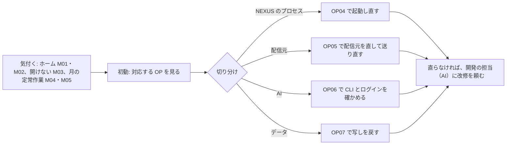

# BD-11 運用設計書（NEXUS）

- 読んだもの: RD-11 1.0、RD-12 1.1、RD-13 1.0、RD-15 1.0、BD-01 0.1、BD-02 0.1（5章 バッチ）、BD-06 0.1、BD-09 0.1、BD-10 0.1。今の Mac mini の運用は cerebellum の `README.md`（launchd への置き方、ログの置き場所）を読んで確かめた。
- 運用するのも使うのも本人1人で、通知は作らない（Q-009 の答え）。監視は、ホームに出すもの（NFR-022）と、本人が見る Mac mini のログだけにする（Q-036 の答え）。
- 0.2: X-05 RV06 の指摘と、Q-079〜Q-081 の答え、CR-003（2026-11-24 承認）で直した（2026-11-24）。RV07 の指摘も直した。
- 1.0: 基本設計の完了判定（X-05 PG02。2026-11-24 RD-01 SH01。条件付きで進める）で承認した。
- 1.1: X-04 CR-016（2026-11-26 RD-01 SH01 が承認）で、サービスの目標の再起動の戻りを、本人のログインからの5分に直した。
- 書いた AI: Claude（Opus 5.5）。人の承認の前の案である。

## 1. 運用の前提

| 項目 | 内容 |
|---|---|
| サービスの提供時間 | いつでも使える。計画停止は本人がいつでも取ってよい（RD-13 1章）。止めていて届かなかった日は、配信元が送り直す（Q-032 の答え） |
| サービスの目標 | 稼働率の目標は置かない（NFR-005）。守るのは、スリープから5分以内に人の手を借りずに使えることと、再起動では本人のログインから5分以内に使えること（NFR-005。CR-016）と、前日の終わりの時点まで戻せること（NFR-006） |
| 運用の体制 | 運用、保守、利用者の全てが本人（RD-01 SH01）。改修は本人が頼み、開発の担当（AI。RD-01 SH02）が行う（RD-13 6章）。外部の事業者は Anthropic だけで、NEXUS の運用の窓口は持たない |
| 問い合わせの窓口 | 該当なし（利用者と運用者が同じ本人。RD-13 2章） |

## 2. 監視

通知の仕組みは作らない（Q-009 の答え）。本人が行動する項目だけを、ホームかログで見えるようにする。

| 監視の番号 | 対象 | 見るもの | しきい値 | 通知先と手段 | 通知を受けたら |
|---|---|---|---|---|---|
| M01 | IF-001、IF-002（配信の受け取り） | その日の受け取りの記録（ENT-010） | 日本時間の7時を過ぎて、配信元ごとに、その日の対象日で結果が「受け取った」の記録が無い（NFR-022、BD-02 FN-020）。「断った」の記録だけの日も未着にする | ホームのカードに MSG-015、MSG-016 | OP05 |
| M02 | AI Runner、IF-004 | 失敗のまま終わった AI の実行（ENT-009） | 24時間以内に1件以上。自動の送り直しで次の実行が完了したものは数えない（Q-078 の答え。BD-02 FN-020） | ホームのカードに MSG-017 | OP06 |
| M03 | Web サーバ、Tailscale Serve | 画面が開けるか | 開けない | 端末の上の帯に MSG-018（本人が開いたときに気付く） | OP04 |
| M04 | BAT-001 | バックアップのログ（MSG-038、MSG-039）と別のディスクの写し | MSG-039 が出た、または直近の予定の回（毎日深夜。時刻は DD-09）の BAT-001 が MSG-038 で終わっていない（BAT-001 は毎日動くため。NFR-023） | 通知しない。本人が月の定常作業（7章 D02）でログを見る | OP08 |
| M05 | BAT-002 | 古い記録の削除のログ（MSG-040、MSG-041） | MSG-041 が出た | 通知しない。月の定常作業で見る | OP09 |

- 死活を外から確かめる口（Web サーバの状態を返す API。BD-01 6章）は、OP04 で本人が Mac mini から確かめるために使う。
- 応答の時間、エラーの件数、ディスクの使用量は、本人が行動するしきい値が無いので監視項目に入れず、7章の定常作業で見る。

## 3. ジョブの運用

| 項目 | 内容 |
|---|---|
| 運用カレンダー | 休日と月末を区別しない。BAT-001 は毎日、BAT-002 は毎月動かす（BD-02 5.4）。計画停止で Mac mini を止めているあいだに起動の時刻が過ぎたときは、その回は動かない（launchd の定期実行は、止まっていたあいだの回を後から動かすことがあるが、動いても結果は同じ。BD-02 5.1 再処理方式） |
| 止まったときの運用 | 気付く方法: M04、M05。再処理は本人が判断し、手で動かす（OP08、OP09）。夜間と休日も同じ（本人の都合のよいときに行う） |
| 手で動かす場合 | 本人が Mac mini でコマンドを打つ。動かした記録は、バッチのログ（開始と終了の日時、件数）に自動で残る（BD-02 5.4）。同じバッチが動いている間は、後から起動したものは何もせずに終わる（BD-02 5.4 多重起動） |

## 4. バックアップと復旧

| 項目 | 内容 |
|---|---|
| バックアップの対象と方法 | 対象: DB（ENT-001〜ENT-013）。方法と頻度と世代: BAT-001（BD-02 5.3）。毎日深夜、7日分（NFR-023）。保管場所: Mac mini につないだままの別のディスク（NFR-028、Q-064 の答え）。設定（launchd の設定、Tailscale Service の設定、NEXUS の設定のファイル）は、リポジトリの雛形と OP01 の手順から作り直せるので、バックアップに入れない。配信元の鍵は作り直す（OP03） |
| 復旧の目標 | 前日の終わりの時点まで、本人が気付いた日のうちに戻す（NFR-006） |
| 復旧の手順 | DB が壊れた、誤ってデータを消した: OP07（一番新しい写しを戻す）。写しには写しを取った時点の端末と配信元の鍵の照合値が入っており、その後に取り消した端末や鍵が戻ってしまうので、戻した後に端末（ENT-011）、登録コード（ENT-012）、配信元の鍵（ENT-013）を全て消し、OP03 で端末を登録し直し、配信元の鍵を作り直す（RD-12 NFR-013、NFR-014）。Mac mini を作り直した: OP01 で入れ直した後に OP07。別のディスクが壊れた: 新しいディスクをつなぎ、次の BAT-001 から写しを取り直す（その間は戻せる写しが無いので、OP08 で手で1回取る） |
| 復旧の訓練 | 総合テストのときに一度、試験の環境で OP07 を行う（RD-15 AC27）。その後は、NEXUS の DB の形を変えるリリースの前に一度行う |
| 災害時の対策 | 条件に当たらない（災害のときも続ける求めは無い。RD-13 4章） |

## 5. 障害対応

### 障害の重さの区分

| 区分 | 内容 | 対応の期限 |
|---|---|---|
| 重 | NEXUS が開けない、データが壊れた | 本人が気付いた日のうち（NFR-006） |
| 中 | 配信が届かない、AI に質問できない、バックアップが取れない | 本人の都合のよいとき（届かなかった日の分は後から送り直せる。Q-032 の答え） |
| 軽 | 記事の関係の判定が失敗した、古い記録が消えない | 次の定常作業のとき |

- 連絡先は全ての区分で本人だけ（1章）。

### 想定する障害と対応

| 構成要素・連携 | 止まったときに本人から見て起きること | 代わりの手段 | 最初の手順 |
|---|---|---|---|
| Web サーバ | 画面が開けない（MSG-018）。配信元の送信が失敗する | 無い（RD-13 4章）。直った後に配信元が送り直す | OP04 |
| AI Runner | 質問が「作成中」のまま進まない。記事の関係がつながらない | 読むことと学ぶことはできる | OP06 |
| DB | 画面が開いても内容が出ない（MSG-019） | 無い | OP04、OP07 |
| Tailscale Serve、Tailscale | 端末から開けない（MSG-018） | 無い | OP04 |
| IF-001、IF-002（配信元） | ホームに未着（MSG-015、MSG-016） | 無い。配信元を直して送り直す | OP05 |
| IF-003（sharpen が答えを読む） | 本人の画面では何も起きない。sharpen が「つながらない」として前の日の答えを使わずに今日のセットを作る（RD-10 IF-003） | 答えは NEXUS に残っているので、直った後の朝に sharpen が読める | OP04（NEXUS が動いているか）、OP05（sharpen のログ） |
| IF-004（Claude の CLI） | 質問に MSG-013、ホームに MSG-017 | 読むことと学ぶことはできる | OP06 |
| BAT-001、別のディスク | ログに MSG-039 | 前の日までの写しで戻せる | OP08 |
| BAT-002 | ログに MSG-041 | 次の月に消える | OP09 |

### 初動から復旧までの流れ

- 暫定対応と恒久対応: 暫定は OP の手順で動かし直すこと。恒久は本人が開発の担当に改修を頼み、PR で直す（6章）。

### 報告

- 報告する相手はいない（本人だけ）。セキュリティの事故の判断と最初に止めるものは BD-10 5章に従う。

### 振り返り

- 改修を頼んだ障害は、直した PR の本文に原因と再発を防ぐ手当てを書く。

## 6. リリースと変更

| 項目 | 内容 |
|---|---|
| リリースの方法 | 本人が PR を main にマージした後、本人が Mac mini で OP02 を行う（作り直し、launchd で動かし直す）。止まる時間は短く、利用者は本人だけなので、時間帯は決めない。配信元の受け取りの時刻（5時と5時半）の前後は避ける。 |
| 切り戻し | 戻す条件: リリースの後に画面が開けない、受け取りか質問ができない。戻す手順: OP02 の前の版に戻して動かし直す（OP02 の切り戻しの節）。DB の形を変えるリリースでは、リリースの前に OP08 で写しを取り、戻すときは OP07 で写しを戻す |
| 設定とデータの変更 | 端末の登録と取り消し（OP03）、配信元の鍵（OP03）は本人が Mac mini のコマンドで行い、申請と承認は無い（本人だけ）。記録は残さない（Q-059 の答え） |

## 7. 定常作業と運用手順の一覧

### 定常作業

| 番号 | 頻度 | 作業 | 担当 | 所要時間の目安 |
|---|---|---|---|---|
| D01 | 毎日（使うとき） | ホームの未着と AI の失敗を見る（M01、M02） | 本人 | 見るだけ |
| D02 | 月に1回（Renovate の更新を入れるとき。NFR-026） | 更新を入れる（OP02）。バックアップと古い記録の削除のログを見る（M04、M05）。端末と配信元の鍵の一覧を見て、知らない端末と使わない鍵を取り消す（BD-10 5章、OP03）。Mac mini の空きの容量を見る | 本人 | 決めない（見込みの根拠が無い） |
| D03 | 安全に関わる更新が出たとき | すぐ更新を入れる（NFR-026、OP02） | 本人 | 更新による |

### 運用手順の一覧

手順書は、リポジトリの `docs/operations/` に OP の番号ごとに置く（実装で書く。NFR-027 で Phase 2 を終えるまでにそろえる。RD-13 7章）。

| 番号 | 名前 | きっかけ | 実施する役割 |
|---|---|---|---|
| OP01 | NEXUS を入れて、自動で動き出すようにする（launchd、Tailscale Service、別のディスクの置き場所） | 初めて入れるとき、Mac mini を作り直したとき | 本人 |
| OP02 | リリースと切り戻し | PR をマージしたとき、D02、D03 | 本人 |
| OP03 | 端末の登録と取り消し、配信元の鍵の用意と取り消し（FN-023、FN-024） | 端末を足すか替えるとき、鍵が漏れたとき、D02 | 本人 |
| OP04 | NEXUS が開けないときの確かめ方と起動し直し方（状態を返す API、launchd、Tailscale Serve、ログの見方） | M03 | 本人 |
| OP05 | 配信が届かないときの確かめ方と送り直し方（brain-harness と sharpen のログ、手で送る） | M01 | 本人 |
| OP06 | AI が失敗するときの確かめ方（AI の実行の記録、CLI が動くか、ログインが有効か、使える量） | M02 | 本人 |
| OP07 | バックアップから戻す（どの写しを戻すか、Web サーバと AI Runner を止めて戻し、端末と配信元の鍵を消して登録し直し、動かし直す） | DB が壊れた、誤ってデータを消した、復旧の訓練 | 本人 |
| OP08 | バックアップを手で取る、取れないときの確かめ方（別のディスク） | M04、DB の形を変えるリリースの前 | 本人 |
| OP09 | 古い記録の削除を手で動かす | M05 | 本人 |
| OP10 | ログの見方とログを消す決まり（30日。NFR-025） | 全ての OP から参照する | 本人 |
| OP11 | 別のディスクの保管、戻すとき、捨てるとき（NFR-028、Q-064 の答え） | ディスクを替えるとき、捨てるとき | 本人 |

- 2章から6章で参照した OP01〜OP09 と、ログの見方（OP10）、ディスクの扱い（OP11）は、全てこの一覧にある。
- ログを30日で消す仕組み（NFR-025）は、ログのファイルを日ごとに分けて古いものを消すか、macOS の仕組みを使うかを DD-09 で決める。

### 運用の費用

- AI の費用は本人の今の Claude の契約の範囲（NFR-009）。D02 のときに、使える量の上限に当たっていないかを本人が見る。従量の課金が出ていないかは、使い始めて1か月の後に本人が請求を見る（RD-15 AC23）。

## 8. 上流との対応

| 元の要件（NFR・REQ）・BAT・IF | この書類の節 | 監視・手順の番号 |
|---|---|---|
| NFR-005 使える時間と戻り（REQ-027） | 1章、5章 | M03、OP01、OP04 |
| NFR-006 戻す時点と時間（REQ-028） | 4章 | OP07 |
| NFR-009 AI の費用（REQ-024） | 7章 運用の費用 | D02 |
| NFR-010 データの保存期間（REQ-028） | 3章 | M05、OP09 |
| NFR-020 AI の実行と受け取りの記録（REQ-023） | 2章 | M01、M02 |
| NFR-022 未着と AI の失敗の見え方（REQ-018） | 2章 | M01、M02、OP05、OP06 |
| NFR-023 バックアップの取り方（REQ-028） | 4章 | M04、OP08 |
| NFR-024 古い記録の消し方（REQ-028） | 3章 | M05、OP09 |
| NFR-025 ログの残し方（REQ-027） | 7章 | OP10 |
| NFR-026 ソフトウェアの更新（REQ-023） | 6章、7章 | D02、D03、OP02 |
| NFR-027 運用の手順の引継ぎ（REQ-027、REQ-028） | 7章 | OP01、OP02、OP03、OP04、OP05、OP06、OP07、OP08、OP09、OP10、OP11 |
| NFR-028 バックアップを読める人（REQ-028） | 4章 | OP07、OP11 |
| NFR-029 AI の使い方が規約に合う（REQ-029） | 5章（IF-004 の障害） | OP06 |
| BAT-001 | 2章、3章、4章 | M04、OP08 |
| BAT-002 | 2章、3章 | M05、OP09 |
| IF-001、IF-002 | 2章、5章 | M01、OP05 |
| IF-003 | 5章 | OP04、OP05 |
| IF-004 | 2章、5章 | M02、OP06 |

- RD-11 の可用性の NFR-005、NFR-006 と、RD-13 の運用・保守性の NFR-022〜NFR-027 は、全てこの表にある。
- BD-02 5章の BAT-001、BAT-002 は、3章と2章の M04、M05 に現れる。

## 9. 未決事項

この書類で起こした未決事項は無い。
