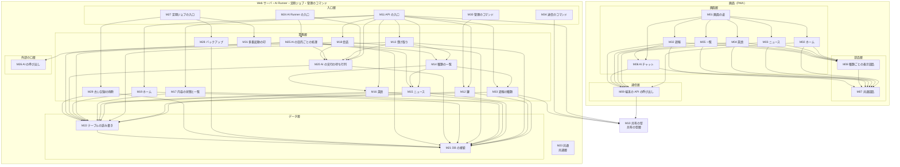

# DD-01 内部構造設計書（モジュール構成）（NEXUS）

- 読んだもの: BD-01 1.3、BD-02 1.1（5章のバッチの節を含む）、BD-03 1.1、BD-06 1.1、BD-07 1.1、BD-09 1.1、BD-10 1.1、BD-11 1.0、X-02 1.3、X-04 1.1（CR-009 まで）、X-06 1.1、X-07 1.1、依頼の文（`NEXUS_implementation_handoff/NEXUS_IMPLEMENTATION_HANDOFF.md` 3章、6章、7章）。
- ESLint の Next.js の標準の設定（`eslint-config-next`）が `eslint-plugin-import` を含むことは、cerebellum の `web/node_modules/eslint-config-next/package.json`（15.5.22）で確かめた（2026-11-24）。
- 0.1: 初めて書いた（2026-11-24）。
- 0.2: X-05 RV16 の指摘で直した（2026-11-25）。M14 の責務に、検索の本文と種類ごとの中身の残し方と、種類の値の確かめを足した（RV16-05）。5章の「共通」の行に支える NFR を書き、範囲で書いた番号を並べた（X-01 の鎖のため）。
- 0.3: X-05 RV17 の指摘で、多重起動の印を扱う業務層の M31 を足した（2026-11-25。RV17-03）。
- 1.0: 詳細設計の完了判定（X-05 PG03。2026-11-25 RD-01 SH01。進める）で承認した。
- 1.1: X-04 CR-020（2026-11-27 RD-01 SH01 が承認）で、調査の週報（IF-005、FN-025〜FN-028、SCR-010、SCR-011）のために M32（週報の画面）、M33（週報の種類の処理）、M34（送信のコマンド）を足し、M01、M02、M08、M10、M11、M12、M14、M19、M21、M22 の受け持ちを広げた。構成要素に送信のコマンド（BD-01 3章）を足した。
- 書いた AI: Claude（Opus 5.5）。人の承認の前の案である。

## 1. 構成要素ごとの層の分け方

BD-01 3章の構成要素は7つある（CR-009 で管理のコマンドを足した）。このうち DB と Tailscale Serve は製品で、NEXUS のコードを持たない。DB の中のテーブルは DD-03 で、Tailscale Serve の設定は DD-09 で決める。NEXUS のコードは1つのリポジトリの TypeScript で書き、画面、Web サーバ、AI Runner、定期ジョブ、管理のコマンドが同じ `src/` の下のモジュールを分けて使う（ADR-006、ADR-008）。

### 1.1 画面（PWA）

対象の構成要素: 画面（PWA）（BD-01 3章）。

層の一覧:

| 層 | 受け持つこと |
|---|---|
| 画面層 | 画面の道（URL）を割り当て、画面ごとに部品を組み立て、本人の操作を受けて通信層を呼ぶ。業務の規則は書かない |
| 部品層 | BD-09 6章の共通部品と、種類ごとの表示部品。データを取りに行かず、渡された値を見せる |
| 通信層 | Web サーバの端末の API を呼び、SSE で応答の続きを受ける。鍵は Cookie にあるので、この層では扱わない |
| 共有の型層 | 端末の API の求めと応答の型と、その形の検証。画面と Web サーバの両方が使う（M10） |

層の間の依存の規則:

- 画面層 → 部品層、通信層、共有の型層 の向きだけを許す。部品層 → 共有の型層、通信層 → 共有の型層 を許す。部品層の中では、種類ごとの表示部品（M08）から共通部品（M07）を呼んでよい。逆は呼ばない。
- 画面の全ての層から、`src/server/`、`src/runner/`、`src/jobs/`、`src/cli/` を読み込まない。鍵の照合値や DB の部品が画面の束に入るのを防ぐためである（BD-10 4章 秘密情報の管理）。
- 画面のデータは、全て通信層を通して端末の API で読む。画面の道のファイルから DB を直接読まない。端末の鍵の確かめを API の入口（M11）の1か所にそろえるためである（BD-01 6章 認証・認可）。

### 1.2 Web サーバ、AI Runner、定期ジョブ、管理のコマンド

対象の構成要素: Web サーバ、AI Runner、定期ジョブ、管理のコマンド、送信のコマンド（BD-01 3章）。前の4つは別のプロセスとして動くが（ADR-008）、業務層とデータ層のモジュールを共有する。層の分け方は5つで同じにする。送信のコマンド（M34。CR-020）は送り手のユーザで動き、NEXUS の DB を読み書きしないので、業務層とデータ層を使わず、共有の型層（M10）と共通層（M23）だけを使う。

層の一覧:

| 層 | 受け持つこと |
|---|---|
| 入口層 | 外からの求め（HTTP、launchd の起動、コマンドの引数）を受け、鍵か引数を確かめ、業務層を呼び、結果を応答か終了コードに変える。業務の規則と SQL は書かない |
| 業務層 | 業務の規則を守って処理する（BD-02 の事後条件、業務ルール、状態遷移）。トランザクションの境界はこの層に置く（DD-05） |
| データ層 | DB の接続とテーブルの読み書き。SQL はこの層の外に書かない |
| 外部の口層 | Claude Code の CLI（`claude -p`）を子のプロセスとして起動する。CLI を起動するのはこの層だけである（ADR-005、依頼 7章の AIProvider） |
| 共通層 | 日時（日本時間の区切り）、乱数と照合値、ログ、MSG の一覧、エラーの型。ほかのどの層にも依存しない |
| 共有の型層 | 1.1 と同じ M10 |

層の間の依存の規則:

- 入口層 → 業務層、共通層、共有の型層 を許す。入口層からデータ層と外部の口層を呼ばない。入口層どうしは呼ばない。
- 業務層 → 業務層、データ層、共通層 を許す。業務層どうしの呼び出しは輪にしない。外部の口層を呼ぶのは M25 だけである。
- 業務層から共有の型層（M10）を呼ぶのは M33 だけにする（IF-005 の本文の形を M34 と同じ定義で確かめるため。CR-020）。送信のコマンド M34 は入口層で、M10 と M23 だけを呼ぶ（業務層とデータ層を呼ばない）。
- データ層 → 共通層 を許す。データ層の中では、M22 から M21 を呼ぶ。
- 外部の口層 → 共通層 だけを許す。
- 共通層と共有の型層は、ほかのモジュールを呼ばない。
- 上の向きの逆（データ層から業務層、業務層から入口層など）は全て許さない。

### 1.3 規則の確かめ方

- 層の向きは、ESLint の `import/no-restricted-paths` に、1.1 と 1.2 の規則をフォルダの組で書いて確かめる。`eslint-plugin-import` は Next.js の標準の設定に含まれるので（X-07 3章で決めた ESLint の設定）、部品を足さずに済む。
- 業務層どうしの輪は、ESLint の `import/no-cycle` で確かめる。
- 外部の口層だけが子のプロセスを起動することは、`no-restricted-imports` で `node:child_process` を M26 の外から読み込めなくして確かめる。
- これらを検証のコマンドのリンタに入れる（X-07 3章「確かめ方」）。コマンドの中身は DD-09 で決める。
- 1つのモジュールの中の書き方（関数の大きさなど）は確かめない。人のレビューで見る。

### 1.4 構成図

- 共通層（M23）は全てのサーバの側のモジュールから使うので、矢印を省いた。依存の全ては 2章の表にある。
- 画面層の M02〜M05 から M06 への矢印（AI チャットを開く）と、M02〜M06 から M10 への矢印は、図を読みやすくするため省いた。2章の表にある。

## 2. モジュール一覧

モジュール名はフォルダの道で書く（X-07 2章。フォルダとファイルは kebab-case）。「依存」の列は、呼び出す依存するモジュールの番号である。

| モジュール番号 | モジュール名 | 層 | 責務 | 公開する操作 | 依存 |
|---|---|---|---|---|---|
| M01 | `src/app/(screens)` | 画面層 | 画面の道（SCR-001、SCR-002、SCR-004、SCR-005、SCR-007〜SCR-011。SCR-010、SCR-011 は CR-020）を割り当て、共通の枠（上の帯、PWA の manifest、service worker の登録）を置く。各画面の中身は M02〜M06 に任せる。SCR-003 と SCR-006 は下から出る面なので、道を持たない（BD-09 5章） | 画面の道ごとの page と layout | M02、M03、M04、M05、M06、M32、M07、M09 |
| M02 | `src/screens/home` | 画面層 | SCR-001 ホーム。円形 HUD（7つの機能。Research は CR-020）、カード、未着と失敗の知らせ、Research のカードの未読の週報の数を見せる（FN-020） | ホームの画面の部品 | M06、M07、M08、M09、M10 |
| M03 | `src/screens/news` | 画面層 | SCR-002 News Galaxy と SCR-003 記事の案内。ニュースの図（React Flow）、案内の面、既読と保存の操作（FN-003〜FN-006） | 図の画面の部品、案内の面の部品 | M06、M07、M08、M09、M10 |
| M04 | `src/screens/english` | 画面層 | SCR-004 英語の教材の一覧と SCR-005 英語の学習。回答、採点、完了、既読と保存の操作（FN-005、FN-006、FN-008〜FN-012） | 一覧の画面の部品、学習の画面の部品 | M06、M07、M08、M09、M10 |
| M05 | `src/screens/lists` | 画面層 | SCR-007 Inbox、SCR-008 Explore、SCR-009 Library。種類を問わない一覧と検索（FN-017〜FN-019） | 一覧の画面の部品 | M07、M08、M09、M10 |
| M06 | `src/screens/chat` | 画面層 | SCR-006 AI チャット。会話の選択、質問、応答の続きの表示、送り直しと止める（FN-014〜FN-016）。M02〜M04 から、対象（内容ID と選んだ箇所）を受けて開く | AI チャットの面を開く（対象 → 面） | M07、M09、M10 |
| M07 | `src/ui` | 部品層 | BD-09 6章の共通部品（下から出る面、内容の一覧の行、空の状態、下の知らせ、確認の面、質問の対象の印、届いた文の表示）。動きを減らす設定をここで読み、全ての動きに当てる（NFR-008） | 部品ごとの React のコンポーネント | なし |
| M08 | `src/ui/kinds` | 部品層 | 種類ごとの表示部品（ニュースの記事のカードと案内、英語の教材の本文と問題、週報の方法の行と印。週報は CR-020）。新しい種類を足すときに足す3つのうちの1つ（NFR-004） | 種類ごとのコンポーネント | M07 |
| M09 | `src/client` | 通信層 | 端末の API を呼び、応答を M10 の形で確かめる。SSE をつなぎ、切れたら受け取った位置から受け直す（ADR-013）。API が MSG-020 を返したらそのまま画面に渡す | API ごとの呼び出し、応答の続きを受ける（会話、発言 → 続きの流れ） | M10 |
| M10 | `src/contracts` | 共有の型層 | 端末の API の求めと応答の型と、その形の検証（ADR-019）。IF-005 の週報の本文の形（`ResearchReportPayload`）もここに置き、M33 と M34 が同じ定義で確かめる（CR-020）。道と項目は DD-04 で決める | API ごとの型と検証の形 | なし |
| M11 | `src/app/api` と登録の URL の道 | 入口層 | Next.js の Route Handlers。端末の API、配信元の API（BD-06 4.1 の道。IF-005 の `postResearchReport` を含む。CR-020）、登録の URL を開いたとき（FN-023）、状態を返す API（BD-01 6章 監視）を受ける。各 handler の最初で M12 に鍵を確かめさせ、求めの形を M10 か M14 で確かめ、業務層を呼び、結果を状態の番号と MSG に変える（BD-06 4.2、BD-09） | 道ごとの handler | M10、M12、M13、M15、M16、M17、M18、M19、M20、M23 |
| M12 | `src/server/auth` | 業務層 | 端末の鍵、配信元の鍵、登録コードを作り、照合値で確かめ、取り消す（FN-023、FN-024。BD-10 4章）。配信元 brain-research は IF-005 だけを使える（CR-020）。鍵そのものは作ったときに返すだけで、残さない | 端末の鍵を確かめる（Cookie の値 → 端末か拒否）、配信元の鍵を確かめる（鍵、使う連携 → 配信元か拒否）、登録コードを作る、登録コードで端末を作る、端末を取り消す、端末の一覧、配信元の鍵を作る、取り消す、一覧 | M21、M22、M23 |
| M13 | `src/server/ingest` | 業務層 | 種類を問わない受け取り（FN-001、FN-007 の共通の部分）。受け取りの記録を残し、同じ日の同じ内容を置き換え、同じ送信の重なりを見分ける（RD-03 R01、R06、NFR-015）。種類ごとの形の確かめは M14 から呼ぶ。ニュースを1件以上残したら、記事の関係の判定を M20 で待ちに入れる | 受け取る（配信元、種類、届いた形 → 受け取った件数と断った記事と理由） | M14、M20、M21、M22、M23 |
| M14 | `src/server/kinds` | 業務層 | 種類の一覧（news、english、research。research は CR-020 で M33 を登録する）。種類ごとに、受け取りの形の確かめ（見出しと、検索の本文と、種類ごとの中身を返す）、種類ごとの中身を残す・読む処理、AI に渡す内容の組み立てを引けるようにする（NFR-004）。共通の部分（M13、M17、M18、DD-02 3章 P08）は種類の値を直に分けず、この一覧から引く。種類の値が正しいかもこの一覧で確かめる（DD-03 で `content.kind` に値の検査制約を置かない。RV16-05）。新しい種類を足すときに足すのは、この一覧への登録と、種類ごとのモジュール（形の確かめ、渡す内容の組み立て、種類ごとの中身のテーブルとマイグレーション）と、表示部品（M08）である。M15、M16 は M14 を読み込まず、同じ形の操作を公開する（輪を作らないため） | 種類から操作を引く（種類 → 形の確かめ、中身を残す・読む、渡す内容の組み立て）、種類の値か確かめる | M15、M16 |
| M15 | `src/server/kinds/news` | 業務層 | ニュースに固有の処理。IF-001 の形の確かめ、記事の図と案内のデータ（FN-003、FN-004）、AI チャットに渡す内容の組み立て（BD-02 FN-015 業務ルール）、記事の関係の判定に渡す記事の選び方と、返った関係の確かめ方と残し方（FN-002 業務ルール） | 形を確かめる、図のデータを読む（日付 → ノードと線）、案内を読む（内容ID → 案内と関係）、渡す内容を組み立てる、判定に渡す記事を選ぶ、判定の結果を残す | M21、M22、M23 |
| M16 | `src/server/kinds/english` | 業務層 | 英語に固有の処理。IF-002 の形の確かめ、教材の一覧と教材（FN-008、FN-009）、回答、採点、完了（FN-010〜FN-012）、sharpen に返すセットと答え（FN-013）、AI チャットに渡す内容の組み立て | 形を確かめる、一覧を読む、教材を読む、回答を残す、採点する、完了にする、セットと答えを読む（日付 → セット、答え）、渡す内容を組み立てる | M21、M22、M23 |
| M17 | `src/server/contents` | 業務層 | 種類を問わない内容の状態と一覧（FN-005、FN-006、FN-017〜FN-019）。内容（ENT-001）と内容の状態（ENT-006）だけで動く（BD-02 4章） | 既読にする、保存する、保存を取り消す、新着と未読の一覧、検索、保存した内容の一覧 | M21、M22、M23 |
| M18 | `src/server/chat` | 業務層 | 会話の選択（FN-014）、質問の受け付け（FN-015 の 1〜2）、送り直しと止めるとやめる（FN-016）。応答の続きを DB から位置で読み出す（SSE の中継で M11 が呼ぶ） | 会話を開く（対象 → 会話）、質問を受ける（会話、質問 → 受け付けた）、送り直す、止める、やめる、続きを読む（発言、位置 → 続きと状態） | M20、M21、M22、M23 |
| M19 | `src/server/home` | 業務層 | ホームの表示のデータ（FN-020）。未着（BD-11 M01）と AI の失敗（BD-11 M02）と、未読の週報の数（CR-020）を数える | ホームを読む（今 → カードと知らせ） | M21、M22、M23 |
| M20 | `src/server/ai-jobs` | 業務層 | AI の実行（ENT-009）の待ち行列。待ちに入れる、拾う（1件を2つの枠が拾わない）、状態を進める、自動の送り直しを1回だけ待ちに入れる、止める求めを立てる（BD-02 3章の ENT-009 の状態遷移。実現は DD-05）。状態を返す API のための待ちの数も返す | 待ちに入れる（目的、対象 → 実行）、次を拾う（空いている枠 → 実行か無し）、完了にする、失敗にする（理由）、中止にする、止める求めを立てる、処理中のまま残ったものを失敗にする、待ちの数 | M21、M22、M23 |
| M21 | `src/server/db` | データ層 | DB の接続、トランザクションの関数、マイグレーション（外部キーの検査を止めて当てるファイルの扱いを含む。DD-03 5章、CR-020）、動かしたままの写し（BAT-001 が使う SQLite のバックアップの機能）。SQLite の部品（`node:sqlite`。ADR-020）は、この中だけで使う | トランザクションで動かす（関数 → 結果）、マイグレーションを当てる、写しを作る（置き場所 → 結果） | M23 |
| M22 | `src/server/repositories` | データ層 | テーブルごとの読み書き（ENT-001〜ENT-015。物理名は DD-03。ENT-014、ENT-015 は CR-020） | テーブルごとの読む、残す、変える、消す | M21、M23 |
| M23 | `src/server/shared` | 共通層 | 日本時間の日付と区切り（BD-01 6章）、ID と推測できない乱数と照合値（BD-10 4章）、ログ（鍵と認証の情報を出さない。NFR-019）、MSG の番号と文（BD-09 1章）、エラーの型（DD-06）、設定の読み込み（DD-09 の設定の名前） | 今の日本時間の日付、乱数を作る、照合値を作る、ログを出す、MSG を引く、設定を読む | なし |
| M24 | `src/runner` | 入口層 | AI Runner のプロセスの入口。起動したときに処理中のまま残った実行を失敗にし（NFR-005）、空いている枠（同時に2つまで。NFR-017）に M20 から実行を拾わせ、M25 に渡す。5分の上限と止める求めを見張り、M25 に止めさせる | 起動する、止める（launchd から） | M20、M23、M25 |
| M25 | `src/runner/purposes` | 業務層 | 目的ごと（記事の関係の判定、質問の応答、会話の要約）の処理。渡す内容を組み立て（M14、M15）、写しを AI の発言に残し、M26 で AI を呼び、出来事を読んで応答を書き足し、ツールを使った回数を数え、結果を残す。失敗の種類で、自動の送り直しをするかを決める（BD-06 IF-004 再送と重複）。質問の応答が終わったら、会話の要約を待ちに入れるかを決める（Q-076） | 実行する（実行 → 完了、失敗、中止） | M14、M15、M20、M21、M22、M23、M26 |
| M26 | `src/runner/ai-provider` | 外部の口層 | AI を呼ぶ1か所（ADR-005、依頼 7章の AIProvider）。本番は `claude -p` を引数の配列で起動し、標準入力に渡す内容を書き、標準出力の出来事を1行ずつ返す。試験と開発では、決まった応答を返す偽の AI を使う（BD-01 4章）。CLI の引数と設定は DD-09、出来事の項目の名前は DD-04 で決める | 呼ぶ（目的、渡す内容、止める合図 → 出来事の流れと終わりの状態） | M23 |
| M27 | `src/jobs` | 入口層 | 定期ジョブの入口。起動の引数でどのバッチかを決め、M31 で多重起動を防ぎ、開始と終了と件数をログに出し、終了コード（0、1、2）を返す（BD-02 5.4）。launchd からも、本人が手で動かすときも、同じ入口を使う | バッチを動かす（バッチの名前 → 終了コード） | M23、M28、M29、M31 |
| M28 | `src/jobs/backup` | 業務層 | BAT-001 データのバックアップ（FN-021）。写しを作り終えてから決まった名前にし、本人のユーザだけが読める権限にし、7日より古い写しを消す（BD-02 5.3） | 写しを取る（今 → 結果と件数） | M21、M23 |
| M29 | `src/jobs/purge` | 業務層 | BAT-002 古い記録の削除（FN-022）。受け取りの記録ID を空にしてから、1年より前の記録を消す（BD-02 5.3） | 古い記録を消す（今 → 消した件数） | M21、M22、M23 |
| M30 | `src/cli` | 入口層 | 管理のコマンドの入口（FN-023 の登録の URL を出す、一覧、取り消し。FN-024 の鍵の用意、一覧、取り消し）。Mac mini の本人のユーザで打つ（BD-10 2章）。鍵と登録の URL は、作ったときに1回だけ出す | コマンドごとの入口 | M12、M23 |
| M31 | `src/jobs/lock` | 業務層 | 定期ジョブの多重起動の印（DD-03 `job_lock`）を、1つの書き込みの権利の中で取り、古い印を置き換え、自分の番号の印だけを消す（DD-05 4章。RV17-03） | 印を取る（バッチの名前、プロセスの番号 → 取れたか）、印を消す（バッチの名前、プロセスの番号） | M21、M22、M23 |
| M32 | `src/screens/research` | 画面層 | SCR-010 課題の一覧と SCR-011 課題の週報（CR-020）。課題の一覧、週報の全体像と今週の変化、方法を広げる、週の切り替え、既読と保存の操作（FN-005、FN-006、FN-026、FN-027）。AI チャットは M06 を開く | 一覧の画面の部品、週報の画面の部品 | M06、M07、M08、M09、M10 |
| M33 | `src/server/kinds/research` | 業務層 | 週報に固有の処理（CR-020）。IF-005 の形の確かめ（M10 の `ResearchReportPayload`）、研究課題と週報の作成と置き換え（FN-025）、課題の一覧と週報（FN-026、FN-027）、検索の本文（課題名、現時点の答え、方法の見出し。RD-03 R19）、AI チャットに渡す内容の組み立て（BD-02 FN-015 業務ルール） | 形を確かめる、週報を残す（課題の ID、週 → 作ったか置き換えたか）、課題の一覧を読む、週報を読む（内容ID → 週報と週の一覧）、検索の本文を返す、渡す内容を組み立てる | M10、M21、M22、M23 |
| M34 | `src/cli/send` | 入口層 | 送信のコマンド `nexus-send`（FN-028。CR-020）。送り手（brain-harness の研究ループ）が送り手のユーザで打つ。ファイルを読み、M10 の `ResearchReportPayload` で形と大きさを確かめ、環境変数の鍵を付けて IF-005 に送り、NEXUS の結果か理由を出し、終了コードを返す。NEXUS の DB と設定のファイルを読まない | コマンドの入口（送り手、種類、ファイル → 終了コード） | M10、M23 |

### 2.1 状態を持つか

複数台では動かさない（BD-01 4章 冗長化）。Web サーバと AI Runner はそれぞれ1つのプロセスで動く。

| モジュール番号 | 持つもの | 作り直す時機 |
|---|---|---|
| M09 | つないでいる SSE と、受け取った応答の位置（端末のブラウザの中） | 画面を開き直したとき。位置は DB にある続きから受け直す（ADR-013） |
| M21 | DB の接続（プロセスごとに1つ） | プロセスの起動のとき |
| M24 | 動いている実行と、その子のプロセスと、5分の時計 | AI Runner の起動のとき。前の起動で処理中のまま残った実行は、M20 で失敗にしてから始める（NFR-005） |
| M26 | 起動した `claude -p` の子のプロセス | 実行ごとに作り、終わったら捨てる |

- 2章のほかのモジュールは状態を持たない。M11 と M18 は、SSE の中継で、つないでいる間だけ送った位置を持つ。要求をまたいで持つものは無い。

## 3. 既製部品とフレームワークの使い方

- 版の決め方: 全ての部品の版を `package.json` で固定し、ロックファイルをリポジトリに入れる。上げるのは Renovate の PR だけにする（NFR-026、BD-11）。

| 使う部品 | 選んだ理由 | 使い方の決まり | 部品を包むモジュール |
|---|---|---|---|
| Next.js（App Router） | BD-01 5章、依頼 3章 | Route Handlers は Node.js の実行環境で動かす（DB のファイルを読むため。BD-01 5章）。Server Actions は使わない。端末の API を DD-04 の1か所に並べ、鍵の確かめを M11 にそろえるためである。Next.js の middleware で鍵を確かめない（各 handler の最初で M12 を呼ぶ。呼び忘れは DD-10 のテストで確かめる） | 包まない |
| React | BD-01 5章 | 画面の部品だけで使う。`dangerouslySetInnerHTML` を使わない（X-07 3章） | 包まない |
| Tailwind CSS | ADR-006 | 色、余白、文字の大きさの値は設定のファイルに置き、部品の中に直に書かない。値は BD-09 と BD-13 の試作に合わせる | 包まない |
| Motion | ADR-006 | 動きを減らす設定は、M07 の1か所で Motion の設定に渡し、全ての動きに当てる（NFR-008、BD-09 5章 アクセシビリティ） | M07 が設定を持つ |
| React Flow | ADR-015 | ニュースの図（SCR-002）だけで使う。ノードの中身は M08 の部品で描く | M03 だけが読み込む |
| react-markdown と remark-gfm | ADR-018 | M07 の「届いた文の表示」だけで使う。生の HTML を描く追加の部品（`rehype-raw` など）を入れない。描く書式は BD-09 6章の見出し、段落、箇条書き、強調、表、リンクに限る | M07 |
| zod | ADR-019 | 端末の API の形（M10）と、配信元から届く形（M15、M16）の確かめだけで使う。上限の値は BD-06 と DD-04 から写さず、定数として1か所に置く（DD-04） | 包まない（M10、M15、M16 が形を定義する） |
| SQLite の部品（`node:sqlite`） | ADR-007、ADR-020 | M21 の外から読み込まない | M21 |
| Node.js の `node:child_process` | 依頼 7章 | M26 だけで使う。シェルを通さず、引数の配列で起動する（X-07 3章）。渡す環境変数は M26 で絞る（BD-01 7章 NFR-016） | M26 |
| Node.js の `node:crypto` | BD-10 4章 | 乱数と照合値は M23 の関数だけで作る | M23 |

- テストの道具と、AI Runner と定期ジョブと管理のコマンドを動かす形（TypeScript を前もって変換するか）は、DD-09 と DD-10 で決める。

## 4. 横断的な処理の置き場所

| 横断的な処理 | 実現するモジュール | 詳細を決める書類 |
|---|---|---|
| 端末の認証（BD-01 6章） | M12。M11 の端末の API の handler が、最初に明示的に呼ぶ。登録の URL の handler だけは端末の鍵を求めず、登録コードを M12 で確かめる | DD-02（X-06 で DD-07 を省いた）、DD-04 |
| 配信元の認証と使える連携の判定（NFR-014） | M12。M11 の配信元の API の handler が、使う連携を添えて最初に呼ぶ | DD-02、DD-04 |
| 管理のコマンドの確かめ | M30。Mac mini の本人のユーザで動くことに任せ、NEXUS の鍵を使わない（BD-10 2章） | DD-09 |
| 入力の形と上限の確かめ（NFR-015、BD-10 4章） | 端末の API は M10 の形を M11 で、配信元の形は M14 から引いた M15、M16 の形を M13 で確かめる | DD-04 |
| エラーとメッセージ | M23 のエラーの型と MSG の一覧。M11 が状態の番号と MSG に、M27 が終了コードに、M30 がコマンドの出力に変える。画面は M07 で見せる | DD-06 |
| ログ（鍵と認証の情報を出さない） | M23 のログの関数。各プロセスが日ごとのファイルに書き、30日より古いファイルを消す（BD-01 6章。CR-013） | DD-06、DD-09 |
| AI の実行の記録（NFR-020） | M20 が状態と理由を、M25 がツールを使った回数を ENT-009 に残す | DD-06 |
| 受け取りの記録（NFR-020） | M13 | DD-06 |
| トランザクションと排他 | M21 のトランザクションの関数を、業務層が処理ごとに呼ぶ | DD-05 |
| 日時の区切り（日本時間） | M23 | DD-02 |
| 届いた文の表示（スクリプトを動かさない。NFR-018） | M07 | DD-02 |
| AI を呼ぶところを1か所にする（ADR-005） | M26。ほかから `claude -p` を起動しない（1.3 の検査） | DD-04（出来事の項目）、DD-09（CLI の引数と設定） |
| 動きを減らす設定（NFR-008） | M07 | DD-02 |
| 応答の中継（SSE。ADR-013） | M11 の handler が M18 で続きを読み、M09 が受ける | DD-04 |

## 5. 上流との対応

| 構成要素（BD-01） | モジュール | 受け持つ FN・BAT・IF |
|---|---|---|
| 画面（PWA） | M01 | 共通（NFR-007、NFR-011） |
| 画面（PWA） | M02 | FN-020（Research のカードを含む。CR-020） |
| 画面（PWA） | M03 | FN-003、FN-004、FN-005、FN-006 |
| 画面（PWA） | M04 | FN-005、FN-006、FN-008、FN-009、FN-010、FN-011、FN-012 |
| 画面（PWA） | M05 | FN-017、FN-018、FN-019 |
| 画面（PWA） | M06 | FN-014、FN-015、FN-016 |
| 画面（PWA） | M32 | FN-005、FN-006、FN-026、FN-027（CR-020） |
| 画面（PWA） | M07 | 共通（NFR-008、NFR-018） |
| 画面（PWA） | M08 | 共通（NFR-004、NFR-008） |
| 画面（PWA） | M09 | 共通（NFR-001、NFR-002） |
| 画面（PWA）、Web サーバ | M10 | 共通（NFR-015） |
| Web サーバ | M11 | FN-001、FN-003、FN-004、FN-005、FN-006、FN-007、FN-008、FN-009、FN-010、FN-011、FN-012、FN-013、FN-014、FN-015、FN-016、FN-017、FN-018、FN-019、FN-020、FN-025、FN-026、FN-027 の API、FN-023（登録の URL を開く）、IF-001、IF-002、IF-003、IF-005 |
| Web サーバ、管理のコマンド | M12 | FN-023、FN-024、FN-025（鍵の確かめ） |
| Web サーバ | M13 | FN-001、FN-007、IF-001、IF-002 |
| Web サーバ、AI Runner | M14 | 共通（NFR-004） |
| Web サーバ、AI Runner | M15 | FN-001、FN-002、FN-003、FN-004、FN-015、IF-001 |
| Web サーバ、AI Runner | M16 | FN-007、FN-008、FN-009、FN-010、FN-011、FN-012、FN-013、FN-015、IF-002、IF-003 |
| Web サーバ、AI Runner | M33 | FN-015、FN-018、FN-025、FN-026、FN-027、IF-005（CR-020） |
| Web サーバ | M17 | FN-005、FN-006、FN-017、FN-018、FN-019 |
| Web サーバ | M18 | FN-014、FN-015、FN-016 |
| Web サーバ | M19 | FN-020 |
| Web サーバ、AI Runner | M20 | FN-002、FN-015、FN-016 |
| Web サーバ、AI Runner、定期ジョブ、管理のコマンド | M21 | 共通（NFR-005、NFR-023） |
| Web サーバ、AI Runner、定期ジョブ、管理のコマンド | M22 | 共通（NFR-003、NFR-010） |
| Web サーバ、AI Runner、定期ジョブ、管理のコマンド | M23 | 共通（NFR-019、NFR-025） |
| AI Runner | M24 | FN-002、FN-015、FN-016 |
| AI Runner | M25 | FN-002、FN-015、FN-016、IF-004 |
| AI Runner | M26 | IF-004 |
| 定期ジョブ | M27 | FN-021、FN-022 |
| 定期ジョブ | M28 | FN-021 |
| 定期ジョブ | M29 | FN-022 |
| 定期ジョブ | M31 | FN-021、FN-022 |
| 管理のコマンド | M30 | FN-023、FN-024 |
| 送信のコマンド | M34 | FN-028、IF-005（CR-020） |
| DB | なし（製品。テーブルは DD-03） | 共通（NFR-005、NFR-023） |
| Tailscale Serve | なし（製品。設定は DD-09） | 共通（NFR-012、NFR-021） |

- BD-01 3章の構成要素8つ（画面、Web サーバ、AI Runner、DB、定期ジョブ、管理のコマンド、送信のコマンド、Tailscale Serve）は、全て 1章とこの表にある。送信のコマンドは CR-020 で BD-01 に足した。管理のコマンドは、この書類で起こした Q-083 の答え（CR-009）で BD-01 に足した。
- BD-02 の FN-001〜FN-028、BD-02 5章の BAT-001、BAT-002、BD-06 の IF-001〜IF-005 は、全てこの表のどれかの行にある。
- どの機能も受け持たないモジュール（「共通」の行）は、全てほかのモジュールから依存されている（2章の依存の列）。M01 は Next.js が道として読む。「共通」の行の括弧には、そのモジュールが支える非機能要件を書いた（X-01 で要件まで戻れるようにするため）。
- BAT-001、BAT-002 は BD-02 5章にまとめたバッチで、M27〜M29 の行は対応する FN-021、FN-022 で書いた。

## 6. 未決事項

この書類で起こした未決事項は全て決まった（Q-083。答えは X-04）。
