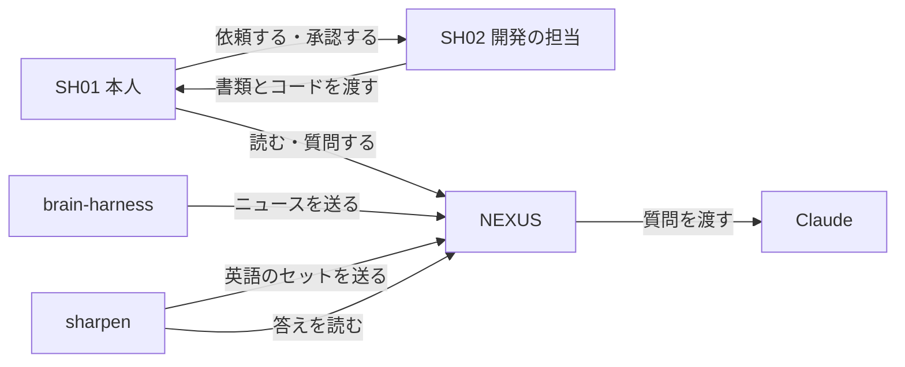

# RD-01 企画・目的書（ビジョン）（NEXUS）

- 読んだもの: 依頼の文（`NEXUS_implementation_handoff/NEXUS_IMPLEMENTATION_HANDOFF.md`。2026-11-23 更新の版。以下「依頼」と書き、章は依頼の章番号）、依頼に同梱の参照（`references/` のデザイン画像2枚）、X-04 0.2（Q の答え）。上流の書類は無い。
- 今の届き方は、本人の答え（Q-001、Q-018）が指した配信元と表示先のコードを読んで確かめた。読んだのは sharpen（`~/projects/sharpen`）、brain-harness（`~/projects/brain-harness`）、cerebellum（`~/workspace/indie-development/cerebellum`）で、いずれも 2026-11-23 の作業ツリーである。
- 0.2: Q-001〜Q-023 の答え（2026-11-23 本人）を書き入れ、関係者の節（RD-02 をまとめた先）を足した。
- 0.3: X-05 RV01 の指摘と Q-040、Q-053〜Q-063 の答え（2026-11-23 本人）で直した。
- 0.4: X-05 RV02 の指摘と Q-064、Q-065 の答え（2026-11-23 本人）で直した。
- 1.0: 要件定義の完了判定（X-05 PG01。2026-11-23 RD-01 SH01）で承認した。
- 書いた AI: Claude（Opus 5.5）。人の承認の前の案である。

## 1. 背景と課題

- 背景: 本人は、自分で動かしている2つの AI の仕組みから、毎朝情報を受け取っている。
  - ニュース: brain-harness の `/brain-collect` が毎朝5時に情報源の新着から10件を選び、1件ずつ日本語の案内（10行以内）と記事のリンクを付けて、cerebellum の汎用口へ送る（`brain-harness/.claude/skills/brain-collect/SKILL.md` 3行目・50行目、`bin/inbox-send.sh`）。送る項目は slug、種類、見出し、案内の本文だけで、画像とテーマは送っていない（同 SKILL.md 168〜176行目）。
  - 英語: sharpen の study-set が毎朝5時半に英語のセット（読む教材と問題）を作り、cerebellum の `/api/learning/sets` へ送る（`sharpen/.claude/skills/study-set/SKILL.md` 107行目、`scripts/deliver.sh` 14行目・188行目）。読む教材は `read.json` から `read.html` を作り、別のサーバ（ポート 48310）に置く（`deliver.sh` 86行目・133行目）。問題への答えは cerebellum が残し、sharpen が翌日に採点する（set.json の `lessonMd` の「昨日の英訳」）。
  - 本人は cerebellum の「今日」の画面から英語の行を選び、`/learning` の画面の本文にあるリンクから教材の HTML を開いている（cerebellum `web/src/features/learning/lib/lane.ts` 43行目、`LearningSession.tsx` 204行目）。
  - 情報の種類は今後増える見込みで、ニュースと英語はその代表にすぎない（依頼 1章）。
- 課題1: 英語の教材は「英語の行 → 決まった画面 → HTML」の順でしか開けず、教材の一覧が無い。本人は「英語の教材の一覧 → 教材」の順で開きたい（Q-001 の答え）。cerebellum の画面の一覧にも教材の一覧は無い（cerebellum `web/src/app/` のルート）。
- 課題2: 届いた情報について AI に続けて質問するには、内容を別の場所へ貼り直す必要がある（依頼 2章「ユーザーが文面を貼り直す必要はない」）。
- 現状の数字: 該当なし（成功指標を今の値との比で決めないため。Q-002 の答え）。

## 2. 目的と目標

目的: AI から届く多様な情報を1か所で受け取り、読み、探し、保存できるようにする。あわせて、表示中の内容をそのまま文脈として AI に質問できるようにし、情報を受け取るだけでなく学ぶ場所にする（依頼 0章、1章）。

| 目標 | 利用者にとっての成果 | 成功指標 | 測り方と時期 |
|---|---|---|---|
| G01 | 本人が、AI から届いたニュースと英語の教材を、種類ごとに見やすい形で、iPad と Android の端末から1か所で読み、保存できる。英語は教材の一覧から開き、問題に答えられる | 依頼 10章 Phase 1 と Phase 2 の受け入れ基準を満たす（Q-002 の答え） | 本人が Phase を終えるたびに確かめる（Q-002 の答え） |
| G02 | 本人が、届いて溜まった情報を後から検索し、過去の記事も含めて記事どうしの関係をたどって探せる | 依頼 10章 Phase 2 の受け入れ基準を満たす（Q-002 の答え） | 本人が Phase 2 を終えたときに確かめる（Q-002 の答え） |
| G03 | 本人が、開いているページ・記事・語句について、文面を貼り直さずに AI に質問し、前の会話の続きから話せる | 依頼 10章 Phase 3 の受け入れ基準を満たす（Q-002 の答え） | 本人が Phase 3 を終えたときに確かめる（Q-002 の答え） |
| G04 | 本人が、ニュースと英語のほかに新しい種類の情報を足しても、受け取り・検索・保存・AI への質問を同じように使える | 依頼 10章 Phase 2 の受け入れ基準を、ニュースと英語の2種類で同じ仕組みのまま満たす（Q-002 の答え） | 本人が Phase 2 を終えたときに確かめる（Q-002 の答え） |

- 優先順位: 期限が無いので日程でぶつかることは無いが、目標どうしがぶつかったときは G01、G03、G02、G04 の順に優先する（Q-003 の答え）。

## 3. 対象利用者

- 対象利用者: 本人1人（Q-004 の答え）。
- 対象外の利用者: 本人のほかの人（家族なども含む。Q-004 の答え）。インターネット上の不特定の人（Tailscale のプライベートな接続からだけ使うため。依頼 1章、3章）。
- 利用の環境: Android のスマートフォンと iPad から、PWA として使う。本人の Mac mini にサーバを置き、端末から Tailscale を通してつなぐ（依頼 1章、3章）。詳しい条件は RD-11 に書く。

## 4. 範囲

- 範囲:
  - AI から届く情報の受け取りと保存（依頼 5章 `POST /api/v1/deliveries`、10章 Phase 2）。今回受け取るのは、brain-harness のニュースと sharpen の英語のセットの2種類（Q-018、Q-015 の答え）。
  - 配信元の送り先の改修。sharpen と brain-harness が、cerebellum ではなく NEXUS に送るようにする（Q-015、Q-019、Q-020 の答え）。切り替えるときは、配信元が3日間 cerebellum と NEXUS の両方に送り、3日が過ぎたら cerebellum への送信をやめる。やめた後に NEXUS に届かなかったときは、cerebellum に戻さずに直し、届かなかった日の分は配信元が送り直す（Q-062、Q-065 の答え。RD-15 4章）。あわせて brain-harness は、記事の画像の URL とテーマを足して送る（Q-021 の答え）。情報の選び方や教材の作り方は変えない（Q-015、Q-019 の答え）。
  - ホーム（NEXUS cockpit）。円形の HUD で6つの機能（News Galaxy、English、Inbox、Explore、Library、AI Chat）を選び、右のカードから各機能へ移る（依頼 2章）。Inbox は届いた新着と未読の一覧、Explore は全ての種類をまたいだ検索と探索、Library は保存した内容の一覧（Q-005 の答え）。
  - News Galaxy。その日の記事を、過去の記事も含めて関係のある記事だけを線でつないだ図で見せ、選んだ記事の案内を下から出る面で読む。記事どうしの関係は、記事が届いたときに過去の記事とも照らして判定する（依頼 2章、Q-017 の答え）。
  - English。教材の一覧から教材を開いて読み、語句をタップすると説明を出し、問題に答えて答えを残す。sharpen が答えを読んで翌日に採点できるようにする（Q-001、Q-022 の答え）。教材は構造化したデータ（sharpen の `read.json` と `set.json`）として受け取り、NEXUS の表示部品で見せる（Q-010、Q-016 の答え。X-02 ADR-001）。
  - 全画面に共通の AI チャット。開いている内容と選んだ箇所を AI に渡して質問し、応答を順に表示し、会話を残して続きから話す（依頼 2章、6章、7章）。
  - 既読と保存、検索、過去の情報の閲覧（依頼 10章 Phase 2）。
- 対象外:
  - 依頼 10章の Phase 4（追加調査と教材作成の依頼をジョブにする、横断の関係づけ、学習の進み具合、検索の高度化）。次の版で扱う（Q-006 の答え。X-02 ADR-004）。ただし記事どうしの関係を過去の記事まで広げることは、今回の範囲に入れた（Q-017 の答え）。
  - 情報を作る AI の仕組みそのもの（ニュースの選び方と案内の書き方、教材と問題の作り方と採点）。送り先の改修と、ニュースに画像の URL とテーマを足すことだけを範囲に入れる（Q-007、Q-015、Q-019、Q-021 の答え）。
  - AI が作った HTML を隔離して表示する仕組み（依頼 8章の iframe）。英語の教材を構造化したデータで見せるので、今回は作らない（Q-016 の答え。X-02 ADR-001）。
  - cerebellum の改修。送り先を NEXUS に変えると cerebellum の「今日」の画面で英語とニュースが「未着」になるが、直すのは本人が別に行う（Q-023 の答え）。
  - 通知。依頼 11章で方式が未決定で、Phase 1〜3 の受け入れ基準に無いため（Q-009 の答え）。
  - これまでに届いたニュースと教材の取り込み。使い始めてから届いた分を扱う（Q-011 の答え）。
  - 紙や PDF で出す帳票（Q-013 の答え）。
- 新規か既存か: 新規（X-02 ADR-003）。対象リポジトリは `nexus`（このリポジトリ）。`setool status` は、Git で追跡している `README.md`（中身は見出し1行）があるため「既存」と判定した。アプリのコードは1行も無く、同梱の HTML モックは参考用で本番のコードにしないと依頼にある（依頼 0章、12章）。本人が「新規」として進めると決めた（2026-11-23 本人）。sharpen と brain-harness は既存のリポジトリだが、改修は送り先と送る項目だけで、NEXUS の書類で扱う（X-02 ADR-002）。
- 作り直しかどうか: 該当なし（新規のため）。

## 5. 制約と前提

- 制約:
  - フロントは Next.js と React を使った PWA で、スマートフォンを先に考えて作る（依頼 3章「確定」）。
  - サーバは本人の Mac mini に置き、端末からは Tailscale のプライベートな接続で使う（依頼 3章「確定」）。
  - AI を動かす CLI は Mac mini の上で動かし、ブラウザから直接起動しない。初めから CLI に制限の無いツールの実行権限を与えない（依頼 0章、7章）。
  - 期限は無い。AI を動かす費用は、本人が今持っている Claude の契約の範囲に収め、それを超える従量の課金をしない（Q-008 の答え）。
  - AI は、本人の Claude のサブスクリプションでログインした、改変していない Claude Code の CLI（`claude -p`）で動かす（Q-040 の答え。X-02 ADR-005）。Anthropic の利用規約に従う（Q-046 の答え）。
- 前提:
  - 本人の Mac mini と、端末をつなぐ Tailscale のネットワークは既にある。Mac mini では cerebellum（ポート 48210）、教材の HTML を配るサーバ（48310）、sharpen の単語帳（48330）が動いており、NEXUS はそこに足す（Q-012 の答え。ポートは各リポジトリの launchd の設定から）。崩れたら、サーバを置く場所とつなぎ方を決め直す。
  - sharpen と brain-harness は、今と同じく毎朝動き続ける（1章）。崩れたら、NEXUS に情報が届かない。
- 依存する外部の動き:
  - Anthropic が、本人のサブスクリプションで `claude -p` を NEXUS のサーバから動かす使い方を認めること。Phase 3 の前に本人が確かめ、認められなければ Messages API に替えて Q-008 を見直す（Q-040 の答え。X-02 ADR-005）。
  - iPad と Android の PWA の制約（ホーム画面への追加、表示のされ方）（依頼 9章）。
  - cerebellum の改修（未着の表示）を本人が別に行う（Q-023 の答え）。行わなくても NEXUS は動く。

## 関係者（RD-02 をまとめた節）

X-06 で RD-02 をこの書類の節にまとめた（2026-11-23 承認）。RD-02 の雛形の項目をここに書く。番号 `SH01` はこの書類の中だけで使い、ほかの書類からは `RD-01 SH01` と書いて参照する。

### ステークホルダー一覧

| 番号 | 関係者 | 種別 | 役割 | 関心事 | 決定権 | 利用者区分 |
|---|---|---|---|---|---|---|
| SH01 | 本人 | 発注者、利用者、運用・保守 | 依頼する。範囲と採否を承認する。NEXUS を使う。Mac mini で動かし続ける。sharpen と brain-harness と cerebellum の持ち主 | 1章 課題1・課題2、2章 G01〜G04 | 全て（Q-004 の答えで利用者は本人だけ） | 本人 |
| SH02 | 開発の担当（AI） | 開発 | 要件定義から詳細設計までの書類を書き、実装する | 基本設計を書き始められるだけの情報がそろうこと | 助言のみ | 該当なし（利用者ではない） |

### ステークホルダー関連図

- 利害がぶつかる点: 関係者が本人だけなので無い。

### 合意の進め方

- 意見が割れたときの決め方: SH01 が決める。決めるまでの期限は置かない。決める人も関係者も本人1人で、意見が割れる相手がいないため（Q-004 の答え。RV01-01）。

### 書類ごとの作成と承認

- 作成主体と承認者: 全ての書類を SH02 が書き、SH01 が承認する。書類ごとの表は作らない。

### 関係者の上流との対応

| 関係者 SH | RD-01 の対象利用者・範囲のどれに当たるか | この関係者が出所の要件 REQ（RD-16） |
|---|---|---|
| SH01 | 3章 対象利用者、4章 範囲（依頼者） | REQ-001〜REQ-029（全て） |
| SH02 | 該当なし（開発の担当で、範囲の業務に当たらない） | 該当なし |

## 6. 上流との対応

この書類より上流の書類は無い。代わりに、依頼の記述との対応を書く。

| 目標 | 依頼のどの記述から来たか | 対応する要件 REQ（RD-16） |
|---|---|---|
| G01 | 依頼 0章「多様な情報を一元的に受信・閲覧・探索・保存」、1章「AIエージェントから送られてくる情報の集約先」、2章 News Galaxy・English Lesson。Q-001 の答え「英語の教材リスト→html にして欲しい」 | REQ-001、REQ-004、REQ-005、REQ-006、REQ-007、REQ-008、REQ-009、REQ-010、REQ-015、REQ-017、REQ-018、REQ-020、REQ-021、REQ-026、REQ-027、REQ-028 |
| G02 | 依頼 1章「蓄積情報の検索・探索・学習もする」、2章 News Galaxy「記事間で関連があるものだけ接続」、10章 Phase 2「検索、過去情報閲覧」。Q-017 の答え | REQ-002、REQ-003、REQ-016 |
| G03 | 依頼 0章「表示中のコンテンツを文脈としてAIに質問できる」、1章「双方向」、2章 画面共通のAIチャット | REQ-011、REQ-012、REQ-013、REQ-014、REQ-023、REQ-024、REQ-029 |
| G04 | 依頼 1章「情報の種類は今後増える」、設計原則1〜3 | REQ-019 |

- 依頼 2章のビジュアルと動きの決まり（HUD の見た目、横並びの配置、動きを減らす設定への対応）は、目標ではなく画面の要件として RD-07 と RD-11 で扱う。
- 依頼 10章 Phase 1 の「English HTML を iframe 内に表示」は、Q-016 の答えで「教材を構造化したデータで見せる」に置き換えた（X-02 ADR-001）。
- 依頼 11章の未決事項のうち、データベースの種類と、記事の関係をどう判定するかは、設計の判断なので基本設計で扱う。Claude を動かす方法は Q-040 で決めた（X-02 ADR-005）。データの保存期間とバックアップは RD-09 と RD-13、端末の認証は RD-12 で扱う。複数の利用者は Q-004、配信元は Q-007・Q-018、通知は Q-009、HTML の隔離は Q-016 で決めた。

## 7. 未決事項

この書類で起こした未決事項は全て決まった（Q-001〜Q-012。答えは X-04）。
