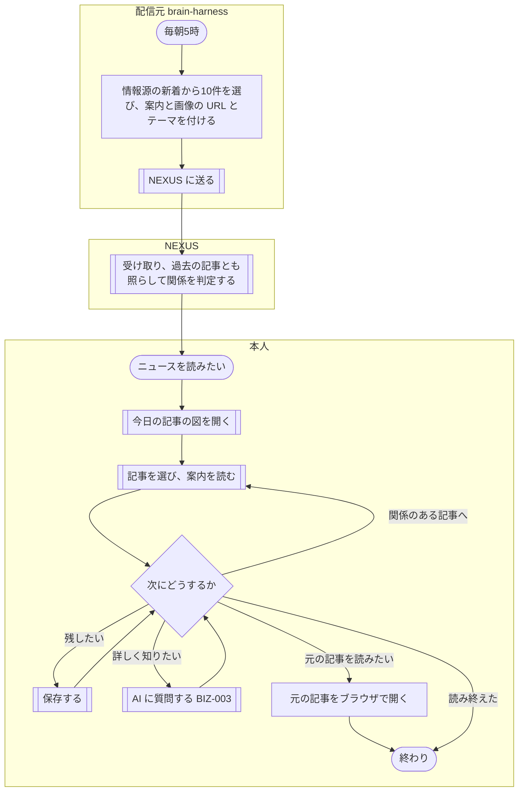
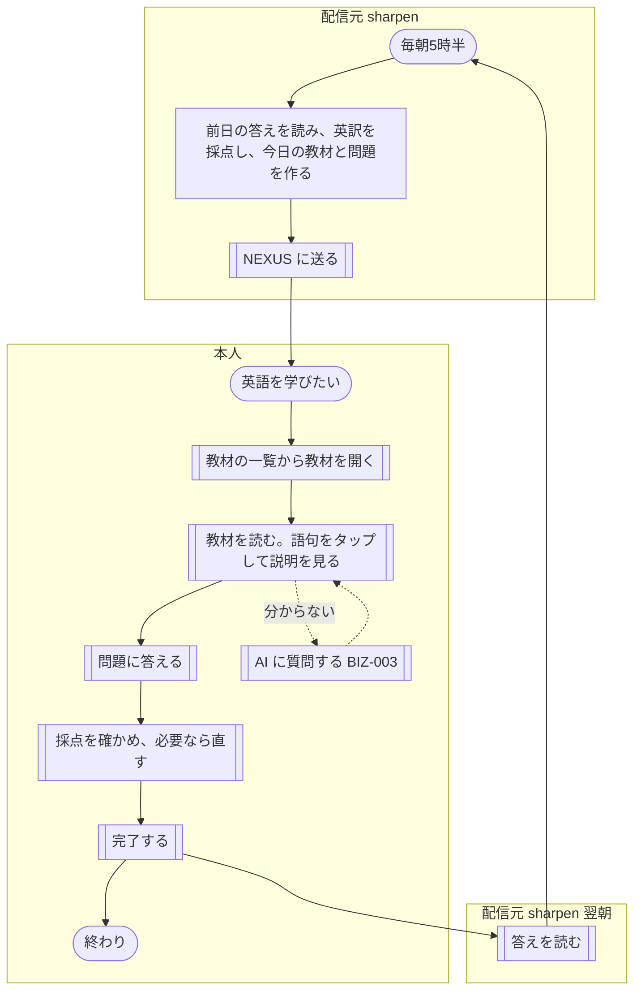
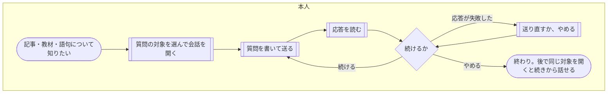
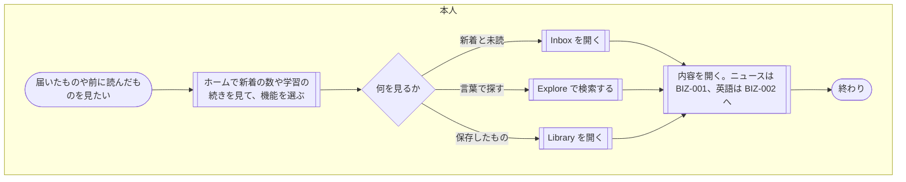
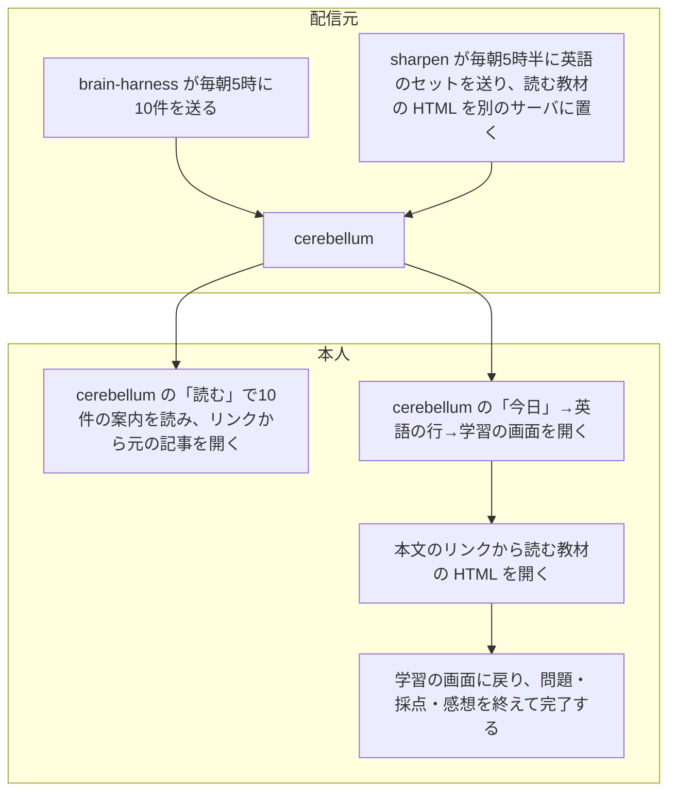

# RD-03 業務要件書（NEXUS）

- 読んだもの: RD-01 0.2（関係者の節を含む。RD-02 はそこにまとめた）、依頼の文、X-04 0.2（Q の答え）。今の英語の学習の流れは、cerebellum の仕様（`docs/specs/15-web-learning.md` 3章、`31-learning-lanes.md` 3章・4章）と sharpen のスキル（`.claude/skills/study-set/`、`.claude/skills/grade-today/`）を読んで確かめた（2026-11-23 の作業ツリー）。
- 0.2: Q-024〜Q-033 の答え（2026-11-23 本人）を書き入れた。
- 0.3: X-05 RV01 の指摘と Q-040、Q-053〜Q-063 の答え（2026-11-23 本人）で直した。
- 1.0: 要件定義の完了判定（X-05 PG01。2026-11-23 RD-01 SH01）で承認した。
- 1.1: X-04 CR-003（2026-11-24 RD-01 SH01 が承認）で、AI チャットを開ける画面を、内容を開いている画面とホームに限った。
- 書いた AI: Claude（Opus 5.5）。人の承認の前の案である。

## 1. 業務一覧

| 業務ID | 業務名 | 概要 | 実施する部署・担当 | システム化の区分 | 現行との差異 |
|---|---|---|---|---|---|
| BIZ-001 | ニュースを読む | 本人が、毎朝届くニュースの案内を読み、記事どうしの関係をたどり、気になる記事を保存し、元の記事を開く | RD-01 SH01 | する | 変更（今は cerebellum の「読む」に届いた10件を一覧で読む。記事どうしの関係は見られない。RD-01 1章） |
| BIZ-002 | 英語を学ぶ | 本人が、毎朝届く英語の教材を一覧から開いて読み、問題に答えて採点し、完了する。答えは翌朝の教材の採点に使われる | RD-01 SH01 | する | 変更（今は cerebellum の「今日」→英語の行→`/learning` で学び、読む教材は別のサーバの HTML で開く。教材の一覧は無い。RD-01 1章 課題1） |
| BIZ-003 | AI に質問する | 本人が、開いている記事・教材・語句について、文面を貼り直さずに AI に質問し、前の会話の続きから話す | RD-01 SH01 | する | 新規（RD-01 1章 課題2） |
| BIZ-004 | 情報を探す・見返す | 本人が、新着と未読を確かめ、全ての種類をまたいで検索し、保存した内容と過去の内容を見返す | RD-01 SH01 | する | 新規（RD-01 4章。Q-005 の答え） |

- 階層: 業務が4件で10件を超えず、分けて書かないので書かない。
- 情報を送る作業（brain-harness と sharpen が毎朝送る）は本人の業務ではなく、配信元の仕組みが行う。BIZ-001 と BIZ-002 のフローに配信元の区画として描き、送り方は RD-10 で扱う。
- Mac mini で NEXUS を動かし続ける作業は業務にせず、RD-13 で扱う。
- cerebellum に残る本線と教養の学習（sharpen の `main` と `liberal` のレーン）は、この案件の範囲の外である（Q-020 の答えで NEXUS に移すのは英語とニュースだけ）。

## 2. 業務フロー

システムを使う作業の識別: `[[ ]]` の箱がシステムを使う作業で、RD-04 の `UC` になる。

### BIZ-001 ニュースを読む（新業務フロー）

### BIZ-002 英語を学ぶ（新業務フロー）

- 前日の教材が未着手のとき、sharpen は前日の教材を今日の分として送り直す（持ち越し。sharpen `study-set/scripts/carryover.sh`、cerebellum `31-learning-lanes.md` 4章）。
- 語句の説明は教材の中に入っている説明を出すだけで、AI を呼ばない（依頼 2章 English Lesson）。

### BIZ-003 AI に質問する（新業務フロー）

### BIZ-004 情報を探す・見返す（新業務フロー）

### 現行業務フロー（BIZ-001、BIZ-002）

- 今のやり方は RD-01 1章に書いた。新しい流れでは、送り先が NEXUS に変わり（Q-020 の答え）、英語は教材の一覧から開き、読む教材と問題を NEXUS の中で続けて扱う（Q-001、Q-016、Q-022 の答え）。

## 3. 業務処理定義（業務ルール）

### BIZ-001 ニュースを読む

- 取扱範囲と制約: brain-harness が送るニュースの案内を扱う（RD-01 4章）。記事の本文は持たず、元の記事へのリンクを持つ（今の案内の形。brain-harness `brain-collect/SKILL.md` 153行目）。これまでに届いたニュースは扱わない（Q-011 の答え）。
- 発生と完了のきっかけ: 毎朝5時に brain-harness が送ったときに届く（brain-harness `brain-collect/SKILL.md` 50行目）。本人が読みたいときに始め、読み終えたときに終わる。
- 重要な日付・期限: 該当なし（期限のある作業は無い）。
- 業務上のチェック: 該当なし（本人が確かめなければならないことは無い）。

| 番号 | 条件 | 結果 |
|---|---|---|
| R01 | 同じ日に、同じ記事（同じ slug）がもう一度届いた | 前に届いたものを置き換える（今の brain-collect の約束。`brain-collect/SKILL.md` 54行目・174行目） |
| R02 | 記事が届いた | 7日前までの記事と照らして、関係のある記事とだけ線を張る。関係の無い記事は線の無いまま置く（依頼 2章、Q-017、Q-024 の答え） |
| R03 | 記事どうしの関係を見せる | 関係の種類（続報、背景、共通の主体、関連する話題など）を持たせる。AI が推し量った因果を事実として見せない（依頼 2章） |
| R04 | 図を開いた | 選んだ日の記事を見せる。「今日のニュース」のような作り物の中心は置かず、本人が選んだ記事を中心にする。過去の記事は要るときに読み込み、1年分を一度に描かない（依頼 2章） |
| R05 | 本人が記事の「読んだ」を押した | 既読にする（Q-025 の答え）。開いただけでは既読にしない。既読は未読に戻せる（Q-044 の答え） |

- 従う法令・規程: 従う法令と規程は無い。AI を動かす BIZ-003 だけ Anthropic の利用規約に従う（Q-046 の答え）。

### BIZ-002 英語を学ぶ

- 取扱範囲と制約: sharpen が送る英語のセット（教材、問題、締めの一言）と読む教材（`read.json`）を扱う（RD-01 4章、Q-022 の答え）。本線と教養のレーンは扱わない（1章）。単語帳（sharpen の別のサーバ）は教材の中のリンクとして開くだけにし、NEXUS では扱わない（RD-01 4章 対象外の「情報を作る AI の仕組みそのもの」）。
- 発生と完了のきっかけ: 毎朝5時半に sharpen が送ったときに届く（sharpen `study-set/SKILL.md` 107行目）。本人が教材を開いたときに始め、完了したときに終わる（今の流れ。cerebellum `15-web-learning.md` 3.4）。
- 重要な日付・期限: 翌朝5時半に sharpen が前日の答えを読む。それまでに完了していない教材は、未着手として持ち越される（2章）。
- 業務上のチェック: 採点の段で、本人が自動採点の結果を確かめ、必要なら直す（R08）。

| 番号 | 条件 | 結果 |
|---|---|---|
| R06 | 同じ日付の英語のセットがもう一度届いた | 前に届いたものを置き換える（今の cerebellum は日付とレーンを主キーにして置き換える。cerebellum `31-learning-lanes.md` 3.2） |
| R07 | 教材を開いた | 教材、問題、採点の段の順に進め、採点の段で完了する。通った段には戻れ、先の段へは飛ばせない（今の流れ。cerebellum `15-web-learning.md` 3章）。今の感想の段は置かない（Q-026 の答え）。読む教材は教材の段の中に、教材の本文に続けて置く（Q-033 の答え） |
| R08 | 答えの形（選択、数、文）を持つ問題 | 本人の答えと正解を比べて自動で ○ か × を付ける。本人は ○、△、× に直せる。答えの形を持たない問題は本人が ○、△、× を付ける。未回答は ×（今の流れ。cerebellum `15-web-learning.md` 3.3） |
| R09 | 全ての問題に ○、△、× がそろっていない | 完了できない（今の cerebellum の「感想へ進めない」決まりを、感想の段を外した後の完了に当てた。cerebellum `15-web-learning.md` 3.3、Q-026 の答え） |
| R10 | 完了した | 答えと ○△× を残し、sharpen が翌朝読めるようにする（Q-022 の答え）。感想は書かない（Q-026 の答え） |
| R11 | 完了した教材を、もう一度完了する | やり直せ、送り直した答えで前の答えを置き換える（Q-027 の答え）。置き換える前に本人に確かめる（Q-044 の答え）。sharpen が既に答えを読んだ後なら、置き換えは NEXUS の中だけで、sharpen の採点と教材は直さない（Q-058 の答え） |
| R12 | 教材を完了した | 既読にする（Q-025 の答え） |

- 従う法令・規程: 従う法令と規程は無い（BIZ-001 と同じ）。

### BIZ-003 AI に質問する

- 取扱範囲と制約: 質問の対象は、ページ全体（開いている内容1件の全体。一覧の画面からは質問しない。CR-003）、ニュースの1記事、教材の中の語句と文、図のノードのどれかで、どれを対象にしたかを本人に見せる（依頼 2章）。AI に渡す内容は、NEXUS に残してある内容から NEXUS のサーバが組み立て、端末が送る文面だけを信じない（依頼 6章）。
- 発生と完了のきっかけ: 本人が会話を開いて質問を送ったときに始まり、応答を読み終えたときに終わる。
- 重要な日付・期限: 該当なし。
- 業務上のチェック: 該当なし。

| 番号 | 条件 | 結果 |
|---|---|---|
| R13 | 会話を開いた | 開いている内容と選んだ箇所を AI に渡す。本人は文面を貼り直さない（依頼 2章） |
| R14 | 同じ内容をもう一度開いて会話を開いた | 前の会話を選んで続きから話せる。新しい会話も始められる（依頼 2章、Q-028 の答え）。ホームの AI Chat からは、内容に結びつかない会話を同じように扱う（Q-028 の答えから広げ、本人に確かめた。2026-11-23） |
| R15 | 応答を作っている | 処理中・完了・失敗の状態を見せ、応答は少しずつ表示する。失敗したら、NEXUS が1回だけ自動で送り直す。それでも失敗したら失敗を見せ、本人が送り直すかやめるかを選べる（依頼 2章、10章 Phase 3、Q-056 の答え） |
| R16 | AI に渡す内容 | 直近の会話と、要る分の要約と、質問だけを足す。全文や過去の会話を際限なく渡さない（依頼 6章） |
| R22 | 送った質問か、会話の対象を間違えた | 送った質問と対象は直さない。本人は続けて言い直すか、正しい対象で新しい会話を始める（Q-057 の答え） |
| R17 | AI が質問に答える | まず NEXUS に残してある内容で答える。それで答えが分からないときだけ、ウェブの検索とページの読み取りを使う。ほかのツールは使わない（Q-029、Q-035 の答え） |

- 従う法令・規程: Anthropic の利用規約に従う（Q-046 の答え。REQ-029）。AI を動かす費用は本人の今の Claude の契約の範囲に収める（RD-01 5章 制約）。

### BIZ-004 情報を探す・見返す

- 取扱範囲と制約: NEXUS が受け取った全ての種類の内容を扱う（RD-01 4章）。
- 発生と完了のきっかけ: 本人が見たいときに始め、内容を開いたときに終わる。
- 重要な日付・期限: 該当なし。
- 業務上のチェック: 該当なし。

| 番号 | 条件 | 結果 |
|---|---|---|
| R21 | ホームを開いた | 主な機能を円形に並べ、新着の数、未読、学習の続き、AI の応答の状況、今日のピックアップを見せる。データが無いものは0か空の状態を見せる（依頼 2章 ホーム）。今日のピックアップは、その日のニュースのうち、つながる記事が多い順に3件（Q-037 の答え）。朝の配信が届いていないときと、AI の実行が失敗しているときは、そのことを出す（Q-049 の答え） |
| R18 | Inbox を開いた | 届いた新着と未読を見せる（Q-005 の答え）。新着は届いてから本人が一度も開いていないもの、未読は既読になっていないもの（Q-053 の答え。既読の決め方は R05 と R12） |
| R19 | Explore で検索した | 全ての種類をまたいで、見出し、ニュースの案内、教材の本文を探す。会話は対象にしない（Q-005、Q-030 の答え） |
| R20 | 保存した・保存を外した | Library に並べる・外す（Q-005 の答え、依頼 10章 Phase 2） |

- 従う法令・規程: 従う法令と規程は無い（BIZ-001 と同じ）。

## 4. 業務の規模・時期・場所

| 業務 | 規模 | 時期・時間 | 入出力する情報と量 |
|---|---|---|---|
| BIZ-001 | 利用者は本人1人（RD-01 3章）。1日10件に、X のブックマークの全てを足した件数（brain-harness `brain-collect/SKILL.md` 3行目・7行目）。今後は新しい種類を足して増え、全ての種類を合わせて1日50件までを見込む（Q-031 の答え） | 毎朝5時に届く（`brain-collect/SKILL.md` 50行目）。読むのは本人の好きなとき | 受け取る: 記事ごとの slug、見出し、案内（10行以内）、元の記事の URL、画像の URL、テーマ（Q-021 の答え） |
| BIZ-002 | 利用者は本人1人。1日1セット（土日も含む）（sharpen `study-set/SKILL.md` 107行目）。1セットの問題は60問まで（cerebellum `31-learning-lanes.md` 3.6） | 毎朝5時半に届く。翌朝5時半に sharpen が答えを読む | 受け取る: 教材、問題、締めの一言、読む教材。渡す: 答え、○△× |
| BIZ-003 | 利用者は本人1人。1日10回（Q-031 の答え） | 本人の好きなとき | 受け取る: 質問、対象。渡す: 応答 |
| BIZ-004 | 利用者は本人1人。溜まる件数は BIZ-001 と BIZ-002 の件数と、残す期間（RD-09）で決まる | 本人の好きなとき | 受け取る: 検索の言葉。渡す: 見つかった内容の一覧 |

- 場所・設備: iPad と Android のスマートフォンの PWA から、Tailscale を通して本人の Mac mini の NEXUS につなぐ（RD-01 3章）。特別な機器は使わない。
- 業務で管理する指標: RD-01 の成功指標は依頼 10章の受け入れ基準を満たしたかで、業務の中で数える指標は無い（Q-002 の答え）。

## 5. 業務の継続と情報の扱い

- 業務の継続の方針: NEXUS が止まっている間に届くはずだったニュースと教材は、直った後に配信元が送り直す。同じ日に送り直したものは置き換える（Q-032 の答え、R01、R06）。NEXUS が止まっている間は、本人は読むことも学ぶこともできない（cerebellum には送らなくなるため。Q-020 の答え）。
- 情報の扱いの方針: RD-12 を作るので、RD-12 を参照する。

## 6. 上流との対応

| 業務ID | RD-01 の目標 | 関連要件 REQ | 実施する関係者 SH |
|---|---|---|---|
| BIZ-001 | RD-01 G01、RD-01 G02、RD-01 G04 | REQ-001、REQ-002、REQ-003、REQ-004、REQ-005、REQ-026 | RD-01 SH01 |
| BIZ-002 | RD-01 G01、RD-01 G04 | REQ-005、REQ-006、REQ-007、REQ-008、REQ-009、REQ-010、REQ-026 | RD-01 SH01 |
| BIZ-003 | RD-01 G03 | REQ-011、REQ-012、REQ-013、REQ-014、REQ-029 | RD-01 SH01 |
| BIZ-004 | RD-01 G01、RD-01 G02、RD-01 G04 | REQ-015、REQ-016、REQ-017、REQ-018 | RD-01 SH01 |

## 7. 未決事項

この書類で起こした未決事項は全て決まった（Q-024〜Q-033。答えは X-04）。
