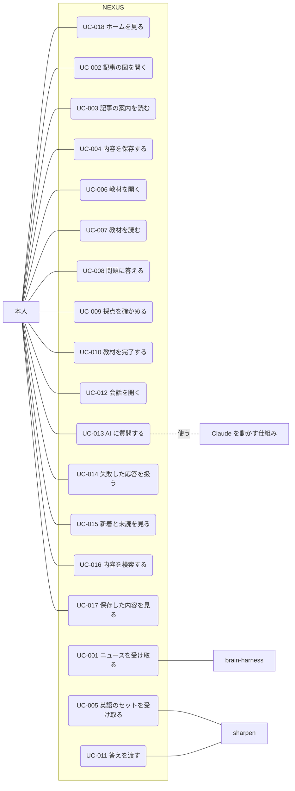

# RD-04 システム化業務一覧・ユースケース一覧（NEXUS）

- 読んだもの: RD-01 0.2（関係者の節を含む）、RD-03 0.2、X-04 0.3（Q の答え）。
- 0.2: X-05 RV01 の指摘と Q-040、Q-053〜Q-063 の答え（2026-11-23 本人）で直した。
- 1.0: 要件定義の完了判定（X-05 PG01。2026-11-23 RD-01 SH01）で承認した。
- 1.1: X-04 CR-003（2026-11-24 RD-01 SH01 が承認）で、UC-012 のきっかけを、内容を開いている画面とホームに限った。
- 書いた AI: Claude（Opus 5.5）。人の承認の前の案である。

## 1. システム化業務一覧（ユースケース一覧）

| UC ID | 名称 | 概要 | アクター | きっかけ | 利用頻度 | 優先度 | 関連業務 |
|---|---|---|---|---|---|---|---|
| UC-001 | ニュースを受け取る | brain-harness が送ったニュースを受け取って残し、7日前までの記事と照らして関係を判定する | brain-harness | 外部システムからの受信（毎朝5時） | 1日1回（10件と X のブックマーク） | Phase 2 | BIZ-001 の「NEXUS に送る」「受け取り、過去の記事とも照らして関係を判定する」 |
| UC-002 | 記事の図を開く | 本人が、選んだ日の記事どうしの関係を図で見る | 本人 | 利用者の操作 | 1日数回 | Phase 1 | BIZ-001 の「今日の記事の図を開く」 |
| UC-003 | 記事の案内を読む | 本人が、記事を選んで案内を読み、関係のある記事へ移り、「読んだ」を押す | 本人 | 利用者の操作（UC-002、UC-015、UC-016、UC-017 から） | 1日10回ほど | Phase 1 | BIZ-001 の「記事を選び、案内を読む」、BIZ-004 の「内容を開く」 |
| UC-004 | 内容を保存する | 本人が、記事や教材を保存し、要らなくなったら保存を外す | 本人 | 利用者の操作 | 1日数回 | Phase 2 | BIZ-001 の「保存する」 |
| UC-005 | 英語のセットを受け取る | sharpen が送った英語のセット（教材、問題、読む教材）を受け取って残す | sharpen | 外部システムからの受信（毎朝5時半） | 1日1回 | Phase 2 | BIZ-002 の「NEXUS に送る」 |
| UC-006 | 教材を開く | 本人が、英語の教材の一覧から教材を選んで開く | 本人 | 利用者の操作 | 1日1回 | Phase 1 | BIZ-002 の「教材の一覧から教材を開く」、BIZ-004 の「内容を開く」 |
| UC-007 | 教材を読む | 本人が、教材と読む教材を読み、語句をタップして教材に入っている説明を見る | 本人 | 利用者の操作（UC-006 から） | 1日1回 | Phase 1 | BIZ-002 の「教材を読む。語句をタップして説明を見る」 |
| UC-008 | 問題に答える | 本人が、問題を1問ずつ読んで答える | 本人 | 利用者の操作（UC-007 の後） | 1日1回 | Phase 2 | BIZ-002 の「問題に答える」 |
| UC-009 | 採点を確かめる | 本人が、自動の採点を確かめ、必要なら ○△× を直し、答えの形を持たない問題に ○△× を付ける | 本人 | 利用者の操作（UC-008 の後） | 1日1回 | Phase 2 | BIZ-002 の「採点を確かめ、必要なら直す」 |
| UC-010 | 教材を完了する | 本人が、答えと ○△× を残して教材を終える。やり直したときは前の答えを置き換える | 本人 | 利用者の操作（UC-009 の後） | 1日1回 | Phase 2 | BIZ-002 の「完了する」 |
| UC-011 | 答えを渡す | sharpen が、前の日の答えと ○△× を読み、未着手の教材を見分ける | sharpen | 外部システムからの要求（毎朝5時半） | 1日1回 | Phase 2 | BIZ-002 の「答えを読む」 |
| UC-012 | 会話を開く | 本人が、質問の対象（ページ、記事、語句、図のノード）を選び、前の会話を選ぶか新しい会話を始める | 本人 | 利用者の操作（内容を開いている画面とホームから。CR-003） | 1日10回 | Phase 1 | BIZ-003 の「質問の対象を選んで会話を開く」 |
| UC-013 | AI に質問する | 本人が質問を送り、AI の応答を少しずつ受け取って読む | 本人 | 利用者の操作（UC-012 の後） | 1日10回 | Phase 3 | BIZ-003 の「質問を書いて送る」「応答を読む」 |
| UC-014 | 失敗した応答を扱う | 本人が、失敗したか止めたい応答を、送り直すかやめる | 本人 | 利用者の操作（UC-013 の失敗か途中） | まれ | Phase 3 | BIZ-003 の「送り直すか、やめる」 |
| UC-015 | 新着と未読を見る | 本人が、Inbox で届いた新着と未読の一覧を見る | 本人 | 利用者の操作 | 1日数回 | Phase 2 | BIZ-004 の「Inbox を開く」 |
| UC-016 | 内容を検索する | 本人が、Explore で見出し、案内、教材の本文を言葉で探す | 本人 | 利用者の操作 | 1日数回 | Phase 2 | BIZ-004 の「Explore で検索する」 |
| UC-017 | 保存した内容を見る | 本人が、Library で保存した内容の一覧を見る | 本人 | 利用者の操作 | 1日数回 | Phase 2 | BIZ-004 の「Library を開く」 |
| UC-018 | ホームを見る | 本人が、新着の数、未読、学習の続き、AI の応答の状況、今日のピックアップを見て、機能を選ぶ | 本人 | 利用者の操作（アプリを開いた） | 1日数回 | Phase 1 | BIZ-004 の「ホームで新着の数や学習の続きを見て、機能を選ぶ」 |

- 優先度: 依頼 10章の Phase の順に作る。Phase 1 は画面をサンプルのデータで作り（AI の応答は作り物）、Phase 2 で受け取りと保存と検索をつなぎ、Phase 3 で AI をつなぐ（依頼 10章）。優先度の列は、その UC を本物のデータで動かす Phase を書いた。
- 利用頻度: RD-03 4章の規模（届くのは1日50件まで、質問は1日10回。Q-031 の答え）から書いた。「1日数回」「まれ」は本人の使い方の見込みで、性能の目標値は RD-11 で決める。
- 管理用のユースケース: 利用者の追加と削除は持たない。利用者は本人だけのため（Q-004 の答え）。バッチ（RD-05 FN-021、FN-022）は Mac mini の定期実行で動く。手で動かすときは本人が Mac mini で動かし、画面を持たない運用の作業なので UC にしない（Q-034、Q-036、Q-050 の答え。RD-13 5章）。マスタの更新と操作の記録の検索は、依頼に書かれていないので持たない（依頼 9章の監査ログは RD-12 で扱う）。配信元が NEXUS に送るための鍵と、端末を NEXUS につなぐための認証を、本人が Mac mini の NEXUS の設定で用意し、取り消す。画面は持たない（Q-034 の答え）。

## 2. 利用者区分とアクター

| 利用者区分 | 説明 | 対応する関係者 | 人数 |
|---|---|---|---|
| 本人 | 情報を読み、学び、探し、AI に質問する | RD-01 SH01 | 1人 |

- システムのアクター:
  - brain-harness: ニュースを送る（UC-001 を起動する）。連携の中身は RD-10 で決める。
  - sharpen: 英語のセットを送り（UC-005）、答えを読む（UC-011）。連携の中身は RD-10 で決める。
  - Claude を動かす仕組み: UC-013 で NEXUS が使う。UC を起動しない。

## 3. ユースケース図

- 典型的な使う順序: 朝は UC-018、UC-002、UC-003 の順にニュースを読み、UC-006、UC-007、UC-008、UC-009、UC-010 の順に英語を学ぶ。途中で分からないことがあれば UC-012、UC-013。
- システムが扱わないこと:
  - ニュースの選び方と案内の書き方、教材と問題の作り方と英訳の採点（配信元が行う。RD-01 4章 対象外）。
  - 元の記事を読むこと（本人が端末のブラウザで開く。RD-03 BIZ-001 の「元の記事をブラウザで開く」）。
  - 単語帳（sharpen の別のサーバ。教材の中のリンクとして開くだけ。RD-03 3章 BIZ-002）。

## 4. 上流との対応

| UC ID | 関連業務 BIZ | 関連要件 REQ |
|---|---|---|
| UC-001 | BIZ-001（NEXUS に送る、受け取り関係を判定する） | REQ-001、REQ-002、REQ-026 |
| UC-002 | BIZ-001（今日の記事の図を開く） | REQ-003 |
| UC-003 | BIZ-001（記事を選び、案内を読む）、BIZ-004（内容を開く） | REQ-003、REQ-004 |
| UC-004 | BIZ-001（保存する） | REQ-005 |
| UC-005 | BIZ-002（NEXUS に送る） | REQ-006、REQ-026 |
| UC-006 | BIZ-002（教材の一覧から教材を開く）、BIZ-004（内容を開く） | REQ-007 |
| UC-007 | BIZ-002（教材を読む。語句をタップして説明を見る） | REQ-008 |
| UC-008 | BIZ-002（問題に答える） | REQ-009 |
| UC-009 | BIZ-002（採点を確かめ、必要なら直す） | REQ-009 |
| UC-010 | BIZ-002（完了する） | REQ-009、REQ-004 |
| UC-011 | BIZ-002（答えを読む） | REQ-010、REQ-026 |
| UC-012 | BIZ-003（質問の対象を選んで会話を開く） | REQ-011、REQ-012 |
| UC-013 | BIZ-003（質問を書いて送る、応答を読む） | REQ-011、REQ-013、REQ-014 |
| UC-014 | BIZ-003（送り直すか、やめる） | REQ-013 |
| UC-015 | BIZ-004（Inbox を開く） | REQ-015 |
| UC-016 | BIZ-004（Explore で検索する） | REQ-016 |
| UC-017 | BIZ-004（Library を開く） | REQ-017 |
| UC-018 | BIZ-004（ホームで新着の数や学習の続きを見て、機能を選ぶ） | REQ-018 |

## 5. 未決事項

この書類で起こした未決事項は全て決まった（Q-034。答えは X-04）。
