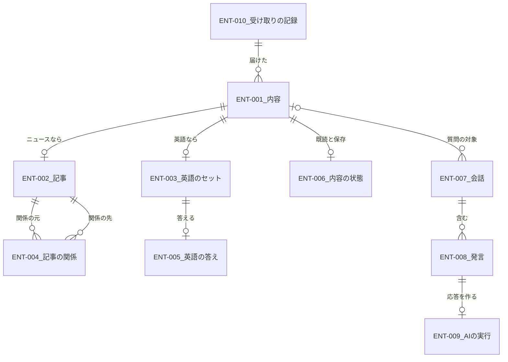

# RD-09 データ要件（NEXUS）

- 読んだもの: RD-03 0.2、RD-05 0.1、RD-06 0.1、依頼の文（4章 データモデル（提案））、X-04 0.3（Q の答え）。配信元が今送っている項目は、brain-harness `brain-collect/SKILL.md` 168〜176行目と、sharpen の `drills/en/2026-11-19/set.json` を読んで確かめた。
- 依頼 4章のデータモデルは「提案」なので、そのまま採らず、業務から要るものだけをエンティティにした。表の名前や列は BD-07 で決める。
- 0.2: X-05 RV01 の指摘と Q-040、Q-053〜Q-063 の答え（2026-11-23 本人）で直した。
- 1.0: 要件定義の完了判定（X-05 PG01。2026-11-23 RD-01 SH01）で承認した。
- 1.1: X-04 CR-001（2026-11-23 RD-01 SH01 が承認）で、端末の登録と取り消し（FN-023）、配信元の鍵の用意と取り消し（FN-024）を足した。 端末、登録コード、配信元の鍵（ENT-011〜ENT-013）を足した。
- 書いた AI: Claude（Opus 5.5）。人の承認の前の案である。

## 1. 概念データモデル

- ENT-001 内容は、種類によらない共通の部分（種類、見出し、届いた日時）を持ち、種類ごとの中身を ENT-002 記事か ENT-003 英語のセットに持つ。新しい種類を足すときは、ENT-001 を変えずに種類ごとのエンティティを足す（REQ-019）。
- 会話は、対象の内容を持たないもの（ホームの AI Chat）もある（RD-06 UC-012）。

## 2. データ一覧

| エンティティID | エンティティ名 | マスタかどうか | 定義 | 用途 | 件数 | 保存期間 | 重要度 |
|---|---|---|---|---|---|---|---|
| ENT-001 | 内容 | マスタ以外 | 届いた情報1件（ニュースの記事1件か、英語のセット1日分） | 全ての業務で、種類をまたいで並べ、探し、会話の対象にする | 稼働の開始時0件（Q-011 の答え）。年に最大で約18,000件（1日50件まで。RD-03 4章） | 消さずに残す（Q-038 の答え） | 公開の情報から作った案内と教材で、機密は含まない |
| ENT-002 | 記事 | マスタ以外 | ニュースの記事1件の中身 | BIZ-001 で図と案内を見せる | 年に約3,650件と X のブックマークの件数（1日10件と X のブックマーク。RD-03 4章） | 消さずに残す（Q-038 の答え） | 機密は含まない（ENT-001 と同じ） |
| ENT-003 | 英語のセット | マスタ以外 | 英語の教材1日分（教材、問題、締めの一言、読む教材） | BIZ-002 で教材と問題を見せ、sharpen に返す | 年に約365件（1日1セット。RD-03 4章） | 消さずに残す（Q-038 の答え） | 機密は含まない |
| ENT-004 | 記事の関係 | マスタ以外 | 2つの記事のあいだの関係1つと、その種類 | BIZ-001 で記事どうしの線を引き、関係をたどる | 記事1件あたりの関係の数は判定の結果で決まり、見込めない | 消さずに残す（Q-038 の答え） | 機密は含まない |
| ENT-005 | 英語の答え | マスタ以外 | 英語のセット1つへの本人の答えと ○△× の1回分（やり直したら置き換える） | BIZ-002 で完了を残し、sharpen が翌朝読む | 年に最大で約365件 | 消さずに残す（Q-038 の答え） | 本人の学習の記録。外へ出すのは sharpen だけ |
| ENT-006 | 内容の状態 | マスタ以外 | 内容1件についての本人の開いたか、既読、保存 | BIZ-001、BIZ-002、BIZ-004 で未読と保存した内容を見せる | ENT-001 と同じ数まで | 消さずに残す（Q-038 の答え） | 本人の使い方の記録 |
| ENT-007 | 会話 | マスタ以外 | 本人と AI のひと続きのやり取り1つ（対象の内容があるものと無いもの） | BIZ-003 で前の会話を選んで続ける | 年に最大で約3,650件（質問は1日10回。RD-03 4章） | 消さずに残す（Q-038 の答え） | 本人が書いた質問を含み、私的な内容を含み得る |
| ENT-008 | 発言 | マスタ以外 | 会話の中の本人の質問1つか、AI の応答1つ。AI に渡した内容の写しも持つ | BIZ-003 で会話を見せ、続きを話すときに直近の会話を AI に渡す | 年に約7,300件（質問1日10回と、その応答） | 消さずに残す（Q-038 の答え） | 本人が書いた質問を含み、私的な内容を含み得る |
| ENT-009 | AI の実行 | マスタ以外 | AI を1回動かした記録（何のために、いつ始まりいつ終わり、どうなったか） | BIZ-003 で処理中・完了・失敗を見せる。依頼 7章の監査の記録 | 年に約3,650件の質問の分と、FN-002 で AI を使うならその分（BD で決める） | 1年（Q-038 の答え）。FN-022 で消す | 渡した内容の要約を含み得る |
| ENT-010 | 受け取りの記録 | マスタ以外 | 配信元から1回送られてきた記録（どの配信元から、いつ、何件、受け取れたか） | 配信が届いたかを Mac mini のログで確かめ（Q-036 の答え）、同じ送信の重なりを見分ける | 年に約730件（1日2回。RD-03 4章） | 1年（Q-038 の答え）。FN-022 で消す | 機密は含まない |
| ENT-011 | 端末 | マスタ | 本人が登録した端末1台と、その端末の鍵 | 端末の認証（RD-12 NFR-013） | 端末は2台まで使う（RD-11 NFR-003）。登録し直しを含めても年に数件 | 取り消すまで残す。取り消したら消す（FN-023） | 鍵は認証の情報。Mac mini の NEXUS の中だけに置く（RD-12 NFR-019） |
| ENT-012 | 登録コード | マスタ以外 | 端末を登録するために出した、1回だけ使えるコード1つ | 端末の登録（FN-023） | 登録するたびに1件 | 使ったか有効な時間が過ぎたら消す（FN-023） | 認証の情報。ENT-011 と同じ |
| ENT-013 | 配信元の鍵 | マスタ | 配信元1つの鍵と、その鍵で使える連携 | 配信元の認証（RD-12 NFR-014） | 配信元ごとに1件（今は2件） | 取り消すまで残す。取り消したら消す（FN-024） | 認証の情報。ENT-011 と同じ |

- 公開の可否: 外へ渡すのは、ENT-003 と ENT-005 を sharpen に返すことだけ（RD-05 FN-013）。インターネットには公開しない（RD-01 3章）。
- 管理する部門: 全て本人（RD-01 SH01）。

## 3. 主要データ定義

| データ項目名 | 意味 | 型と桁の目安 | 値の範囲 | 使うエンティティ |
|---|---|---|---|---|
| 種類 | 内容がニュースか英語か | コード | 4章の「情報の種類」 | ENT-001 |
| 見出し | 一覧に出す1行 | 文字。上限は基本設計で、RD-12 NFR-015 の上限と一緒に決める | 配信元が送る値 | ENT-001 |
| 届いた日時 | NEXUS が受け取った日時 | 日時 | - | ENT-001 |
| 対象日 | その内容がどの日の分か（ニュースの日、英語のセットの日付） | 日付 | 配信元が送る値 | ENT-001 |
| slug | 同じ記事を見分ける印（元の記事の URL から配信元が作る） | 文字、12文字 | 配信元が送る値（`brain-collect/SKILL.md` 174行目） | ENT-002 |
| 案内 | 記事について配信元が書いた日本語の説明 | 文字（Markdown）、10行以内 | 配信元が送る値（`brain-collect/SKILL.md` 149行目） | ENT-002 |
| 元の記事の URL | 元の記事の場所 | 文字、URL | 配信元が送る値 | ENT-002 |
| 画像の URL | 記事の画像の場所 | 文字、URL | 配信元が送る値（Q-021 の答え） | ENT-002 |
| テーマ | 記事の分類 | 文字 | 配信元が持つテーマ（Q-021 の答え） | ENT-002 |
| 学習テーマ | 英語のセットが扱う学びの題材（例 文型） | 文字 | sharpen が送る `theme` | ENT-003 |
| 関係の種類 | 2つの記事がどう関係するか | コード | 4章の「関係の種類」 | ENT-004 |
| 関係の根拠 | 関係があると判定したわけ | 文字 | - | ENT-004 |
| 教材 | 英語の教材の本文 | 文字（Markdown） | sharpen が送る `lessonMd` | ENT-003 |
| 問題 | 問題の一覧（番号、問題文、答えの形、選択肢、正解、解説） | 構造化した文字（JSON）、60問まで | sharpen が送る `problems`（cerebellum `31-learning-lanes.md` 3.6） | ENT-003 |
| 読む教材 | 語句ごとの説明を含む読む教材 | 構造化した文字（JSON） | sharpen が送る `read.json`。無い日がある | ENT-003 |
| 答え | 問題ごとの本人の答え | 文字 | - | ENT-005 |
| 採点 | 問題ごとの ○△× | コード | 4章の「採点」 | ENT-005 |
| 開いた | 本人が一度でも開いたか（新着かどうか。Q-053 の答え） | 真偽と日時 | 初期値は開いていない | ENT-006 |
| 既読 | 本人が読み終えたか | 真偽と日時 | 初期値は未読 | ENT-006 |
| 保存 | 本人が保存したか | 真偽と日時 | 初期値は保存していない | ENT-006 |
| 対象 | 会話の対象（内容と、その中の箇所） | 構造化した文字 | 内容が無い会話もある | ENT-007 |
| AI に渡した内容の写し | 応答を作るときに AI に渡した内容 | 文字 | - | ENT-008 |
| 実行の状態 | AI の実行がどうなったか | コード | 4章の「実行の状態」 | ENT-009 |

## 4. コード一覧

| コード名 | 用途 | 構造と付け方 | 標準に従うか | 主な値と意味 |
|---|---|---|---|---|
| 情報の種類 | 内容がどの種類かを区別する | 値の形は BD-07 で決める。種類を足すときに値を足す | 自分で決める（業界の標準が無い） | ニュース、英語 |
| 関係の種類 | 記事どうしの関係を区別する | 値の形は BD-07 で決める | 自分で決める | 続報、背景、共通の主体、関連する話題（依頼 2章）。値を足すかは BD-07 で決める |
| 採点 | 問題ごとの出来を区別する | 1文字 | sharpen と cerebellum の今の値に合わせる（`grade-today/SKILL.md` の `o`、`d`、`x`） | ○、△、× |
| 実行の状態 | AI の実行の状態を区別する | 値の形は BD-07 で決める | 自分で決める | 処理中、完了、失敗、中止（RD-03 R15） |

## 5. CRUD

| 機能 | ENT-001 | ENT-002 | ENT-003 | ENT-004 | ENT-005 | ENT-006 | ENT-007 | ENT-008 | ENT-009 | ENT-010 |
|---|---|---|---|---|---|---|---|---|---|---|
| FN-001 ニュースの受信 | CU | CRU | - | - | - | - | - | - | - | C |
| FN-002 記事の関係の判定 | R | R | - | C | - | - | - | - | C | - |
| FN-003 記事の図の表示 | R | R | - | R | - | R | - | - | - | - |
| FN-004 記事の案内の表示 | R | R | - | R | - | CRU | - | - | - | - |
| FN-005 既読にする | R | - | - | - | - | CU | - | - | - | - |
| FN-006 保存と保存の取り消し | R | - | - | - | - | CU | - | - | - | - |
| FN-007 英語のセットの受信 | CU | - | CRU | - | - | - | - | - | - | C |
| FN-008 教材の一覧の表示 | R | - | R | - | R | R | - | - | - | - |
| FN-009 教材の表示 | R | - | R | - | - | CRU | - | - | - | - |
| FN-010 問題の回答 | - | - | R | - | - | - | - | - | - | - |
| FN-011 採点 | - | - | R | - | - | - | - | - | - | - |
| FN-012 教材の完了 | R | - | R | - | CU | - | - | - | - | - |
| FN-013 答えの提供 | R | - | R | - | R | - | - | - | - | - |
| FN-014 会話の選択 | R | - | - | - | - | - | CR | R | - | - |
| FN-015 質問と応答 | R | R | R | R | - | - | RU | CRU | CU | - |
| FN-016 応答の送り直しと中止 | - | - | - | - | - | - | R | CRU | CRU | - |
| FN-017 新着と未読の一覧 | R | - | - | - | - | R | - | - | - | - |
| FN-018 検索 | R | R | R | - | - | - | - | - | - | - |
| FN-019 保存した内容の一覧 | R | - | - | - | - | R | - | - | - | - |
| FN-020 ホームの表示 | R | R | R | R | R | R | - | - | R | R |
| FN-021 データのバックアップ | R | R | R | R | R | R | R | R | R | R |
| FN-022 古い記録の削除 | - | - | - | - | - | - | - | - | D | D |

CR-001 で足した FN-023、FN-024 と ENT-011〜ENT-013 の CRUD は次のとおり（上の表の ENT-001〜ENT-010 の列は、FN-023、FN-024 では全て「-」）。

| 機能 | ENT-011 | ENT-012 | ENT-013 |
|---|---|---|---|
| FN-001、FN-007、FN-013（配信元からの受信と提供） | - | - | R |
| FN-003〜FN-006、FN-008〜FN-012、FN-014〜FN-020（端末からの利用） | R | - | - |
| FN-021 データのバックアップ | R | R | R |
| FN-023 端末の登録と取り消し | CRD | CRD | - |
| FN-024 配信元の鍵の用意と取り消し | - | - | CRD |

- 作る機能の無いデータ: 無い。全ての列に C がある。
- 読む機能: 全ての列に R がある。ENT-010 は FN-020 がホームの未着の表示に読む（Q-049 の答え）。
- 消す機能: ENT-001、ENT-002、ENT-003、ENT-004、ENT-005、ENT-006、ENT-007、ENT-008 は、消さない理由がある。保存期間が「消さずに残す」で、消す機能を持たない（Q-038 の答え）。ENT-009 と ENT-010 は1年を過ぎたら FN-022 が月に1回自動で消す。消す画面は持たない（Q-038、Q-050 の答え）。

## 6. 上流との対応

| エンティティID | 使う機能 FN | 該当業務 BIZ | 関連要件 REQ |
|---|---|---|---|
| ENT-001 | FN-001〜FN-009、FN-012〜FN-015、FN-017〜FN-020 | BIZ-001、BIZ-002、BIZ-003、BIZ-004 | REQ-001、REQ-006、REQ-019 |
| ENT-002 | FN-001〜FN-004、FN-015、FN-018、FN-020 | BIZ-001 | REQ-001、REQ-003、REQ-004 |
| ENT-003 | FN-007〜FN-013、FN-015、FN-018、FN-020 | BIZ-002 | REQ-006、REQ-007、REQ-008、REQ-009 |
| ENT-004 | FN-002〜FN-004、FN-015、FN-020 | BIZ-001 | REQ-002、REQ-003 |
| ENT-005 | FN-008、FN-012、FN-013、FN-020 | BIZ-002 | REQ-009、REQ-010 |
| ENT-006 | FN-003〜FN-006、FN-008、FN-009、FN-017、FN-019、FN-020 | BIZ-001、BIZ-002、BIZ-004 | REQ-004、REQ-005、REQ-015、REQ-017 |
| ENT-007 | FN-014〜FN-016 | BIZ-003 | REQ-011、REQ-012 |
| ENT-008 | FN-014〜FN-016 | BIZ-003 | REQ-011、REQ-012、REQ-013 |
| ENT-009 | FN-002、FN-015、FN-016、FN-020、FN-021、FN-022 | BIZ-003 | REQ-013、REQ-023 |
| ENT-010 | FN-001、FN-007、FN-020、FN-021、FN-022 | BIZ-001、BIZ-002 | REQ-001、REQ-006 |
| ENT-011 | FN-003〜FN-006、FN-008〜FN-012、FN-014〜FN-021、FN-023 | 該当なし（管理用） | REQ-022 |
| ENT-012 | FN-021、FN-023 | 該当なし（管理用） | REQ-022 |
| ENT-013 | FN-001、FN-007、FN-013、FN-021、FN-024 | 該当なし（管理用） | REQ-022 |

- RD-05 の全ての FN が CRUD 表に現れる。

## 7. 未決事項

この書類で起こした未決事項は全て決まった（Q-038。答えは X-04）。
