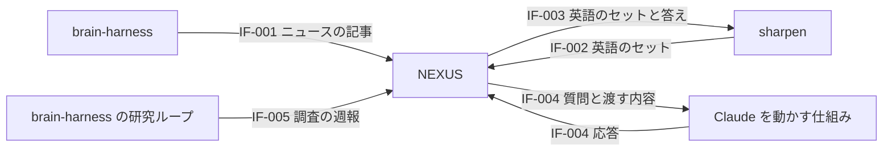

# RD-10 外部インタフェース要件（NEXUS）

- 読んだもの: RD-01 0.2（関係者の節を含む）、RD-03 0.2、RD-05 0.1、RD-09 0.1、X-04 0.3（Q の答え）。配信元の今の送り方は、brain-harness `bin/inbox-send.sh`、second-brain の `.claude/scripts/inbox_post.py`（1〜51行目）、sharpen `study-set/scripts/deliver.sh`・`carryover.sh`、`grade-today/scripts/fetch.py`、cerebellum `docs/specs/31-learning-lanes.md` を読んで確かめた（2026-11-23）。
- 0.2: X-05 RV01 の指摘と Q-040、Q-053〜Q-063 の答え（2026-11-23 本人）で直した。
- 0.3: X-05 RV02 の指摘と Q-064、Q-065 の答え（2026-11-23 本人）で直した。
- 1.0: 要件定義の完了判定（X-05 PG01。2026-11-23 RD-01 SH01）で承認した。
- 1.1: X-04 CR-002（2026-11-24 RD-01 SH01 が承認）で、IF-001 の物理的な条件と相手先で必要な変更に、元の記事の URL を別の項目として送ることを足した（Q-077 の答え）。
- 1.2: X-04 CR-005（2026-11-24 RD-01 SH01 が承認）で、IF-004 の物理的な条件の使えるツールに、決めたフォルダ（`~/projects/brain-harness`）の読み取りを足した。X-04 CR-006（2026-11-24 RD-01 SH01 が承認）で、相手先の窓口と合意の状態の確かめ方を、本人が公式の文書を読んで判断することに変えた（X-05 RV13-01）。X-05 RV14-02 の指摘で、2章 IF-004 の頻度とタイミングにも決めたフォルダ（`~/projects/brain-harness`）の読み取りを足した。
- 1.3: X-04 CR-020（2026-11-27 RD-01 SH01 が承認）で、IF-005（調査の週報の受信）を足した（Q-087〜Q-092 の答え）。IF-001〜IF-004 は変えない。
- 1.4: X-04 CR-024（2026-11-28。本人の承認の前の案）で、IF-005 に任意の段の欄を足し、方法の件数の上限を外した（Q-098〜Q-100 の答え）。
- 書いた AI: Claude（Opus 5.5）。人の承認の前の案である。

## 1. システム関連図

- 人の手で受け渡すもの: 該当なし。届かなかった日の送り直しも、配信元を動かし直して IF-001 と IF-002 で送る（Q-032 の答え）。
- 端末のブラウザは、記事の画像と元の記事を、それぞれのサイトから直に読む（RD-03 BIZ-001）。NEXUS のサーバを通すかは RD-12 と基本設計で決める。

## 2. 外部インタフェース一覧

| IF ID | 名称 | 概要 | 相手先システム | 送受信区分 | 新規・既存 | 実装方式 | 送受信データ | 送受信タイミング | 送受信の条件 |
|---|---|---|---|---|---|---|---|---|---|
| IF-001 | ニュースの受信 | brain-harness が選んだその日の記事を NEXUS が受け取る | brain-harness（`/brain-collect`。持ち主は RD-01 SH01） | 受信 | 変更（今は cerebellum の汎用口へ送っている） | API（HTTP。今も HTTP で送っている） | 記事の slug、見出し、案内、元の記事の URL、画像の URL、テーマ（RD-09 ENT-002） | 日次（毎朝5時） | brain-collect が動くたびに1回送る。0件の日も送る（`inbox-send.sh` 13行目） |
| IF-002 | 英語のセットの受信 | sharpen が作ったその日の英語のセットを NEXUS が受け取る | sharpen（`study-set` の英語のレーン。持ち主は RD-01 SH01） | 受信 | 変更（今は cerebellum の `/api/learning/sets` へ送っている） | API（HTTP。今も HTTP で送っている） | 日付、学習テーマ、教材、問題、締めの一言、読む教材（RD-09 ENT-003） | 日次（毎朝5時半） | 英語のセットができたとき。前日が未着手なら前日のセットを今日の分として送る（持ち越し） |
| IF-003 | 英語のセットと答えの提供 | sharpen が、日付を指定して英語のセットと本人の答えを NEXUS から読む | sharpen（`study-set` と英語の採点。持ち主は RD-01 SH01） | 送信（sharpen が取りに来る） | 変更（今は cerebellum から読んでいる） | API（HTTP。今も HTTP で読んでいる） | 英語のセット（RD-09 ENT-003）、答えと ○△×（RD-09 ENT-005） | 日次（毎朝5時半）と、持ち越しのとき | sharpen が求めたとき。答えが無ければ「まだ無い」を返す |
| IF-004 | AI の実行 | NEXUS が質問と渡す内容を AI に渡し、応答を受け取る。記事の関係の判定にも使うかは基本設計で決める | Claude Code の CLI（`claude -p`）。本人の Claude のサブスクリプションでログインする（Q-040 の答え。X-02 ADR-005） | 双方向 | 新規 | 同じ Mac mini の上でコマンドとして起動し、引数と標準入力で渡す（依頼 7章）。出力の受け方は基本設計で決める | 送る: 質問、対象の内容、直近の会話（RD-09 ENT-001〜ENT-004、ENT-008）。受ける: 応答（RD-09 ENT-008） | 都度（本人が質問したとき） | 本人が質問を送ったとき。応答が分からないときは、AI がウェブの検索とページの読み取りと決めたフォルダ（`~/projects/brain-harness`）の読み取りのどれを使うかを決めて使う（RD-03 R17、CR-005） |
| IF-005 | 調査の週報の受信 | brain-harness の研究ループが、研究課題ごとにまとめた1週分の調査の週報を NEXUS が受け取る（CR-020） | brain-harness の研究ループ（新設。配信元 brain-research。持ち主は RD-01 SH01） | 受信 | 新規 | API（HTTP。NEXUS が配る送信のコマンドから送る。Q-092 の答え） | 課題の ID と名前、何週目か、送った日、状態、現時点の答え、方法の一覧（見出し、そのためには、出典の URL、印、反対の意見）、まだ分かっていないこと、今週の変化（RD-09 ENT-014、ENT-015） | 週次（研究課題ごとに週1回。曜日と時刻は決まっていない） | 研究ループが課題の1週分をまとめたとき。終了した課題は最後の週報を送る（RD-03 R25） |

## 3. 連携ごとの要件

### IF-001 ニュースの受信

- データ量: 1回あたり10件と X のブックマークの件数。全ての種類を合わせて1日50件まで（RD-03 4章）。
- 物理的な条件: 今の cerebellum の汎用口の形のまま受け取り、画像の URL とテーマの項目を足す（Q-039 の答え）。元の記事の URL の項目も足す（Q-077 の答え。CR-002）。今の形は `{"source", "date", "items": [{"slug", "kind", "title", "bodyMd"}]}`（`inbox_post.py` 156行目、`brain-collect/SKILL.md` 168〜176行目）で、画像の URL とテーマは無く、元の記事の URL は案内の本文の末尾のリンクにだけある。
- 障害時・緊急時の代替手段: NEXUS が止まっていて送れなかったときは、brain-collect が送信の失敗を報告し（`brain-collect/SKILL.md` 178行目）、NEXUS が直った後に本人が送り直す。同じ日に送り直したものは置き換える（Q-032 の答え、RD-03 R01）。
- 相手先の窓口と合意の状態: 窓口は RD-01 SH01。送り先を NEXUS に変え、画像の URL とテーマを足すことは合意した（Q-019、Q-020、Q-021 の答え）。
- 相手先で必要な変更: brain-collect の送り先を NEXUS に変え、記事の画像の URL とテーマを足して送る（Q-021 の答え）。元の記事の URL も別の項目として足して送り、案内の本文のリンクは今のまま残す（Q-077 の答え。CR-002）。NEXUS の鍵を付けて送る（REQ-022）。送信に使う `inbox_post.py` は second-brain の共用の部品で、sharpen の知らせや x も使っている（`grep` で確かめた）ので、共用の部品の送り先は変えず、brain-collect の分だけを変える。作業は RD-01 SH02 が NEXUS の作業として行う（X-02 ADR-002）。切り替えるときは、配信元が3日間 cerebellum と NEXUS の両方に送り、3日が過ぎたら cerebellum への送信をやめる。やめた後に NEXUS に届かなかったときは、cerebellum に戻さずに直し、届かなかった日の分は配信元が送り直す（Q-062、Q-065 の答え。RD-15 4章）。

### IF-002 英語のセットの受信

- データ量: 1回あたり1セット（問題は60問まで。cerebellum `31-learning-lanes.md` 3.6）。1日1回と、持ち越しのときにもう1回。
- 物理的な条件: 今の cerebellum の `POST /api/learning/sets` の形のまま受け取り、読む教材の項目を足す（Q-039 の答え）。今の形は cerebellum の `POST /api/learning/sets` の形（`lane` が `en`）で、読む教材（`read.json`）は送っておらず、HTML にして別のサーバに置いている（RD-01 1章）。
- 障害時・緊急時の代替手段: IF-001 と同じ。NEXUS が直った後に、本人が sharpen の送信を動かし直す。同じ日付のセットは置き換える（RD-03 R06）。
- 相手先の窓口と合意の状態: 窓口は RD-01 SH01。送り先を NEXUS に変えることは合意した（Q-015、Q-020 の答え）。
- 相手先で必要な変更: 英語のレーンの送り先を NEXUS に変え、読む教材（`read.json`）も一緒に送る（Q-016 の答え）。NEXUS の鍵を付けて送る。本線と教養のレーンは今のまま cerebellum に送る（RD-03 1章）。作業は RD-01 SH02 が行う（X-02 ADR-002）。切り替えるときは、配信元が3日間 cerebellum と NEXUS の両方に送り、3日が過ぎたら cerebellum への送信をやめる。やめた後に NEXUS に届かなかったときは、cerebellum に戻さずに直し、届かなかった日の分は配信元が送り直す（Q-062、Q-065 の答え。RD-15 4章）。

### IF-003 英語のセットと答えの提供

- データ量: 1回あたり1セットとその答え。1日1回と、持ち越しのとき。
- 物理的な条件: 今の cerebellum の形のまま返す（Q-039 の答え）。今の形は cerebellum の `GET /api/learning/sets/{date}?lane=en` と `GET .../result?lane=en`（答えが無ければ 404）。答えは `grades[]`（問題の番号、答え、○△×）と感想（`feeling`）を持つ（`grade-today/scripts/fetch.py`）。NEXUS では感想を書かない（Q-026 の答え）ので、感想は空で返す。
- 障害時・緊急時の代替手段: NEXUS が止まっていて読めなかったとき、sharpen は前日の答えを使わずに今日のセットを作る。答えは NEXUS に残っているので、直った後の朝に読める。sharpen が読めなかったときにどうするかは sharpen の今の作りに従う（`fetch.py` は `unreachable` を返す）。
- 相手先の窓口と合意の状態: 窓口は RD-01 SH01。答えを読む先を NEXUS に変えることは合意した（Q-022 の答え）。
- 読んだ後の訂正: sharpen が答えを読んだ後に本人がやり直したときは、NEXUS の中だけで置き換え、sharpen には送り直さない（Q-058 の答え）。
- 相手先で必要な変更: 英語のレーンで cerebellum から読んでいるところ（今日の教材を作るときの前日の答え、持ち越しの判定と前日のセットの読み出し）の読み先を NEXUS に変え、NEXUS の鍵を付ける。作業は RD-01 SH02 が行う（X-02 ADR-002）。

### IF-004 AI の実行

- データ量: 1日10回の質問（RD-03 4章）。1回あたり、対象の内容と直近の会話と要る分の要約（RD-03 R16）。記事の関係の判定に使うなら、1日50件までの記事ごとに7日前までの記事と照らす分が足される。
- 物理的な条件: Claude Code の CLI を、改変せずに `claude -p` で起動する（Q-040 の答え）。使えるツールは、質問の応答ではウェブの検索とページの読み取りと、決めたフォルダ（`~/projects/brain-harness`）の読み取りだけに限り、記事の関係の判定と会話の要約ではツールを使わせない（Q-029 の答え、CR-005）。出力を少しずつ受ける方法（公式の文書の headless の頁には `stream-json` がある）を含め、起動の選択肢は基本設計で決める。
- 障害時・緊急時の代替手段: AI を動かす仕組みが止まっているか費用の上限に当たったときは、質問を残して答えられないことを見せ、本人が後で送り直す（RD-06 UC-013、UC-014）。記事の関係の判定が失敗したときは、記事を残したまま関係をつながない（RD-06 UC-001）。
- 相手先の窓口と合意の状態: Anthropic の Claude。本人の今の契約（サブスクリプション）の範囲で使う（Q-008 の答え）。公式の文書は、サブスクリプションのログインを Claude Code の通常の利用のためとし、製品やサービスを作る開発者には API キーを求めている。自分で作った NEXUS のサーバから呼ぶ使い方が認められるかは、Phase 3 の前に本人が公式の文書を読んで判断し、根拠の URL と残る不確かさを記録する。利用規約が変わったとき、または Anthropic から指摘があったときは Messages API に替え、Q-008 を見直す（Q-040 の答え。NFR-029、CR-006）。判断の記録は Q-066 にある。
- 相手先で必要な変更: 該当なし。

### IF-005 調査の週報の受信（CR-020）

- データ量: 1回あたり研究課題1つの1週分。全体は 256 KiB まで（Q-088 の答え）。方法の件数の上限は持たない（Q-099 の答え。CR-024 で15件の上限を外した）。研究課題は同時に1〜3個で、課題ごとに週1回。1回の大きさは IF-001 の記事数件分を超えない見込み（`handoff-nexus.md`）。
- 物理的な条件: 週報専用の受け口にする。種類を足すだけで受け取れる共通の受け口は作らず、IF-001〜IF-003 の形と道は変えない（Q-087 の答え）。方法の一覧は構造（項目ごと）で受ける（Q-088 の答え）。送り手は、NEXUS が配る送信のコマンド（RD-05 FN-028）で送る。コマンドを使わずに同じ形で直接送ってもよい（Q-092 の答え）。
- 障害時・緊急時の代替手段: NEXUS が止まっていて送れなかったときは、研究ループが送信の失敗を報告し、NEXUS が直った後に送り直す。同じ課題の同じ週は置き換える（RD-03 R23）。週報は届く曜日が決まっていないので、ホームに未着は出さない（Q-093 の答え）。
- 相手先の窓口と合意の状態: 窓口は RD-01 SH01。brain-harness からの依頼書（`handoff-nexus.md`。2026-11-27）を受け、受け口の形、方法の一覧の形、重複の扱い、鍵を決めた（Q-087〜Q-090 の答え）。
- 相手先で必要な変更: brain-harness に研究ループを新しく作り、週報を NEXUS に送る（brain-harness 側の作業。NEXUS のリポジトリと本番には手を入れない。`handoff-nexus.md` の「触らないもの」）。最初の数週は本人と AI が手で作って送り、形が決まってから毎日の自動の実行にする。配信元 brain-research の鍵を付けて送る（Q-090 の答え。REQ-022）。brain-collect の送信（IF-001）は変えない。CR-024（`request-nexus-roadmap.md`。2026-11-28）で、任意の欄（段の一覧、方法の番号とぶら下がる段、段の変更の案）を足した。欄の無い今の形の週報も受け取れるままにする。brain-harness の週報の作り方（`週報.md`）と形の確かめ（`bin/research-check.py`）を、決まった欄に合わせて直す（brain-harness 側の作業）。

## 4. 上流との対応

| IF ID | 関連業務 BIZ | 関連機能 FN | 関連要件 REQ | 関係する NFR |
|---|---|---|---|---|
| IF-001 | BIZ-001 | FN-001、FN-002 | REQ-001、REQ-026 | NFR-003、NFR-014、NFR-015、NFR-020 |
| IF-002 | BIZ-002 | FN-007 | REQ-006、REQ-026 | NFR-003、NFR-014、NFR-015、NFR-020 |
| IF-003 | BIZ-002 | FN-013 | REQ-010、REQ-026 | NFR-014 |
| IF-004 | BIZ-003、BIZ-001 | FN-015、FN-016、FN-002 | REQ-011、REQ-013、REQ-014、REQ-023、REQ-024、REQ-029 | NFR-002、NFR-009、NFR-016、NFR-017、NFR-019、NFR-020、NFR-029 |
| IF-005 | BIZ-005 | FN-025、FN-028 | REQ-030、REQ-032 | NFR-014、NFR-015、NFR-020 |

## 5. 未決事項

決まった未決事項: Q-039、Q-040（2026-11-23。答えは X-04）。

| ID | 内容 | 影響する箇所 | 期限 | 担当 |
|---|---|---|---|---|
