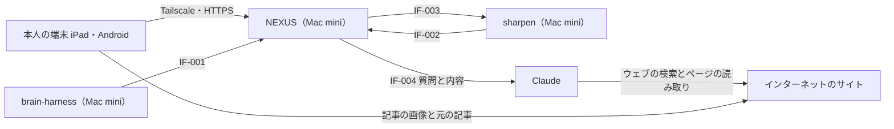

# RD-12 セキュリティ要件書（NEXUS）

- 読んだもの: RD-01 0.2（関係者の節を含む）、RD-03 0.2、RD-05 0.1、RD-09 0.1、RD-10 0.1、RD-11 0.1、依頼の文（5章、6章、7章、8章、9章）、X-04 0.3（Q の答え）。
- NFR の番号は RD-11 から続けて振る。
- 0.2: X-05 RV01 の指摘と Q-040、Q-053〜Q-063 の答え（2026-11-23 本人）で直した。
- 0.3: X-05 RV02 の指摘と Q-064、Q-065 の答え（2026-11-23 本人）で直した。
- 0.4: X-05 RV03-01 の指摘で、Q-066 に左右される行に Q-066 を書いた。
- 1.0: 要件定義の完了判定（X-05 PG01。2026-11-23 RD-01 SH01）で承認した。
- 書いた AI: Claude（Opus 5.5）。人の承認の前の案である。

## 1. システムプロファイル

- 重要情報の種類:

| 情報 | 重要度 | 漏えい | 改ざん | 消失 |
|---|---|---|---|---|
| ENT-007 会話、ENT-008 発言 | 高（本人が書いた質問で、私的な内容を含み得る。RD-09 2章） | 本人の関心や私的なことが他人に知られる | 偽の会話の続きから AI が答える | 続きから話せなくなる |
| ENT-005 英語の答え、ENT-006 内容の状態 | 中（本人の学習と使い方の記録） | 本人の学習の様子が知られる | 翌朝の採点と持ち越しが狂う | 学習の記録を失う |
| ENT-001〜ENT-004 内容、記事、英語のセット、記事の関係 | 低（公開の情報から作った案内と教材。RD-09 2章） | 被害は小さい | 偽の記事や教材を本当のものとして読む | 溜めた情報を失う |
| ENT-009 AI の実行、ENT-010 受け取りの記録 | 中（渡した内容の要約を含み得る） | ENT-008 と同じ | 監査ができなくなる | 何が起きたか追えなくなる |
| 配信元の鍵、端末の認証の情報、Claude を動かす認証の情報 | 高 | 他人が配信元や本人を装い、本人の Claude の契約を使う | - | 配信と AI が止まる |

- 情報の流れ:

- 情報のライフサイクル: 内容は配信元が作って送り（IF-001、IF-002）、NEXUS が残し、消さない（Q-038 の答え）。会話は本人が書き、NEXUS が残し、質問のときに AI に渡し（IF-004）、消さない。AI の実行と受け取りの記録は NEXUS が作り、1年で消す（Q-038 の答え）。触るのは本人と、本人が動かす配信元と、AI だけ。
- 関係者: 本人（RD-01 SH01）。運用も本人が行う。外部の事業者は Anthropic（Claude）だけ。
- 利用する場所と経路: 本人の端末から Tailscale のプライベートな接続で使う（RD-01 3章）。Tailscale につないでいるのは本人の機器だけ（Q-045 の答え）。共用の端末は無い（利用者は本人だけ。Q-004 の答え）。
- 守るべき標準と法令: Anthropic の Claude の利用規約に従う。サーバで AI を動かすときの条件は基本設計で確かめる（Q-040）。記事は本文を持たず、案内と URL だけを持つので、著作権のために足す対策は無い（Q-046 の答え）。

## 2. 脅威の特定

- 使う手法: STRIDE。業務の視点で、なりすまし、改ざん、否認、漏えい、止める、権限を上げる、の6つから漏れなく見るため。AI に渡す内容による乗っ取り（プロンプトインジェクション）は依頼 7章が名指しで挙げているので、権限を上げる（E）と漏えい（I）に入れて扱う。

| 番号 | 脅威 | 狙われる情報 | 起こりうる経路 | STRIDE |
|---|---|---|---|---|
| T01 | 本人でない人や機器が NEXUS を使う | ENT-001〜ENT-008 | Tailscale の外から、または Tailscale につないだ別の機器から NEXUS を開く | S、I |
| T02 | 配信元を装って偽の記事や教材を送る | ENT-001〜ENT-003 | 配信元の鍵を盗むか、鍵の無い送信を受け付けてしまう | S、T |
| T03 | 届いた案内・教材・検索したページ・質問の文が、AI への指示になって、AI に許していない操作をさせ、Mac mini のファイルや認証の情報を読ませるか外へ出させる | ENT-007、ENT-008、Mac mini の情報、Claude の認証の情報 | IF-004 で AI に渡す内容に指示を紛れ込ませる（依頼 7章） | E、I |
| T04 | AI がウェブを検索するとき、会話の私的な内容が検索の言葉としてインターネットに出る | ENT-007、ENT-008 | IF-004 の AI がウェブの検索を使う（RD-03 R17） | I |
| T05 | 届いた内容に紛れたスクリプトが本人の端末で動く | 端末の中の NEXUS の画面と認証 | 案内や教材の Markdown と構造化した文字に、スクリプトを紛れ込ませる | T、E |
| T06 | sharpen でない機器が答えを読むか、偽のセットを読ませる | ENT-003、ENT-005 | IF-003 を鍵なしか盗んだ鍵で呼ぶ | S、I |
| T07 | 大量の送信や大きな入力で NEXUS が止まる | NEXUS 全体 | IF-001、IF-002 に大量・大きなデータを送る。同じ送信を何度も送る | D |
| T08 | AI を何度も、長く動かして費用が契約を超えるか、Mac mini が重くなる | 本人の Claude の契約、NEXUS 全体 | 質問の繰り返し、応答が終わらない、送り直しの繰り返し | D |
| T09 | Claude を動かす認証の情報が漏れる | Claude の認証の情報 | AI を動かす仕組みの設定や記録、端末への応答に混ざる | I |
| T10 | Mac mini の故障や誤った操作でデータが消える | ENT-001〜ENT-008 | 機器の故障、誤った削除 | D |
| T11 | 誰がいつ AI を動かしたか、何が届いたかを後から追えない | ENT-009、ENT-010 | 記録を残さない | R |
| T12 | 端末が記事の画像と元の記事を直に読むとき、本人の端末の情報（IP アドレスなど）が相手のサイトに渡る | 端末の情報 | 端末のブラウザが外のサイトから画像を読む（RD-10 1章） | I |
| T13 | 通信の途中で会話や内容を読まれるか書き換えられる | ENT-001〜ENT-008 | 暗号化していない通信 | I、T |
| T14 | バックアップから私的な会話が読まれる | ENT-007、ENT-008 | 別のディスクに置いたバックアップを、本人でない人やプログラムが読む | I |
| T15 | AI の使い方が Anthropic の規約に合わず、使えなくなる | 本人の Claude の契約 | サブスクリプションのログインを、認められない使い方で使う | D |

## 3. リスク分析

| 番号 | 影響 | 起こりやすさ | 対応の優先度 | 対応の方針 |
|---|---|---|---|---|
| T01 | 大きい（会話が読まれる） | 低い。Tailscale の外からは届かず、つないでいるのは本人の機器だけ（Q-045 の答え） | 高。依頼 9章が「Tailscale はネットワークの境界で、アプリの認証を不要にしない」としている | 対策する（NFR-012、NFR-013） |
| T02 | 中（偽の情報を本物として読む） | 低い（配信元は Mac mini の上で動く） | 中。依頼 5章が配信の認証を求めている | 対策する（NFR-014、NFR-015） |
| T03 | 大きい（Mac mini の情報と認証の情報が漏れる） | 高い（毎日外の情報を AI に渡し、ウェブも読ませる） | 高。依頼 7章が名指ししている | 対策する（NFR-016、NFR-019） |
| T04 | 中（私的な内容が検索の言葉として外に出る） | 中（答えが分からないときだけ検索する。Q-035 の答え） | 中 | 受け入れる（5章。Q-047 の答え） |
| T05 | 大きい（端末で NEXUS を操られる） | 中（届く内容は AI が作ったもの） | 高。依頼 8章が生成物をそのまま埋め込まないとしている | 対策する（NFR-018） |
| T06 | 中 | 低い | 中 | 対策する（NFR-014） |
| T07 | 中（止まると読めない） | 低い（配信元は本人のもの） | 中。依頼 5章が入力の上限と重なりの除外を求めている | 対策する（NFR-015） |
| T08 | 中（費用か Mac mini の重さ） | 中 | 中。依頼 7章がタイムアウトと同時実行の上限を求めている | 対策する（NFR-017） |
| T09 | 大きい | 低い | 高。依頼 7章が API の資格情報の保護を求めている | 対策する（NFR-019） |
| T10 | 大きい | 低い | 中 | 対策する（RD-11 NFR-006） |
| T11 | 小さい | 高い（記録の仕組みを作らなければ必ず起きる） | 低。依頼 7章が監査ログを求めている | 対策する（NFR-020） |
| T12 | 小さい（個人の閲覧で、渡るのは IP アドレスなど） | 高い（画像を読むたびに起きる） | 低 | 受け入れる（5章。Q-047 の答え） |
| T14 | 大きい | 低い（別のディスクは Mac mini につないだままにし、持ち出さない。Q-064 の答え） | 中 | 対策する（NFR-028） |
| T15 | 大きい（AI に質問できなくなる） | 分からない（文書から言い切れない。Q-040） | 高 | 対策する（NFR-029） |
| T13 | 大きい | 低い（Tailscale の通信は暗号化される） | 中。依頼 9章が PWA を HTTPS で配るとしている | 対策する（NFR-021） |

## 4. セキュリティ要件

| 要件ID | 区分 | 要件の内容 | 対応する脅威 | 指標と目標値 | 検証方法 | 多層の守り | 担当 |
|---|---|---|---|---|---|---|---|
| NFR-012 | 非機能面 | Tailscale のプライベートな接続の外からは NEXUS に届かない | T01 | Tailscale の外からの接続で、NEXUS の画面と API が開けない。0件 | 総合テストで、Tailscale の外から開けないことを確かめる（RD-15） | 破られても NFR-013 の端末の認証が止める | RD-01 SH01 |
| NFR-013 | 非機能面 | 本人が NEXUS の設定で用意した端末だけが NEXUS を使える。端末の認証と配信元の鍵は分ける（依頼 5章）。用意と取り消しは Mac mini の設定で行う（Q-034 の答え）。認証の方式は基本設計で決める（依頼 0章「認証方式を勝手に確定しない」） | T01 | 用意していない端末からの利用が0件。取り消した端末は次の利用から使えない | 総合テストで、用意していない端末と取り消した端末で確かめる（RD-15） | Tailscale（NFR-012）の内側でもう一度止める | RD-01 SH01 |
| NFR-014 | 非機能面 | 配信元ごとに別の鍵を持たせ、鍵ごとに使える連携を限る（brain-harness は IF-001 だけ、sharpen は IF-002 と IF-003 だけ）。鍵は取り消せる（依頼 5章「スコープ付きトークン」、Q-034 の答え） | T02、T06 | 鍵の無い送信、別の配信元の鍵での送信、取り消した鍵での送信を受け付けない。0件 | 総合テストで確かめる（RD-15） | NFR-015 の形の確かめが偽の内容を止める | RD-01 SH01 |
| NFR-015 | 非機能面 | 受け取る内容は、形を確かめ、大きさの上限を超えるものを断り、同じ送信の重なりを見分ける（依頼 5章） | T02、T07 | 形の正しくない内容、上限を超える内容を残さない。同じ送信を2回受けても内容は1つ。上限の値は基本設計で、RD-03 4章の量（1回10件と X のブックマーク、1セットに60問まで）から決める | 総合テストで確かめる（RD-15） | NFR-018 が表示の側でも止める | RD-01 SH01 |
| NFR-016 | 非機能面 | AI を動かす仕組みは Mac mini の上で動かし、ブラウザから直接起動させない。起動はコマンドの文字列をつなげず、引数と標準入力で渡す。使えるツールはウェブの検索とページの読み取りだけにし、ファイルの読み書き、コマンドの実行、リポジトリの操作をさせない。作業の場所、環境変数、実行するユーザ、読めるファイル、ネットワークを限る。届いた内容、ウェブのページ、質問の文を指示として扱わない（依頼 7章、Q-029 の答え）。AI を動かす仕組みは、規約の確認の結果（Q-066）で替わることがある。 | T03 | 許していない操作が行われた回数0件。届いた内容に指示を紛れ込ませた試験で、許していない操作が起きない | 総合テストで、指示を紛れ込ませた記事と教材と質問を使って確かめる（RD-15） | ツールを限る、場所とファイルを限る、認証の情報を持たせない（NFR-019）の3つで止める | RD-01 SH01 |
| NFR-017 | 非機能面 | AI の実行に、1回の時間の上限、同時に動かす数の上限、送り直しの決まり、取り消しを持たせる（依頼 7章）。AI を動かす仕組みは、規約の確認の結果（Q-066）で替わることがある。 | T08 | 1回の実行は5分で打ち切る。同時に動かすのは2つまで。1日の回数の上限は置かない（Q-048 の答え）。失敗した応答は1回だけ自動で送り直し、その後は本人が選んだときだけ送り直す（Q-056 の答え。RD-03 R15） | 総合テストで、上限を超えたときに止まることを確かめる（RD-15） | NFR-009（費用0円の上乗せ）と合わせて見る | RD-01 SH01 |
| NFR-018 | 非機能面 | 届いた内容（案内、教材、読む教材、問題）と AI の応答を見せるとき、中に紛れたスクリプトを動かさない。生成された HTML を画面にそのまま埋め込まない（依頼 8章） | T05 | スクリプトを紛れ込ませた内容を見せても、スクリプトが動かない。0件 | 総合テストで確かめる（RD-15） | NFR-015 の受け取りの確かめと合わせる | RD-01 SH01 |
| NFR-019 | 非機能面 | Claude を動かす認証の情報と配信元の鍵は Mac mini の NEXUS の中だけに置き、端末にも AI に渡す内容にも記録にも出さない（依頼 7章）。AI を動かす仕組みは、規約の確認の結果（Q-066）で替わることがある。 | T03、T09 | 端末への応答、AI に渡す内容、記録に認証の情報が出た回数0件 | 総合テストと、記録の確認（RD-15） | NFR-016 で AI が読めるファイルを限る | RD-01 SH01 |
| NFR-020 | 非機能面 | AI の実行と受け取りを記録する。何のための実行か、いつ始まりいつ終わったか、どうなったか、失敗の理由（依頼 7章）。1年残す（Q-038 の答え） | T11 | 全ての AI の実行と受け取りに記録がある | 総合テストで確かめる（RD-15） | - | RD-01 SH01 |
| NFR-028 | 非機能面 | バックアップ（私的な会話を含む）は本人だけが読めるようにする。暗号化は求めない（Q-060 の答え）。保管: 別のディスクは Mac mini につないだままにし、ほかの機器につながず、持ち出さない。戻すとき: Mac mini の本人のユーザの中だけで戻す。捨てるとき: ディスクの中身を消してから捨てる（Q-064 の答え） | T10、T14 | 本人のユーザのほかから読めるバックアップが0件。保管、戻し方、捨て方が運用の手順に書かれている | 運用の試験で置き場所の読み取りの権限を確かめ、資料の確認で運用の手順を確かめる（RD-15） | - | RD-01 SH01 |
| NFR-029 | 非機能面 | AI は Anthropic の利用規約と本人の契約の条件の範囲で動かす。本人のサブスクリプションで `claude -p` を NEXUS のサーバから動かす使い方が認められることを、Phase 3 の前に本人が Anthropic に確かめる（Q-040、Q-046 の答え） | T15 | Phase 3 を始める前に、`claude -p` の使い方が認められたという記録か、Messages API に替えて Q-008 を見直すことに本人が合意した記録がある。確かめていない、または認められなかったという記録だけでは Phase 3 を始めない（Q-066） | 資料の確認（RD-15） | - | RD-01 SH01 |
| NFR-021 | 非機能面 | 端末と NEXUS の通信を HTTPS で暗号化する（依頼 9章） | T13 | 暗号化していない通信で NEXUS が開けない | 総合テストで確かめる（RD-15） | Tailscale の通信の暗号化と重ねる | RD-01 SH01 |

- 機能面の要件: 端末と配信元の認証の用意と取り消しは画面を持たない（Q-034 の答え）ので、RD-05 に機能は足していない。
- 記録しない操作: 教材の完了とやり直し、端末と配信元の鍵の用意と取り消しは、いつ行ったかを記録しない。利用者も操作する人も本人だけのため（Q-059 の答え）。

## 5. リスク受容の記録

| 受け入れるリスク | 理由 | 受け入れた人と日付 | 見直す時期 |
|---|---|---|---|
| T04（AI のウェブの検索で、会話の内容が検索の言葉として外に出る） | 個人の使い方で影響が小さく、答えが分からないときだけ検索する（Q-035 の答え） | RD-01 SH01（本人）、2026-11-23（Q-047 の答え） | NEXUS を外へ公開するとき、扱う情報の種類が増えるとき |
| T12（端末が記事の画像を直に読み、端末の情報が相手のサイトに渡る） | 個人の閲覧で、渡るのは IP アドレスなどに限られる | RD-01 SH01（本人）、2026-11-23（Q-047 の答え） | T04 と同じ |

## 6. 上流との対応

| 要件ID（NFR・FN） | 対応する脅威 | 守る情報 ENT | 関係する IF | 根拠 REQ |
|---|---|---|---|---|
| NFR-012 | T01 | ENT-001〜ENT-008 | - | REQ-022 |
| NFR-013 | T01 | ENT-001〜ENT-008 | - | REQ-022 |
| NFR-014 | T02、T06 | ENT-001〜ENT-005 | IF-001、IF-002、IF-003 | REQ-022 |
| NFR-015 | T02、T07 | ENT-001〜ENT-003 | IF-001、IF-002 | REQ-022 |
| NFR-016 | T03 | ENT-007、ENT-008 | IF-004 | REQ-023 |
| NFR-017 | T08 | - | IF-004 | REQ-023、REQ-024 |
| NFR-018 | T05 | ENT-001〜ENT-003、ENT-008 | IF-001、IF-002、IF-004 | REQ-023 |
| NFR-019 | T03、T09 | - | IF-004 | REQ-023 |
| NFR-020 | T11 | ENT-009、ENT-010 | IF-001、IF-002、IF-004 | REQ-023 |
| NFR-021 | T13 | ENT-001〜ENT-008 | - | REQ-020、REQ-022 |
| NFR-028 | T10、T14 | ENT-007、ENT-008 | - | REQ-028 |
| NFR-029 | T15 | - | IF-004 | REQ-029 |

- RD-10 の IF-001〜IF-004 は、全て1章の情報の流れに現れる。

## 7. 未決事項

この書類で起こした未決事項は全て決まった（Q-045〜Q-048。答えは X-04）。
